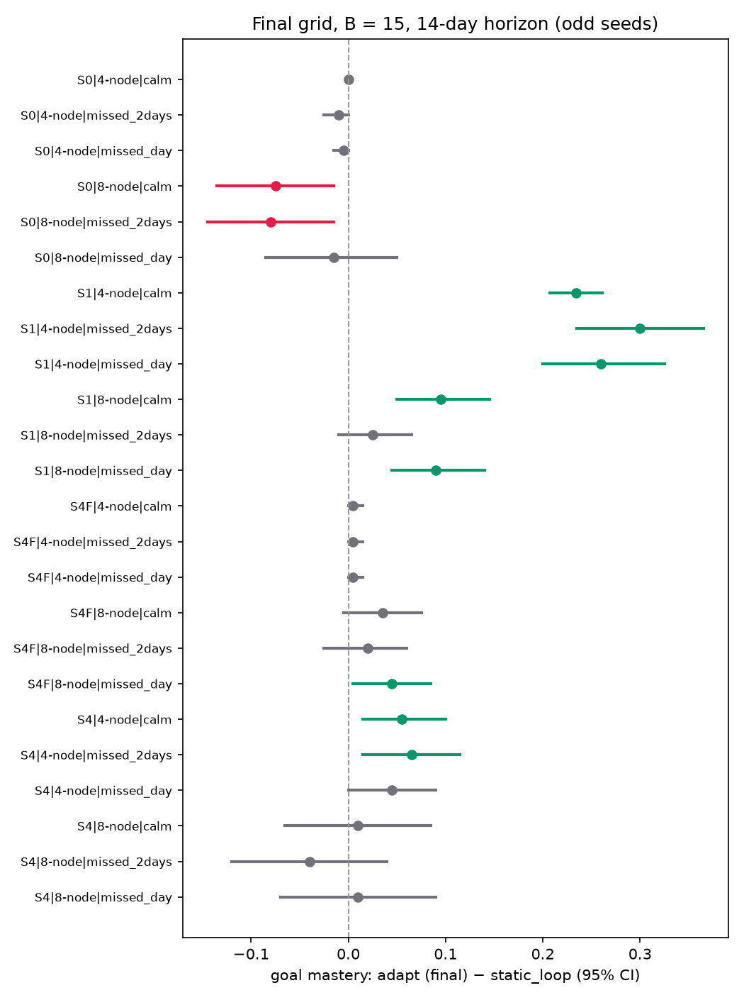
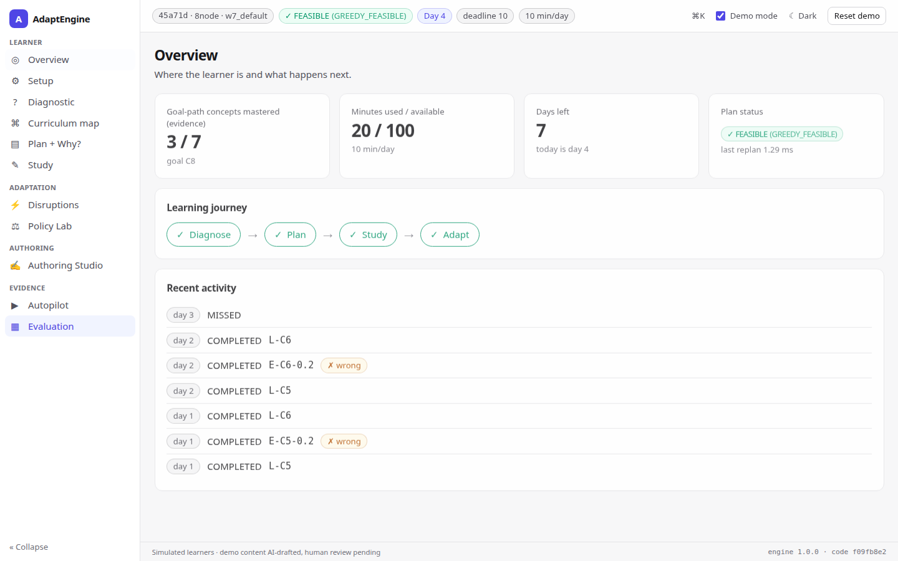
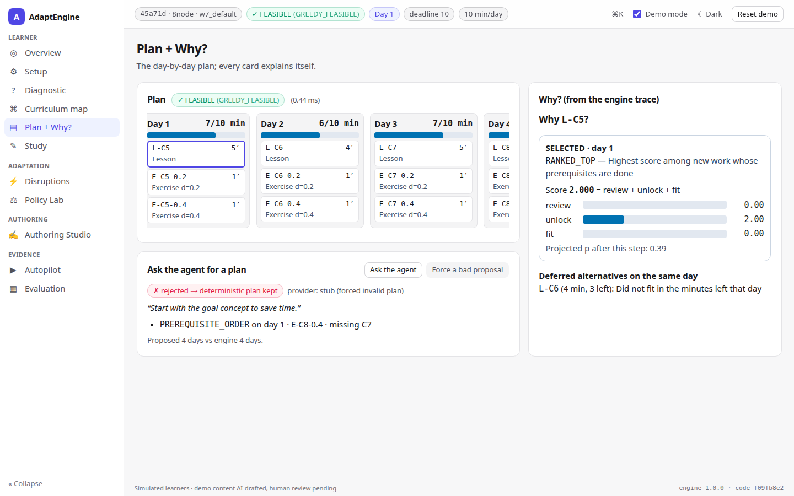
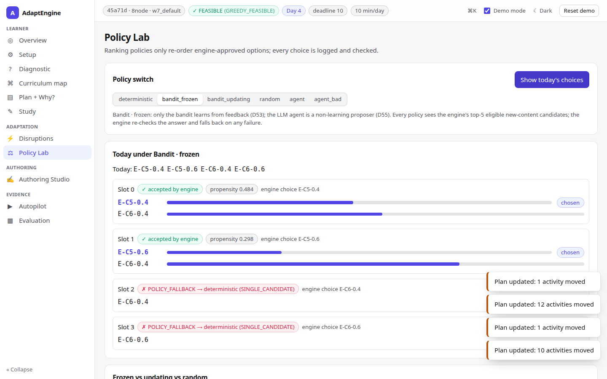
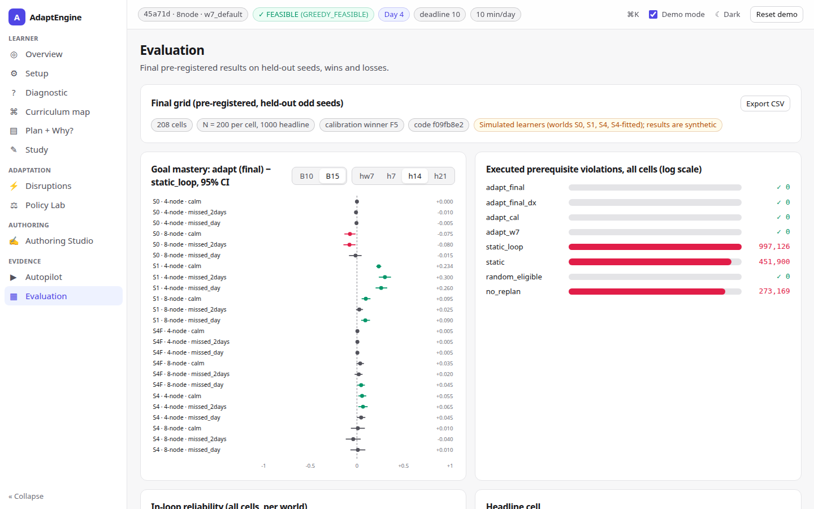

# AdaptEngine — Final Report

Version 1.0.0 · code hash `f09fb8e2f6126c98c5a81cddf0a840a3936509111cbbbdb064fd2e8d5a881b66` for every final result.
Built only from `docs/WEEK8_REPORT_NOTES.md`, `docs/WEEK7_REPORT_NOTES.md` and the results files they cite (`docs/FINAL_RESULTS.md` is generated from `experiments/results/*.json`). All learners in the evaluation are **simulated**.

## 1. Problem

A learner has a goal concept, a deadline and a fixed number of minutes per day. AdaptEngine must decide what to study each day so that prerequisites are respected, the daily budget is never exceeded, the plan adapts to answers and disruptions (missed days, budget and deadline changes), and every decision can be explained.

## 2. Design (summary)

- **Curriculum and state (M1):** a validated prerequisite DAG, activities (lessons, exercises with difficulty), a review gate for content (D7/D54).
- **Measurement (M2, M4):** BKT mastery p per concept with guess/slip by difficulty class; an adaptive diagnostic (EIG, entropy stop, caps). W8 adds named, validated **profiles** fitted per population (B.1, D48).
- **Planning (M3, M5, M6):** workload projection to mastery, feasibility bounds, greedy day packing with tiers (remediation, due review, new content, and in W8 **consolidation**), an exact oracle, best-effort plans, and the closed loop `Engine.next_activities` that replans from the real state every day and after every wrong answer (T2.2).
- **Traceability (M7):** one `SELECTED` record per planned activity with reason and score components; policy decisions with candidates and propensities.
- **Final-week changes (D49–D52):** consolidation tier (use the whole budget for verification practice), verification probe (a hard item before unlocking when evidence is mostly easy), horizon-aware strictness (more certainty when there is slack), and an optional diagnostic.
- **Agentic layer, off by default (D53–D58):** A2 bandit ranking policy (the single feedback-driven policy, `POLICY_SPEC.md`), A0 authoring aid with a human review gate, A2′ LLM ranker, A1 plan proposer and A3 orchestrator. Agents propose; the engine validates and decides; any failure falls back to the deterministic path. The core never imports providers or network clients.
- **Extensions behind flags (D59–D60):** Elo/1PL measurement model, HLR-lite half-life, BKT forgets, CP-SAT scheduler.
- **Demo (WP-H):** `make demo` starts an 11-screen web app (light/dark) over a thin FastAPI adapter whose plans equal direct engine calls.

All decisions D1–D60 with rationale and verification: `docs/DECISIONS.md` (§1–§8), status in `docs/FREEZE_RECORD.md`.

## 3. What Week 7 got wrong, and the corrections (I.2)

- **"0 idle days"** held only *while the goal was believed unmastered*. Counting every study day, the W7 engine idled 3.3–3.8 of 8 days and used 52.7–59.8 of 120 minutes (R§1.3 probes, reproduced exactly in `w8_probe_baseline.json`). The metric is now split into `idle_days_unmastered` and `idle_days_total` (F.2).
- **The baseline was too weak.** W7's `static` stops after one pass. Against `static_loop` (same order, keeps practising until the deadline) the W7 engine was 0.275 (S0) and 0.080 (S1) worse at 8 days.
- **Premature mastery** motivated the final changes: 39.3% (S0) and 50.9% (S1) of concepts the engine believed mastered were truly unmastered, because easy items are answered correctly well below mastery (fitted easy-class guess 0.62–0.68 in the IRT worlds).
- **Horizons depended on the policy under test.** Final results use fixed 7/14/21-day horizons (the W7 rule is kept for continuity).

## 4. Evaluation

### 4.1 Protocol

Pre-registered before any run (`docs/preregistration/FINAL_A5_2026-11-10.md`, one amendment before any fit): fit on even seeds, select on other even seeds, report on odd seeds. Final grid: worlds S0, S1, S4, S4-fitted × 4-node, 8-node × B ∈ {10, 15} × {calm, missed_day, missed_2days} × horizons {W7, 7, 14, 21} + forgetting_21; 8 arms; 200 learners per cell, 1000 in the headline cell; 208 cells (2,327 s). Paired bootstrap 95% CIs; no multiplicity correction; every cell reported.

### 4.2 Calibration (WP-B)

Lesson-aware BKT fits per world (the S4 fit recovers its generating parameters). The pre-registered rule selected **F5**: the fitted profile with k = 2, θ = 0.85 and horizon-aware strictness. In-loop Brier fell from 0.254 to 0.219 (S0), 0.252 to 0.224 (S1) and 0.234 to 0.210 (S4); AUC rose to 0.64–0.69. In the S4-fitted world calibration got worse (0.248 → 0.283) because the selected world profile did not match it.

### 4.3 Final grid (WP-G)

**Safety (primary):** 0 executed prerequisite violations and 0 budget violations for every adapt arm in all 208 cells (static_loop 997,126, static 451,900, no_replan 273,169).

**Headline cell (S1, 4-node, 15 min/day, calm, 14 days, N = 1000):**

| Arm | Goal mastery | All required | False mastery | Minute utilisation |
|---|---|---|---|---|
| adapt (final) | **0.939** | **0.896** | 0.033 | 0.95 |
| adapt (W7) | 0.368 | 0.088 | 0.522 | 0.29 |
| static_loop | 0.705 | 0.657 | 0.071 | 0.99 |
| static | 0.303 | 0.021 | 0.427 | 0.20 |

adapt-final vs static_loop **+0.234 [+0.207, +0.261]**; vs adapt-W7 **+0.571 [+0.541, +0.601]**, all-required +0.808.

**Across the grid (goal mastery vs static_loop, cells better / n.s. / worse):** W7 horizon 0/5/43, 7 days 2/8/38, 14 days 11/19/18, 21 days 25/32/7. All-required mastery: 118/85/5 (mean +0.104). **The gain depends on the horizon:** with little time a state-blind loop that practises from the first minute wins; with 14–21 days the calibrated, stricter engine wins, most clearly in S1. Consolidation + probe added +0.196 to goal mastery in the headline cell and never made a cell worse (42/166/0 vs calibration alone).

### 4.4 Diagnostic (WP-E, D52)

Running the diagnostic first changes almost nothing and costs study minutes: headline −0.017 [−0.027, −0.007]; over all 208 cells 1 better, 191 n.s., 16 worse. The product flow makes it optional (Skip → plan from the prior).

### 4.5 Agentic layer

- **Bandit (D53):** frozen, updating and random rankings do not differ from the deterministic ranking (all CIs include 0; 0 violations). Per-learner updating does not change choices at this data scale. OPE of the frozen policy from random logs is within 0.007 of its simulated value.
- **Authoring aid, LLM ranker, plan proposer, orchestrator (D54–D58):** engine validation, fallbacks and the review gate are tested offline (adversarial agent outputs always fall back with 0 violations). **Live-model evaluations were not run** (no model available); results are marked "not run", not invented.

### 4.6 Extensions (WP-O)

Elo raised AUC but lowered goal mastery (S1 −0.145, S4 −0.200); HLR-lite fitted worse than a constant and lowered goal mastery; BKT forgets made θ unreachable (p plateaus near 0.76); the review cap did not fix review crowding on synth-20. CP-SAT is implemented and tested for fallback but not run (OR-Tools not installed). Junyi, CSEDM and the pilot were not done. All stay off by default.

## 5. Limitations (honest)

Simulated learners only; the largest gains are in S1, whose prerequisite-gated learning matches the engine's assumptions. Results depend on the horizon. Profiles are fitted per world. Consolidation and the verification probe were evaluated together. Agents were not evaluated with a model. W8 scheduling (flags off) is ~20–27% slower than W7 (still < 30 ms for 50 concepts). Demo content still awaits human review (I.3). Details: notes §14 and §16.

## 6. Demo

`make demo` → http://127.0.0.1:8000. Eight-minute script: `frontend/README.md`.

| | |
|---|---|
|  |  |
|  |  |

## 7. Reproducibility

`make final` runs every gate, every final-week run and the results document in order; individual commands: notes §15. Traceability of the 23 TC IDs: `docs/TRACEABILITY.md`.
