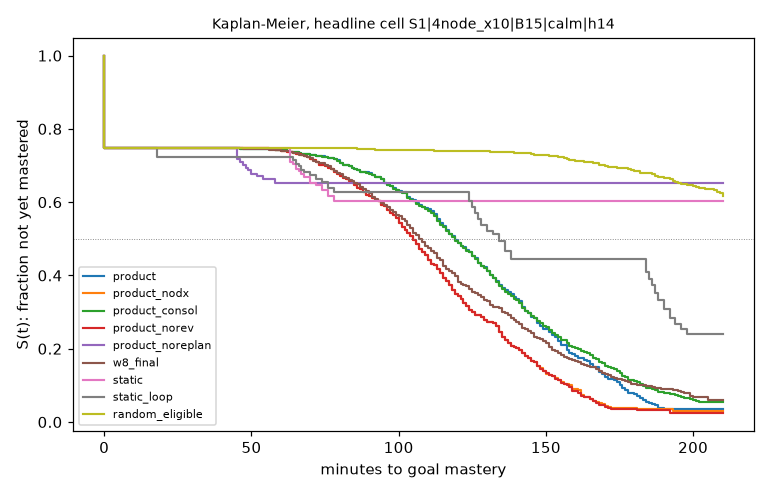
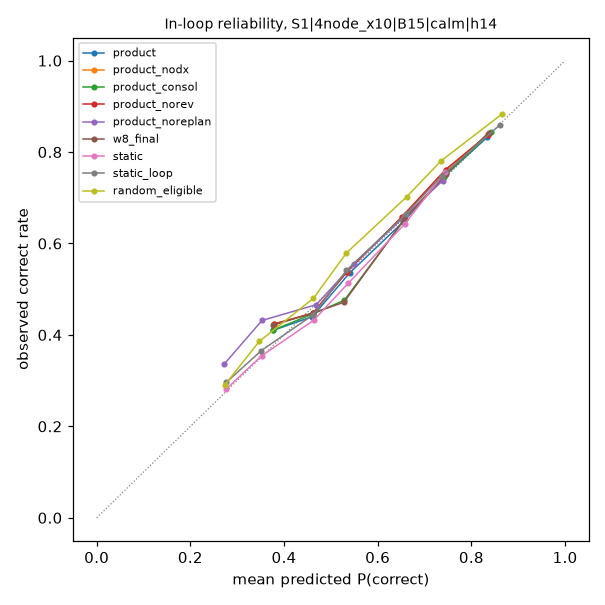
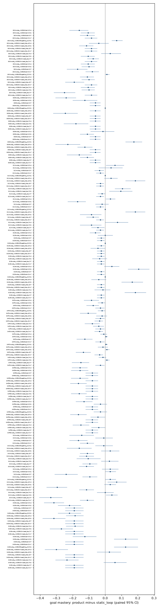
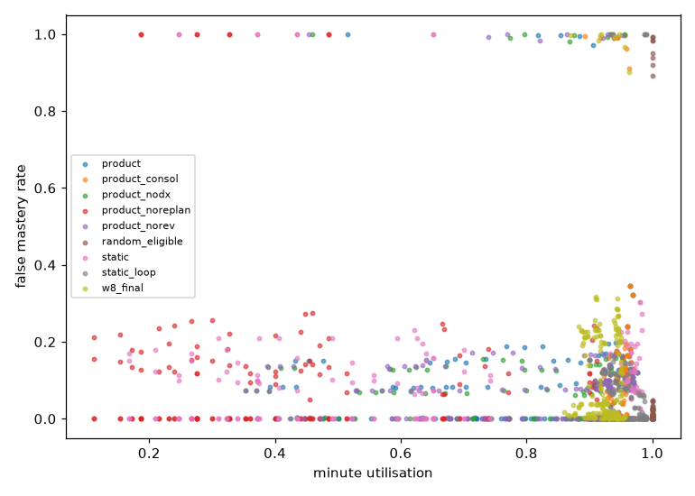

# Results: product-engine rerun (E1–E6)

Generated (UTC): 2026-11-14T23:18:59.709984+00:00

Executed prerequisite violations in adaptive arms: none found in the loaded files (section 1).

Provenance: every input carries the pre-registered code and experiment hashes.

Pre-registration: `docs/preregistration/PRODUCT_RERUN_2026-11-15.md`. Every table and figure is followed by a `Source:` line.

## Approximations

- AUC in the E1 grid is computed from per-seed 100-bin histograms of bin-mean predictions (approximate); Brier is exact.
- `irt_cat@n` in E2 uses the simulator's true discrimination (a = 3), an advantage in 2PL worlds.
- `product_noreplan` plans once, open loop (non-adaptive); it is excluded from the zero-violation gate with the static baselines.
- The E5 review_cap pass rule is lenient: it fails only if the upper CI bound is below 0.
- Greedy plans can contain duplicate in-plan reviews even with maintenance reviews off; the duplicate audit is asserted 0 for CP-SAT only.
- The E6 CP-SAT deadlines and replan deadlines are implementer-chosen.
- The by-group means in section 3 are unweighted means of per-cell paired differences (no pooled CI); the policy_eval file does not record plan prerequisite violations (n/a).
- Kaplan-Meier: episodes without goal mastery are censored at minutes used, which is informative censoring (FINAL_A5 convention); RMST is restricted to the max minutes available.
- Items per mastered concept counts required concepts already mastered at day 0 in the denominator (true θ ≥ 0.70 at episode end); diagnostic items are excluded from the numerator.
- OPE: per-decision IPS / SNIPS / DR reweight the action only and do not correct for the shift in the state distribution that the target policy would induce.
- Paired bootstrap 95% CIs, no multiplicity correction; every cell is reported, nothing is selected from report seeds (measurement only).

Source: `docs/preregistration/PRODUCT_RERUN_2026-11-15.md` (registered code hash `6c55d4f99dc1`, experiment hash `24eabf602925`)

## 1. Violations

**E1 grid (summed over cells)**

| arm | adaptive | cells | executed prereq | plan prereq | budget |
|---|---|---|---|---|---|
| product | yes | 343 | 0 | 0 | 0 |
| product_consol | yes | 208 | 0 | 0 | 0 |
| product_nodx | yes | 208 | 0 | 0 | 0 |
| product_noreplan | no | 343 | 1034357 | 193600 | 9000 |
| product_norev | yes | 208 | 0 | 0 | 0 |
| random_eligible | no | 208 | 0 | 0 | 0 |
| static | no | 208 | 1118764 | 289600 | 0 |
| static_loop | no | 343 | 1660407 | 338200 | 0 |
| w8_final | yes | 208 | 0 | 0 | 0 |

Source: `grid.json` (code hash `6c55d4f99dc1`)

**E3 sensitivity (adapt_dx configs, summed over cells)**

| arm | adaptive | cells | executed prereq | plan prereq | budget |
|---|---|---|---|---|---|
| concept_cap=2 | yes | 6 | 0 | 0 | 0 |
| concept_cap=6 | yes | 6 | 0 | 0 | 0 |
| consolidation=True | yes | 6 | 0 | 0 | 0 |
| diag_budget_per_concept=0.0 | yes | 6 | 0 | 0 | 0 |
| diag_budget_per_concept=0.5 | yes | 6 | 0 | 0 | 0 |
| diag_budget_per_concept=2.0 | yes | 6 | 0 | 0 | 0 |
| horizon_aware_mastery=True | yes | 6 | 0 | 0 | 0 |
| k_responses=2 | yes | 6 | 0 | 0 | 0 |
| k_responses=2,theta=0.85 | yes | 6 | 0 | 0 | 0 |
| k_responses=2,theta=0.9 | yes | 6 | 0 | 0 | 0 |
| k_responses=2,theta=0.98 | yes | 6 | 0 | 0 | 0 |
| k_responses=3 | yes | 6 | 0 | 0 | 0 |
| k_responses=3,theta=0.85 | yes | 6 | 0 | 0 | 0 |
| k_responses=3,theta=0.9 | yes | 6 | 0 | 0 | 0 |
| k_responses=3,theta=0.98 | yes | 6 | 0 | 0 | 0 |
| known_threshold=0.6 | yes | 6 | 0 | 0 | 0 |
| known_threshold=0.8 | yes | 6 | 0 | 0 | 0 |
| mastery_criterion=n_consecutive | yes | 6 | 0 | 0 | 0 |
| mastery_criterion=two_threshold | yes | 6 | 0 | 0 | 0 |
| n_max=12 | yes | 6 | 0 | 0 | 0 |
| n_max=40 | yes | 6 | 0 | 0 | 0 |
| product | yes | 6 | 0 | 0 | 0 |
| pruning_mode=none | yes | 6 | 0 | 0 | 0 |
| pruning_mode=soft | yes | 6 | 0 | 0 | 0 |
| selection_scope=concept_sweep | yes | 6 | 0 | 0 | 0 |
| selection_scope=frontier | yes | 6 | 0 | 0 | 0 |
| skip_threshold=0.3 | yes | 6 | 0 | 0 | 0 |
| skip_threshold=0.5 | yes | 6 | 0 | 0 | 0 |
| static_loop | no | 6 | 58568 | 4200 | 0 |
| theta=0.85 | yes | 6 | 0 | 0 | 0 |
| theta=0.9 | yes | 6 | 0 | 0 | 0 |
| theta=0.98 | yes | 6 | 0 | 0 | 0 |

Source: `sensitivity.json` (code hash `6c55d4f99dc1`)

**E4 policy eval (summed over cells; n/a = not recorded)**

| arm | adaptive | cells | executed prereq | plan prereq | budget |
|---|---|---|---|---|---|
| deterministic | yes | 4 | 0 | n/a | 0 |
| frozen | yes | 4 | 0 | n/a | 0 |
| random | yes | 4 | 0 | n/a | 0 |
| updating | yes | 4 | 0 | n/a | 0 |

Source: `policy_eval.json` (code hash `6c55d4f99dc1`)

**E4 policy train (executed violations over the training curve)**

| episodes | executed prereq |
|---|---|
| 800 | 0 |

Source: `policy_train.json` (code hash `6c55d4f99dc1`)

**E5 extensions (summed over cells)**

| arm | adaptive | cells | executed prereq | plan prereq | budget |
|---|---|---|---|---|---|
| elo:bkt | yes | 3 | 0 | 0 | 0 |
| elo:elo | yes | 3 | 0 | 0 | 0 |
| forgets:fitted_S3 | yes | 1 | 0 | 0 | 0 |
| forgets:fitted_S3_forget | yes | 1 | 0 | 0 | 0 |
| hlr:fixed | yes | 4 | 0 | 0 | 0 |
| hlr:hlr | yes | 4 | 0 | 0 | 0 |
| hlr:product_norev | yes | 4 | 0 | 0 | 0 |
| review_cap:capped | yes | 4 | 0 | 0 | 0 |
| review_cap:product_nodx | yes | 4 | 0 | 0 | 0 |
| review_cap:product_norev | yes | 4 | 0 | 0 | 0 |

Source: `extensions.json` (code hash `6c55d4f99dc1`)

## 2. Headline cell

Cell `S1|4node_x10|B15|calm|h14`. KM median shows — when censored (median not reached).

| arm | n | goal | all-req | false mast. | util. | KM median min | KM RMST min | diagnostic min | diagnostic items | items per mastered concept | reach rate | Brier | AUC | Δ goal vs static_loop [95% CI] |
|---|---|---|---|---|---|---|---|---|---|---|---|---|---|---|
| product | 1000 | 0.792 | 0.562 | 0.152 | 0.641 | 119.0 | 101.7 | 18.6 | 9.3 | 18.8 | 0.792 | 0.210 | 0.679 | +0.032 [+0.003, +0.061] |
| product_nodx | 1000 | 0.808 | 0.619 | 0.130 | 0.583 | 105.0 | 90.9 | 0.0 | 0.0 | 19.3 | 0.808 | 0.209 | 0.679 | +0.048 [+0.020, +0.076] |
| product_consol | 1000 | 0.938 | 0.874 | 0.038 | 0.954 | 119.0 | 103.2 | 18.6 | 9.3 | 26.0 | 0.938 | 0.219 | 0.675 | +0.178 [+0.154, +0.203] |
| product_norev | 1000 | 0.810 | 0.618 | 0.130 | 0.582 | 105.0 | 90.7 | 0.0 | 0.0 | 19.3 | 0.810 | 0.209 | 0.679 | +0.050 [+0.021, +0.078] |
| product_noreplan | 1000 | 0.349 | 0.060 | 0.189 | 0.276 | — | 141.5 | 0.0 | 0.0 | 19.5 | 0.349 | 0.221 | 0.637 | -0.411 [-0.441, -0.381] |
| w8_final | 1000 | 0.927 | 0.869 | 0.043 | 0.949 | 107.0 | 97.3 | 8.1 | 4.0 | 27.2 | 0.927 | 0.221 | 0.670 | +0.167 [+0.144, +0.191] |
| static | 1000 | 0.399 | 0.101 | 0.097 | 0.371 | — | 136.5 | 0.0 | 0.0 | 21.1 | 0.398 | 0.222 | 0.683 | -0.361 [-0.391, -0.332] |
| static_loop | 1000 | 0.760 | 0.709 | 0.011 | 0.986 | 134.0 | 120.3 | 0.0 | 0.0 | 35.8 | 0.760 | 0.208 | 0.697 | — |
| random_eligible | 1000 | 0.384 | 0.367 | 0.002 | 1.000 | — | 152.6 | 0.0 | 0.0 | 38.1 | 0.384 | 0.192 | 0.721 | -0.376 [-0.405, -0.346] |

Source: `grid.json` (code hash `6c55d4f99dc1`)

Source: `grid.json` (code hash `6c55d4f99dc1`), cell `S1|4node_x10|B15|calm|h14`: Kaplan-Meier curves of minutes to goal mastery (episodes without mastery censored at minutes used)

Source: `grid.json` (code hash `6c55d4f99dc1`), cell `S1|4node_x10|B15|calm|h14`: 10 equal-width bins of in-loop predicted P(correct), merged from the 100-bin histogram; dotted line is perfect calibration

## 3. Goal mastery vs static_loop by world, curriculum and horizon

Arm `product` vs `static_loop`, paired by seed. First table: unweighted mean of the per-cell paired differences by world, curriculum and horizon (no pooled CI). Second table: every primary cell.

| world | curriculum | horizon | cells | mean Δ goal | min | max |
|---|---|---|---|---|---|---|
| S0 | 4node_x10 | h14 | 6 | -0.082 | -0.160 | +0.030 |
| S0 | 4node_x10 | h21 | 8 | -0.068 | -0.115 | +0.070 |
| S0 | 4node_x10 | h7 | 6 | -0.147 | -0.250 | -0.075 |
| S0 | 4node_x10 | hw7 | 6 | -0.084 | -0.085 | -0.080 |
| S0 | 8node_x10 | h14 | 6 | -0.128 | -0.240 | -0.015 |
| S0 | 8node_x10 | h21 | 8 | -0.090 | -0.245 | +0.175 |
| S0 | 8node_x10 | h7 | 6 | -0.060 | -0.060 | -0.060 |
| S0 | 8node_x10 | hw7 | 6 | -0.060 | -0.060 | -0.060 |
| S1 | 4node_x10 | h14 | 6 | +0.082 | +0.032 | +0.185 |
| S1 | 4node_x10 | h21 | 8 | -0.003 | -0.170 | +0.185 |
| S1 | 4node_x10 | h7 | 6 | -0.037 | -0.075 | -0.020 |
| S1 | 4node_x10 | hw7 | 6 | -0.030 | -0.030 | -0.030 |
| S1 | 8node_x10 | h14 | 6 | -0.021 | -0.060 | +0.040 |
| S1 | 8node_x10 | h21 | 8 | +0.059 | -0.045 | +0.205 |
| S1 | 8node_x10 | h7 | 6 | -0.025 | -0.025 | -0.025 |
| S1 | 8node_x10 | hw7 | 6 | -0.025 | -0.025 | -0.025 |
| S4 | 4node_x10 | h14 | 6 | -0.052 | -0.160 | +0.070 |
| S4 | 4node_x10 | h21 | 8 | +0.021 | -0.010 | +0.040 |
| S4 | 4node_x10 | h7 | 6 | -0.207 | -0.335 | -0.095 |
| S4 | 4node_x10 | hw7 | 6 | -0.110 | -0.115 | -0.095 |
| S4 | 8node_x10 | h14 | 6 | -0.224 | -0.315 | -0.125 |
| S4 | 8node_x10 | h21 | 8 | -0.086 | -0.315 | +0.125 |
| S4 | 8node_x10 | h7 | 6 | -0.190 | -0.190 | -0.190 |
| S4 | 8node_x10 | hw7 | 6 | -0.190 | -0.190 | -0.190 |
| S4F | 4node_x10 | h14 | 6 | -0.052 | -0.105 | -0.010 |
| S4F | 4node_x10 | h21 | 8 | -0.009 | -0.040 | +0.010 |
| S4F | 4node_x10 | h7 | 6 | -0.091 | -0.150 | -0.030 |
| S4F | 4node_x10 | hw7 | 6 | -0.033 | -0.035 | -0.030 |
| S4F | 8node_x10 | h14 | 6 | -0.127 | -0.165 | -0.080 |
| S4F | 8node_x10 | h21 | 8 | -0.098 | -0.165 | -0.030 |
| S4F | 8node_x10 | h7 | 6 | -0.080 | -0.080 | -0.080 |
| S4F | 8node_x10 | hw7 | 6 | -0.080 | -0.080 | -0.080 |

Source: `grid.json` (code hash `6c55d4f99dc1`)

| cell | product goal | static_loop goal | Δ goal [95% CI] | Δ all-req [95% CI] |
|---|---|---|---|---|
| S0\|4node_x10\|B10\|calm\|h14 | 0.725 | 0.885 | -0.160 [-0.220, -0.105] | -0.345 [-0.415, -0.275] |
| S0\|4node_x10\|B10\|calm\|h21 | 0.895 | 1.000 | -0.105 [-0.150, -0.065] | -0.300 [-0.365, -0.235] |
| S0\|4node_x10\|B10\|calm\|h7 | 0.310 | 0.420 | -0.110 [-0.155, -0.065] | -0.040 [-0.080, +0.000] |
| S0\|4node_x10\|B10\|calm\|hw7 | 0.285 | 0.370 | -0.085 [-0.125, -0.050] | -0.020 [-0.045, +0.000] |
| S0\|4node_x10\|B10\|forgetting_21\|h21 | 0.070 | 0.000 | +0.070 [+0.040, +0.105] | +0.000 [+0.000, +0.000] |
| S0\|4node_x10\|B10\|missed_2days\|h14 | 0.595 | 0.635 | -0.040 [-0.100, +0.020] | -0.075 [-0.150, +0.000] |
| S0\|4node_x10\|B10\|missed_2days\|h21 | 0.885 | 1.000 | -0.115 [-0.160, -0.075] | -0.310 [-0.375, -0.245] |
| S0\|4node_x10\|B10\|missed_2days\|h7 | 0.285 | 0.370 | -0.085 [-0.125, -0.050] | -0.020 [-0.045, +0.000] |
| S0\|4node_x10\|B10\|missed_2days\|hw7 | 0.285 | 0.370 | -0.085 [-0.125, -0.050] | -0.015 [-0.035, +0.000] |
| S0\|4node_x10\|B10\|missed_day\|h14 | 0.665 | 0.635 | +0.030 [-0.025, +0.095] | -0.150 [-0.220, -0.075] |
| S0\|4node_x10\|B10\|missed_day\|h21 | 0.895 | 1.000 | -0.105 [-0.150, -0.065] | -0.300 [-0.365, -0.235] |
| S0\|4node_x10\|B10\|missed_day\|h7 | 0.295 | 0.370 | -0.075 [-0.110, -0.040] | -0.035 [-0.065, -0.005] |
| S0\|4node_x10\|B10\|missed_day\|hw7 | 0.285 | 0.370 | -0.085 [-0.125, -0.050] | -0.020 [-0.040, -0.005] |
| S0\|4node_x10\|B15\|calm\|h14 | 0.895 | 1.000 | -0.105 [-0.150, -0.065] | -0.305 [-0.370, -0.240] |
| S0\|4node_x10\|B15\|calm\|h21 | 0.900 | 1.000 | -0.100 [-0.145, -0.065] | -0.300 [-0.365, -0.235] |
| S0\|4node_x10\|B15\|calm\|h7 | 0.465 | 0.635 | -0.170 [-0.235, -0.110] | -0.095 [-0.165, -0.025] |
| S0\|4node_x10\|B15\|calm\|hw7 | 0.290 | 0.370 | -0.080 [-0.120, -0.040] | -0.040 [-0.075, -0.005] |
| S0\|4node_x10\|B15\|forgetting_21\|h21 | 0.010 | 0.000 | +0.010 [+0.000, +0.025] | +0.000 [+0.000, +0.000] |
| S0\|4node_x10\|B15\|missed_2days\|h14 | 0.890 | 1.000 | -0.110 [-0.155, -0.070] | -0.310 [-0.375, -0.245] |
| S0\|4node_x10\|B15\|missed_2days\|h21 | 0.900 | 1.000 | -0.100 [-0.145, -0.065] | -0.300 [-0.365, -0.235] |
| S0\|4node_x10\|B15\|missed_2days\|h7 | 0.330 | 0.520 | -0.190 [-0.245, -0.130] | -0.060 [-0.110, -0.010] |
| S0\|4node_x10\|B15\|missed_2days\|hw7 | 0.285 | 0.370 | -0.085 [-0.125, -0.050] | -0.015 [-0.035, +0.000] |
| S0\|4node_x10\|B15\|missed_day\|h14 | 0.895 | 1.000 | -0.105 [-0.150, -0.065] | -0.305 [-0.370, -0.240] |
| S0\|4node_x10\|B15\|missed_day\|h21 | 0.900 | 1.000 | -0.100 [-0.145, -0.065] | -0.300 [-0.365, -0.235] |
| S0\|4node_x10\|B15\|missed_day\|h7 | 0.385 | 0.635 | -0.250 [-0.315, -0.185] | -0.065 [-0.125, -0.005] |
| S0\|4node_x10\|B15\|missed_day\|hw7 | 0.285 | 0.370 | -0.085 [-0.125, -0.050] | -0.020 [-0.045, +0.000] |
| S0\|8node_x10\|B10\|calm\|h14 | 0.260 | 0.500 | -0.240 [-0.305, -0.180] | -0.010 [-0.045, +0.025] |
| S0\|8node_x10\|B10\|calm\|h21 | 0.510 | 0.635 | -0.125 [-0.200, -0.050] | -0.040 [-0.110, +0.035] |
| S0\|8node_x10\|B10\|calm\|h7 | 0.245 | 0.305 | -0.060 [-0.095, -0.030] | +0.000 [+0.000, +0.000] |
| S0\|8node_x10\|B10\|calm\|hw7 | 0.245 | 0.305 | -0.060 [-0.095, -0.030] | +0.000 [+0.000, +0.000] |
| S0\|8node_x10\|B10\|forgetting_21\|h21 | 0.000 | 0.000 | +0.000 [+0.000, +0.000] | +0.000 [+0.000, +0.000] |
| S0\|8node_x10\|B10\|missed_2days\|h14 | 0.245 | 0.305 | -0.060 [-0.095, -0.030] | +0.015 [-0.005, +0.040] |
| S0\|8node_x10\|B10\|missed_2days\|h21 | 0.390 | 0.635 | -0.245 [-0.320, -0.170] | -0.005 [-0.065, +0.055] |
| S0\|8node_x10\|B10\|missed_2days\|h7 | 0.245 | 0.305 | -0.060 [-0.095, -0.030] | +0.000 [+0.000, +0.000] |
| S0\|8node_x10\|B10\|missed_2days\|hw7 | 0.245 | 0.305 | -0.060 [-0.095, -0.030] | +0.000 [+0.000, +0.000] |
| S0\|8node_x10\|B10\|missed_day\|h14 | 0.245 | 0.305 | -0.060 [-0.095, -0.030] | +0.000 [-0.030, +0.025] |
| S0\|8node_x10\|B10\|missed_day\|h21 | 0.455 | 0.635 | -0.180 [-0.255, -0.105] | -0.055 [-0.120, +0.010] |
| S0\|8node_x10\|B10\|missed_day\|h7 | 0.245 | 0.305 | -0.060 [-0.095, -0.030] | +0.000 [+0.000, +0.000] |
| S0\|8node_x10\|B10\|missed_day\|hw7 | 0.245 | 0.305 | -0.060 [-0.095, -0.030] | +0.000 [+0.000, +0.000] |
| S0\|8node_x10\|B15\|calm\|h14 | 0.620 | 0.635 | -0.015 [-0.090, +0.055] | -0.070 [-0.150, +0.010] |
| S0\|8node_x10\|B15\|calm\|h21 | 0.890 | 1.000 | -0.110 [-0.155, -0.070] | -0.465 [-0.530, -0.395] |
| S0\|8node_x10\|B15\|calm\|h7 | 0.245 | 0.305 | -0.060 [-0.095, -0.030] | +0.000 [+0.000, +0.000] |
| S0\|8node_x10\|B15\|calm\|hw7 | 0.245 | 0.305 | -0.060 [-0.095, -0.030] | +0.000 [+0.000, +0.000] |
| S0\|8node_x10\|B15\|forgetting_21\|h21 | 0.175 | 0.000 | +0.175 [+0.125, +0.225] | +0.000 [+0.000, +0.000] |
| S0\|8node_x10\|B15\|missed_2days\|h14 | 0.405 | 0.635 | -0.230 [-0.305, -0.155] | -0.030 [-0.090, +0.030] |
| S0\|8node_x10\|B15\|missed_2days\|h21 | 0.875 | 1.000 | -0.125 [-0.170, -0.080] | -0.480 [-0.550, -0.415] |
| S0\|8node_x10\|B15\|missed_2days\|h7 | 0.245 | 0.305 | -0.060 [-0.095, -0.030] | +0.000 [+0.000, +0.000] |
| S0\|8node_x10\|B15\|missed_2days\|hw7 | 0.245 | 0.305 | -0.060 [-0.095, -0.030] | +0.000 [+0.000, +0.000] |
| S0\|8node_x10\|B15\|missed_day\|h14 | 0.475 | 0.635 | -0.160 [-0.235, -0.085] | -0.075 [-0.145, +0.000] |
| S0\|8node_x10\|B15\|missed_day\|h21 | 0.890 | 1.000 | -0.110 [-0.155, -0.070] | -0.465 [-0.530, -0.395] |
| S0\|8node_x10\|B15\|missed_day\|h7 | 0.245 | 0.305 | -0.060 [-0.095, -0.030] | +0.000 [+0.000, +0.000] |
| S0\|8node_x10\|B15\|missed_day\|hw7 | 0.245 | 0.305 | -0.060 [-0.095, -0.030] | +0.000 [+0.000, +0.000] |
| S1\|4node_x10\|B10\|calm\|h14 | 0.565 | 0.505 | +0.060 [+0.005, +0.115] | +0.005 [-0.065, +0.075] |
| S1\|4node_x10\|B10\|calm\|h21 | 0.785 | 0.750 | +0.035 [-0.040, +0.105] | -0.160 [-0.245, -0.080] |
| S1\|4node_x10\|B10\|calm\|h7 | 0.300 | 0.335 | -0.035 [-0.065, -0.010] | -0.005 [-0.030, +0.020] |
| S1\|4node_x10\|B10\|calm\|hw7 | 0.285 | 0.315 | -0.030 [-0.055, -0.010] | -0.005 [-0.020, +0.010] |
| S1\|4node_x10\|B10\|forgetting_21\|h21 | 0.000 | 0.000 | +0.000 [+0.000, +0.000] | +0.000 [+0.000, +0.000] |
| S1\|4node_x10\|B10\|missed_2days\|h14 | 0.440 | 0.405 | +0.035 [-0.005, +0.075] | +0.055 [+0.000, +0.110] |
| S1\|4node_x10\|B10\|missed_2days\|h21 | 0.740 | 0.555 | +0.185 [+0.125, +0.245] | +0.045 [-0.035, +0.120] |
| S1\|4node_x10\|B10\|missed_2days\|h7 | 0.285 | 0.315 | -0.030 [-0.055, -0.010] | -0.005 [-0.020, +0.010] |
| S1\|4node_x10\|B10\|missed_2days\|hw7 | 0.285 | 0.315 | -0.030 [-0.055, -0.010] | -0.015 [-0.035, +0.000] |
| S1\|4node_x10\|B10\|missed_day\|h14 | 0.510 | 0.405 | +0.105 [+0.060, +0.155] | +0.055 [-0.005, +0.115] |
| S1\|4node_x10\|B10\|missed_day\|h21 | 0.760 | 0.665 | +0.095 [+0.025, +0.165] | -0.085 [-0.170, -0.005] |
| S1\|4node_x10\|B10\|missed_day\|h7 | 0.295 | 0.315 | -0.020 [-0.045, +0.000] | -0.025 [-0.050, +0.000] |
| S1\|4node_x10\|B10\|missed_day\|hw7 | 0.285 | 0.315 | -0.030 [-0.055, -0.010] | -0.005 [-0.015, +0.000] |
| S1\|4node_x10\|B15\|calm\|h14 | 0.792 | 0.760 | +0.032 [+0.003, +0.061] | -0.147 [-0.185, -0.109] |
| S1\|4node_x10\|B15\|calm\|h21 | 0.810 | 0.980 | -0.170 [-0.230, -0.120] | -0.420 [-0.490, -0.350] |
| S1\|4node_x10\|B15\|calm\|h7 | 0.385 | 0.405 | -0.020 [-0.060, +0.020] | +0.020 [-0.030, +0.070] |
| S1\|4node_x10\|B15\|calm\|hw7 | 0.285 | 0.315 | -0.030 [-0.055, -0.010] | -0.025 [-0.050, +0.000] |
| S1\|4node_x10\|B15\|forgetting_21\|h21 | 0.000 | 0.000 | +0.000 [+0.000, +0.000] | +0.000 [+0.000, +0.000] |
| S1\|4node_x10\|B15\|missed_2days\|h14 | 0.740 | 0.555 | +0.185 [+0.125, +0.245] | +0.030 [-0.050, +0.105] |
| S1\|4node_x10\|B15\|missed_2days\|h21 | 0.805 | 0.890 | -0.085 [-0.155, -0.025] | -0.330 [-0.410, -0.255] |
| S1\|4node_x10\|B15\|missed_2days\|h7 | 0.310 | 0.385 | -0.075 [-0.115, -0.040] | -0.025 [-0.055, +0.005] |
| S1\|4node_x10\|B15\|missed_2days\|hw7 | 0.285 | 0.315 | -0.030 [-0.055, -0.010] | -0.015 [-0.035, +0.000] |
| S1\|4node_x10\|B15\|missed_day\|h14 | 0.790 | 0.715 | +0.075 [+0.000, +0.140] | -0.125 [-0.215, -0.040] |
| S1\|4node_x10\|B15\|missed_day\|h21 | 0.805 | 0.890 | -0.085 [-0.155, -0.025] | -0.330 [-0.410, -0.255] |
| S1\|4node_x10\|B15\|missed_day\|h7 | 0.360 | 0.405 | -0.045 [-0.085, -0.005] | +0.000 [-0.040, +0.040] |
| S1\|4node_x10\|B15\|missed_day\|hw7 | 0.285 | 0.315 | -0.030 [-0.055, -0.010] | -0.005 [-0.020, +0.010] |
| S1\|8node_x10\|B10\|calm\|h14 | 0.245 | 0.305 | -0.060 [-0.095, -0.030] | +0.015 [+0.000, +0.035] |
| S1\|8node_x10\|B10\|calm\|h21 | 0.325 | 0.325 | +0.000 [-0.045, +0.045] | +0.085 [+0.045, +0.130] |
| S1\|8node_x10\|B10\|calm\|h7 | 0.245 | 0.270 | -0.025 [-0.050, -0.005] | +0.000 [+0.000, +0.000] |
| S1\|8node_x10\|B10\|calm\|hw7 | 0.245 | 0.270 | -0.025 [-0.050, -0.005] | +0.000 [+0.000, +0.000] |
| S1\|8node_x10\|B10\|forgetting_21\|h21 | 0.000 | 0.000 | +0.000 [+0.000, +0.000] | +0.000 [+0.000, +0.000] |
| S1\|8node_x10\|B10\|missed_2days\|h14 | 0.245 | 0.270 | -0.025 [-0.050, -0.005] | +0.000 [+0.000, +0.000] |
| S1\|8node_x10\|B10\|missed_2days\|h21 | 0.280 | 0.325 | -0.045 [-0.090, +0.000] | +0.055 [+0.020, +0.095] |
| S1\|8node_x10\|B10\|missed_2days\|h7 | 0.245 | 0.270 | -0.025 [-0.050, -0.005] | +0.000 [+0.000, +0.000] |
| S1\|8node_x10\|B10\|missed_2days\|hw7 | 0.245 | 0.270 | -0.025 [-0.050, -0.005] | +0.000 [+0.000, +0.000] |
| S1\|8node_x10\|B10\|missed_day\|h14 | 0.245 | 0.270 | -0.025 [-0.050, -0.005] | +0.010 [-0.010, +0.030] |
| S1\|8node_x10\|B10\|missed_day\|h21 | 0.290 | 0.325 | -0.035 [-0.080, +0.010] | +0.055 [+0.020, +0.095] |
| S1\|8node_x10\|B10\|missed_day\|h7 | 0.245 | 0.270 | -0.025 [-0.050, -0.005] | +0.000 [+0.000, +0.000] |
| S1\|8node_x10\|B10\|missed_day\|hw7 | 0.245 | 0.270 | -0.025 [-0.050, -0.005] | +0.000 [+0.000, +0.000] |
| S1\|8node_x10\|B15\|calm\|h14 | 0.365 | 0.325 | +0.040 [-0.005, +0.085] | +0.090 [+0.045, +0.140] |
| S1\|8node_x10\|B15\|calm\|h21 | 0.670 | 0.465 | +0.205 [+0.140, +0.270] | +0.130 [+0.050, +0.205] |
| S1\|8node_x10\|B15\|calm\|h7 | 0.245 | 0.270 | -0.025 [-0.050, -0.005] | +0.000 [+0.000, +0.000] |
| S1\|8node_x10\|B15\|calm\|hw7 | 0.245 | 0.270 | -0.025 [-0.050, -0.005] | +0.000 [+0.000, +0.000] |
| S1\|8node_x10\|B15\|forgetting_21\|h21 | 0.000 | 0.000 | +0.000 [+0.000, +0.000] | +0.000 [+0.000, +0.000] |
| S1\|8node_x10\|B15\|missed_2days\|h14 | 0.285 | 0.325 | -0.040 [-0.085, +0.005] | +0.045 [+0.015, +0.080] |
| S1\|8node_x10\|B15\|missed_2days\|h21 | 0.630 | 0.465 | +0.165 [+0.100, +0.230] | +0.195 [+0.130, +0.260] |
| S1\|8node_x10\|B15\|missed_2days\|h7 | 0.245 | 0.270 | -0.025 [-0.050, -0.005] | +0.000 [+0.000, +0.000] |
| S1\|8node_x10\|B15\|missed_2days\|hw7 | 0.245 | 0.270 | -0.025 [-0.050, -0.005] | +0.000 [+0.000, +0.000] |
| S1\|8node_x10\|B15\|missed_day\|h14 | 0.310 | 0.325 | -0.015 [-0.065, +0.030] | +0.065 [+0.025, +0.110] |
| S1\|8node_x10\|B15\|missed_day\|h21 | 0.650 | 0.465 | +0.185 [+0.120, +0.250] | +0.175 [+0.105, +0.240] |
| S1\|8node_x10\|B15\|missed_day\|h7 | 0.245 | 0.270 | -0.025 [-0.050, -0.005] | +0.000 [+0.000, +0.000] |
| S1\|8node_x10\|B15\|missed_day\|hw7 | 0.245 | 0.270 | -0.025 [-0.050, -0.005] | +0.000 [+0.000, +0.000] |
| S4F\|4node_x10\|B10\|calm\|h14 | 0.860 | 0.945 | -0.085 [-0.130, -0.040] | -0.020 [-0.080, +0.035] |
| S4F\|4node_x10\|B10\|calm\|h21 | 0.965 | 0.985 | -0.020 [-0.045, +0.000] | +0.005 [-0.030, +0.040] |
| S4F\|4node_x10\|B10\|calm\|h7 | 0.740 | 0.815 | -0.075 [-0.115, -0.040] | -0.140 [-0.205, -0.085] |
| S4F\|4node_x10\|B10\|calm\|hw7 | 0.740 | 0.770 | -0.030 [-0.060, -0.005] | -0.125 [-0.180, -0.075] |
| S4F\|4node_x10\|B10\|forgetting_21\|h21 | 0.965 | 0.985 | -0.020 [-0.045, +0.000] | +0.005 [-0.030, +0.040] |
| S4F\|4node_x10\|B10\|missed_2days\|h14 | 0.805 | 0.910 | -0.105 [-0.155, -0.055] | -0.065 [-0.130, -0.005] |
| S4F\|4node_x10\|B10\|missed_2days\|h21 | 0.945 | 0.965 | -0.020 [-0.055, +0.010] | +0.005 [-0.040, +0.045] |
| S4F\|4node_x10\|B10\|missed_2days\|h7 | 0.740 | 0.770 | -0.030 [-0.060, -0.005] | -0.125 [-0.180, -0.075] |
| S4F\|4node_x10\|B10\|missed_2days\|hw7 | 0.735 | 0.770 | -0.035 [-0.065, -0.015] | -0.105 [-0.150, -0.065] |
| S4F\|4node_x10\|B10\|missed_day\|h14 | 0.830 | 0.910 | -0.080 [-0.125, -0.035] | -0.040 [-0.100, +0.020] |
| S4F\|4node_x10\|B10\|missed_day\|h21 | 0.945 | 0.985 | -0.040 [-0.075, -0.010] | -0.015 [-0.055, +0.025] |
| S4F\|4node_x10\|B10\|missed_day\|h7 | 0.740 | 0.770 | -0.030 [-0.060, -0.005] | -0.110 [-0.165, -0.055] |
| S4F\|4node_x10\|B10\|missed_day\|hw7 | 0.735 | 0.770 | -0.035 [-0.065, -0.015] | -0.110 [-0.155, -0.065] |
| S4F\|4node_x10\|B15\|calm\|h14 | 0.975 | 0.985 | -0.010 [-0.030, +0.010] | +0.015 [-0.015, +0.045] |
| S4F\|4node_x10\|B15\|calm\|h21 | 1.000 | 0.995 | +0.005 [+0.000, +0.015] | +0.015 [+0.000, +0.035] |
| S4F\|4node_x10\|B15\|calm\|h7 | 0.785 | 0.910 | -0.125 [-0.175, -0.080] | -0.075 [-0.145, -0.005] |
| S4F\|4node_x10\|B15\|calm\|hw7 | 0.740 | 0.770 | -0.030 [-0.060, -0.005] | -0.110 [-0.165, -0.055] |
| S4F\|4node_x10\|B15\|forgetting_21\|h21 | 1.000 | 0.995 | +0.005 [+0.000, +0.015] | +0.015 [+0.000, +0.035] |
| S4F\|4node_x10\|B15\|missed_2days\|h14 | 0.950 | 0.965 | -0.015 [-0.045, +0.015] | +0.010 [-0.030, +0.050] |
| S4F\|4node_x10\|B15\|missed_2days\|h21 | 1.000 | 0.990 | +0.010 [+0.000, +0.025] | +0.030 [+0.010, +0.055] |
| S4F\|4node_x10\|B15\|missed_2days\|h7 | 0.740 | 0.875 | -0.135 [-0.180, -0.090] | -0.160 [-0.225, -0.100] |
| S4F\|4node_x10\|B15\|missed_2days\|hw7 | 0.735 | 0.770 | -0.035 [-0.065, -0.015] | -0.105 [-0.150, -0.065] |
| S4F\|4node_x10\|B15\|missed_day\|h14 | 0.970 | 0.985 | -0.015 [-0.040, +0.005] | +0.015 [-0.015, +0.045] |
| S4F\|4node_x10\|B15\|missed_day\|h21 | 1.000 | 0.990 | +0.010 [+0.000, +0.025] | +0.025 [+0.005, +0.050] |
| S4F\|4node_x10\|B15\|missed_day\|h7 | 0.760 | 0.910 | -0.150 [-0.205, -0.100] | -0.125 [-0.200, -0.055] |
| S4F\|4node_x10\|B15\|missed_day\|hw7 | 0.740 | 0.770 | -0.030 [-0.060, -0.005] | -0.110 [-0.160, -0.060] |
| S4F\|8node_x10\|B10\|calm\|h14 | 0.720 | 0.875 | -0.155 [-0.205, -0.110] | -0.135 [-0.205, -0.070] |
| S4F\|8node_x10\|B10\|calm\|h21 | 0.745 | 0.900 | -0.155 [-0.210, -0.105] | -0.040 [-0.120, +0.040] |
| S4F\|8node_x10\|B10\|calm\|h7 | 0.720 | 0.800 | -0.080 [-0.120, -0.045] | -0.065 [-0.110, -0.020] |
| S4F\|8node_x10\|B10\|calm\|hw7 | 0.720 | 0.800 | -0.080 [-0.120, -0.045] | -0.070 [-0.120, -0.025] |
| S4F\|8node_x10\|B10\|forgetting_21\|h21 | 0.745 | 0.900 | -0.155 [-0.210, -0.105] | -0.040 [-0.120, +0.040] |
| S4F\|8node_x10\|B10\|missed_2days\|h14 | 0.720 | 0.800 | -0.080 [-0.120, -0.045] | -0.140 [-0.200, -0.075] |
| S4F\|8node_x10\|B10\|missed_2days\|h21 | 0.735 | 0.900 | -0.165 [-0.215, -0.115] | -0.065 [-0.145, +0.010] |
| S4F\|8node_x10\|B10\|missed_2days\|h7 | 0.720 | 0.800 | -0.080 [-0.120, -0.045] | -0.065 [-0.110, -0.025] |
| S4F\|8node_x10\|B10\|missed_2days\|hw7 | 0.720 | 0.800 | -0.080 [-0.120, -0.045] | -0.060 [-0.105, -0.020] |
| S4F\|8node_x10\|B10\|missed_day\|h14 | 0.720 | 0.800 | -0.080 [-0.120, -0.045] | -0.150 [-0.215, -0.085] |
| S4F\|8node_x10\|B10\|missed_day\|h21 | 0.740 | 0.900 | -0.160 [-0.210, -0.115] | -0.075 [-0.160, +0.005] |
| S4F\|8node_x10\|B10\|missed_day\|h7 | 0.720 | 0.800 | -0.080 [-0.120, -0.045] | -0.060 [-0.105, -0.020] |
| S4F\|8node_x10\|B10\|missed_day\|hw7 | 0.720 | 0.800 | -0.080 [-0.120, -0.045] | -0.065 [-0.110, -0.020] |
| S4F\|8node_x10\|B15\|calm\|h14 | 0.770 | 0.900 | -0.130 [-0.180, -0.080] | -0.030 [-0.105, +0.045] |
| S4F\|8node_x10\|B15\|calm\|h21 | 0.920 | 0.950 | -0.030 [-0.070, +0.010] | +0.060 [+0.000, +0.125] |
| S4F\|8node_x10\|B15\|calm\|h7 | 0.720 | 0.800 | -0.080 [-0.120, -0.045] | -0.105 [-0.165, -0.045] |
| S4F\|8node_x10\|B15\|calm\|hw7 | 0.720 | 0.800 | -0.080 [-0.120, -0.045] | -0.080 [-0.135, -0.025] |
| S4F\|8node_x10\|B15\|forgetting_21\|h21 | 0.920 | 0.950 | -0.030 [-0.070, +0.010] | +0.060 [+0.000, +0.125] |
| S4F\|8node_x10\|B15\|missed_2days\|h14 | 0.735 | 0.900 | -0.165 [-0.215, -0.115] | -0.070 [-0.150, +0.005] |
| S4F\|8node_x10\|B15\|missed_2days\|h21 | 0.905 | 0.950 | -0.045 [-0.090, +0.000] | +0.070 [+0.005, +0.135] |
| S4F\|8node_x10\|B15\|missed_2days\|h7 | 0.720 | 0.800 | -0.080 [-0.120, -0.045] | -0.055 [-0.100, -0.015] |
| S4F\|8node_x10\|B15\|missed_2days\|hw7 | 0.720 | 0.800 | -0.080 [-0.120, -0.045] | -0.055 [-0.100, -0.015] |
| S4F\|8node_x10\|B15\|missed_day\|h14 | 0.750 | 0.900 | -0.150 [-0.200, -0.100] | -0.060 [-0.140, +0.015] |
| S4F\|8node_x10\|B15\|missed_day\|h21 | 0.910 | 0.950 | -0.040 [-0.085, +0.000] | +0.055 [-0.005, +0.120] |
| S4F\|8node_x10\|B15\|missed_day\|h7 | 0.720 | 0.800 | -0.080 [-0.120, -0.045] | -0.080 [-0.135, -0.025] |
| S4F\|8node_x10\|B15\|missed_day\|hw7 | 0.720 | 0.800 | -0.080 [-0.120, -0.045] | -0.055 [-0.100, -0.015] |
| S4\|4node_x10\|B10\|calm\|h14 | 0.600 | 0.745 | -0.145 [-0.220, -0.070] | +0.220 [+0.140, +0.295] |
| S4\|4node_x10\|B10\|calm\|h21 | 0.890 | 0.900 | -0.010 [-0.060, +0.045] | +0.240 [+0.175, +0.300] |
| S4\|4node_x10\|B10\|calm\|h7 | 0.255 | 0.420 | -0.165 [-0.220, -0.110] | -0.005 [-0.045, +0.030] |
| S4\|4node_x10\|B10\|calm\|hw7 | 0.235 | 0.345 | -0.110 [-0.155, -0.070] | -0.050 [-0.080, -0.020] |
| S4\|4node_x10\|B10\|forgetting_21\|h21 | 0.890 | 0.900 | -0.010 [-0.060, +0.045] | +0.240 [+0.175, +0.300] |
| S4\|4node_x10\|B10\|missed_2days\|h14 | 0.485 | 0.645 | -0.160 [-0.235, -0.085] | +0.165 [+0.095, +0.235] |
| S4\|4node_x10\|B10\|missed_2days\|h21 | 0.840 | 0.810 | +0.030 [-0.025, +0.085] | +0.255 [+0.185, +0.325] |
| S4\|4node_x10\|B10\|missed_2days\|h7 | 0.235 | 0.345 | -0.110 [-0.155, -0.070] | -0.050 [-0.080, -0.020] |
| S4\|4node_x10\|B10\|missed_2days\|hw7 | 0.230 | 0.345 | -0.115 [-0.160, -0.070] | -0.035 [-0.065, -0.010] |
| S4\|4node_x10\|B10\|missed_day\|h14 | 0.540 | 0.645 | -0.105 [-0.175, -0.030] | +0.210 [+0.135, +0.280] |
| S4\|4node_x10\|B10\|missed_day\|h21 | 0.890 | 0.865 | +0.025 [-0.025, +0.080] | +0.255 [+0.190, +0.320] |
| S4\|4node_x10\|B10\|missed_day\|h7 | 0.250 | 0.345 | -0.095 [-0.140, -0.050] | -0.035 [-0.065, -0.005] |
| S4\|4node_x10\|B10\|missed_day\|hw7 | 0.230 | 0.345 | -0.115 [-0.160, -0.070] | -0.040 [-0.070, -0.015] |
| S4\|4node_x10\|B15\|calm\|h14 | 0.930 | 0.900 | +0.030 [-0.020, +0.080] | +0.255 [+0.190, +0.315] |
| S4\|4node_x10\|B15\|calm\|h21 | 0.990 | 0.960 | +0.030 [+0.000, +0.065] | +0.115 [+0.065, +0.165] |
| S4\|4node_x10\|B15\|calm\|h7 | 0.405 | 0.645 | -0.240 [-0.310, -0.170] | +0.135 [+0.070, +0.195] |
| S4\|4node_x10\|B15\|calm\|hw7 | 0.250 | 0.345 | -0.095 [-0.140, -0.050] | -0.020 [-0.050, +0.010] |
| S4\|4node_x10\|B15\|forgetting_21\|h21 | 0.990 | 0.960 | +0.030 [+0.000, +0.065] | +0.115 [+0.065, +0.165] |
| S4\|4node_x10\|B15\|missed_2days\|h14 | 0.880 | 0.810 | +0.070 [+0.015, +0.130] | +0.290 [+0.220, +0.360] |
| S4\|4node_x10\|B15\|missed_2days\|h21 | 0.980 | 0.950 | +0.030 [-0.005, +0.065] | +0.135 [+0.080, +0.185] |
| S4\|4node_x10\|B15\|missed_2days\|h7 | 0.260 | 0.555 | -0.295 [-0.360, -0.235] | +0.000 [-0.045, +0.040] |
| S4\|4node_x10\|B15\|missed_2days\|hw7 | 0.230 | 0.345 | -0.115 [-0.160, -0.070] | -0.035 [-0.065, -0.010] |
| S4\|4node_x10\|B15\|missed_day\|h14 | 0.895 | 0.895 | +0.000 [-0.050, +0.050] | +0.240 [+0.175, +0.300] |
| S4\|4node_x10\|B15\|missed_day\|h21 | 0.990 | 0.950 | +0.040 [+0.005, +0.075] | +0.125 [+0.075, +0.175] |
| S4\|4node_x10\|B15\|missed_day\|h7 | 0.310 | 0.645 | -0.335 [-0.405, -0.265] | +0.060 [+0.000, +0.115] |
| S4\|4node_x10\|B15\|missed_day\|hw7 | 0.235 | 0.345 | -0.110 [-0.155, -0.070] | -0.050 [-0.080, -0.025] |
| S4\|8node_x10\|B10\|calm\|h14 | 0.230 | 0.545 | -0.315 [-0.375, -0.255] | +0.015 [-0.015, +0.045] |
| S4\|8node_x10\|B10\|calm\|h21 | 0.410 | 0.630 | -0.220 [-0.290, -0.150] | +0.225 [+0.170, +0.280] |
| S4\|8node_x10\|B10\|calm\|h7 | 0.225 | 0.415 | -0.190 [-0.245, -0.135] | +0.000 [+0.000, +0.000] |
| S4\|8node_x10\|B10\|calm\|hw7 | 0.225 | 0.415 | -0.190 [-0.245, -0.135] | +0.000 [+0.000, +0.000] |
| S4\|8node_x10\|B10\|forgetting_21\|h21 | 0.410 | 0.630 | -0.220 [-0.290, -0.150] | +0.225 [+0.170, +0.280] |
| S4\|8node_x10\|B10\|missed_2days\|h14 | 0.230 | 0.415 | -0.185 [-0.240, -0.135] | -0.005 [-0.030, +0.015] |
| S4\|8node_x10\|B10\|missed_2days\|h21 | 0.315 | 0.630 | -0.315 [-0.385, -0.245] | +0.120 [+0.065, +0.180] |
| S4\|8node_x10\|B10\|missed_2days\|h7 | 0.225 | 0.415 | -0.190 [-0.245, -0.135] | +0.000 [+0.000, +0.000] |
| S4\|8node_x10\|B10\|missed_2days\|hw7 | 0.225 | 0.415 | -0.190 [-0.245, -0.135] | +0.000 [+0.000, +0.000] |
| S4\|8node_x10\|B10\|missed_day\|h14 | 0.230 | 0.415 | -0.185 [-0.240, -0.135] | +0.010 [-0.015, +0.035] |
| S4\|8node_x10\|B10\|missed_day\|h21 | 0.360 | 0.630 | -0.270 [-0.340, -0.200] | +0.165 [+0.110, +0.220] |
| S4\|8node_x10\|B10\|missed_day\|h7 | 0.225 | 0.415 | -0.190 [-0.245, -0.135] | +0.000 [+0.000, +0.000] |
| S4\|8node_x10\|B10\|missed_day\|hw7 | 0.225 | 0.415 | -0.190 [-0.245, -0.135] | +0.000 [+0.000, +0.000] |
| S4\|8node_x10\|B15\|calm\|h14 | 0.505 | 0.630 | -0.125 [-0.200, -0.055] | +0.315 [+0.255, +0.385] |
| S4\|8node_x10\|B15\|calm\|h21 | 0.885 | 0.760 | +0.125 [+0.055, +0.200] | +0.585 [+0.515, +0.660] |
| S4\|8node_x10\|B15\|calm\|h7 | 0.225 | 0.415 | -0.190 [-0.245, -0.135] | -0.010 [-0.030, +0.010] |
| S4\|8node_x10\|B15\|calm\|hw7 | 0.225 | 0.415 | -0.190 [-0.245, -0.135] | -0.010 [-0.025, +0.000] |
| S4\|8node_x10\|B15\|forgetting_21\|h21 | 0.885 | 0.760 | +0.125 [+0.055, +0.200] | +0.585 [+0.515, +0.660] |
| S4\|8node_x10\|B15\|missed_2days\|h14 | 0.330 | 0.630 | -0.300 [-0.370, -0.230] | +0.125 [+0.070, +0.185] |
| S4\|8node_x10\|B15\|missed_2days\|h21 | 0.785 | 0.760 | +0.025 [-0.050, +0.095] | +0.520 [+0.445, +0.590] |
| S4\|8node_x10\|B15\|missed_2days\|h7 | 0.225 | 0.415 | -0.190 [-0.245, -0.135] | +0.000 [+0.000, +0.000] |
| S4\|8node_x10\|B15\|missed_2days\|hw7 | 0.225 | 0.415 | -0.190 [-0.245, -0.135] | +0.000 [+0.000, +0.000] |
| S4\|8node_x10\|B15\|missed_day\|h14 | 0.395 | 0.630 | -0.235 [-0.305, -0.165] | +0.205 [+0.150, +0.260] |
| S4\|8node_x10\|B15\|missed_day\|h21 | 0.820 | 0.760 | +0.060 [-0.010, +0.130] | +0.540 [+0.465, +0.610] |
| S4\|8node_x10\|B15\|missed_day\|h7 | 0.225 | 0.415 | -0.190 [-0.245, -0.135] | -0.010 [-0.025, +0.000] |
| S4\|8node_x10\|B15\|missed_day\|hw7 | 0.225 | 0.415 | -0.190 [-0.245, -0.135] | +0.000 [+0.000, +0.000] |

Source: `grid.json` (code hash `6c55d4f99dc1`)

Registered E1 secondary metrics for every primary cell and arm.

| cell | arm | diagnostic min | diagnostic items | items per mastered concept | reach rate |
|---|---|---|---|---|---|
| S0\|4node_x10\|B10\|calm\|h14 | product | 18.8 | 9.4 | 15.1 | 0.725 |
| S0\|4node_x10\|B10\|calm\|h14 | product_nodx | 0.0 | 0.0 | 16.2 | 0.830 |
| S0\|4node_x10\|B10\|calm\|h14 | product_consol | 18.8 | 9.4 | 16.9 | 0.775 |
| S0\|4node_x10\|B10\|calm\|h14 | product_norev | 0.0 | 0.0 | 16.2 | 0.830 |
| S0\|4node_x10\|B10\|calm\|h14 | product_noreplan | 0.0 | 0.0 | 15.6 | 0.520 |
| S0\|4node_x10\|B10\|calm\|h14 | w8_final | 8.1 | 4.0 | 17.8 | 0.890 |
| S0\|4node_x10\|B10\|calm\|h14 | static | 0.0 | 0.0 | 17.2 | 0.635 |
| S0\|4node_x10\|B10\|calm\|h14 | static_loop | 0.0 | 0.0 | 20.6 | 0.885 |
| S0\|4node_x10\|B10\|calm\|h14 | random_eligible | 0.0 | 0.0 | 29.5 | 0.295 |
| S0\|4node_x10\|B10\|calm\|h21 | product | 18.8 | 9.4 | 15.9 | 0.895 |
| S0\|4node_x10\|B10\|calm\|h21 | product_nodx | 0.0 | 0.0 | 16.7 | 0.915 |
| S0\|4node_x10\|B10\|calm\|h21 | product_consol | 18.8 | 9.4 | 24.8 | 0.995 |
| S0\|4node_x10\|B10\|calm\|h21 | product_norev | 0.0 | 0.0 | 16.5 | 0.915 |
| S0\|4node_x10\|B10\|calm\|h21 | product_noreplan | 0.0 | 0.0 | 16.1 | 0.560 |
| S0\|4node_x10\|B10\|calm\|h21 | w8_final | 8.1 | 4.0 | 26.0 | 1.000 |
| S0\|4node_x10\|B10\|calm\|h21 | static | 0.0 | 0.0 | 17.2 | 0.635 |
| S0\|4node_x10\|B10\|calm\|h21 | static_loop | 0.0 | 0.0 | 30.8 | 1.000 |
| S0\|4node_x10\|B10\|calm\|h21 | random_eligible | 0.0 | 0.0 | 37.9 | 0.460 |
| S0\|4node_x10\|B10\|calm\|h7 | product | 18.8 | 9.4 | 11.4 | 0.310 |
| S0\|4node_x10\|B10\|calm\|h7 | product_nodx | 0.0 | 0.0 | 13.4 | 0.330 |
| S0\|4node_x10\|B10\|calm\|h7 | product_consol | 18.8 | 9.4 | 11.4 | 0.310 |
| S0\|4node_x10\|B10\|calm\|h7 | product_norev | 0.0 | 0.0 | 13.4 | 0.330 |
| S0\|4node_x10\|B10\|calm\|h7 | product_noreplan | 0.0 | 0.0 | 15.1 | 0.520 |
| S0\|4node_x10\|B10\|calm\|h7 | w8_final | 8.1 | 4.0 | 11.5 | 0.375 |
| S0\|4node_x10\|B10\|calm\|h7 | static | 0.0 | 0.0 | 16.2 | 0.480 |
| S0\|4node_x10\|B10\|calm\|h7 | static_loop | 0.0 | 0.0 | 15.4 | 0.420 |
| S0\|4node_x10\|B10\|calm\|h7 | random_eligible | 0.0 | 0.0 | 17.3 | 0.285 |
| S0\|4node_x10\|B10\|calm\|hw7 | product | 18.8 | 9.4 | 8.6 | 0.285 |
| S0\|4node_x10\|B10\|calm\|hw7 | product_nodx | 0.0 | 0.0 | 11.5 | 0.285 |
| S0\|4node_x10\|B10\|calm\|hw7 | product_consol | 18.8 | 9.4 | 8.6 | 0.285 |
| S0\|4node_x10\|B10\|calm\|hw7 | product_norev | 0.0 | 0.0 | 11.5 | 0.285 |
| S0\|4node_x10\|B10\|calm\|hw7 | product_noreplan | 0.0 | 0.0 | 0.0 | 0.285 |
| S0\|4node_x10\|B10\|calm\|hw7 | w8_final | 8.1 | 4.0 | 9.6 | 0.295 |
| S0\|4node_x10\|B10\|calm\|hw7 | static | 0.0 | 0.0 | 13.6 | 0.285 |
| S0\|4node_x10\|B10\|calm\|hw7 | static_loop | 0.0 | 0.0 | 11.9 | 0.370 |
| S0\|4node_x10\|B10\|calm\|hw7 | random_eligible | 0.0 | 0.0 | 14.4 | 0.285 |
| S0\|4node_x10\|B10\|forgetting_21\|h21 | product | 18.8 | 9.4 | 547.8 | 0.455 |
| S0\|4node_x10\|B10\|forgetting_21\|h21 | product_nodx | 0.0 | 0.0 | 561.8 | 0.485 |
| S0\|4node_x10\|B10\|forgetting_21\|h21 | product_consol | 18.8 | 9.4 | 389.7 | 0.480 |
| S0\|4node_x10\|B10\|forgetting_21\|h21 | product_norev | 0.0 | 0.0 | 626.8 | 0.530 |
| S0\|4node_x10\|B10\|forgetting_21\|h21 | product_noreplan | 0.0 | 0.0 | — | 0.285 |
| S0\|4node_x10\|B10\|forgetting_21\|h21 | w8_final | 8.1 | 4.0 | 574.2 | 0.485 |
| S0\|4node_x10\|B10\|forgetting_21\|h21 | static | 0.0 | 0.0 | — | 0.285 |
| S0\|4node_x10\|B10\|forgetting_21\|h21 | static_loop | 0.0 | 0.0 | — | 0.285 |
| S0\|4node_x10\|B10\|forgetting_21\|h21 | random_eligible | 0.0 | 0.0 | 3711.0 | 0.285 |
| S0\|4node_x10\|B10\|missed_2days\|h14 | product | 18.8 | 9.4 | 14.5 | 0.595 |
| S0\|4node_x10\|B10\|missed_2days\|h14 | product_nodx | 0.0 | 0.0 | 15.7 | 0.705 |
| S0\|4node_x10\|B10\|missed_2days\|h14 | product_consol | 18.8 | 9.4 | 15.2 | 0.610 |
| S0\|4node_x10\|B10\|missed_2days\|h14 | product_norev | 0.0 | 0.0 | 15.8 | 0.705 |
| S0\|4node_x10\|B10\|missed_2days\|h14 | product_noreplan | 0.0 | 0.0 | 13.0 | 0.520 |
| S0\|4node_x10\|B10\|missed_2days\|h14 | w8_final | 8.1 | 4.0 | 15.6 | 0.785 |
| S0\|4node_x10\|B10\|missed_2days\|h14 | static | 0.0 | 0.0 | 15.2 | 0.635 |
| S0\|4node_x10\|B10\|missed_2days\|h14 | static_loop | 0.0 | 0.0 | 19.9 | 0.635 |
| S0\|4node_x10\|B10\|missed_2days\|h14 | random_eligible | 0.0 | 0.0 | 26.4 | 0.295 |
| S0\|4node_x10\|B10\|missed_2days\|h21 | product | 18.8 | 9.4 | 15.8 | 0.885 |
| S0\|4node_x10\|B10\|missed_2days\|h21 | product_nodx | 0.0 | 0.0 | 16.7 | 0.910 |
| S0\|4node_x10\|B10\|missed_2days\|h21 | product_consol | 18.8 | 9.4 | 22.3 | 0.985 |
| S0\|4node_x10\|B10\|missed_2days\|h21 | product_norev | 0.0 | 0.0 | 16.5 | 0.910 |
| S0\|4node_x10\|B10\|missed_2days\|h21 | product_noreplan | 0.0 | 0.0 | 13.6 | 0.560 |
| S0\|4node_x10\|B10\|missed_2days\|h21 | w8_final | 8.1 | 4.0 | 23.5 | 0.995 |
| S0\|4node_x10\|B10\|missed_2days\|h21 | static | 0.0 | 0.0 | 15.2 | 0.635 |
| S0\|4node_x10\|B10\|missed_2days\|h21 | static_loop | 0.0 | 0.0 | 27.8 | 1.000 |
| S0\|4node_x10\|B10\|missed_2days\|h21 | random_eligible | 0.0 | 0.0 | 35.2 | 0.415 |
| S0\|4node_x10\|B10\|missed_2days\|h7 | product | 18.8 | 9.4 | 8.6 | 0.285 |
| S0\|4node_x10\|B10\|missed_2days\|h7 | product_nodx | 0.0 | 0.0 | 11.5 | 0.285 |
| S0\|4node_x10\|B10\|missed_2days\|h7 | product_consol | 18.8 | 9.4 | 8.6 | 0.285 |
| S0\|4node_x10\|B10\|missed_2days\|h7 | product_norev | 0.0 | 0.0 | 11.5 | 0.285 |
| S0\|4node_x10\|B10\|missed_2days\|h7 | product_noreplan | 0.0 | 0.0 | 12.2 | 0.520 |
| S0\|4node_x10\|B10\|missed_2days\|h7 | w8_final | 8.1 | 4.0 | 9.6 | 0.295 |
| S0\|4node_x10\|B10\|missed_2days\|h7 | static | 0.0 | 0.0 | 13.9 | 0.480 |
| S0\|4node_x10\|B10\|missed_2days\|h7 | static_loop | 0.0 | 0.0 | 11.9 | 0.370 |
| S0\|4node_x10\|B10\|missed_2days\|h7 | random_eligible | 0.0 | 0.0 | 14.4 | 0.285 |
| S0\|4node_x10\|B10\|missed_2days\|hw7 | product | 18.8 | 9.4 | 4.4 | 0.285 |
| S0\|4node_x10\|B10\|missed_2days\|hw7 | product_nodx | 0.0 | 0.0 | 8.5 | 0.285 |
| S0\|4node_x10\|B10\|missed_2days\|hw7 | product_consol | 18.8 | 9.4 | 4.4 | 0.285 |
| S0\|4node_x10\|B10\|missed_2days\|hw7 | product_norev | 0.0 | 0.0 | 8.5 | 0.285 |
| S0\|4node_x10\|B10\|missed_2days\|hw7 | product_noreplan | 0.0 | 0.0 | 0.0 | 0.285 |
| S0\|4node_x10\|B10\|missed_2days\|hw7 | w8_final | 8.1 | 4.0 | 6.6 | 0.285 |
| S0\|4node_x10\|B10\|missed_2days\|hw7 | static | 0.0 | 0.0 | 10.2 | 0.285 |
| S0\|4node_x10\|B10\|missed_2days\|hw7 | static_loop | 0.0 | 0.0 | 6.8 | 0.370 |
| S0\|4node_x10\|B10\|missed_2days\|hw7 | random_eligible | 0.0 | 0.0 | 11.7 | 0.285 |
| S0\|4node_x10\|B10\|missed_day\|h14 | product | 18.8 | 9.4 | 14.8 | 0.665 |
| S0\|4node_x10\|B10\|missed_day\|h14 | product_nodx | 0.0 | 0.0 | 16.1 | 0.770 |
| S0\|4node_x10\|B10\|missed_day\|h14 | product_consol | 18.8 | 9.4 | 15.9 | 0.695 |
| S0\|4node_x10\|B10\|missed_day\|h14 | product_norev | 0.0 | 0.0 | 16.0 | 0.775 |
| S0\|4node_x10\|B10\|missed_day\|h14 | product_noreplan | 0.0 | 0.0 | 14.7 | 0.520 |
| S0\|4node_x10\|B10\|missed_day\|h14 | w8_final | 8.1 | 4.0 | 16.5 | 0.865 |
| S0\|4node_x10\|B10\|missed_day\|h14 | static | 0.0 | 0.0 | 16.2 | 0.635 |
| S0\|4node_x10\|B10\|missed_day\|h14 | static_loop | 0.0 | 0.0 | 20.1 | 0.635 |
| S0\|4node_x10\|B10\|missed_day\|h14 | random_eligible | 0.0 | 0.0 | 28.1 | 0.295 |
| S0\|4node_x10\|B10\|missed_day\|h21 | product | 18.8 | 9.4 | 15.9 | 0.895 |
| S0\|4node_x10\|B10\|missed_day\|h21 | product_nodx | 0.0 | 0.0 | 16.7 | 0.915 |
| S0\|4node_x10\|B10\|missed_day\|h21 | product_consol | 18.8 | 9.4 | 23.5 | 0.995 |
| S0\|4node_x10\|B10\|missed_day\|h21 | product_norev | 0.0 | 0.0 | 16.5 | 0.915 |
| S0\|4node_x10\|B10\|missed_day\|h21 | product_noreplan | 0.0 | 0.0 | 15.2 | 0.560 |
| S0\|4node_x10\|B10\|missed_day\|h21 | w8_final | 8.1 | 4.0 | 24.8 | 1.000 |
| S0\|4node_x10\|B10\|missed_day\|h21 | static | 0.0 | 0.0 | 16.2 | 0.635 |
| S0\|4node_x10\|B10\|missed_day\|h21 | static_loop | 0.0 | 0.0 | 29.5 | 1.000 |
| S0\|4node_x10\|B10\|missed_day\|h21 | random_eligible | 0.0 | 0.0 | 36.3 | 0.455 |
| S0\|4node_x10\|B10\|missed_day\|h7 | product | 18.8 | 9.4 | 10.2 | 0.295 |
| S0\|4node_x10\|B10\|missed_day\|h7 | product_nodx | 0.0 | 0.0 | 12.7 | 0.310 |
| S0\|4node_x10\|B10\|missed_day\|h7 | product_consol | 18.8 | 9.4 | 10.2 | 0.295 |
| S0\|4node_x10\|B10\|missed_day\|h7 | product_norev | 0.0 | 0.0 | 12.7 | 0.310 |
| S0\|4node_x10\|B10\|missed_day\|h7 | product_noreplan | 0.0 | 0.0 | 13.8 | 0.520 |
| S0\|4node_x10\|B10\|missed_day\|h7 | w8_final | 8.1 | 4.0 | 10.5 | 0.320 |
| S0\|4node_x10\|B10\|missed_day\|h7 | static | 0.0 | 0.0 | 15.1 | 0.480 |
| S0\|4node_x10\|B10\|missed_day\|h7 | static_loop | 0.0 | 0.0 | 13.9 | 0.370 |
| S0\|4node_x10\|B10\|missed_day\|h7 | random_eligible | 0.0 | 0.0 | 15.8 | 0.285 |
| S0\|4node_x10\|B10\|missed_day\|hw7 | product | 18.8 | 9.4 | 7.0 | 0.285 |
| S0\|4node_x10\|B10\|missed_day\|hw7 | product_nodx | 0.0 | 0.0 | 10.3 | 0.285 |
| S0\|4node_x10\|B10\|missed_day\|hw7 | product_consol | 18.8 | 9.4 | 7.0 | 0.285 |
| S0\|4node_x10\|B10\|missed_day\|hw7 | product_norev | 0.0 | 0.0 | 10.3 | 0.285 |
| S0\|4node_x10\|B10\|missed_day\|hw7 | product_noreplan | 0.0 | 0.0 | 0.0 | 0.285 |
| S0\|4node_x10\|B10\|missed_day\|hw7 | w8_final | 8.1 | 4.0 | 8.5 | 0.285 |
| S0\|4node_x10\|B10\|missed_day\|hw7 | static | 0.0 | 0.0 | 12.1 | 0.285 |
| S0\|4node_x10\|B10\|missed_day\|hw7 | static_loop | 0.0 | 0.0 | 10.1 | 0.370 |
| S0\|4node_x10\|B10\|missed_day\|hw7 | random_eligible | 0.0 | 0.0 | 13.5 | 0.285 |
| S0\|4node_x10\|B15\|calm\|h14 | product | 18.8 | 9.4 | 15.7 | 0.895 |
| S0\|4node_x10\|B15\|calm\|h14 | product_nodx | 0.0 | 0.0 | 16.6 | 0.915 |
| S0\|4node_x10\|B15\|calm\|h14 | product_consol | 18.8 | 9.4 | 25.0 | 0.995 |
| S0\|4node_x10\|B15\|calm\|h14 | product_norev | 0.0 | 0.0 | 16.6 | 0.915 |
| S0\|4node_x10\|B15\|calm\|h14 | product_noreplan | 0.0 | 0.0 | 16.1 | 0.560 |
| S0\|4node_x10\|B15\|calm\|h14 | w8_final | 8.1 | 4.0 | 26.4 | 1.000 |
| S0\|4node_x10\|B15\|calm\|h14 | static | 0.0 | 0.0 | 17.2 | 0.635 |
| S0\|4node_x10\|B15\|calm\|h14 | static_loop | 0.0 | 0.0 | 32.8 | 1.000 |
| S0\|4node_x10\|B15\|calm\|h14 | random_eligible | 0.0 | 0.0 | 36.6 | 0.475 |
| S0\|4node_x10\|B15\|calm\|h21 | product | 18.8 | 9.4 | 15.8 | 0.900 |
| S0\|4node_x10\|B15\|calm\|h21 | product_nodx | 0.0 | 0.0 | 16.6 | 0.915 |
| S0\|4node_x10\|B15\|calm\|h21 | product_consol | 18.8 | 9.4 | 37.4 | 1.000 |
| S0\|4node_x10\|B15\|calm\|h21 | product_norev | 0.0 | 0.0 | 16.6 | 0.915 |
| S0\|4node_x10\|B15\|calm\|h21 | product_noreplan | 0.0 | 0.0 | 16.2 | 0.560 |
| S0\|4node_x10\|B15\|calm\|h21 | w8_final | 8.1 | 4.0 | 38.7 | 1.000 |
| S0\|4node_x10\|B15\|calm\|h21 | static | 0.0 | 0.0 | 17.2 | 0.635 |
| S0\|4node_x10\|B15\|calm\|h21 | static_loop | 0.0 | 0.0 | 50.2 | 1.000 |
| S0\|4node_x10\|B15\|calm\|h21 | random_eligible | 0.0 | 0.0 | 49.1 | 0.855 |
| S0\|4node_x10\|B15\|calm\|h7 | product | 18.8 | 9.4 | 14.0 | 0.465 |
| S0\|4node_x10\|B15\|calm\|h7 | product_nodx | 0.0 | 0.0 | 15.6 | 0.630 |
| S0\|4node_x10\|B15\|calm\|h7 | product_consol | 18.8 | 9.4 | 14.4 | 0.470 |
| S0\|4node_x10\|B15\|calm\|h7 | product_norev | 0.0 | 0.0 | 15.6 | 0.630 |
| S0\|4node_x10\|B15\|calm\|h7 | product_noreplan | 0.0 | 0.0 | 15.1 | 0.520 |
| S0\|4node_x10\|B15\|calm\|h7 | w8_final | 8.1 | 4.0 | 14.7 | 0.765 |
| S0\|4node_x10\|B15\|calm\|h7 | static | 0.0 | 0.0 | 17.2 | 0.635 |
| S0\|4node_x10\|B15\|calm\|h7 | static_loop | 0.0 | 0.0 | 18.8 | 0.635 |
| S0\|4node_x10\|B15\|calm\|h7 | random_eligible | 0.0 | 0.0 | 23.6 | 0.295 |
| S0\|4node_x10\|B15\|calm\|hw7 | product | 18.8 | 9.4 | 10.4 | 0.290 |
| S0\|4node_x10\|B15\|calm\|hw7 | product_nodx | 0.0 | 0.0 | 12.9 | 0.310 |
| S0\|4node_x10\|B15\|calm\|hw7 | product_consol | 18.8 | 9.4 | 10.4 | 0.290 |
| S0\|4node_x10\|B15\|calm\|hw7 | product_norev | 0.0 | 0.0 | 12.9 | 0.310 |
| S0\|4node_x10\|B15\|calm\|hw7 | product_noreplan | 0.0 | 0.0 | 15.1 | 0.520 |
| S0\|4node_x10\|B15\|calm\|hw7 | w8_final | 8.1 | 4.0 | 10.8 | 0.330 |
| S0\|4node_x10\|B15\|calm\|hw7 | static | 0.0 | 0.0 | 14.9 | 0.285 |
| S0\|4node_x10\|B15\|calm\|hw7 | static_loop | 0.0 | 0.0 | 14.2 | 0.370 |
| S0\|4node_x10\|B15\|calm\|hw7 | random_eligible | 0.0 | 0.0 | 15.3 | 0.285 |
| S0\|4node_x10\|B15\|forgetting_21\|h21 | product | 18.8 | 9.4 | 7869.0 | 0.690 |
| S0\|4node_x10\|B15\|forgetting_21\|h21 | product_nodx | 0.0 | 0.0 | — | 0.735 |
| S0\|4node_x10\|B15\|forgetting_21\|h21 | product_consol | 18.8 | 9.4 | 298.7 | 0.850 |
| S0\|4node_x10\|B15\|forgetting_21\|h21 | product_norev | 0.0 | 0.0 | — | 0.730 |
| S0\|4node_x10\|B15\|forgetting_21\|h21 | product_noreplan | 0.0 | 0.0 | — | 0.320 |
| S0\|4node_x10\|B15\|forgetting_21\|h21 | w8_final | 8.1 | 4.0 | 360.4 | 0.860 |
| S0\|4node_x10\|B15\|forgetting_21\|h21 | static | 0.0 | 0.0 | — | 0.285 |
| S0\|4node_x10\|B15\|forgetting_21\|h21 | static_loop | 0.0 | 0.0 | — | 0.285 |
| S0\|4node_x10\|B15\|forgetting_21\|h21 | random_eligible | 0.0 | 0.0 | 949.2 | 0.285 |
| S0\|4node_x10\|B15\|missed_2days\|h14 | product | 18.8 | 9.4 | 15.7 | 0.890 |
| S0\|4node_x10\|B15\|missed_2days\|h14 | product_nodx | 0.0 | 0.0 | 16.5 | 0.915 |
| S0\|4node_x10\|B15\|missed_2days\|h14 | product_consol | 18.8 | 9.4 | 21.3 | 0.985 |
| S0\|4node_x10\|B15\|missed_2days\|h14 | product_norev | 0.0 | 0.0 | 16.5 | 0.915 |
| S0\|4node_x10\|B15\|missed_2days\|h14 | product_noreplan | 0.0 | 0.0 | 12.1 | 0.560 |
| S0\|4node_x10\|B15\|missed_2days\|h14 | w8_final | 8.1 | 4.0 | 22.8 | 0.995 |
| S0\|4node_x10\|B15\|missed_2days\|h14 | static | 0.0 | 0.0 | 14.5 | 0.635 |
| S0\|4node_x10\|B15\|missed_2days\|h14 | static_loop | 0.0 | 0.0 | 27.8 | 1.000 |
| S0\|4node_x10\|B15\|missed_2days\|h14 | random_eligible | 0.0 | 0.0 | 33.7 | 0.360 |
| S0\|4node_x10\|B15\|missed_2days\|h21 | product | 18.8 | 9.4 | 15.8 | 0.900 |
| S0\|4node_x10\|B15\|missed_2days\|h21 | product_nodx | 0.0 | 0.0 | 16.6 | 0.915 |
| S0\|4node_x10\|B15\|missed_2days\|h21 | product_consol | 18.8 | 9.4 | 33.9 | 1.000 |
| S0\|4node_x10\|B15\|missed_2days\|h21 | product_norev | 0.0 | 0.0 | 16.6 | 0.915 |
| S0\|4node_x10\|B15\|missed_2days\|h21 | product_noreplan | 0.0 | 0.0 | 12.4 | 0.560 |
| S0\|4node_x10\|B15\|missed_2days\|h21 | w8_final | 8.1 | 4.0 | 35.2 | 1.000 |
| S0\|4node_x10\|B15\|missed_2days\|h21 | static | 0.0 | 0.0 | 14.5 | 0.635 |
| S0\|4node_x10\|B15\|missed_2days\|h21 | static_loop | 0.0 | 0.0 | 45.2 | 1.000 |
| S0\|4node_x10\|B15\|missed_2days\|h21 | random_eligible | 0.0 | 0.0 | 45.8 | 0.745 |
| S0\|4node_x10\|B15\|missed_2days\|h7 | product | 18.8 | 9.4 | 11.9 | 0.330 |
| S0\|4node_x10\|B15\|missed_2days\|h7 | product_nodx | 0.0 | 0.0 | 13.8 | 0.360 |
| S0\|4node_x10\|B15\|missed_2days\|h7 | product_consol | 18.8 | 9.4 | 12.0 | 0.330 |
| S0\|4node_x10\|B15\|missed_2days\|h7 | product_norev | 0.0 | 0.0 | 13.8 | 0.360 |
| S0\|4node_x10\|B15\|missed_2days\|h7 | product_noreplan | 0.0 | 0.0 | 10.3 | 0.520 |
| S0\|4node_x10\|B15\|missed_2days\|h7 | w8_final | 8.1 | 4.0 | 12.2 | 0.450 |
| S0\|4node_x10\|B15\|missed_2days\|h7 | static | 0.0 | 0.0 | 14.5 | 0.635 |
| S0\|4node_x10\|B15\|missed_2days\|h7 | static_loop | 0.0 | 0.0 | 16.8 | 0.520 |
| S0\|4node_x10\|B15\|missed_2days\|h7 | random_eligible | 0.0 | 0.0 | 17.9 | 0.290 |
| S0\|4node_x10\|B15\|missed_2days\|hw7 | product | 18.8 | 9.4 | 4.3 | 0.285 |
| S0\|4node_x10\|B15\|missed_2days\|hw7 | product_nodx | 0.0 | 0.0 | 8.9 | 0.285 |
| S0\|4node_x10\|B15\|missed_2days\|hw7 | product_consol | 18.8 | 9.4 | 4.3 | 0.285 |
| S0\|4node_x10\|B15\|missed_2days\|hw7 | product_norev | 0.0 | 0.0 | 8.9 | 0.285 |
| S0\|4node_x10\|B15\|missed_2days\|hw7 | product_noreplan | 0.0 | 0.0 | 10.3 | 0.520 |
| S0\|4node_x10\|B15\|missed_2days\|hw7 | w8_final | 8.1 | 4.0 | 7.0 | 0.285 |
| S0\|4node_x10\|B15\|missed_2days\|hw7 | static | 0.0 | 0.0 | 10.8 | 0.285 |
| S0\|4node_x10\|B15\|missed_2days\|hw7 | static_loop | 0.0 | 0.0 | 6.8 | 0.370 |
| S0\|4node_x10\|B15\|missed_2days\|hw7 | random_eligible | 0.0 | 0.0 | 11.4 | 0.285 |
| S0\|4node_x10\|B15\|missed_day\|h14 | product | 18.8 | 9.4 | 15.7 | 0.895 |
| S0\|4node_x10\|B15\|missed_day\|h14 | product_nodx | 0.0 | 0.0 | 16.5 | 0.915 |
| S0\|4node_x10\|B15\|missed_day\|h14 | product_consol | 18.8 | 9.4 | 23.2 | 0.995 |
| S0\|4node_x10\|B15\|missed_day\|h14 | product_norev | 0.0 | 0.0 | 16.5 | 0.915 |
| S0\|4node_x10\|B15\|missed_day\|h14 | product_noreplan | 0.0 | 0.0 | 14.2 | 0.560 |
| S0\|4node_x10\|B15\|missed_day\|h14 | w8_final | 8.1 | 4.0 | 24.6 | 1.000 |
| S0\|4node_x10\|B15\|missed_day\|h14 | static | 0.0 | 0.0 | 15.8 | 0.635 |
| S0\|4node_x10\|B15\|missed_day\|h14 | static_loop | 0.0 | 0.0 | 30.2 | 1.000 |
| S0\|4node_x10\|B15\|missed_day\|h14 | random_eligible | 0.0 | 0.0 | 35.4 | 0.375 |
| S0\|4node_x10\|B15\|missed_day\|h21 | product | 18.8 | 9.4 | 15.8 | 0.900 |
| S0\|4node_x10\|B15\|missed_day\|h21 | product_nodx | 0.0 | 0.0 | 16.6 | 0.915 |
| S0\|4node_x10\|B15\|missed_day\|h21 | product_consol | 18.8 | 9.4 | 35.6 | 1.000 |
| S0\|4node_x10\|B15\|missed_day\|h21 | product_norev | 0.0 | 0.0 | 16.6 | 0.915 |
| S0\|4node_x10\|B15\|missed_day\|h21 | product_noreplan | 0.0 | 0.0 | 14.4 | 0.560 |
| S0\|4node_x10\|B15\|missed_day\|h21 | w8_final | 8.1 | 4.0 | 37.0 | 1.000 |
| S0\|4node_x10\|B15\|missed_day\|h21 | static | 0.0 | 0.0 | 15.8 | 0.635 |
| S0\|4node_x10\|B15\|missed_day\|h21 | static_loop | 0.0 | 0.0 | 47.8 | 1.000 |
| S0\|4node_x10\|B15\|missed_day\|h21 | random_eligible | 0.0 | 0.0 | 47.5 | 0.800 |
| S0\|4node_x10\|B15\|missed_day\|h7 | product | 18.8 | 9.4 | 13.1 | 0.385 |
| S0\|4node_x10\|B15\|missed_day\|h7 | product_nodx | 0.0 | 0.0 | 15.0 | 0.470 |
| S0\|4node_x10\|B15\|missed_day\|h7 | product_consol | 18.8 | 9.4 | 13.2 | 0.385 |
| S0\|4node_x10\|B15\|missed_day\|h7 | product_norev | 0.0 | 0.0 | 15.0 | 0.470 |
| S0\|4node_x10\|B15\|missed_day\|h7 | product_noreplan | 0.0 | 0.0 | 12.9 | 0.520 |
| S0\|4node_x10\|B15\|missed_day\|h7 | w8_final | 8.1 | 4.0 | 13.5 | 0.605 |
| S0\|4node_x10\|B15\|missed_day\|h7 | static | 0.0 | 0.0 | 15.8 | 0.635 |
| S0\|4node_x10\|B15\|missed_day\|h7 | static_loop | 0.0 | 0.0 | 17.8 | 0.635 |
| S0\|4node_x10\|B15\|missed_day\|h7 | random_eligible | 0.0 | 0.0 | 20.7 | 0.300 |
| S0\|4node_x10\|B15\|missed_day\|hw7 | product | 18.8 | 9.4 | 8.0 | 0.285 |
| S0\|4node_x10\|B15\|missed_day\|hw7 | product_nodx | 0.0 | 0.0 | 11.2 | 0.285 |
| S0\|4node_x10\|B15\|missed_day\|hw7 | product_consol | 18.8 | 9.4 | 8.0 | 0.285 |
| S0\|4node_x10\|B15\|missed_day\|hw7 | product_norev | 0.0 | 0.0 | 11.2 | 0.285 |
| S0\|4node_x10\|B15\|missed_day\|hw7 | product_noreplan | 0.0 | 0.0 | 12.9 | 0.520 |
| S0\|4node_x10\|B15\|missed_day\|hw7 | w8_final | 8.1 | 4.0 | 9.3 | 0.290 |
| S0\|4node_x10\|B15\|missed_day\|hw7 | static | 0.0 | 0.0 | 12.9 | 0.285 |
| S0\|4node_x10\|B15\|missed_day\|hw7 | static_loop | 0.0 | 0.0 | 11.3 | 0.370 |
| S0\|4node_x10\|B15\|missed_day\|hw7 | random_eligible | 0.0 | 0.0 | 13.5 | 0.285 |
| S0\|8node_x10\|B10\|calm\|h14 | product | 20.6 | 10.3 | 13.3 | 0.260 |
| S0\|8node_x10\|B10\|calm\|h14 | product_nodx | 0.0 | 0.0 | 14.7 | 0.250 |
| S0\|8node_x10\|B10\|calm\|h14 | product_consol | 20.6 | 10.3 | 13.3 | 0.260 |
| S0\|8node_x10\|B10\|calm\|h14 | product_norev | 0.0 | 0.0 | 14.6 | 0.250 |
| S0\|8node_x10\|B10\|calm\|h14 | product_noreplan | 0.0 | 0.0 | 15.5 | 0.500 |
| S0\|8node_x10\|B10\|calm\|h14 | w8_final | 8.5 | 4.2 | 12.8 | 0.370 |
| S0\|8node_x10\|B10\|calm\|h14 | static | 0.0 | 0.0 | 17.1 | 0.635 |
| S0\|8node_x10\|B10\|calm\|h14 | static_loop | 0.0 | 0.0 | 17.0 | 0.500 |
| S0\|8node_x10\|B10\|calm\|h14 | random_eligible | 0.0 | 0.0 | 22.2 | 0.245 |
| S0\|8node_x10\|B10\|calm\|h21 | product | 20.6 | 10.3 | 15.8 | 0.510 |
| S0\|8node_x10\|B10\|calm\|h21 | product_nodx | 0.0 | 0.0 | 16.6 | 0.595 |
| S0\|8node_x10\|B10\|calm\|h21 | product_consol | 20.6 | 10.3 | 16.3 | 0.530 |
| S0\|8node_x10\|B10\|calm\|h21 | product_norev | 0.0 | 0.0 | 16.2 | 0.645 |
| S0\|8node_x10\|B10\|calm\|h21 | product_noreplan | 0.0 | 0.0 | 16.1 | 0.535 |
| S0\|8node_x10\|B10\|calm\|h21 | w8_final | 8.5 | 4.2 | 16.4 | 0.775 |
| S0\|8node_x10\|B10\|calm\|h21 | static | 0.0 | 0.0 | 17.1 | 0.635 |
| S0\|8node_x10\|B10\|calm\|h21 | static_loop | 0.0 | 0.0 | 19.6 | 0.635 |
| S0\|8node_x10\|B10\|calm\|h21 | random_eligible | 0.0 | 0.0 | 28.3 | 0.245 |
| S0\|8node_x10\|B10\|calm\|h7 | product | 20.6 | 10.3 | 8.7 | 0.245 |
| S0\|8node_x10\|B10\|calm\|h7 | product_nodx | 0.0 | 0.0 | 10.7 | 0.245 |
| S0\|8node_x10\|B10\|calm\|h7 | product_consol | 20.6 | 10.3 | 8.7 | 0.245 |
| S0\|8node_x10\|B10\|calm\|h7 | product_norev | 0.0 | 0.0 | 10.7 | 0.245 |
| S0\|8node_x10\|B10\|calm\|h7 | product_noreplan | 0.0 | 0.0 | 0.0 | 0.245 |
| S0\|8node_x10\|B10\|calm\|h7 | w8_final | 8.5 | 4.2 | 9.1 | 0.245 |
| S0\|8node_x10\|B10\|calm\|h7 | static | 0.0 | 0.0 | 12.5 | 0.245 |
| S0\|8node_x10\|B10\|calm\|h7 | static_loop | 0.0 | 0.0 | 10.2 | 0.305 |
| S0\|8node_x10\|B10\|calm\|h7 | random_eligible | 0.0 | 0.0 | 13.4 | 0.245 |
| S0\|8node_x10\|B10\|calm\|hw7 | product | 20.6 | 10.3 | 9.7 | 0.245 |
| S0\|8node_x10\|B10\|calm\|hw7 | product_nodx | 0.0 | 0.0 | 11.5 | 0.245 |
| S0\|8node_x10\|B10\|calm\|hw7 | product_consol | 20.6 | 10.3 | 9.7 | 0.245 |
| S0\|8node_x10\|B10\|calm\|hw7 | product_norev | 0.0 | 0.0 | 11.5 | 0.245 |
| S0\|8node_x10\|B10\|calm\|hw7 | product_noreplan | 0.0 | 0.0 | 0.0 | 0.245 |
| S0\|8node_x10\|B10\|calm\|hw7 | w8_final | 8.5 | 4.2 | 9.8 | 0.245 |
| S0\|8node_x10\|B10\|calm\|hw7 | static | 0.0 | 0.0 | 13.4 | 0.245 |
| S0\|8node_x10\|B10\|calm\|hw7 | static_loop | 0.0 | 0.0 | 11.4 | 0.305 |
| S0\|8node_x10\|B10\|calm\|hw7 | random_eligible | 0.0 | 0.0 | 14.9 | 0.245 |
| S0\|8node_x10\|B10\|forgetting_21\|h21 | product | 20.6 | 10.3 | 501.6 | 0.245 |
| S0\|8node_x10\|B10\|forgetting_21\|h21 | product_nodx | 0.0 | 0.0 | 479.4 | 0.245 |
| S0\|8node_x10\|B10\|forgetting_21\|h21 | product_consol | 20.6 | 10.3 | 501.6 | 0.245 |
| S0\|8node_x10\|B10\|forgetting_21\|h21 | product_norev | 0.0 | 0.0 | 419.9 | 0.245 |
| S0\|8node_x10\|B10\|forgetting_21\|h21 | product_noreplan | 0.0 | 0.0 | — | 0.245 |
| S0\|8node_x10\|B10\|forgetting_21\|h21 | w8_final | 8.5 | 4.2 | 2022.4 | 0.245 |
| S0\|8node_x10\|B10\|forgetting_21\|h21 | static | 0.0 | 0.0 | — | 0.245 |
| S0\|8node_x10\|B10\|forgetting_21\|h21 | static_loop | 0.0 | 0.0 | — | 0.245 |
| S0\|8node_x10\|B10\|forgetting_21\|h21 | random_eligible | 0.0 | 0.0 | 5204.0 | 0.245 |
| S0\|8node_x10\|B10\|missed_2days\|h14 | product | 20.6 | 10.3 | 12.3 | 0.245 |
| S0\|8node_x10\|B10\|missed_2days\|h14 | product_nodx | 0.0 | 0.0 | 13.7 | 0.245 |
| S0\|8node_x10\|B10\|missed_2days\|h14 | product_consol | 20.6 | 10.3 | 12.3 | 0.245 |
| S0\|8node_x10\|B10\|missed_2days\|h14 | product_norev | 0.0 | 0.0 | 13.7 | 0.245 |
| S0\|8node_x10\|B10\|missed_2days\|h14 | product_noreplan | 0.0 | 0.0 | 14.0 | 0.500 |
| S0\|8node_x10\|B10\|missed_2days\|h14 | w8_final | 8.5 | 4.2 | 12.1 | 0.275 |
| S0\|8node_x10\|B10\|missed_2days\|h14 | static | 0.0 | 0.0 | 16.1 | 0.635 |
| S0\|8node_x10\|B10\|missed_2days\|h14 | static_loop | 0.0 | 0.0 | 15.5 | 0.305 |
| S0\|8node_x10\|B10\|missed_2days\|h14 | random_eligible | 0.0 | 0.0 | 20.0 | 0.245 |
| S0\|8node_x10\|B10\|missed_2days\|h21 | product | 20.6 | 10.3 | 15.3 | 0.390 |
| S0\|8node_x10\|B10\|missed_2days\|h21 | product_nodx | 0.0 | 0.0 | 16.2 | 0.470 |
| S0\|8node_x10\|B10\|missed_2days\|h21 | product_consol | 20.6 | 10.3 | 15.5 | 0.405 |
| S0\|8node_x10\|B10\|missed_2days\|h21 | product_norev | 0.0 | 0.0 | 15.8 | 0.490 |
| S0\|8node_x10\|B10\|missed_2days\|h21 | product_noreplan | 0.0 | 0.0 | 14.8 | 0.535 |
| S0\|8node_x10\|B10\|missed_2days\|h21 | w8_final | 8.5 | 4.2 | 15.3 | 0.645 |
| S0\|8node_x10\|B10\|missed_2days\|h21 | static | 0.0 | 0.0 | 16.1 | 0.635 |
| S0\|8node_x10\|B10\|missed_2days\|h21 | static_loop | 0.0 | 0.0 | 18.9 | 0.635 |
| S0\|8node_x10\|B10\|missed_2days\|h21 | random_eligible | 0.0 | 0.0 | 26.8 | 0.245 |
| S0\|8node_x10\|B10\|missed_2days\|h7 | product | 20.6 | 10.3 | 6.0 | 0.245 |
| S0\|8node_x10\|B10\|missed_2days\|h7 | product_nodx | 0.0 | 0.0 | 8.8 | 0.245 |
| S0\|8node_x10\|B10\|missed_2days\|h7 | product_consol | 20.6 | 10.3 | 6.0 | 0.245 |
| S0\|8node_x10\|B10\|missed_2days\|h7 | product_norev | 0.0 | 0.0 | 8.8 | 0.245 |
| S0\|8node_x10\|B10\|missed_2days\|h7 | product_noreplan | 0.0 | 0.0 | 0.0 | 0.245 |
| S0\|8node_x10\|B10\|missed_2days\|h7 | w8_final | 8.5 | 4.2 | 7.2 | 0.245 |
| S0\|8node_x10\|B10\|missed_2days\|h7 | static | 0.0 | 0.0 | 10.3 | 0.245 |
| S0\|8node_x10\|B10\|missed_2days\|h7 | static_loop | 0.0 | 0.0 | 6.5 | 0.305 |
| S0\|8node_x10\|B10\|missed_2days\|h7 | random_eligible | 0.0 | 0.0 | 10.9 | 0.245 |
| S0\|8node_x10\|B10\|missed_2days\|hw7 | product | 20.6 | 10.3 | 7.5 | 0.245 |
| S0\|8node_x10\|B10\|missed_2days\|hw7 | product_nodx | 0.0 | 0.0 | 9.9 | 0.245 |
| S0\|8node_x10\|B10\|missed_2days\|hw7 | product_consol | 20.6 | 10.3 | 7.5 | 0.245 |
| S0\|8node_x10\|B10\|missed_2days\|hw7 | product_norev | 0.0 | 0.0 | 9.9 | 0.245 |
| S0\|8node_x10\|B10\|missed_2days\|hw7 | product_noreplan | 0.0 | 0.0 | 0.0 | 0.245 |
| S0\|8node_x10\|B10\|missed_2days\|hw7 | w8_final | 8.5 | 4.2 | 8.2 | 0.245 |
| S0\|8node_x10\|B10\|missed_2days\|hw7 | static | 0.0 | 0.0 | 11.4 | 0.245 |
| S0\|8node_x10\|B10\|missed_2days\|hw7 | static_loop | 0.0 | 0.0 | 8.6 | 0.305 |
| S0\|8node_x10\|B10\|missed_2days\|hw7 | random_eligible | 0.0 | 0.0 | 12.1 | 0.245 |
| S0\|8node_x10\|B10\|missed_day\|h14 | product | 20.6 | 10.3 | 12.7 | 0.245 |
| S0\|8node_x10\|B10\|missed_day\|h14 | product_nodx | 0.0 | 0.0 | 14.3 | 0.245 |
| S0\|8node_x10\|B10\|missed_day\|h14 | product_consol | 20.6 | 10.3 | 12.7 | 0.245 |
| S0\|8node_x10\|B10\|missed_day\|h14 | product_norev | 0.0 | 0.0 | 14.2 | 0.245 |
| S0\|8node_x10\|B10\|missed_day\|h14 | product_noreplan | 0.0 | 0.0 | 14.9 | 0.500 |
| S0\|8node_x10\|B10\|missed_day\|h14 | w8_final | 8.5 | 4.2 | 12.4 | 0.310 |
| S0\|8node_x10\|B10\|missed_day\|h14 | static | 0.0 | 0.0 | 16.6 | 0.635 |
| S0\|8node_x10\|B10\|missed_day\|h14 | static_loop | 0.0 | 0.0 | 16.1 | 0.305 |
| S0\|8node_x10\|B10\|missed_day\|h14 | random_eligible | 0.0 | 0.0 | 21.2 | 0.245 |
| S0\|8node_x10\|B10\|missed_day\|h21 | product | 20.6 | 10.3 | 15.5 | 0.455 |
| S0\|8node_x10\|B10\|missed_day\|h21 | product_nodx | 0.0 | 0.0 | 16.4 | 0.525 |
| S0\|8node_x10\|B10\|missed_day\|h21 | product_consol | 20.6 | 10.3 | 15.8 | 0.470 |
| S0\|8node_x10\|B10\|missed_day\|h21 | product_norev | 0.0 | 0.0 | 16.0 | 0.565 |
| S0\|8node_x10\|B10\|missed_day\|h21 | product_noreplan | 0.0 | 0.0 | 15.6 | 0.535 |
| S0\|8node_x10\|B10\|missed_day\|h21 | w8_final | 8.5 | 4.2 | 15.9 | 0.695 |
| S0\|8node_x10\|B10\|missed_day\|h21 | static | 0.0 | 0.0 | 16.6 | 0.635 |
| S0\|8node_x10\|B10\|missed_day\|h21 | static_loop | 0.0 | 0.0 | 19.2 | 0.635 |
| S0\|8node_x10\|B10\|missed_day\|h21 | random_eligible | 0.0 | 0.0 | 27.6 | 0.245 |
| S0\|8node_x10\|B10\|missed_day\|h7 | product | 20.6 | 10.3 | 7.5 | 0.245 |
| S0\|8node_x10\|B10\|missed_day\|h7 | product_nodx | 0.0 | 0.0 | 9.9 | 0.245 |
| S0\|8node_x10\|B10\|missed_day\|h7 | product_consol | 20.6 | 10.3 | 7.5 | 0.245 |
| S0\|8node_x10\|B10\|missed_day\|h7 | product_norev | 0.0 | 0.0 | 9.9 | 0.245 |
| S0\|8node_x10\|B10\|missed_day\|h7 | product_noreplan | 0.0 | 0.0 | 0.0 | 0.245 |
| S0\|8node_x10\|B10\|missed_day\|h7 | w8_final | 8.5 | 4.2 | 8.2 | 0.245 |
| S0\|8node_x10\|B10\|missed_day\|h7 | static | 0.0 | 0.0 | 11.5 | 0.245 |
| S0\|8node_x10\|B10\|missed_day\|h7 | static_loop | 0.0 | 0.0 | 8.6 | 0.305 |
| S0\|8node_x10\|B10\|missed_day\|h7 | random_eligible | 0.0 | 0.0 | 12.2 | 0.245 |
| S0\|8node_x10\|B10\|missed_day\|hw7 | product | 20.6 | 10.3 | 8.7 | 0.245 |
| S0\|8node_x10\|B10\|missed_day\|hw7 | product_nodx | 0.0 | 0.0 | 10.7 | 0.245 |
| S0\|8node_x10\|B10\|missed_day\|hw7 | product_consol | 20.6 | 10.3 | 8.7 | 0.245 |
| S0\|8node_x10\|B10\|missed_day\|hw7 | product_norev | 0.0 | 0.0 | 10.7 | 0.245 |
| S0\|8node_x10\|B10\|missed_day\|hw7 | product_noreplan | 0.0 | 0.0 | 0.0 | 0.245 |
| S0\|8node_x10\|B10\|missed_day\|hw7 | w8_final | 8.5 | 4.2 | 9.1 | 0.245 |
| S0\|8node_x10\|B10\|missed_day\|hw7 | static | 0.0 | 0.0 | 12.5 | 0.245 |
| S0\|8node_x10\|B10\|missed_day\|hw7 | static_loop | 0.0 | 0.0 | 10.2 | 0.305 |
| S0\|8node_x10\|B10\|missed_day\|hw7 | random_eligible | 0.0 | 0.0 | 13.5 | 0.245 |
| S0\|8node_x10\|B15\|calm\|h14 | product | 20.6 | 10.3 | 15.5 | 0.620 |
| S0\|8node_x10\|B15\|calm\|h14 | product_nodx | 0.0 | 0.0 | 16.4 | 0.725 |
| S0\|8node_x10\|B15\|calm\|h14 | product_consol | 20.6 | 10.3 | 16.2 | 0.645 |
| S0\|8node_x10\|B15\|calm\|h14 | product_norev | 0.0 | 0.0 | 16.2 | 0.755 |
| S0\|8node_x10\|B15\|calm\|h14 | product_noreplan | 0.0 | 0.0 | 15.7 | 0.500 |
| S0\|8node_x10\|B15\|calm\|h14 | w8_final | 8.5 | 4.2 | 16.5 | 0.845 |
| S0\|8node_x10\|B15\|calm\|h14 | static | 0.0 | 0.0 | 17.1 | 0.635 |
| S0\|8node_x10\|B15\|calm\|h14 | static_loop | 0.0 | 0.0 | 19.8 | 0.635 |
| S0\|8node_x10\|B15\|calm\|h14 | random_eligible | 0.0 | 0.0 | 27.7 | 0.245 |
| S0\|8node_x10\|B15\|calm\|h21 | product | 20.6 | 10.3 | 16.5 | 0.890 |
| S0\|8node_x10\|B15\|calm\|h21 | product_nodx | 0.0 | 0.0 | 17.0 | 0.920 |
| S0\|8node_x10\|B15\|calm\|h21 | product_consol | 20.6 | 10.3 | 22.5 | 0.985 |
| S0\|8node_x10\|B15\|calm\|h21 | product_norev | 0.0 | 0.0 | 16.7 | 0.920 |
| S0\|8node_x10\|B15\|calm\|h21 | product_noreplan | 0.0 | 0.0 | 16.1 | 0.535 |
| S0\|8node_x10\|B15\|calm\|h21 | w8_final | 8.5 | 4.2 | 23.4 | 0.995 |
| S0\|8node_x10\|B15\|calm\|h21 | static | 0.0 | 0.0 | 17.1 | 0.635 |
| S0\|8node_x10\|B15\|calm\|h21 | static_loop | 0.0 | 0.0 | 27.7 | 1.000 |
| S0\|8node_x10\|B15\|calm\|h21 | random_eligible | 0.0 | 0.0 | 37.3 | 0.245 |
| S0\|8node_x10\|B15\|calm\|h7 | product | 20.6 | 10.3 | 11.5 | 0.245 |
| S0\|8node_x10\|B15\|calm\|h7 | product_nodx | 0.0 | 0.0 | 13.0 | 0.245 |
| S0\|8node_x10\|B15\|calm\|h7 | product_consol | 20.6 | 10.3 | 11.5 | 0.245 |
| S0\|8node_x10\|B15\|calm\|h7 | product_norev | 0.0 | 0.0 | 13.0 | 0.245 |
| S0\|8node_x10\|B15\|calm\|h7 | product_noreplan | 0.0 | 0.0 | 15.2 | 0.500 |
| S0\|8node_x10\|B15\|calm\|h7 | w8_final | 8.5 | 4.2 | 11.3 | 0.250 |
| S0\|8node_x10\|B15\|calm\|h7 | static | 0.0 | 0.0 | 15.0 | 0.245 |
| S0\|8node_x10\|B15\|calm\|h7 | static_loop | 0.0 | 0.0 | 14.7 | 0.305 |
| S0\|8node_x10\|B15\|calm\|h7 | random_eligible | 0.0 | 0.0 | 17.9 | 0.245 |
| S0\|8node_x10\|B15\|calm\|hw7 | product | 20.6 | 10.3 | 10.5 | 0.245 |
| S0\|8node_x10\|B15\|calm\|hw7 | product_nodx | 0.0 | 0.0 | 12.2 | 0.245 |
| S0\|8node_x10\|B15\|calm\|hw7 | product_consol | 20.6 | 10.3 | 10.5 | 0.245 |
| S0\|8node_x10\|B15\|calm\|hw7 | product_norev | 0.0 | 0.0 | 12.2 | 0.245 |
| S0\|8node_x10\|B15\|calm\|hw7 | product_noreplan | 0.0 | 0.0 | 0.0 | 0.245 |
| S0\|8node_x10\|B15\|calm\|hw7 | w8_final | 8.5 | 4.2 | 10.5 | 0.245 |
| S0\|8node_x10\|B15\|calm\|hw7 | static | 0.0 | 0.0 | 14.3 | 0.245 |
| S0\|8node_x10\|B15\|calm\|hw7 | static_loop | 0.0 | 0.0 | 13.0 | 0.305 |
| S0\|8node_x10\|B15\|calm\|hw7 | random_eligible | 0.0 | 0.0 | 15.9 | 0.245 |
| S0\|8node_x10\|B15\|forgetting_21\|h21 | product | 20.6 | 10.3 | 398.7 | 0.490 |
| S0\|8node_x10\|B15\|forgetting_21\|h21 | product_nodx | 0.0 | 0.0 | 435.2 | 0.595 |
| S0\|8node_x10\|B15\|forgetting_21\|h21 | product_consol | 20.6 | 10.3 | 324.3 | 0.500 |
| S0\|8node_x10\|B15\|forgetting_21\|h21 | product_norev | 0.0 | 0.0 | 632.8 | 0.670 |
| S0\|8node_x10\|B15\|forgetting_21\|h21 | product_noreplan | 0.0 | 0.0 | — | 0.245 |
| S0\|8node_x10\|B15\|forgetting_21\|h21 | w8_final | 8.5 | 4.2 | 458.7 | 0.615 |
| S0\|8node_x10\|B15\|forgetting_21\|h21 | static | 0.0 | 0.0 | — | 0.245 |
| S0\|8node_x10\|B15\|forgetting_21\|h21 | static_loop | 0.0 | 0.0 | — | 0.245 |
| S0\|8node_x10\|B15\|forgetting_21\|h21 | random_eligible | 0.0 | 0.0 | 1269.2 | 0.245 |
| S0\|8node_x10\|B15\|missed_2days\|h14 | product | 20.6 | 10.3 | 14.8 | 0.405 |
| S0\|8node_x10\|B15\|missed_2days\|h14 | product_nodx | 0.0 | 0.0 | 15.9 | 0.460 |
| S0\|8node_x10\|B15\|missed_2days\|h14 | product_consol | 20.6 | 10.3 | 15.0 | 0.420 |
| S0\|8node_x10\|B15\|missed_2days\|h14 | product_norev | 0.0 | 0.0 | 15.7 | 0.475 |
| S0\|8node_x10\|B15\|missed_2days\|h14 | product_noreplan | 0.0 | 0.0 | 13.6 | 0.500 |
| S0\|8node_x10\|B15\|missed_2days\|h14 | w8_final | 8.5 | 4.2 | 14.8 | 0.730 |
| S0\|8node_x10\|B15\|missed_2days\|h14 | static | 0.0 | 0.0 | 15.8 | 0.635 |
| S0\|8node_x10\|B15\|missed_2days\|h14 | static_loop | 0.0 | 0.0 | 18.8 | 0.635 |
| S0\|8node_x10\|B15\|missed_2days\|h14 | random_eligible | 0.0 | 0.0 | 25.4 | 0.245 |
| S0\|8node_x10\|B15\|missed_2days\|h21 | product | 20.6 | 10.3 | 16.4 | 0.875 |
| S0\|8node_x10\|B15\|missed_2days\|h21 | product_nodx | 0.0 | 0.0 | 17.0 | 0.915 |
| S0\|8node_x10\|B15\|missed_2days\|h21 | product_consol | 20.6 | 10.3 | 20.4 | 0.970 |
| S0\|8node_x10\|B15\|missed_2days\|h21 | product_norev | 0.0 | 0.0 | 16.7 | 0.915 |
| S0\|8node_x10\|B15\|missed_2days\|h21 | product_noreplan | 0.0 | 0.0 | 14.2 | 0.535 |
| S0\|8node_x10\|B15\|missed_2days\|h21 | w8_final | 8.5 | 4.2 | 21.3 | 0.990 |
| S0\|8node_x10\|B15\|missed_2days\|h21 | static | 0.0 | 0.0 | 15.8 | 0.635 |
| S0\|8node_x10\|B15\|missed_2days\|h21 | static_loop | 0.0 | 0.0 | 24.9 | 1.000 |
| S0\|8node_x10\|B15\|missed_2days\|h21 | random_eligible | 0.0 | 0.0 | 34.7 | 0.245 |
| S0\|8node_x10\|B15\|missed_2days\|h7 | product | 20.6 | 10.3 | 9.4 | 0.245 |
| S0\|8node_x10\|B15\|missed_2days\|h7 | product_nodx | 0.0 | 0.0 | 11.2 | 0.245 |
| S0\|8node_x10\|B15\|missed_2days\|h7 | product_consol | 20.6 | 10.3 | 9.4 | 0.245 |
| S0\|8node_x10\|B15\|missed_2days\|h7 | product_norev | 0.0 | 0.0 | 11.2 | 0.245 |
| S0\|8node_x10\|B15\|missed_2days\|h7 | product_noreplan | 0.0 | 0.0 | 12.8 | 0.500 |
| S0\|8node_x10\|B15\|missed_2days\|h7 | w8_final | 8.5 | 4.2 | 9.7 | 0.245 |
| S0\|8node_x10\|B15\|missed_2days\|h7 | static | 0.0 | 0.0 | 12.9 | 0.245 |
| S0\|8node_x10\|B15\|missed_2days\|h7 | static_loop | 0.0 | 0.0 | 10.9 | 0.305 |
| S0\|8node_x10\|B15\|missed_2days\|h7 | random_eligible | 0.0 | 0.0 | 14.0 | 0.245 |
| S0\|8node_x10\|B15\|missed_2days\|hw7 | product | 20.6 | 10.3 | 7.6 | 0.245 |
| S0\|8node_x10\|B15\|missed_2days\|hw7 | product_nodx | 0.0 | 0.0 | 10.1 | 0.245 |
| S0\|8node_x10\|B15\|missed_2days\|hw7 | product_consol | 20.6 | 10.3 | 7.6 | 0.245 |
| S0\|8node_x10\|B15\|missed_2days\|hw7 | product_norev | 0.0 | 0.0 | 10.1 | 0.245 |
| S0\|8node_x10\|B15\|missed_2days\|hw7 | product_noreplan | 0.0 | 0.0 | 0.0 | 0.245 |
| S0\|8node_x10\|B15\|missed_2days\|hw7 | w8_final | 8.5 | 4.2 | 8.4 | 0.245 |
| S0\|8node_x10\|B15\|missed_2days\|hw7 | static | 0.0 | 0.0 | 11.8 | 0.245 |
| S0\|8node_x10\|B15\|missed_2days\|hw7 | static_loop | 0.0 | 0.0 | 8.6 | 0.305 |
| S0\|8node_x10\|B15\|missed_2days\|hw7 | random_eligible | 0.0 | 0.0 | 11.9 | 0.245 |
| S0\|8node_x10\|B15\|missed_day\|h14 | product | 20.6 | 10.3 | 15.3 | 0.475 |
| S0\|8node_x10\|B15\|missed_day\|h14 | product_nodx | 0.0 | 0.0 | 16.2 | 0.600 |
| S0\|8node_x10\|B15\|missed_day\|h14 | product_consol | 20.6 | 10.3 | 15.7 | 0.495 |
| S0\|8node_x10\|B15\|missed_day\|h14 | product_norev | 0.0 | 0.0 | 16.1 | 0.610 |
| S0\|8node_x10\|B15\|missed_day\|h14 | product_noreplan | 0.0 | 0.0 | 14.7 | 0.500 |
| S0\|8node_x10\|B15\|missed_day\|h14 | w8_final | 8.5 | 4.2 | 15.6 | 0.820 |
| S0\|8node_x10\|B15\|missed_day\|h14 | static | 0.0 | 0.0 | 16.4 | 0.635 |
| S0\|8node_x10\|B15\|missed_day\|h14 | static_loop | 0.0 | 0.0 | 19.2 | 0.635 |
| S0\|8node_x10\|B15\|missed_day\|h14 | random_eligible | 0.0 | 0.0 | 26.7 | 0.245 |
| S0\|8node_x10\|B15\|missed_day\|h21 | product | 20.6 | 10.3 | 16.5 | 0.890 |
| S0\|8node_x10\|B15\|missed_day\|h21 | product_nodx | 0.0 | 0.0 | 17.0 | 0.915 |
| S0\|8node_x10\|B15\|missed_day\|h21 | product_consol | 20.6 | 10.3 | 21.4 | 0.985 |
| S0\|8node_x10\|B15\|missed_day\|h21 | product_norev | 0.0 | 0.0 | 16.7 | 0.915 |
| S0\|8node_x10\|B15\|missed_day\|h21 | product_noreplan | 0.0 | 0.0 | 15.2 | 0.535 |
| S0\|8node_x10\|B15\|missed_day\|h21 | w8_final | 8.5 | 4.2 | 22.3 | 0.995 |
| S0\|8node_x10\|B15\|missed_day\|h21 | static | 0.0 | 0.0 | 16.4 | 0.635 |
| S0\|8node_x10\|B15\|missed_day\|h21 | static_loop | 0.0 | 0.0 | 26.3 | 1.000 |
| S0\|8node_x10\|B15\|missed_day\|h21 | random_eligible | 0.0 | 0.0 | 36.3 | 0.245 |
| S0\|8node_x10\|B15\|missed_day\|h7 | product | 20.6 | 10.3 | 10.5 | 0.245 |
| S0\|8node_x10\|B15\|missed_day\|h7 | product_nodx | 0.0 | 0.0 | 12.2 | 0.245 |
| S0\|8node_x10\|B15\|missed_day\|h7 | product_consol | 20.6 | 10.3 | 10.5 | 0.245 |
| S0\|8node_x10\|B15\|missed_day\|h7 | product_norev | 0.0 | 0.0 | 12.2 | 0.245 |
| S0\|8node_x10\|B15\|missed_day\|h7 | product_noreplan | 0.0 | 0.0 | 14.0 | 0.500 |
| S0\|8node_x10\|B15\|missed_day\|h7 | w8_final | 8.5 | 4.2 | 10.5 | 0.245 |
| S0\|8node_x10\|B15\|missed_day\|h7 | static | 0.0 | 0.0 | 13.8 | 0.245 |
| S0\|8node_x10\|B15\|missed_day\|h7 | static_loop | 0.0 | 0.0 | 13.0 | 0.305 |
| S0\|8node_x10\|B15\|missed_day\|h7 | random_eligible | 0.0 | 0.0 | 15.8 | 0.245 |
| S0\|8node_x10\|B15\|missed_day\|hw7 | product | 20.6 | 10.3 | 9.4 | 0.245 |
| S0\|8node_x10\|B15\|missed_day\|hw7 | product_nodx | 0.0 | 0.0 | 11.2 | 0.245 |
| S0\|8node_x10\|B15\|missed_day\|hw7 | product_consol | 20.6 | 10.3 | 9.4 | 0.245 |
| S0\|8node_x10\|B15\|missed_day\|hw7 | product_norev | 0.0 | 0.0 | 11.2 | 0.245 |
| S0\|8node_x10\|B15\|missed_day\|hw7 | product_noreplan | 0.0 | 0.0 | 0.0 | 0.245 |
| S0\|8node_x10\|B15\|missed_day\|hw7 | w8_final | 8.5 | 4.2 | 9.7 | 0.245 |
| S0\|8node_x10\|B15\|missed_day\|hw7 | static | 0.0 | 0.0 | 13.0 | 0.245 |
| S0\|8node_x10\|B15\|missed_day\|hw7 | static_loop | 0.0 | 0.0 | 10.9 | 0.305 |
| S0\|8node_x10\|B15\|missed_day\|hw7 | random_eligible | 0.0 | 0.0 | 13.8 | 0.245 |
| S1\|4node_x10\|B10\|calm\|h14 | product | 18.8 | 9.4 | 17.3 | 0.565 |
| S1\|4node_x10\|B10\|calm\|h14 | product_nodx | 0.0 | 0.0 | 18.6 | 0.645 |
| S1\|4node_x10\|B10\|calm\|h14 | product_consol | 18.8 | 9.4 | 18.6 | 0.585 |
| S1\|4node_x10\|B10\|calm\|h14 | product_norev | 0.0 | 0.0 | 18.5 | 0.650 |
| S1\|4node_x10\|B10\|calm\|h14 | product_noreplan | 0.0 | 0.0 | 18.5 | 0.385 |
| S1\|4node_x10\|B10\|calm\|h14 | w8_final | 8.1 | 4.0 | 19.7 | 0.630 |
| S1\|4node_x10\|B10\|calm\|h14 | static | 0.0 | 0.0 | 20.9 | 0.420 |
| S1\|4node_x10\|B10\|calm\|h14 | static_loop | 0.0 | 0.0 | 25.7 | 0.505 |
| S1\|4node_x10\|B10\|calm\|h14 | random_eligible | 0.0 | 0.0 | 30.0 | 0.295 |
| S1\|4node_x10\|B10\|calm\|h21 | product | 18.8 | 9.4 | 19.0 | 0.785 |
| S1\|4node_x10\|B10\|calm\|h21 | product_nodx | 0.0 | 0.0 | 19.5 | 0.820 |
| S1\|4node_x10\|B10\|calm\|h21 | product_consol | 18.8 | 9.4 | 25.8 | 0.920 |
| S1\|4node_x10\|B10\|calm\|h21 | product_norev | 0.0 | 0.0 | 19.3 | 0.820 |
| S1\|4node_x10\|B10\|calm\|h21 | product_noreplan | 0.0 | 0.0 | 19.4 | 0.390 |
| S1\|4node_x10\|B10\|calm\|h21 | w8_final | 8.1 | 4.0 | 26.8 | 0.905 |
| S1\|4node_x10\|B10\|calm\|h21 | static | 0.0 | 0.0 | 20.9 | 0.420 |
| S1\|4node_x10\|B10\|calm\|h21 | static_loop | 0.0 | 0.0 | 33.8 | 0.750 |
| S1\|4node_x10\|B10\|calm\|h21 | random_eligible | 0.0 | 0.0 | 38.3 | 0.435 |
| S1\|4node_x10\|B10\|calm\|h7 | product | 18.8 | 9.4 | 11.7 | 0.300 |
| S1\|4node_x10\|B10\|calm\|h7 | product_nodx | 0.0 | 0.0 | 14.2 | 0.320 |
| S1\|4node_x10\|B10\|calm\|h7 | product_consol | 18.8 | 9.4 | 11.7 | 0.300 |
| S1\|4node_x10\|B10\|calm\|h7 | product_norev | 0.0 | 0.0 | 14.2 | 0.320 |
| S1\|4node_x10\|B10\|calm\|h7 | product_noreplan | 0.0 | 0.0 | 17.9 | 0.385 |
| S1\|4node_x10\|B10\|calm\|h7 | w8_final | 8.1 | 4.0 | 12.2 | 0.315 |
| S1\|4node_x10\|B10\|calm\|h7 | static | 0.0 | 0.0 | 18.8 | 0.385 |
| S1\|4node_x10\|B10\|calm\|h7 | static_loop | 0.0 | 0.0 | 18.1 | 0.335 |
| S1\|4node_x10\|B10\|calm\|h7 | random_eligible | 0.0 | 0.0 | 17.3 | 0.285 |
| S1\|4node_x10\|B10\|calm\|hw7 | product | 18.8 | 9.4 | 8.7 | 0.285 |
| S1\|4node_x10\|B10\|calm\|hw7 | product_nodx | 0.0 | 0.0 | 11.7 | 0.285 |
| S1\|4node_x10\|B10\|calm\|hw7 | product_consol | 18.8 | 9.4 | 8.7 | 0.285 |
| S1\|4node_x10\|B10\|calm\|hw7 | product_norev | 0.0 | 0.0 | 11.7 | 0.285 |
| S1\|4node_x10\|B10\|calm\|hw7 | product_noreplan | 0.0 | 0.0 | 0.0 | 0.285 |
| S1\|4node_x10\|B10\|calm\|hw7 | w8_final | 8.1 | 4.0 | 9.5 | 0.295 |
| S1\|4node_x10\|B10\|calm\|hw7 | static | 0.0 | 0.0 | 14.7 | 0.285 |
| S1\|4node_x10\|B10\|calm\|hw7 | static_loop | 0.0 | 0.0 | 12.9 | 0.315 |
| S1\|4node_x10\|B10\|calm\|hw7 | random_eligible | 0.0 | 0.0 | 14.4 | 0.285 |
| S1\|4node_x10\|B10\|forgetting_21\|h21 | product | 18.8 | 9.4 | 1453.1 | 0.285 |
| S1\|4node_x10\|B10\|forgetting_21\|h21 | product_nodx | 0.0 | 0.0 | 2728.4 | 0.285 |
| S1\|4node_x10\|B10\|forgetting_21\|h21 | product_consol | 18.8 | 9.4 | 1473.3 | 0.285 |
| S1\|4node_x10\|B10\|forgetting_21\|h21 | product_norev | 0.0 | 0.0 | — | 0.285 |
| S1\|4node_x10\|B10\|forgetting_21\|h21 | product_noreplan | 0.0 | 0.0 | — | 0.285 |
| S1\|4node_x10\|B10\|forgetting_21\|h21 | w8_final | 8.1 | 4.0 | 5887.3 | 0.285 |
| S1\|4node_x10\|B10\|forgetting_21\|h21 | static | 0.0 | 0.0 | — | 0.285 |
| S1\|4node_x10\|B10\|forgetting_21\|h21 | static_loop | 0.0 | 0.0 | — | 0.285 |
| S1\|4node_x10\|B10\|forgetting_21\|h21 | random_eligible | 0.0 | 0.0 | 3710.9 | 0.285 |
| S1\|4node_x10\|B10\|missed_2days\|h14 | product | 18.8 | 9.4 | 16.7 | 0.440 |
| S1\|4node_x10\|B10\|missed_2days\|h14 | product_nodx | 0.0 | 0.0 | 17.8 | 0.520 |
| S1\|4node_x10\|B10\|missed_2days\|h14 | product_consol | 18.8 | 9.4 | 17.3 | 0.445 |
| S1\|4node_x10\|B10\|missed_2days\|h14 | product_norev | 0.0 | 0.0 | 17.8 | 0.525 |
| S1\|4node_x10\|B10\|missed_2days\|h14 | product_noreplan | 0.0 | 0.0 | 16.5 | 0.375 |
| S1\|4node_x10\|B10\|missed_2days\|h14 | w8_final | 8.1 | 4.0 | 17.9 | 0.525 |
| S1\|4node_x10\|B10\|missed_2days\|h14 | static | 0.0 | 0.0 | 20.4 | 0.400 |
| S1\|4node_x10\|B10\|missed_2days\|h14 | static_loop | 0.0 | 0.0 | 23.9 | 0.405 |
| S1\|4node_x10\|B10\|missed_2days\|h14 | random_eligible | 0.0 | 0.0 | 27.1 | 0.295 |
| S1\|4node_x10\|B10\|missed_2days\|h21 | product | 18.8 | 9.4 | 18.9 | 0.740 |
| S1\|4node_x10\|B10\|missed_2days\|h21 | product_nodx | 0.0 | 0.0 | 19.4 | 0.800 |
| S1\|4node_x10\|B10\|missed_2days\|h21 | product_consol | 18.8 | 9.4 | 23.7 | 0.835 |
| S1\|4node_x10\|B10\|missed_2days\|h21 | product_norev | 0.0 | 0.0 | 19.2 | 0.805 |
| S1\|4node_x10\|B10\|missed_2days\|h21 | product_noreplan | 0.0 | 0.0 | 17.7 | 0.380 |
| S1\|4node_x10\|B10\|missed_2days\|h21 | w8_final | 8.1 | 4.0 | 24.8 | 0.845 |
| S1\|4node_x10\|B10\|missed_2days\|h21 | static | 0.0 | 0.0 | 20.4 | 0.400 |
| S1\|4node_x10\|B10\|missed_2days\|h21 | static_loop | 0.0 | 0.0 | 33.1 | 0.555 |
| S1\|4node_x10\|B10\|missed_2days\|h21 | random_eligible | 0.0 | 0.0 | 36.1 | 0.370 |
| S1\|4node_x10\|B10\|missed_2days\|h7 | product | 18.8 | 9.4 | 8.7 | 0.285 |
| S1\|4node_x10\|B10\|missed_2days\|h7 | product_nodx | 0.0 | 0.0 | 11.7 | 0.285 |
| S1\|4node_x10\|B10\|missed_2days\|h7 | product_consol | 18.8 | 9.4 | 8.7 | 0.285 |
| S1\|4node_x10\|B10\|missed_2days\|h7 | product_norev | 0.0 | 0.0 | 11.7 | 0.285 |
| S1\|4node_x10\|B10\|missed_2days\|h7 | product_noreplan | 0.0 | 0.0 | 15.5 | 0.375 |
| S1\|4node_x10\|B10\|missed_2days\|h7 | w8_final | 8.1 | 4.0 | 9.5 | 0.295 |
| S1\|4node_x10\|B10\|missed_2days\|h7 | static | 0.0 | 0.0 | 17.7 | 0.365 |
| S1\|4node_x10\|B10\|missed_2days\|h7 | static_loop | 0.0 | 0.0 | 12.9 | 0.315 |
| S1\|4node_x10\|B10\|missed_2days\|h7 | random_eligible | 0.0 | 0.0 | 14.4 | 0.285 |
| S1\|4node_x10\|B10\|missed_2days\|hw7 | product | 18.8 | 9.4 | 4.4 | 0.285 |
| S1\|4node_x10\|B10\|missed_2days\|hw7 | product_nodx | 0.0 | 0.0 | 8.5 | 0.285 |
| S1\|4node_x10\|B10\|missed_2days\|hw7 | product_consol | 18.8 | 9.4 | 4.4 | 0.285 |
| S1\|4node_x10\|B10\|missed_2days\|hw7 | product_norev | 0.0 | 0.0 | 8.5 | 0.285 |
| S1\|4node_x10\|B10\|missed_2days\|hw7 | product_noreplan | 0.0 | 0.0 | 0.0 | 0.285 |
| S1\|4node_x10\|B10\|missed_2days\|hw7 | w8_final | 8.1 | 4.0 | 6.5 | 0.285 |
| S1\|4node_x10\|B10\|missed_2days\|hw7 | static | 0.0 | 0.0 | 11.6 | 0.285 |
| S1\|4node_x10\|B10\|missed_2days\|hw7 | static_loop | 0.0 | 0.0 | 7.5 | 0.315 |
| S1\|4node_x10\|B10\|missed_2days\|hw7 | random_eligible | 0.0 | 0.0 | 11.7 | 0.285 |
| S1\|4node_x10\|B10\|missed_day\|h14 | product | 18.8 | 9.4 | 16.9 | 0.510 |
| S1\|4node_x10\|B10\|missed_day\|h14 | product_nodx | 0.0 | 0.0 | 18.3 | 0.580 |
| S1\|4node_x10\|B10\|missed_day\|h14 | product_consol | 18.8 | 9.4 | 17.8 | 0.520 |
| S1\|4node_x10\|B10\|missed_day\|h14 | product_norev | 0.0 | 0.0 | 18.2 | 0.585 |
| S1\|4node_x10\|B10\|missed_day\|h14 | product_noreplan | 0.0 | 0.0 | 18.1 | 0.380 |
| S1\|4node_x10\|B10\|missed_day\|h14 | w8_final | 8.1 | 4.0 | 18.7 | 0.570 |
| S1\|4node_x10\|B10\|missed_day\|h14 | static | 0.0 | 0.0 | 20.3 | 0.415 |
| S1\|4node_x10\|B10\|missed_day\|h14 | static_loop | 0.0 | 0.0 | 24.4 | 0.405 |
| S1\|4node_x10\|B10\|missed_day\|h14 | random_eligible | 0.0 | 0.0 | 28.7 | 0.295 |
| S1\|4node_x10\|B10\|missed_day\|h21 | product | 18.8 | 9.4 | 19.0 | 0.760 |
| S1\|4node_x10\|B10\|missed_day\|h21 | product_nodx | 0.0 | 0.0 | 19.5 | 0.815 |
| S1\|4node_x10\|B10\|missed_day\|h21 | product_consol | 18.8 | 9.4 | 24.8 | 0.870 |
| S1\|4node_x10\|B10\|missed_day\|h21 | product_norev | 0.0 | 0.0 | 19.3 | 0.815 |
| S1\|4node_x10\|B10\|missed_day\|h21 | product_noreplan | 0.0 | 0.0 | 19.1 | 0.390 |
| S1\|4node_x10\|B10\|missed_day\|h21 | w8_final | 8.1 | 4.0 | 25.8 | 0.875 |
| S1\|4node_x10\|B10\|missed_day\|h21 | static | 0.0 | 0.0 | 20.3 | 0.415 |
| S1\|4node_x10\|B10\|missed_day\|h21 | static_loop | 0.0 | 0.0 | 33.2 | 0.665 |
| S1\|4node_x10\|B10\|missed_day\|h21 | random_eligible | 0.0 | 0.0 | 37.3 | 0.405 |
| S1\|4node_x10\|B10\|missed_day\|h7 | product | 18.8 | 9.4 | 10.3 | 0.295 |
| S1\|4node_x10\|B10\|missed_day\|h7 | product_nodx | 0.0 | 0.0 | 13.1 | 0.295 |
| S1\|4node_x10\|B10\|missed_day\|h7 | product_consol | 18.8 | 9.4 | 10.3 | 0.295 |
| S1\|4node_x10\|B10\|missed_day\|h7 | product_norev | 0.0 | 0.0 | 13.1 | 0.295 |
| S1\|4node_x10\|B10\|missed_day\|h7 | product_noreplan | 0.0 | 0.0 | 17.1 | 0.380 |
| S1\|4node_x10\|B10\|missed_day\|h7 | w8_final | 8.1 | 4.0 | 10.8 | 0.305 |
| S1\|4node_x10\|B10\|missed_day\|h7 | static | 0.0 | 0.0 | 18.0 | 0.385 |
| S1\|4node_x10\|B10\|missed_day\|h7 | static_loop | 0.0 | 0.0 | 15.6 | 0.315 |
| S1\|4node_x10\|B10\|missed_day\|h7 | random_eligible | 0.0 | 0.0 | 15.8 | 0.285 |
| S1\|4node_x10\|B10\|missed_day\|hw7 | product | 18.8 | 9.4 | 7.0 | 0.285 |
| S1\|4node_x10\|B10\|missed_day\|hw7 | product_nodx | 0.0 | 0.0 | 10.3 | 0.285 |
| S1\|4node_x10\|B10\|missed_day\|hw7 | product_consol | 18.8 | 9.4 | 7.0 | 0.285 |
| S1\|4node_x10\|B10\|missed_day\|hw7 | product_norev | 0.0 | 0.0 | 10.3 | 0.285 |
| S1\|4node_x10\|B10\|missed_day\|hw7 | product_noreplan | 0.0 | 0.0 | 0.0 | 0.285 |
| S1\|4node_x10\|B10\|missed_day\|hw7 | w8_final | 8.1 | 4.0 | 8.1 | 0.285 |
| S1\|4node_x10\|B10\|missed_day\|hw7 | static | 0.0 | 0.0 | 13.4 | 0.285 |
| S1\|4node_x10\|B10\|missed_day\|hw7 | static_loop | 0.0 | 0.0 | 11.0 | 0.315 |
| S1\|4node_x10\|B10\|missed_day\|hw7 | random_eligible | 0.0 | 0.0 | 13.5 | 0.285 |
| S1\|4node_x10\|B15\|calm\|h14 | product | 18.6 | 9.3 | 18.8 | 0.792 |
| S1\|4node_x10\|B15\|calm\|h14 | product_nodx | 0.0 | 0.0 | 19.3 | 0.808 |
| S1\|4node_x10\|B15\|calm\|h14 | product_consol | 18.6 | 9.3 | 26.0 | 0.938 |
| S1\|4node_x10\|B15\|calm\|h14 | product_norev | 0.0 | 0.0 | 19.3 | 0.810 |
| S1\|4node_x10\|B15\|calm\|h14 | product_noreplan | 0.0 | 0.0 | 19.5 | 0.349 |
| S1\|4node_x10\|B15\|calm\|h14 | w8_final | 8.1 | 4.0 | 27.2 | 0.927 |
| S1\|4node_x10\|B15\|calm\|h14 | static | 0.0 | 0.0 | 21.1 | 0.398 |
| S1\|4node_x10\|B15\|calm\|h14 | static_loop | 0.0 | 0.0 | 35.8 | 0.760 |
| S1\|4node_x10\|B15\|calm\|h14 | random_eligible | 0.0 | 0.0 | 38.1 | 0.384 |
| S1\|4node_x10\|B15\|calm\|h21 | product | 18.8 | 9.4 | 18.9 | 0.810 |
| S1\|4node_x10\|B15\|calm\|h21 | product_nodx | 0.0 | 0.0 | 19.4 | 0.830 |
| S1\|4node_x10\|B15\|calm\|h21 | product_consol | 18.8 | 9.4 | 37.6 | 1.000 |
| S1\|4node_x10\|B15\|calm\|h21 | product_norev | 0.0 | 0.0 | 19.4 | 0.825 |
| S1\|4node_x10\|B15\|calm\|h21 | product_noreplan | 0.0 | 0.0 | 19.4 | 0.390 |
| S1\|4node_x10\|B15\|calm\|h21 | w8_final | 8.1 | 4.0 | 38.6 | 0.995 |
| S1\|4node_x10\|B15\|calm\|h21 | static | 0.0 | 0.0 | 20.9 | 0.420 |
| S1\|4node_x10\|B15\|calm\|h21 | static_loop | 0.0 | 0.0 | 50.5 | 0.980 |
| S1\|4node_x10\|B15\|calm\|h21 | random_eligible | 0.0 | 0.0 | 49.8 | 0.800 |
| S1\|4node_x10\|B15\|calm\|h7 | product | 18.8 | 9.4 | 16.0 | 0.385 |
| S1\|4node_x10\|B15\|calm\|h7 | product_nodx | 0.0 | 0.0 | 17.4 | 0.495 |
| S1\|4node_x10\|B15\|calm\|h7 | product_consol | 18.8 | 9.4 | 16.3 | 0.385 |
| S1\|4node_x10\|B15\|calm\|h7 | product_norev | 0.0 | 0.0 | 17.4 | 0.495 |
| S1\|4node_x10\|B15\|calm\|h7 | product_noreplan | 0.0 | 0.0 | 17.9 | 0.385 |
| S1\|4node_x10\|B15\|calm\|h7 | w8_final | 8.1 | 4.0 | 17.3 | 0.495 |
| S1\|4node_x10\|B15\|calm\|h7 | static | 0.0 | 0.0 | 20.9 | 0.420 |
| S1\|4node_x10\|B15\|calm\|h7 | static_loop | 0.0 | 0.0 | 22.3 | 0.405 |
| S1\|4node_x10\|B15\|calm\|h7 | random_eligible | 0.0 | 0.0 | 24.0 | 0.290 |
| S1\|4node_x10\|B15\|calm\|hw7 | product | 18.8 | 9.4 | 10.5 | 0.285 |
| S1\|4node_x10\|B15\|calm\|hw7 | product_nodx | 0.0 | 0.0 | 13.4 | 0.305 |
| S1\|4node_x10\|B15\|calm\|hw7 | product_consol | 18.8 | 9.4 | 10.5 | 0.285 |
| S1\|4node_x10\|B15\|calm\|hw7 | product_norev | 0.0 | 0.0 | 13.4 | 0.305 |
| S1\|4node_x10\|B15\|calm\|hw7 | product_noreplan | 0.0 | 0.0 | 17.9 | 0.385 |
| S1\|4node_x10\|B15\|calm\|hw7 | w8_final | 8.1 | 4.0 | 11.4 | 0.315 |
| S1\|4node_x10\|B15\|calm\|hw7 | static | 0.0 | 0.0 | 16.8 | 0.285 |
| S1\|4node_x10\|B15\|calm\|hw7 | static_loop | 0.0 | 0.0 | 15.9 | 0.315 |
| S1\|4node_x10\|B15\|calm\|hw7 | random_eligible | 0.0 | 0.0 | 15.3 | 0.285 |
| S1\|4node_x10\|B15\|forgetting_21\|h21 | product | 18.8 | 9.4 | 6415.0 | 0.285 |
| S1\|4node_x10\|B15\|forgetting_21\|h21 | product_nodx | 0.0 | 0.0 | — | 0.285 |
| S1\|4node_x10\|B15\|forgetting_21\|h21 | product_consol | 18.8 | 9.4 | 2402.5 | 0.285 |
| S1\|4node_x10\|B15\|forgetting_21\|h21 | product_norev | 0.0 | 0.0 | — | 0.285 |
| S1\|4node_x10\|B15\|forgetting_21\|h21 | product_noreplan | 0.0 | 0.0 | — | 0.285 |
| S1\|4node_x10\|B15\|forgetting_21\|h21 | w8_final | 8.1 | 4.0 | 3275.6 | 0.285 |
| S1\|4node_x10\|B15\|forgetting_21\|h21 | static | 0.0 | 0.0 | — | 0.285 |
| S1\|4node_x10\|B15\|forgetting_21\|h21 | static_loop | 0.0 | 0.0 | — | 0.285 |
| S1\|4node_x10\|B15\|forgetting_21\|h21 | random_eligible | 0.0 | 0.0 | 843.8 | 0.285 |
| S1\|4node_x10\|B15\|missed_2days\|h14 | product | 18.8 | 9.4 | 18.7 | 0.740 |
| S1\|4node_x10\|B15\|missed_2days\|h14 | product_nodx | 0.0 | 0.0 | 19.2 | 0.820 |
| S1\|4node_x10\|B15\|missed_2days\|h14 | product_consol | 18.8 | 9.4 | 23.0 | 0.835 |
| S1\|4node_x10\|B15\|missed_2days\|h14 | product_norev | 0.0 | 0.0 | 19.2 | 0.820 |
| S1\|4node_x10\|B15\|missed_2days\|h14 | product_noreplan | 0.0 | 0.0 | 13.8 | 0.370 |
| S1\|4node_x10\|B15\|missed_2days\|h14 | w8_final | 8.1 | 4.0 | 24.1 | 0.855 |
| S1\|4node_x10\|B15\|missed_2days\|h14 | static | 0.0 | 0.0 | 18.7 | 0.395 |
| S1\|4node_x10\|B15\|missed_2days\|h14 | static_loop | 0.0 | 0.0 | 33.1 | 0.555 |
| S1\|4node_x10\|B15\|missed_2days\|h14 | random_eligible | 0.0 | 0.0 | 34.5 | 0.335 |
| S1\|4node_x10\|B15\|missed_2days\|h21 | product | 18.8 | 9.4 | 18.9 | 0.805 |
| S1\|4node_x10\|B15\|missed_2days\|h21 | product_nodx | 0.0 | 0.0 | 19.4 | 0.825 |
| S1\|4node_x10\|B15\|missed_2days\|h21 | product_consol | 18.8 | 9.4 | 34.3 | 0.990 |
| S1\|4node_x10\|B15\|missed_2days\|h21 | product_norev | 0.0 | 0.0 | 19.4 | 0.825 |
| S1\|4node_x10\|B15\|missed_2days\|h21 | product_noreplan | 0.0 | 0.0 | 14.1 | 0.370 |
| S1\|4node_x10\|B15\|missed_2days\|h21 | w8_final | 8.1 | 4.0 | 35.3 | 0.980 |
| S1\|4node_x10\|B15\|missed_2days\|h21 | static | 0.0 | 0.0 | 18.7 | 0.395 |
| S1\|4node_x10\|B15\|missed_2days\|h21 | static_loop | 0.0 | 0.0 | 46.5 | 0.890 |
| S1\|4node_x10\|B15\|missed_2days\|h21 | random_eligible | 0.0 | 0.0 | 46.9 | 0.660 |
| S1\|4node_x10\|B15\|missed_2days\|h7 | product | 18.8 | 9.4 | 12.5 | 0.310 |
| S1\|4node_x10\|B15\|missed_2days\|h7 | product_nodx | 0.0 | 0.0 | 14.9 | 0.325 |
| S1\|4node_x10\|B15\|missed_2days\|h7 | product_consol | 18.8 | 9.4 | 12.5 | 0.310 |
| S1\|4node_x10\|B15\|missed_2days\|h7 | product_norev | 0.0 | 0.0 | 14.9 | 0.325 |
| S1\|4node_x10\|B15\|missed_2days\|h7 | product_noreplan | 0.0 | 0.0 | 11.5 | 0.365 |
| S1\|4node_x10\|B15\|missed_2days\|h7 | w8_final | 8.1 | 4.0 | 13.6 | 0.335 |
| S1\|4node_x10\|B15\|missed_2days\|h7 | static | 0.0 | 0.0 | 18.7 | 0.395 |
| S1\|4node_x10\|B15\|missed_2days\|h7 | static_loop | 0.0 | 0.0 | 20.1 | 0.385 |
| S1\|4node_x10\|B15\|missed_2days\|h7 | random_eligible | 0.0 | 0.0 | 18.0 | 0.290 |
| S1\|4node_x10\|B15\|missed_2days\|hw7 | product | 18.8 | 9.4 | 4.3 | 0.285 |
| S1\|4node_x10\|B15\|missed_2days\|hw7 | product_nodx | 0.0 | 0.0 | 8.9 | 0.285 |
| S1\|4node_x10\|B15\|missed_2days\|hw7 | product_consol | 18.8 | 9.4 | 4.3 | 0.285 |
| S1\|4node_x10\|B15\|missed_2days\|hw7 | product_norev | 0.0 | 0.0 | 8.9 | 0.285 |
| S1\|4node_x10\|B15\|missed_2days\|hw7 | product_noreplan | 0.0 | 0.0 | 11.5 | 0.365 |
| S1\|4node_x10\|B15\|missed_2days\|hw7 | w8_final | 8.1 | 4.0 | 6.7 | 0.285 |
| S1\|4node_x10\|B15\|missed_2days\|hw7 | static | 0.0 | 0.0 | 12.2 | 0.285 |
| S1\|4node_x10\|B15\|missed_2days\|hw7 | static_loop | 0.0 | 0.0 | 7.5 | 0.315 |
| S1\|4node_x10\|B15\|missed_2days\|hw7 | random_eligible | 0.0 | 0.0 | 11.4 | 0.285 |
| S1\|4node_x10\|B15\|missed_day\|h14 | product | 18.8 | 9.4 | 18.7 | 0.790 |
| S1\|4node_x10\|B15\|missed_day\|h14 | product_nodx | 0.0 | 0.0 | 19.3 | 0.820 |
| S1\|4node_x10\|B15\|missed_day\|h14 | product_consol | 18.8 | 9.4 | 24.3 | 0.910 |
| S1\|4node_x10\|B15\|missed_day\|h14 | product_norev | 0.0 | 0.0 | 19.3 | 0.820 |
| S1\|4node_x10\|B15\|missed_day\|h14 | product_noreplan | 0.0 | 0.0 | 18.4 | 0.380 |
| S1\|4node_x10\|B15\|missed_day\|h14 | w8_final | 8.1 | 4.0 | 25.7 | 0.880 |
| S1\|4node_x10\|B15\|missed_day\|h14 | static | 0.0 | 0.0 | 21.1 | 0.400 |
| S1\|4node_x10\|B15\|missed_day\|h14 | static_loop | 0.0 | 0.0 | 33.6 | 0.715 |
| S1\|4node_x10\|B15\|missed_day\|h14 | random_eligible | 0.0 | 0.0 | 35.9 | 0.350 |
| S1\|4node_x10\|B15\|missed_day\|h21 | product | 18.8 | 9.4 | 18.9 | 0.805 |
| S1\|4node_x10\|B15\|missed_day\|h21 | product_nodx | 0.0 | 0.0 | 19.4 | 0.825 |
| S1\|4node_x10\|B15\|missed_day\|h21 | product_consol | 18.8 | 9.4 | 36.0 | 0.990 |
| S1\|4node_x10\|B15\|missed_day\|h21 | product_norev | 0.0 | 0.0 | 19.4 | 0.825 |
| S1\|4node_x10\|B15\|missed_day\|h21 | product_noreplan | 0.0 | 0.0 | 18.5 | 0.380 |
| S1\|4node_x10\|B15\|missed_day\|h21 | w8_final | 8.1 | 4.0 | 37.0 | 0.985 |
| S1\|4node_x10\|B15\|missed_day\|h21 | static | 0.0 | 0.0 | 21.1 | 0.400 |
| S1\|4node_x10\|B15\|missed_day\|h21 | static_loop | 0.0 | 0.0 | 49.1 | 0.890 |
| S1\|4node_x10\|B15\|missed_day\|h21 | random_eligible | 0.0 | 0.0 | 48.2 | 0.740 |
| S1\|4node_x10\|B15\|missed_day\|h7 | product | 18.8 | 9.4 | 14.2 | 0.360 |
| S1\|4node_x10\|B15\|missed_day\|h7 | product_nodx | 0.0 | 0.0 | 16.5 | 0.390 |
| S1\|4node_x10\|B15\|missed_day\|h7 | product_consol | 18.8 | 9.4 | 14.3 | 0.360 |
| S1\|4node_x10\|B15\|missed_day\|h7 | product_norev | 0.0 | 0.0 | 16.5 | 0.390 |
| S1\|4node_x10\|B15\|missed_day\|h7 | product_noreplan | 0.0 | 0.0 | 16.3 | 0.375 |
| S1\|4node_x10\|B15\|missed_day\|h7 | w8_final | 8.1 | 4.0 | 15.5 | 0.420 |
| S1\|4node_x10\|B15\|missed_day\|h7 | static | 0.0 | 0.0 | 21.1 | 0.400 |
| S1\|4node_x10\|B15\|missed_day\|h7 | static_loop | 0.0 | 0.0 | 21.5 | 0.405 |
| S1\|4node_x10\|B15\|missed_day\|h7 | random_eligible | 0.0 | 0.0 | 20.8 | 0.300 |
| S1\|4node_x10\|B15\|missed_day\|hw7 | product | 18.8 | 9.4 | 8.1 | 0.285 |
| S1\|4node_x10\|B15\|missed_day\|hw7 | product_nodx | 0.0 | 0.0 | 11.3 | 0.285 |
| S1\|4node_x10\|B15\|missed_day\|hw7 | product_consol | 18.8 | 9.4 | 8.1 | 0.285 |
| S1\|4node_x10\|B15\|missed_day\|hw7 | product_norev | 0.0 | 0.0 | 11.3 | 0.285 |
| S1\|4node_x10\|B15\|missed_day\|hw7 | product_noreplan | 0.0 | 0.0 | 16.3 | 0.375 |
| S1\|4node_x10\|B15\|missed_day\|hw7 | w8_final | 8.1 | 4.0 | 9.2 | 0.290 |
| S1\|4node_x10\|B15\|missed_day\|hw7 | static | 0.0 | 0.0 | 15.5 | 0.285 |
| S1\|4node_x10\|B15\|missed_day\|hw7 | static_loop | 0.0 | 0.0 | 12.3 | 0.315 |
| S1\|4node_x10\|B15\|missed_day\|hw7 | random_eligible | 0.0 | 0.0 | 13.5 | 0.285 |
| S1\|8node_x10\|B10\|calm\|h14 | product | 20.6 | 10.3 | 15.2 | 0.245 |
| S1\|8node_x10\|B10\|calm\|h14 | product_nodx | 0.0 | 0.0 | 16.5 | 0.245 |
| S1\|8node_x10\|B10\|calm\|h14 | product_consol | 20.6 | 10.3 | 15.2 | 0.245 |
| S1\|8node_x10\|B10\|calm\|h14 | product_norev | 0.0 | 0.0 | 16.5 | 0.245 |
| S1\|8node_x10\|B10\|calm\|h14 | product_noreplan | 0.0 | 0.0 | 21.4 | 0.305 |
| S1\|8node_x10\|B10\|calm\|h14 | w8_final | 8.5 | 4.2 | 16.1 | 0.265 |
| S1\|8node_x10\|B10\|calm\|h14 | static | 0.0 | 0.0 | 24.2 | 0.340 |
| S1\|8node_x10\|B10\|calm\|h14 | static_loop | 0.0 | 0.0 | 24.1 | 0.305 |
| S1\|8node_x10\|B10\|calm\|h14 | random_eligible | 0.0 | 0.0 | 22.8 | 0.245 |
| S1\|8node_x10\|B10\|calm\|h21 | product | 20.6 | 10.3 | 19.2 | 0.325 |
| S1\|8node_x10\|B10\|calm\|h21 | product_nodx | 0.0 | 0.0 | 19.8 | 0.370 |
| S1\|8node_x10\|B10\|calm\|h21 | product_consol | 20.6 | 10.3 | 19.4 | 0.340 |
| S1\|8node_x10\|B10\|calm\|h21 | product_norev | 0.0 | 0.0 | 19.5 | 0.400 |
| S1\|8node_x10\|B10\|calm\|h21 | product_noreplan | 0.0 | 0.0 | 22.7 | 0.315 |
| S1\|8node_x10\|B10\|calm\|h21 | w8_final | 8.5 | 4.2 | 20.0 | 0.415 |
| S1\|8node_x10\|B10\|calm\|h21 | static | 0.0 | 0.0 | 24.2 | 0.340 |
| S1\|8node_x10\|B10\|calm\|h21 | static_loop | 0.0 | 0.0 | 27.9 | 0.325 |
| S1\|8node_x10\|B10\|calm\|h21 | random_eligible | 0.0 | 0.0 | 29.3 | 0.245 |
| S1\|8node_x10\|B10\|calm\|h7 | product | 20.6 | 10.3 | 8.8 | 0.245 |
| S1\|8node_x10\|B10\|calm\|h7 | product_nodx | 0.0 | 0.0 | 11.2 | 0.245 |
| S1\|8node_x10\|B10\|calm\|h7 | product_consol | 20.6 | 10.3 | 8.8 | 0.245 |
| S1\|8node_x10\|B10\|calm\|h7 | product_norev | 0.0 | 0.0 | 11.2 | 0.245 |
| S1\|8node_x10\|B10\|calm\|h7 | product_noreplan | 0.0 | 0.0 | 0.0 | 0.245 |
| S1\|8node_x10\|B10\|calm\|h7 | w8_final | 8.5 | 4.2 | 9.6 | 0.245 |
| S1\|8node_x10\|B10\|calm\|h7 | static | 0.0 | 0.0 | 14.2 | 0.245 |
| S1\|8node_x10\|B10\|calm\|h7 | static_loop | 0.0 | 0.0 | 11.7 | 0.270 |
| S1\|8node_x10\|B10\|calm\|h7 | random_eligible | 0.0 | 0.0 | 13.4 | 0.245 |
| S1\|8node_x10\|B10\|calm\|hw7 | product | 20.6 | 10.3 | 10.1 | 0.245 |
| S1\|8node_x10\|B10\|calm\|hw7 | product_nodx | 0.0 | 0.0 | 12.2 | 0.245 |
| S1\|8node_x10\|B10\|calm\|hw7 | product_consol | 20.6 | 10.3 | 10.1 | 0.245 |
| S1\|8node_x10\|B10\|calm\|hw7 | product_norev | 0.0 | 0.0 | 12.2 | 0.245 |
| S1\|8node_x10\|B10\|calm\|hw7 | product_noreplan | 0.0 | 0.0 | 0.0 | 0.245 |
| S1\|8node_x10\|B10\|calm\|hw7 | w8_final | 8.5 | 4.2 | 10.7 | 0.245 |
| S1\|8node_x10\|B10\|calm\|hw7 | static | 0.0 | 0.0 | 15.7 | 0.245 |
| S1\|8node_x10\|B10\|calm\|hw7 | static_loop | 0.0 | 0.0 | 13.2 | 0.270 |
| S1\|8node_x10\|B10\|calm\|hw7 | random_eligible | 0.0 | 0.0 | 15.1 | 0.245 |
| S1\|8node_x10\|B10\|forgetting_21\|h21 | product | 20.6 | 10.3 | 1685.5 | 0.245 |
| S1\|8node_x10\|B10\|forgetting_21\|h21 | product_nodx | 0.0 | 0.0 | 2541.4 | 0.245 |
| S1\|8node_x10\|B10\|forgetting_21\|h21 | product_consol | 20.6 | 10.3 | 1685.5 | 0.245 |
| S1\|8node_x10\|B10\|forgetting_21\|h21 | product_norev | 0.0 | 0.0 | — | 0.245 |
| S1\|8node_x10\|B10\|forgetting_21\|h21 | product_noreplan | 0.0 | 0.0 | — | 0.245 |
| S1\|8node_x10\|B10\|forgetting_21\|h21 | w8_final | 8.5 | 4.2 | — | 0.245 |
| S1\|8node_x10\|B10\|forgetting_21\|h21 | static | 0.0 | 0.0 | — | 0.245 |
| S1\|8node_x10\|B10\|forgetting_21\|h21 | static_loop | 0.0 | 0.0 | — | 0.245 |
| S1\|8node_x10\|B10\|forgetting_21\|h21 | random_eligible | 0.0 | 0.0 | 5204.6 | 0.245 |
| S1\|8node_x10\|B10\|missed_2days\|h14 | product | 20.6 | 10.3 | 14.0 | 0.245 |
| S1\|8node_x10\|B10\|missed_2days\|h14 | product_nodx | 0.0 | 0.0 | 15.2 | 0.245 |
| S1\|8node_x10\|B10\|missed_2days\|h14 | product_consol | 20.6 | 10.3 | 14.0 | 0.245 |
| S1\|8node_x10\|B10\|missed_2days\|h14 | product_norev | 0.0 | 0.0 | 15.2 | 0.245 |
| S1\|8node_x10\|B10\|missed_2days\|h14 | product_noreplan | 0.0 | 0.0 | 20.8 | 0.305 |
| S1\|8node_x10\|B10\|missed_2days\|h14 | w8_final | 8.5 | 4.2 | 14.6 | 0.250 |
| S1\|8node_x10\|B10\|missed_2days\|h14 | static | 0.0 | 0.0 | 25.2 | 0.335 |
| S1\|8node_x10\|B10\|missed_2days\|h14 | static_loop | 0.0 | 0.0 | 21.0 | 0.270 |
| S1\|8node_x10\|B10\|missed_2days\|h14 | random_eligible | 0.0 | 0.0 | 20.6 | 0.245 |
| S1\|8node_x10\|B10\|missed_2days\|h21 | product | 20.6 | 10.3 | 18.3 | 0.280 |
| S1\|8node_x10\|B10\|missed_2days\|h21 | product_nodx | 0.0 | 0.0 | 19.1 | 0.295 |
| S1\|8node_x10\|B10\|missed_2days\|h21 | product_consol | 20.6 | 10.3 | 18.4 | 0.285 |
| S1\|8node_x10\|B10\|missed_2days\|h21 | product_norev | 0.0 | 0.0 | 18.9 | 0.310 |
| S1\|8node_x10\|B10\|missed_2days\|h21 | product_noreplan | 0.0 | 0.0 | 22.5 | 0.315 |
| S1\|8node_x10\|B10\|missed_2days\|h21 | w8_final | 8.5 | 4.2 | 18.9 | 0.360 |
| S1\|8node_x10\|B10\|missed_2days\|h21 | static | 0.0 | 0.0 | 25.2 | 0.335 |
| S1\|8node_x10\|B10\|missed_2days\|h21 | static_loop | 0.0 | 0.0 | 26.3 | 0.325 |
| S1\|8node_x10\|B10\|missed_2days\|h21 | random_eligible | 0.0 | 0.0 | 27.6 | 0.245 |
| S1\|8node_x10\|B10\|missed_2days\|h7 | product | 20.6 | 10.3 | 6.0 | 0.245 |
| S1\|8node_x10\|B10\|missed_2days\|h7 | product_nodx | 0.0 | 0.0 | 8.9 | 0.245 |
| S1\|8node_x10\|B10\|missed_2days\|h7 | product_consol | 20.6 | 10.3 | 6.0 | 0.245 |
| S1\|8node_x10\|B10\|missed_2days\|h7 | product_norev | 0.0 | 0.0 | 8.9 | 0.245 |
| S1\|8node_x10\|B10\|missed_2days\|h7 | product_noreplan | 0.0 | 0.0 | 0.0 | 0.245 |
| S1\|8node_x10\|B10\|missed_2days\|h7 | w8_final | 8.5 | 4.2 | 7.2 | 0.245 |
| S1\|8node_x10\|B10\|missed_2days\|h7 | static | 0.0 | 0.0 | 12.4 | 0.245 |
| S1\|8node_x10\|B10\|missed_2days\|h7 | static_loop | 0.0 | 0.0 | 7.3 | 0.270 |
| S1\|8node_x10\|B10\|missed_2days\|h7 | random_eligible | 0.0 | 0.0 | 10.9 | 0.245 |
| S1\|8node_x10\|B10\|missed_2days\|hw7 | product | 20.6 | 10.3 | 7.6 | 0.245 |
| S1\|8node_x10\|B10\|missed_2days\|hw7 | product_nodx | 0.0 | 0.0 | 10.1 | 0.245 |
| S1\|8node_x10\|B10\|missed_2days\|hw7 | product_consol | 20.6 | 10.3 | 7.6 | 0.245 |
| S1\|8node_x10\|B10\|missed_2days\|hw7 | product_norev | 0.0 | 0.0 | 10.1 | 0.245 |
| S1\|8node_x10\|B10\|missed_2days\|hw7 | product_noreplan | 0.0 | 0.0 | 0.0 | 0.245 |
| S1\|8node_x10\|B10\|missed_2days\|hw7 | w8_final | 8.5 | 4.2 | 8.3 | 0.245 |
| S1\|8node_x10\|B10\|missed_2days\|hw7 | static | 0.0 | 0.0 | 14.3 | 0.245 |
| S1\|8node_x10\|B10\|missed_2days\|hw7 | static_loop | 0.0 | 0.0 | 9.7 | 0.270 |
| S1\|8node_x10\|B10\|missed_2days\|hw7 | random_eligible | 0.0 | 0.0 | 12.2 | 0.245 |
| S1\|8node_x10\|B10\|missed_day\|h14 | product | 20.6 | 10.3 | 14.6 | 0.245 |
| S1\|8node_x10\|B10\|missed_day\|h14 | product_nodx | 0.0 | 0.0 | 16.0 | 0.245 |
| S1\|8node_x10\|B10\|missed_day\|h14 | product_consol | 20.6 | 10.3 | 14.6 | 0.245 |
| S1\|8node_x10\|B10\|missed_day\|h14 | product_norev | 0.0 | 0.0 | 16.0 | 0.245 |
| S1\|8node_x10\|B10\|missed_day\|h14 | product_noreplan | 0.0 | 0.0 | 21.6 | 0.305 |
| S1\|8node_x10\|B10\|missed_day\|h14 | w8_final | 8.5 | 4.2 | 15.4 | 0.260 |
| S1\|8node_x10\|B10\|missed_day\|h14 | static | 0.0 | 0.0 | 24.6 | 0.335 |
| S1\|8node_x10\|B10\|missed_day\|h14 | static_loop | 0.0 | 0.0 | 22.1 | 0.270 |
| S1\|8node_x10\|B10\|missed_day\|h14 | random_eligible | 0.0 | 0.0 | 21.7 | 0.245 |
| S1\|8node_x10\|B10\|missed_day\|h21 | product | 20.6 | 10.3 | 18.8 | 0.290 |
| S1\|8node_x10\|B10\|missed_day\|h21 | product_nodx | 0.0 | 0.0 | 19.4 | 0.345 |
| S1\|8node_x10\|B10\|missed_day\|h21 | product_consol | 20.6 | 10.3 | 19.0 | 0.300 |
| S1\|8node_x10\|B10\|missed_day\|h21 | product_norev | 0.0 | 0.0 | 19.1 | 0.365 |
| S1\|8node_x10\|B10\|missed_day\|h21 | product_noreplan | 0.0 | 0.0 | 23.1 | 0.315 |
| S1\|8node_x10\|B10\|missed_day\|h21 | w8_final | 8.5 | 4.2 | 19.3 | 0.390 |
| S1\|8node_x10\|B10\|missed_day\|h21 | static | 0.0 | 0.0 | 24.6 | 0.335 |
| S1\|8node_x10\|B10\|missed_day\|h21 | static_loop | 0.0 | 0.0 | 27.3 | 0.325 |
| S1\|8node_x10\|B10\|missed_day\|h21 | random_eligible | 0.0 | 0.0 | 28.7 | 0.245 |
| S1\|8node_x10\|B10\|missed_day\|h7 | product | 20.6 | 10.3 | 7.6 | 0.245 |
| S1\|8node_x10\|B10\|missed_day\|h7 | product_nodx | 0.0 | 0.0 | 10.1 | 0.245 |
| S1\|8node_x10\|B10\|missed_day\|h7 | product_consol | 20.6 | 10.3 | 7.6 | 0.245 |
| S1\|8node_x10\|B10\|missed_day\|h7 | product_norev | 0.0 | 0.0 | 10.1 | 0.245 |
| S1\|8node_x10\|B10\|missed_day\|h7 | product_noreplan | 0.0 | 0.0 | 0.0 | 0.245 |
| S1\|8node_x10\|B10\|missed_day\|h7 | w8_final | 8.5 | 4.2 | 8.3 | 0.245 |
| S1\|8node_x10\|B10\|missed_day\|h7 | static | 0.0 | 0.0 | 13.2 | 0.245 |
| S1\|8node_x10\|B10\|missed_day\|h7 | static_loop | 0.0 | 0.0 | 9.7 | 0.270 |
| S1\|8node_x10\|B10\|missed_day\|h7 | random_eligible | 0.0 | 0.0 | 12.2 | 0.245 |
| S1\|8node_x10\|B10\|missed_day\|hw7 | product | 20.6 | 10.3 | 8.8 | 0.245 |
| S1\|8node_x10\|B10\|missed_day\|hw7 | product_nodx | 0.0 | 0.0 | 11.2 | 0.245 |
| S1\|8node_x10\|B10\|missed_day\|hw7 | product_consol | 20.6 | 10.3 | 8.8 | 0.245 |
| S1\|8node_x10\|B10\|missed_day\|hw7 | product_norev | 0.0 | 0.0 | 11.2 | 0.245 |
| S1\|8node_x10\|B10\|missed_day\|hw7 | product_noreplan | 0.0 | 0.0 | 0.0 | 0.245 |
| S1\|8node_x10\|B10\|missed_day\|hw7 | w8_final | 8.5 | 4.2 | 9.6 | 0.245 |
| S1\|8node_x10\|B10\|missed_day\|hw7 | static | 0.0 | 0.0 | 14.9 | 0.245 |
| S1\|8node_x10\|B10\|missed_day\|hw7 | static_loop | 0.0 | 0.0 | 11.7 | 0.270 |
| S1\|8node_x10\|B10\|missed_day\|hw7 | random_eligible | 0.0 | 0.0 | 13.6 | 0.245 |
| S1\|8node_x10\|B15\|calm\|h14 | product | 20.6 | 10.3 | 19.4 | 0.365 |
| S1\|8node_x10\|B15\|calm\|h14 | product_nodx | 0.0 | 0.0 | 20.0 | 0.425 |
| S1\|8node_x10\|B15\|calm\|h14 | product_consol | 20.6 | 10.3 | 19.7 | 0.385 |
| S1\|8node_x10\|B15\|calm\|h14 | product_norev | 0.0 | 0.0 | 19.8 | 0.465 |
| S1\|8node_x10\|B15\|calm\|h14 | product_noreplan | 0.0 | 0.0 | 21.9 | 0.305 |
| S1\|8node_x10\|B15\|calm\|h14 | w8_final | 8.5 | 4.2 | 20.4 | 0.475 |
| S1\|8node_x10\|B15\|calm\|h14 | static | 0.0 | 0.0 | 24.2 | 0.340 |
| S1\|8node_x10\|B15\|calm\|h14 | static_loop | 0.0 | 0.0 | 28.2 | 0.325 |
| S1\|8node_x10\|B15\|calm\|h14 | random_eligible | 0.0 | 0.0 | 28.6 | 0.245 |
| S1\|8node_x10\|B15\|calm\|h21 | product | 20.6 | 10.3 | 21.8 | 0.670 |
| S1\|8node_x10\|B15\|calm\|h21 | product_nodx | 0.0 | 0.0 | 21.5 | 0.735 |
| S1\|8node_x10\|B15\|calm\|h21 | product_consol | 20.6 | 10.3 | 25.2 | 0.785 |
| S1\|8node_x10\|B15\|calm\|h21 | product_norev | 0.0 | 0.0 | 21.3 | 0.745 |
| S1\|8node_x10\|B15\|calm\|h21 | product_noreplan | 0.0 | 0.0 | 22.7 | 0.315 |
| S1\|8node_x10\|B15\|calm\|h21 | w8_final | 8.5 | 4.2 | 26.1 | 0.800 |
| S1\|8node_x10\|B15\|calm\|h21 | static | 0.0 | 0.0 | 24.2 | 0.340 |
| S1\|8node_x10\|B15\|calm\|h21 | static_loop | 0.0 | 0.0 | 36.1 | 0.465 |
| S1\|8node_x10\|B15\|calm\|h21 | random_eligible | 0.0 | 0.0 | 38.2 | 0.245 |
| S1\|8node_x10\|B15\|calm\|h7 | product | 20.6 | 10.3 | 13.0 | 0.245 |
| S1\|8node_x10\|B15\|calm\|h7 | product_nodx | 0.0 | 0.0 | 14.6 | 0.245 |
| S1\|8node_x10\|B15\|calm\|h7 | product_consol | 20.6 | 10.3 | 13.0 | 0.245 |
| S1\|8node_x10\|B15\|calm\|h7 | product_norev | 0.0 | 0.0 | 14.6 | 0.245 |
| S1\|8node_x10\|B15\|calm\|h7 | product_noreplan | 0.0 | 0.0 | 21.1 | 0.305 |
| S1\|8node_x10\|B15\|calm\|h7 | w8_final | 8.5 | 4.2 | 13.5 | 0.245 |
| S1\|8node_x10\|B15\|calm\|h7 | static | 0.0 | 0.0 | 18.7 | 0.245 |
| S1\|8node_x10\|B15\|calm\|h7 | static_loop | 0.0 | 0.0 | 18.7 | 0.270 |
| S1\|8node_x10\|B15\|calm\|h7 | random_eligible | 0.0 | 0.0 | 18.3 | 0.245 |
| S1\|8node_x10\|B15\|calm\|hw7 | product | 20.6 | 10.3 | 11.3 | 0.245 |
| S1\|8node_x10\|B15\|calm\|hw7 | product_nodx | 0.0 | 0.0 | 13.4 | 0.245 |
| S1\|8node_x10\|B15\|calm\|hw7 | product_consol | 20.6 | 10.3 | 11.3 | 0.245 |
| S1\|8node_x10\|B15\|calm\|hw7 | product_norev | 0.0 | 0.0 | 13.4 | 0.245 |
| S1\|8node_x10\|B15\|calm\|hw7 | product_noreplan | 0.0 | 0.0 | 0.0 | 0.245 |
| S1\|8node_x10\|B15\|calm\|hw7 | w8_final | 8.5 | 4.2 | 12.1 | 0.245 |
| S1\|8node_x10\|B15\|calm\|hw7 | static | 0.0 | 0.0 | 17.2 | 0.245 |
| S1\|8node_x10\|B15\|calm\|hw7 | static_loop | 0.0 | 0.0 | 15.9 | 0.270 |
| S1\|8node_x10\|B15\|calm\|hw7 | random_eligible | 0.0 | 0.0 | 16.1 | 0.245 |
| S1\|8node_x10\|B15\|forgetting_21\|h21 | product | 20.6 | 10.3 | 7198.2 | 0.245 |
| S1\|8node_x10\|B15\|forgetting_21\|h21 | product_nodx | 0.0 | 0.0 | 30932.0 | 0.245 |
| S1\|8node_x10\|B15\|forgetting_21\|h21 | product_consol | 20.6 | 10.3 | 7198.2 | 0.245 |
| S1\|8node_x10\|B15\|forgetting_21\|h21 | product_norev | 0.0 | 0.0 | 4358.6 | 0.245 |
| S1\|8node_x10\|B15\|forgetting_21\|h21 | product_noreplan | 0.0 | 0.0 | — | 0.245 |
| S1\|8node_x10\|B15\|forgetting_21\|h21 | w8_final | 8.5 | 4.2 | — | 0.245 |
| S1\|8node_x10\|B15\|forgetting_21\|h21 | static | 0.0 | 0.0 | — | 0.245 |
| S1\|8node_x10\|B15\|forgetting_21\|h21 | static_loop | 0.0 | 0.0 | — | 0.245 |
| S1\|8node_x10\|B15\|forgetting_21\|h21 | random_eligible | 0.0 | 0.0 | 1313.0 | 0.245 |
| S1\|8node_x10\|B15\|missed_2days\|h14 | product | 20.6 | 10.3 | 18.0 | 0.285 |
| S1\|8node_x10\|B15\|missed_2days\|h14 | product_nodx | 0.0 | 0.0 | 18.9 | 0.305 |
| S1\|8node_x10\|B15\|missed_2days\|h14 | product_consol | 20.6 | 10.3 | 18.1 | 0.290 |
| S1\|8node_x10\|B15\|missed_2days\|h14 | product_norev | 0.0 | 0.0 | 18.7 | 0.320 |
| S1\|8node_x10\|B15\|missed_2days\|h14 | product_noreplan | 0.0 | 0.0 | 18.9 | 0.305 |
| S1\|8node_x10\|B15\|missed_2days\|h14 | w8_final | 8.5 | 4.2 | 18.9 | 0.385 |
| S1\|8node_x10\|B15\|missed_2days\|h14 | static | 0.0 | 0.0 | 24.2 | 0.340 |
| S1\|8node_x10\|B15\|missed_2days\|h14 | static_loop | 0.0 | 0.0 | 26.2 | 0.325 |
| S1\|8node_x10\|B15\|missed_2days\|h14 | random_eligible | 0.0 | 0.0 | 26.2 | 0.245 |
| S1\|8node_x10\|B15\|missed_2days\|h21 | product | 20.6 | 10.3 | 21.4 | 0.630 |
| S1\|8node_x10\|B15\|missed_2days\|h21 | product_nodx | 0.0 | 0.0 | 21.4 | 0.695 |
| S1\|8node_x10\|B15\|missed_2days\|h21 | product_consol | 20.6 | 10.3 | 23.7 | 0.715 |
| S1\|8node_x10\|B15\|missed_2days\|h21 | product_norev | 0.0 | 0.0 | 21.1 | 0.715 |
| S1\|8node_x10\|B15\|missed_2days\|h21 | product_noreplan | 0.0 | 0.0 | 20.0 | 0.315 |
| S1\|8node_x10\|B15\|missed_2days\|h21 | w8_final | 8.5 | 4.2 | 24.5 | 0.745 |
| S1\|8node_x10\|B15\|missed_2days\|h21 | static | 0.0 | 0.0 | 24.2 | 0.340 |
| S1\|8node_x10\|B15\|missed_2days\|h21 | static_loop | 0.0 | 0.0 | 35.4 | 0.465 |
| S1\|8node_x10\|B15\|missed_2days\|h21 | random_eligible | 0.0 | 0.0 | 35.4 | 0.245 |
| S1\|8node_x10\|B15\|missed_2days\|h7 | product | 20.6 | 10.3 | 9.6 | 0.245 |
| S1\|8node_x10\|B15\|missed_2days\|h7 | product_nodx | 0.0 | 0.0 | 11.9 | 0.245 |
| S1\|8node_x10\|B15\|missed_2days\|h7 | product_consol | 20.6 | 10.3 | 9.6 | 0.245 |
| S1\|8node_x10\|B15\|missed_2days\|h7 | product_norev | 0.0 | 0.0 | 11.9 | 0.245 |
| S1\|8node_x10\|B15\|missed_2days\|h7 | product_noreplan | 0.0 | 0.0 | 17.6 | 0.305 |
| S1\|8node_x10\|B15\|missed_2days\|h7 | w8_final | 8.5 | 4.2 | 10.5 | 0.245 |
| S1\|8node_x10\|B15\|missed_2days\|h7 | static | 0.0 | 0.0 | 17.1 | 0.245 |
| S1\|8node_x10\|B15\|missed_2days\|h7 | static_loop | 0.0 | 0.0 | 12.5 | 0.270 |
| S1\|8node_x10\|B15\|missed_2days\|h7 | random_eligible | 0.0 | 0.0 | 14.1 | 0.245 |
| S1\|8node_x10\|B15\|missed_2days\|hw7 | product | 20.6 | 10.3 | 7.7 | 0.245 |
| S1\|8node_x10\|B15\|missed_2days\|hw7 | product_nodx | 0.0 | 0.0 | 10.4 | 0.245 |
| S1\|8node_x10\|B15\|missed_2days\|hw7 | product_consol | 20.6 | 10.3 | 7.7 | 0.245 |
| S1\|8node_x10\|B15\|missed_2days\|hw7 | product_norev | 0.0 | 0.0 | 10.4 | 0.245 |
| S1\|8node_x10\|B15\|missed_2days\|hw7 | product_noreplan | 0.0 | 0.0 | 0.0 | 0.245 |
| S1\|8node_x10\|B15\|missed_2days\|hw7 | w8_final | 8.5 | 4.2 | 8.7 | 0.245 |
| S1\|8node_x10\|B15\|missed_2days\|hw7 | static | 0.0 | 0.0 | 15.0 | 0.245 |
| S1\|8node_x10\|B15\|missed_2days\|hw7 | static_loop | 0.0 | 0.0 | 9.7 | 0.270 |
| S1\|8node_x10\|B15\|missed_2days\|hw7 | random_eligible | 0.0 | 0.0 | 12.0 | 0.245 |
| S1\|8node_x10\|B15\|missed_day\|h14 | product | 20.6 | 10.3 | 18.7 | 0.310 |
| S1\|8node_x10\|B15\|missed_day\|h14 | product_nodx | 0.0 | 0.0 | 19.4 | 0.365 |
| S1\|8node_x10\|B15\|missed_day\|h14 | product_consol | 20.6 | 10.3 | 18.9 | 0.320 |
| S1\|8node_x10\|B15\|missed_day\|h14 | product_norev | 0.0 | 0.0 | 19.3 | 0.380 |
| S1\|8node_x10\|B15\|missed_day\|h14 | product_noreplan | 0.0 | 0.0 | 21.7 | 0.305 |
| S1\|8node_x10\|B15\|missed_day\|h14 | w8_final | 8.5 | 4.2 | 19.7 | 0.425 |
| S1\|8node_x10\|B15\|missed_day\|h14 | static | 0.0 | 0.0 | 25.2 | 0.340 |
| S1\|8node_x10\|B15\|missed_day\|h14 | static_loop | 0.0 | 0.0 | 27.4 | 0.325 |
| S1\|8node_x10\|B15\|missed_day\|h14 | random_eligible | 0.0 | 0.0 | 27.3 | 0.245 |
| S1\|8node_x10\|B15\|missed_day\|h21 | product | 20.6 | 10.3 | 21.6 | 0.650 |
| S1\|8node_x10\|B15\|missed_day\|h21 | product_nodx | 0.0 | 0.0 | 21.5 | 0.710 |
| S1\|8node_x10\|B15\|missed_day\|h21 | product_consol | 20.6 | 10.3 | 24.4 | 0.760 |
| S1\|8node_x10\|B15\|missed_day\|h21 | product_norev | 0.0 | 0.0 | 21.2 | 0.730 |
| S1\|8node_x10\|B15\|missed_day\|h21 | product_noreplan | 0.0 | 0.0 | 22.5 | 0.315 |
| S1\|8node_x10\|B15\|missed_day\|h21 | w8_final | 8.5 | 4.2 | 25.3 | 0.770 |
| S1\|8node_x10\|B15\|missed_day\|h21 | static | 0.0 | 0.0 | 25.2 | 0.340 |
| S1\|8node_x10\|B15\|missed_day\|h21 | static_loop | 0.0 | 0.0 | 35.8 | 0.465 |
| S1\|8node_x10\|B15\|missed_day\|h21 | random_eligible | 0.0 | 0.0 | 36.7 | 0.245 |
| S1\|8node_x10\|B15\|missed_day\|h7 | product | 20.6 | 10.3 | 11.3 | 0.245 |
| S1\|8node_x10\|B15\|missed_day\|h7 | product_nodx | 0.0 | 0.0 | 13.4 | 0.245 |
| S1\|8node_x10\|B15\|missed_day\|h7 | product_consol | 20.6 | 10.3 | 11.3 | 0.245 |
| S1\|8node_x10\|B15\|missed_day\|h7 | product_norev | 0.0 | 0.0 | 13.4 | 0.245 |
| S1\|8node_x10\|B15\|missed_day\|h7 | product_noreplan | 0.0 | 0.0 | 20.4 | 0.305 |
| S1\|8node_x10\|B15\|missed_day\|h7 | w8_final | 8.5 | 4.2 | 12.1 | 0.245 |
| S1\|8node_x10\|B15\|missed_day\|h7 | static | 0.0 | 0.0 | 18.7 | 0.245 |
| S1\|8node_x10\|B15\|missed_day\|h7 | static_loop | 0.0 | 0.0 | 15.9 | 0.270 |
| S1\|8node_x10\|B15\|missed_day\|h7 | random_eligible | 0.0 | 0.0 | 16.1 | 0.245 |
| S1\|8node_x10\|B15\|missed_day\|hw7 | product | 20.6 | 10.3 | 9.6 | 0.245 |
| S1\|8node_x10\|B15\|missed_day\|hw7 | product_nodx | 0.0 | 0.0 | 11.9 | 0.245 |
| S1\|8node_x10\|B15\|missed_day\|hw7 | product_consol | 20.6 | 10.3 | 9.6 | 0.245 |
| S1\|8node_x10\|B15\|missed_day\|hw7 | product_norev | 0.0 | 0.0 | 11.9 | 0.245 |
| S1\|8node_x10\|B15\|missed_day\|hw7 | product_noreplan | 0.0 | 0.0 | 0.0 | 0.245 |
| S1\|8node_x10\|B15\|missed_day\|hw7 | w8_final | 8.5 | 4.2 | 10.5 | 0.245 |
| S1\|8node_x10\|B15\|missed_day\|hw7 | static | 0.0 | 0.0 | 16.8 | 0.245 |
| S1\|8node_x10\|B15\|missed_day\|hw7 | static_loop | 0.0 | 0.0 | 12.5 | 0.270 |
| S1\|8node_x10\|B15\|missed_day\|hw7 | random_eligible | 0.0 | 0.0 | 14.0 | 0.245 |
| S4F\|4node_x10\|B10\|calm\|h14 | product | 17.7 | 8.8 | 15.2 | 0.860 |
| S4F\|4node_x10\|B10\|calm\|h14 | product_nodx | 0.0 | 0.0 | 17.3 | 0.865 |
| S4F\|4node_x10\|B10\|calm\|h14 | product_consol | 17.7 | 8.8 | 16.4 | 0.860 |
| S4F\|4node_x10\|B10\|calm\|h14 | product_norev | 0.0 | 0.0 | 17.2 | 0.875 |
| S4F\|4node_x10\|B10\|calm\|h14 | product_noreplan | 0.0 | 0.0 | 9.7 | 0.875 |
| S4F\|4node_x10\|B10\|calm\|h14 | w8_final | 5.1 | 2.6 | 15.4 | 0.960 |
| S4F\|4node_x10\|B10\|calm\|h14 | static | 0.0 | 0.0 | 12.1 | 0.910 |
| S4F\|4node_x10\|B10\|calm\|h14 | static_loop | 0.0 | 0.0 | 21.0 | 0.945 |
| S4F\|4node_x10\|B10\|calm\|h14 | random_eligible | 0.0 | 0.0 | 24.1 | 0.745 |
| S4F\|4node_x10\|B10\|calm\|h21 | product | 17.7 | 8.8 | 18.9 | 0.965 |
| S4F\|4node_x10\|B10\|calm\|h21 | product_nodx | 0.0 | 0.0 | 20.5 | 0.970 |
| S4F\|4node_x10\|B10\|calm\|h21 | product_consol | 17.7 | 8.8 | 25.3 | 0.965 |
| S4F\|4node_x10\|B10\|calm\|h21 | product_norev | 0.0 | 0.0 | 20.0 | 0.975 |
| S4F\|4node_x10\|B10\|calm\|h21 | product_noreplan | 0.0 | 0.0 | 10.2 | 0.895 |
| S4F\|4node_x10\|B10\|calm\|h21 | w8_final | 5.1 | 2.6 | 23.8 | 0.990 |
| S4F\|4node_x10\|B10\|calm\|h21 | static | 0.0 | 0.0 | 12.1 | 0.910 |
| S4F\|4node_x10\|B10\|calm\|h21 | static_loop | 0.0 | 0.0 | 31.1 | 0.985 |
| S4F\|4node_x10\|B10\|calm\|h21 | random_eligible | 0.0 | 0.0 | 35.3 | 0.770 |
| S4F\|4node_x10\|B10\|calm\|h7 | product | 17.7 | 8.8 | 7.9 | 0.740 |
| S4F\|4node_x10\|B10\|calm\|h7 | product_nodx | 0.0 | 0.0 | 10.4 | 0.740 |
| S4F\|4node_x10\|B10\|calm\|h7 | product_consol | 17.7 | 8.8 | 7.9 | 0.740 |
| S4F\|4node_x10\|B10\|calm\|h7 | product_norev | 0.0 | 0.0 | 10.4 | 0.740 |
| S4F\|4node_x10\|B10\|calm\|h7 | product_noreplan | 0.0 | 0.0 | 9.2 | 0.875 |
| S4F\|4node_x10\|B10\|calm\|h7 | w8_final | 5.1 | 2.6 | 7.4 | 0.840 |
| S4F\|4node_x10\|B10\|calm\|h7 | static | 0.0 | 0.0 | 11.0 | 0.835 |
| S4F\|4node_x10\|B10\|calm\|h7 | static_loop | 0.0 | 0.0 | 10.2 | 0.815 |
| S4F\|4node_x10\|B10\|calm\|h7 | random_eligible | 0.0 | 0.0 | 12.8 | 0.735 |
| S4F\|4node_x10\|B10\|calm\|hw7 | product | 17.7 | 8.8 | 5.1 | 0.740 |
| S4F\|4node_x10\|B10\|calm\|hw7 | product_nodx | 0.0 | 0.0 | 7.7 | 0.735 |
| S4F\|4node_x10\|B10\|calm\|hw7 | product_consol | 17.7 | 8.8 | 5.1 | 0.740 |
| S4F\|4node_x10\|B10\|calm\|hw7 | product_norev | 0.0 | 0.0 | 7.7 | 0.735 |
| S4F\|4node_x10\|B10\|calm\|hw7 | product_noreplan | 0.0 | 0.0 | 0.0 | 0.735 |
| S4F\|4node_x10\|B10\|calm\|hw7 | w8_final | 5.1 | 2.6 | 5.4 | 0.790 |
| S4F\|4node_x10\|B10\|calm\|hw7 | static | 0.0 | 0.0 | 8.2 | 0.735 |
| S4F\|4node_x10\|B10\|calm\|hw7 | static_loop | 0.0 | 0.0 | 6.8 | 0.770 |
| S4F\|4node_x10\|B10\|calm\|hw7 | random_eligible | 0.0 | 0.0 | 9.2 | 0.735 |
| S4F\|4node_x10\|B10\|forgetting_21\|h21 | product | 17.7 | 8.8 | 18.9 | 0.965 |
| S4F\|4node_x10\|B10\|forgetting_21\|h21 | product_nodx | 0.0 | 0.0 | 20.5 | 0.970 |
| S4F\|4node_x10\|B10\|forgetting_21\|h21 | product_consol | 17.7 | 8.8 | 25.3 | 0.965 |
| S4F\|4node_x10\|B10\|forgetting_21\|h21 | product_norev | 0.0 | 0.0 | 20.0 | 0.975 |
| S4F\|4node_x10\|B10\|forgetting_21\|h21 | product_noreplan | 0.0 | 0.0 | 10.2 | 0.895 |
| S4F\|4node_x10\|B10\|forgetting_21\|h21 | w8_final | 5.1 | 2.6 | 23.8 | 0.990 |
| S4F\|4node_x10\|B10\|forgetting_21\|h21 | static | 0.0 | 0.0 | 12.1 | 0.910 |
| S4F\|4node_x10\|B10\|forgetting_21\|h21 | static_loop | 0.0 | 0.0 | 31.1 | 0.985 |
| S4F\|4node_x10\|B10\|forgetting_21\|h21 | random_eligible | 0.0 | 0.0 | 35.3 | 0.770 |
| S4F\|4node_x10\|B10\|missed_2days\|h14 | product | 17.7 | 8.8 | 13.8 | 0.805 |
| S4F\|4node_x10\|B10\|missed_2days\|h14 | product_nodx | 0.0 | 0.0 | 15.8 | 0.840 |
| S4F\|4node_x10\|B10\|missed_2days\|h14 | product_consol | 17.7 | 8.8 | 14.2 | 0.805 |
| S4F\|4node_x10\|B10\|missed_2days\|h14 | product_norev | 0.0 | 0.0 | 15.7 | 0.840 |
| S4F\|4node_x10\|B10\|missed_2days\|h14 | product_noreplan | 0.0 | 0.0 | 7.2 | 0.875 |
| S4F\|4node_x10\|B10\|missed_2days\|h14 | w8_final | 5.1 | 2.6 | 13.0 | 0.935 |
| S4F\|4node_x10\|B10\|missed_2days\|h14 | static | 0.0 | 0.0 | 9.6 | 0.910 |
| S4F\|4node_x10\|B10\|missed_2days\|h14 | static_loop | 0.0 | 0.0 | 18.2 | 0.910 |
| S4F\|4node_x10\|B10\|missed_2days\|h14 | random_eligible | 0.0 | 0.0 | 20.9 | 0.740 |
| S4F\|4node_x10\|B10\|missed_2days\|h21 | product | 17.7 | 8.8 | 18.2 | 0.945 |
| S4F\|4node_x10\|B10\|missed_2days\|h21 | product_nodx | 0.0 | 0.0 | 19.9 | 0.955 |
| S4F\|4node_x10\|B10\|missed_2days\|h21 | product_consol | 17.7 | 8.8 | 22.8 | 0.945 |
| S4F\|4node_x10\|B10\|missed_2days\|h21 | product_norev | 0.0 | 0.0 | 19.5 | 0.955 |
| S4F\|4node_x10\|B10\|missed_2days\|h21 | product_noreplan | 0.0 | 0.0 | 7.7 | 0.895 |
| S4F\|4node_x10\|B10\|missed_2days\|h21 | w8_final | 5.1 | 2.6 | 21.4 | 0.985 |
| S4F\|4node_x10\|B10\|missed_2days\|h21 | static | 0.0 | 0.0 | 9.6 | 0.910 |
| S4F\|4node_x10\|B10\|missed_2days\|h21 | static_loop | 0.0 | 0.0 | 28.3 | 0.965 |
| S4F\|4node_x10\|B10\|missed_2days\|h21 | random_eligible | 0.0 | 0.0 | 31.9 | 0.770 |
| S4F\|4node_x10\|B10\|missed_2days\|h7 | product | 17.7 | 8.8 | 5.1 | 0.740 |
| S4F\|4node_x10\|B10\|missed_2days\|h7 | product_nodx | 0.0 | 0.0 | 7.7 | 0.735 |
| S4F\|4node_x10\|B10\|missed_2days\|h7 | product_consol | 17.7 | 8.8 | 5.1 | 0.740 |
| S4F\|4node_x10\|B10\|missed_2days\|h7 | product_norev | 0.0 | 0.0 | 7.7 | 0.735 |
| S4F\|4node_x10\|B10\|missed_2days\|h7 | product_noreplan | 0.0 | 0.0 | 6.6 | 0.875 |
| S4F\|4node_x10\|B10\|missed_2days\|h7 | w8_final | 5.1 | 2.6 | 5.4 | 0.790 |
| S4F\|4node_x10\|B10\|missed_2days\|h7 | static | 0.0 | 0.0 | 8.3 | 0.835 |
| S4F\|4node_x10\|B10\|missed_2days\|h7 | static_loop | 0.0 | 0.0 | 6.8 | 0.770 |
| S4F\|4node_x10\|B10\|missed_2days\|h7 | random_eligible | 0.0 | 0.0 | 9.2 | 0.735 |
| S4F\|4node_x10\|B10\|missed_2days\|hw7 | product | 17.7 | 8.8 | 1.9 | 0.735 |
| S4F\|4node_x10\|B10\|missed_2days\|hw7 | product_nodx | 0.0 | 0.0 | 4.8 | 0.735 |
| S4F\|4node_x10\|B10\|missed_2days\|hw7 | product_consol | 17.7 | 8.8 | 1.9 | 0.735 |
| S4F\|4node_x10\|B10\|missed_2days\|hw7 | product_norev | 0.0 | 0.0 | 4.8 | 0.735 |
| S4F\|4node_x10\|B10\|missed_2days\|hw7 | product_noreplan | 0.0 | 0.0 | 0.0 | 0.735 |
| S4F\|4node_x10\|B10\|missed_2days\|hw7 | w8_final | 5.1 | 2.6 | 3.4 | 0.735 |
| S4F\|4node_x10\|B10\|missed_2days\|hw7 | static | 0.0 | 0.0 | 5.3 | 0.735 |
| S4F\|4node_x10\|B10\|missed_2days\|hw7 | static_loop | 0.0 | 0.0 | 3.4 | 0.770 |
| S4F\|4node_x10\|B10\|missed_2days\|hw7 | random_eligible | 0.0 | 0.0 | 5.7 | 0.735 |
| S4F\|4node_x10\|B10\|missed_day\|h14 | product | 17.7 | 8.8 | 14.5 | 0.830 |
| S4F\|4node_x10\|B10\|missed_day\|h14 | product_nodx | 0.0 | 0.0 | 16.5 | 0.850 |
| S4F\|4node_x10\|B10\|missed_day\|h14 | product_consol | 17.7 | 8.8 | 15.3 | 0.830 |
| S4F\|4node_x10\|B10\|missed_day\|h14 | product_norev | 0.0 | 0.0 | 16.4 | 0.850 |
| S4F\|4node_x10\|B10\|missed_day\|h14 | product_noreplan | 0.0 | 0.0 | 8.5 | 0.875 |
| S4F\|4node_x10\|B10\|missed_day\|h14 | w8_final | 5.1 | 2.6 | 14.1 | 0.955 |
| S4F\|4node_x10\|B10\|missed_day\|h14 | static | 0.0 | 0.0 | 11.0 | 0.910 |
| S4F\|4node_x10\|B10\|missed_day\|h14 | static_loop | 0.0 | 0.0 | 19.3 | 0.910 |
| S4F\|4node_x10\|B10\|missed_day\|h14 | random_eligible | 0.0 | 0.0 | 22.7 | 0.740 |
| S4F\|4node_x10\|B10\|missed_day\|h21 | product | 17.7 | 8.8 | 18.6 | 0.945 |
| S4F\|4node_x10\|B10\|missed_day\|h21 | product_nodx | 0.0 | 0.0 | 20.2 | 0.965 |
| S4F\|4node_x10\|B10\|missed_day\|h21 | product_consol | 17.7 | 8.8 | 24.1 | 0.945 |
| S4F\|4node_x10\|B10\|missed_day\|h21 | product_norev | 0.0 | 0.0 | 19.8 | 0.965 |
| S4F\|4node_x10\|B10\|missed_day\|h21 | product_noreplan | 0.0 | 0.0 | 9.0 | 0.895 |
| S4F\|4node_x10\|B10\|missed_day\|h21 | w8_final | 5.1 | 2.6 | 22.6 | 0.990 |
| S4F\|4node_x10\|B10\|missed_day\|h21 | static | 0.0 | 0.0 | 11.0 | 0.910 |
| S4F\|4node_x10\|B10\|missed_day\|h21 | static_loop | 0.0 | 0.0 | 29.9 | 0.985 |
| S4F\|4node_x10\|B10\|missed_day\|h21 | random_eligible | 0.0 | 0.0 | 33.8 | 0.770 |
| S4F\|4node_x10\|B10\|missed_day\|h7 | product | 17.7 | 8.8 | 6.5 | 0.740 |
| S4F\|4node_x10\|B10\|missed_day\|h7 | product_nodx | 0.0 | 0.0 | 9.1 | 0.735 |
| S4F\|4node_x10\|B10\|missed_day\|h7 | product_consol | 17.7 | 8.8 | 6.5 | 0.740 |
| S4F\|4node_x10\|B10\|missed_day\|h7 | product_norev | 0.0 | 0.0 | 9.1 | 0.735 |
| S4F\|4node_x10\|B10\|missed_day\|h7 | product_noreplan | 0.0 | 0.0 | 8.0 | 0.875 |
| S4F\|4node_x10\|B10\|missed_day\|h7 | w8_final | 5.1 | 2.6 | 6.4 | 0.800 |
| S4F\|4node_x10\|B10\|missed_day\|h7 | static | 0.0 | 0.0 | 9.8 | 0.835 |
| S4F\|4node_x10\|B10\|missed_day\|h7 | static_loop | 0.0 | 0.0 | 8.7 | 0.770 |
| S4F\|4node_x10\|B10\|missed_day\|h7 | random_eligible | 0.0 | 0.0 | 11.0 | 0.735 |
| S4F\|4node_x10\|B10\|missed_day\|hw7 | product | 17.7 | 8.8 | 3.5 | 0.735 |
| S4F\|4node_x10\|B10\|missed_day\|hw7 | product_nodx | 0.0 | 0.0 | 6.3 | 0.735 |
| S4F\|4node_x10\|B10\|missed_day\|hw7 | product_consol | 17.7 | 8.8 | 3.5 | 0.735 |
| S4F\|4node_x10\|B10\|missed_day\|hw7 | product_norev | 0.0 | 0.0 | 6.3 | 0.735 |
| S4F\|4node_x10\|B10\|missed_day\|hw7 | product_noreplan | 0.0 | 0.0 | 0.0 | 0.735 |
| S4F\|4node_x10\|B10\|missed_day\|hw7 | w8_final | 5.1 | 2.6 | 4.4 | 0.770 |
| S4F\|4node_x10\|B10\|missed_day\|hw7 | static | 0.0 | 0.0 | 6.9 | 0.735 |
| S4F\|4node_x10\|B10\|missed_day\|hw7 | static_loop | 0.0 | 0.0 | 5.4 | 0.770 |
| S4F\|4node_x10\|B10\|missed_day\|hw7 | random_eligible | 0.0 | 0.0 | 7.5 | 0.735 |
| S4F\|4node_x10\|B15\|calm\|h14 | product | 17.7 | 8.8 | 18.6 | 0.975 |
| S4F\|4node_x10\|B15\|calm\|h14 | product_nodx | 0.0 | 0.0 | 20.3 | 0.985 |
| S4F\|4node_x10\|B15\|calm\|h14 | product_consol | 17.7 | 8.8 | 25.9 | 0.975 |
| S4F\|4node_x10\|B15\|calm\|h14 | product_norev | 0.0 | 0.0 | 20.2 | 0.985 |
| S4F\|4node_x10\|B15\|calm\|h14 | product_noreplan | 0.0 | 0.0 | 10.2 | 0.895 |
| S4F\|4node_x10\|B15\|calm\|h14 | w8_final | 5.1 | 2.6 | 24.3 | 0.995 |
| S4F\|4node_x10\|B15\|calm\|h14 | static | 0.0 | 0.0 | 12.1 | 0.910 |
| S4F\|4node_x10\|B15\|calm\|h14 | static_loop | 0.0 | 0.0 | 33.1 | 0.985 |
| S4F\|4node_x10\|B15\|calm\|h14 | random_eligible | 0.0 | 0.0 | 34.2 | 0.780 |
| S4F\|4node_x10\|B15\|calm\|h21 | product | 17.7 | 8.8 | 19.4 | 1.000 |
| S4F\|4node_x10\|B15\|calm\|h21 | product_nodx | 0.0 | 0.0 | 21.0 | 1.000 |
| S4F\|4node_x10\|B15\|calm\|h21 | product_consol | 17.7 | 8.8 | 39.7 | 1.000 |
| S4F\|4node_x10\|B15\|calm\|h21 | product_norev | 0.0 | 0.0 | 20.7 | 1.000 |
| S4F\|4node_x10\|B15\|calm\|h21 | product_noreplan | 0.0 | 0.0 | 10.4 | 0.895 |
| S4F\|4node_x10\|B15\|calm\|h21 | w8_final | 5.1 | 2.6 | 37.0 | 0.995 |
| S4F\|4node_x10\|B15\|calm\|h21 | static | 0.0 | 0.0 | 12.1 | 0.910 |
| S4F\|4node_x10\|B15\|calm\|h21 | static_loop | 0.0 | 0.0 | 50.4 | 0.995 |
| S4F\|4node_x10\|B15\|calm\|h21 | random_eligible | 0.0 | 0.0 | 49.4 | 0.865 |
| S4F\|4node_x10\|B15\|calm\|h7 | product | 17.7 | 8.8 | 12.5 | 0.785 |
| S4F\|4node_x10\|B15\|calm\|h7 | product_nodx | 0.0 | 0.0 | 14.9 | 0.825 |
| S4F\|4node_x10\|B15\|calm\|h7 | product_consol | 17.7 | 8.8 | 12.6 | 0.785 |
| S4F\|4node_x10\|B15\|calm\|h7 | product_norev | 0.0 | 0.0 | 14.9 | 0.825 |
| S4F\|4node_x10\|B15\|calm\|h7 | product_noreplan | 0.0 | 0.0 | 9.2 | 0.875 |
| S4F\|4node_x10\|B15\|calm\|h7 | w8_final | 5.1 | 2.6 | 11.6 | 0.935 |
| S4F\|4node_x10\|B15\|calm\|h7 | static | 0.0 | 0.0 | 12.1 | 0.910 |
| S4F\|4node_x10\|B15\|calm\|h7 | static_loop | 0.0 | 0.0 | 16.5 | 0.910 |
| S4F\|4node_x10\|B15\|calm\|h7 | random_eligible | 0.0 | 0.0 | 17.9 | 0.735 |
| S4F\|4node_x10\|B15\|calm\|hw7 | product | 17.7 | 8.8 | 6.6 | 0.740 |
| S4F\|4node_x10\|B15\|calm\|hw7 | product_nodx | 0.0 | 0.0 | 9.6 | 0.735 |
| S4F\|4node_x10\|B15\|calm\|hw7 | product_consol | 17.7 | 8.8 | 6.6 | 0.740 |
| S4F\|4node_x10\|B15\|calm\|hw7 | product_norev | 0.0 | 0.0 | 9.6 | 0.735 |
| S4F\|4node_x10\|B15\|calm\|hw7 | product_noreplan | 0.0 | 0.0 | 9.2 | 0.875 |
| S4F\|4node_x10\|B15\|calm\|hw7 | w8_final | 5.1 | 2.6 | 6.5 | 0.815 |
| S4F\|4node_x10\|B15\|calm\|hw7 | static | 0.0 | 0.0 | 9.6 | 0.735 |
| S4F\|4node_x10\|B15\|calm\|hw7 | static_loop | 0.0 | 0.0 | 9.0 | 0.770 |
| S4F\|4node_x10\|B15\|calm\|hw7 | random_eligible | 0.0 | 0.0 | 10.7 | 0.735 |
| S4F\|4node_x10\|B15\|forgetting_21\|h21 | product | 17.7 | 8.8 | 19.4 | 1.000 |
| S4F\|4node_x10\|B15\|forgetting_21\|h21 | product_nodx | 0.0 | 0.0 | 21.0 | 1.000 |
| S4F\|4node_x10\|B15\|forgetting_21\|h21 | product_consol | 17.7 | 8.8 | 39.7 | 1.000 |
| S4F\|4node_x10\|B15\|forgetting_21\|h21 | product_norev | 0.0 | 0.0 | 20.7 | 1.000 |
| S4F\|4node_x10\|B15\|forgetting_21\|h21 | product_noreplan | 0.0 | 0.0 | 10.4 | 0.895 |
| S4F\|4node_x10\|B15\|forgetting_21\|h21 | w8_final | 5.1 | 2.6 | 37.0 | 0.995 |
| S4F\|4node_x10\|B15\|forgetting_21\|h21 | static | 0.0 | 0.0 | 12.1 | 0.910 |
| S4F\|4node_x10\|B15\|forgetting_21\|h21 | static_loop | 0.0 | 0.0 | 50.4 | 0.995 |
| S4F\|4node_x10\|B15\|forgetting_21\|h21 | random_eligible | 0.0 | 0.0 | 49.4 | 0.865 |
| S4F\|4node_x10\|B15\|missed_2days\|h14 | product | 17.7 | 8.8 | 17.7 | 0.950 |
| S4F\|4node_x10\|B15\|missed_2days\|h14 | product_nodx | 0.0 | 0.0 | 19.6 | 0.960 |
| S4F\|4node_x10\|B15\|missed_2days\|h14 | product_consol | 17.7 | 8.8 | 21.9 | 0.950 |
| S4F\|4node_x10\|B15\|missed_2days\|h14 | product_norev | 0.0 | 0.0 | 19.5 | 0.960 |
| S4F\|4node_x10\|B15\|missed_2days\|h14 | product_noreplan | 0.0 | 0.0 | 6.0 | 0.895 |
| S4F\|4node_x10\|B15\|missed_2days\|h14 | w8_final | 5.1 | 2.6 | 20.7 | 0.990 |
| S4F\|4node_x10\|B15\|missed_2days\|h14 | static | 0.0 | 0.0 | 8.2 | 0.910 |
| S4F\|4node_x10\|B15\|missed_2days\|h14 | static_loop | 0.0 | 0.0 | 28.3 | 0.965 |
| S4F\|4node_x10\|B15\|missed_2days\|h14 | random_eligible | 0.0 | 0.0 | 29.6 | 0.760 |
| S4F\|4node_x10\|B15\|missed_2days\|h21 | product | 17.7 | 8.8 | 19.4 | 1.000 |
| S4F\|4node_x10\|B15\|missed_2days\|h21 | product_nodx | 0.0 | 0.0 | 20.9 | 1.000 |
| S4F\|4node_x10\|B15\|missed_2days\|h21 | product_consol | 17.7 | 8.8 | 35.8 | 1.000 |
| S4F\|4node_x10\|B15\|missed_2days\|h21 | product_norev | 0.0 | 0.0 | 20.6 | 1.000 |
| S4F\|4node_x10\|B15\|missed_2days\|h21 | product_noreplan | 0.0 | 0.0 | 6.3 | 0.895 |
| S4F\|4node_x10\|B15\|missed_2days\|h21 | w8_final | 5.1 | 2.6 | 33.4 | 0.995 |
| S4F\|4node_x10\|B15\|missed_2days\|h21 | static | 0.0 | 0.0 | 8.2 | 0.910 |
| S4F\|4node_x10\|B15\|missed_2days\|h21 | static_loop | 0.0 | 0.0 | 45.6 | 0.990 |
| S4F\|4node_x10\|B15\|missed_2days\|h21 | random_eligible | 0.0 | 0.0 | 45.2 | 0.850 |
| S4F\|4node_x10\|B15\|missed_2days\|h7 | product | 17.7 | 8.8 | 8.8 | 0.740 |
| S4F\|4node_x10\|B15\|missed_2days\|h7 | product_nodx | 0.0 | 0.0 | 11.5 | 0.750 |
| S4F\|4node_x10\|B15\|missed_2days\|h7 | product_consol | 17.7 | 8.8 | 8.8 | 0.740 |
| S4F\|4node_x10\|B15\|missed_2days\|h7 | product_norev | 0.0 | 0.0 | 11.5 | 0.750 |
| S4F\|4node_x10\|B15\|missed_2days\|h7 | product_noreplan | 0.0 | 0.0 | 4.9 | 0.875 |
| S4F\|4node_x10\|B15\|missed_2days\|h7 | w8_final | 5.1 | 2.6 | 8.1 | 0.865 |
| S4F\|4node_x10\|B15\|missed_2days\|h7 | static | 0.0 | 0.0 | 8.2 | 0.910 |
| S4F\|4node_x10\|B15\|missed_2days\|h7 | static_loop | 0.0 | 0.0 | 11.4 | 0.875 |
| S4F\|4node_x10\|B15\|missed_2days\|h7 | random_eligible | 0.0 | 0.0 | 13.1 | 0.735 |
| S4F\|4node_x10\|B15\|missed_2days\|hw7 | product | 17.7 | 8.8 | 1.9 | 0.735 |
| S4F\|4node_x10\|B15\|missed_2days\|hw7 | product_nodx | 0.0 | 0.0 | 5.0 | 0.735 |
| S4F\|4node_x10\|B15\|missed_2days\|hw7 | product_consol | 17.7 | 8.8 | 1.9 | 0.735 |
| S4F\|4node_x10\|B15\|missed_2days\|hw7 | product_norev | 0.0 | 0.0 | 5.0 | 0.735 |
| S4F\|4node_x10\|B15\|missed_2days\|hw7 | product_noreplan | 0.0 | 0.0 | 4.9 | 0.875 |
| S4F\|4node_x10\|B15\|missed_2days\|hw7 | w8_final | 5.1 | 2.6 | 3.4 | 0.735 |
| S4F\|4node_x10\|B15\|missed_2days\|hw7 | static | 0.0 | 0.0 | 5.3 | 0.735 |
| S4F\|4node_x10\|B15\|missed_2days\|hw7 | static_loop | 0.0 | 0.0 | 3.4 | 0.770 |
| S4F\|4node_x10\|B15\|missed_2days\|hw7 | random_eligible | 0.0 | 0.0 | 5.6 | 0.735 |
| S4F\|4node_x10\|B15\|missed_day\|h14 | product | 17.7 | 8.8 | 18.2 | 0.970 |
| S4F\|4node_x10\|B15\|missed_day\|h14 | product_nodx | 0.0 | 0.0 | 20.0 | 0.970 |
| S4F\|4node_x10\|B15\|missed_day\|h14 | product_consol | 17.7 | 8.8 | 23.9 | 0.970 |
| S4F\|4node_x10\|B15\|missed_day\|h14 | product_norev | 0.0 | 0.0 | 19.9 | 0.970 |
| S4F\|4node_x10\|B15\|missed_day\|h14 | product_noreplan | 0.0 | 0.0 | 8.2 | 0.895 |
| S4F\|4node_x10\|B15\|missed_day\|h14 | w8_final | 5.1 | 2.6 | 22.5 | 0.990 |
| S4F\|4node_x10\|B15\|missed_day\|h14 | static | 0.0 | 0.0 | 10.0 | 0.910 |
| S4F\|4node_x10\|B15\|missed_day\|h14 | static_loop | 0.0 | 0.0 | 30.6 | 0.985 |
| S4F\|4node_x10\|B15\|missed_day\|h14 | random_eligible | 0.0 | 0.0 | 31.6 | 0.780 |
| S4F\|4node_x10\|B15\|missed_day\|h21 | product | 17.7 | 8.8 | 19.4 | 1.000 |
| S4F\|4node_x10\|B15\|missed_day\|h21 | product_nodx | 0.0 | 0.0 | 21.0 | 1.000 |
| S4F\|4node_x10\|B15\|missed_day\|h21 | product_consol | 17.7 | 8.8 | 37.8 | 1.000 |
| S4F\|4node_x10\|B15\|missed_day\|h21 | product_norev | 0.0 | 0.0 | 20.7 | 1.000 |
| S4F\|4node_x10\|B15\|missed_day\|h21 | product_noreplan | 0.0 | 0.0 | 8.4 | 0.895 |
| S4F\|4node_x10\|B15\|missed_day\|h21 | w8_final | 5.1 | 2.6 | 35.2 | 0.995 |
| S4F\|4node_x10\|B15\|missed_day\|h21 | static | 0.0 | 0.0 | 10.0 | 0.910 |
| S4F\|4node_x10\|B15\|missed_day\|h21 | static_loop | 0.0 | 0.0 | 48.1 | 0.990 |
| S4F\|4node_x10\|B15\|missed_day\|h21 | random_eligible | 0.0 | 0.0 | 47.5 | 0.845 |
| S4F\|4node_x10\|B15\|missed_day\|h7 | product | 17.7 | 8.8 | 10.6 | 0.760 |
| S4F\|4node_x10\|B15\|missed_day\|h7 | product_nodx | 0.0 | 0.0 | 13.5 | 0.765 |
| S4F\|4node_x10\|B15\|missed_day\|h7 | product_consol | 17.7 | 8.8 | 10.7 | 0.760 |
| S4F\|4node_x10\|B15\|missed_day\|h7 | product_norev | 0.0 | 0.0 | 13.5 | 0.765 |
| S4F\|4node_x10\|B15\|missed_day\|h7 | product_noreplan | 0.0 | 0.0 | 7.1 | 0.875 |
| S4F\|4node_x10\|B15\|missed_day\|h7 | w8_final | 5.1 | 2.6 | 9.8 | 0.895 |
| S4F\|4node_x10\|B15\|missed_day\|h7 | static | 0.0 | 0.0 | 10.0 | 0.910 |
| S4F\|4node_x10\|B15\|missed_day\|h7 | static_loop | 0.0 | 0.0 | 13.9 | 0.910 |
| S4F\|4node_x10\|B15\|missed_day\|h7 | random_eligible | 0.0 | 0.0 | 15.6 | 0.735 |
| S4F\|4node_x10\|B15\|missed_day\|hw7 | product | 17.7 | 8.8 | 4.3 | 0.740 |
| S4F\|4node_x10\|B15\|missed_day\|hw7 | product_nodx | 0.0 | 0.0 | 7.3 | 0.735 |
| S4F\|4node_x10\|B15\|missed_day\|hw7 | product_consol | 17.7 | 8.8 | 4.3 | 0.740 |
| S4F\|4node_x10\|B15\|missed_day\|hw7 | product_norev | 0.0 | 0.0 | 7.3 | 0.735 |
| S4F\|4node_x10\|B15\|missed_day\|hw7 | product_noreplan | 0.0 | 0.0 | 7.1 | 0.875 |
| S4F\|4node_x10\|B15\|missed_day\|hw7 | w8_final | 5.1 | 2.6 | 4.9 | 0.780 |
| S4F\|4node_x10\|B15\|missed_day\|hw7 | static | 0.0 | 0.0 | 7.2 | 0.735 |
| S4F\|4node_x10\|B15\|missed_day\|hw7 | static_loop | 0.0 | 0.0 | 6.3 | 0.770 |
| S4F\|4node_x10\|B15\|missed_day\|hw7 | random_eligible | 0.0 | 0.0 | 8.2 | 0.735 |
| S4F\|8node_x10\|B10\|calm\|h14 | product | 19.1 | 9.5 | 10.3 | 0.720 |
| S4F\|8node_x10\|B10\|calm\|h14 | product_nodx | 0.0 | 0.0 | 12.0 | 0.720 |
| S4F\|8node_x10\|B10\|calm\|h14 | product_consol | 19.1 | 9.5 | 10.3 | 0.720 |
| S4F\|8node_x10\|B10\|calm\|h14 | product_norev | 0.0 | 0.0 | 11.9 | 0.720 |
| S4F\|8node_x10\|B10\|calm\|h14 | product_noreplan | 0.0 | 0.0 | 9.4 | 0.875 |
| S4F\|8node_x10\|B10\|calm\|h14 | w8_final | 5.8 | 2.9 | 8.4 | 0.820 |
| S4F\|8node_x10\|B10\|calm\|h14 | static | 0.0 | 0.0 | 12.1 | 0.900 |
| S4F\|8node_x10\|B10\|calm\|h14 | static_loop | 0.0 | 0.0 | 11.7 | 0.875 |
| S4F\|8node_x10\|B10\|calm\|h14 | random_eligible | 0.0 | 0.0 | 14.7 | 0.720 |
| S4F\|8node_x10\|B10\|calm\|h21 | product | 19.1 | 9.5 | 15.2 | 0.745 |
| S4F\|8node_x10\|B10\|calm\|h21 | product_nodx | 0.0 | 0.0 | 16.7 | 0.755 |
| S4F\|8node_x10\|B10\|calm\|h21 | product_consol | 19.1 | 9.5 | 15.4 | 0.745 |
| S4F\|8node_x10\|B10\|calm\|h21 | product_norev | 0.0 | 0.0 | 16.2 | 0.765 |
| S4F\|8node_x10\|B10\|calm\|h21 | product_noreplan | 0.0 | 0.0 | 10.1 | 0.885 |
| S4F\|8node_x10\|B10\|calm\|h21 | w8_final | 5.8 | 2.9 | 13.0 | 0.935 |
| S4F\|8node_x10\|B10\|calm\|h21 | static | 0.0 | 0.0 | 12.1 | 0.900 |
| S4F\|8node_x10\|B10\|calm\|h21 | static_loop | 0.0 | 0.0 | 17.9 | 0.900 |
| S4F\|8node_x10\|B10\|calm\|h21 | random_eligible | 0.0 | 0.0 | 21.5 | 0.720 |
| S4F\|8node_x10\|B10\|calm\|h7 | product | 19.1 | 9.5 | 4.7 | 0.720 |
| S4F\|8node_x10\|B10\|calm\|h7 | product_nodx | 0.0 | 0.0 | 6.4 | 0.720 |
| S4F\|8node_x10\|B10\|calm\|h7 | product_consol | 19.1 | 9.5 | 4.7 | 0.720 |
| S4F\|8node_x10\|B10\|calm\|h7 | product_norev | 0.0 | 0.0 | 6.4 | 0.720 |
| S4F\|8node_x10\|B10\|calm\|h7 | product_noreplan | 0.0 | 0.0 | 0.0 | 0.720 |
| S4F\|8node_x10\|B10\|calm\|h7 | w8_final | 5.8 | 2.9 | 4.5 | 0.720 |
| S4F\|8node_x10\|B10\|calm\|h7 | static | 0.0 | 0.0 | 6.7 | 0.720 |
| S4F\|8node_x10\|B10\|calm\|h7 | static_loop | 0.0 | 0.0 | 5.3 | 0.800 |
| S4F\|8node_x10\|B10\|calm\|h7 | random_eligible | 0.0 | 0.0 | 7.6 | 0.720 |
| S4F\|8node_x10\|B10\|calm\|hw7 | product | 19.1 | 9.5 | 5.6 | 0.720 |
| S4F\|8node_x10\|B10\|calm\|hw7 | product_nodx | 0.0 | 0.0 | 7.2 | 0.720 |
| S4F\|8node_x10\|B10\|calm\|hw7 | product_consol | 19.1 | 9.5 | 5.6 | 0.720 |
| S4F\|8node_x10\|B10\|calm\|hw7 | product_norev | 0.0 | 0.0 | 7.2 | 0.720 |
| S4F\|8node_x10\|B10\|calm\|hw7 | product_noreplan | 0.0 | 0.0 | 0.0 | 0.720 |
| S4F\|8node_x10\|B10\|calm\|hw7 | w8_final | 5.8 | 2.9 | 5.1 | 0.730 |
| S4F\|8node_x10\|B10\|calm\|hw7 | static | 0.0 | 0.0 | 7.6 | 0.720 |
| S4F\|8node_x10\|B10\|calm\|hw7 | static_loop | 0.0 | 0.0 | 6.1 | 0.800 |
| S4F\|8node_x10\|B10\|calm\|hw7 | random_eligible | 0.0 | 0.0 | 8.6 | 0.720 |
| S4F\|8node_x10\|B10\|forgetting_21\|h21 | product | 19.1 | 9.5 | 15.2 | 0.745 |
| S4F\|8node_x10\|B10\|forgetting_21\|h21 | product_nodx | 0.0 | 0.0 | 16.7 | 0.755 |
| S4F\|8node_x10\|B10\|forgetting_21\|h21 | product_consol | 19.1 | 9.5 | 15.4 | 0.745 |
| S4F\|8node_x10\|B10\|forgetting_21\|h21 | product_norev | 0.0 | 0.0 | 16.2 | 0.765 |
| S4F\|8node_x10\|B10\|forgetting_21\|h21 | product_noreplan | 0.0 | 0.0 | 10.1 | 0.885 |
| S4F\|8node_x10\|B10\|forgetting_21\|h21 | w8_final | 5.8 | 2.9 | 13.0 | 0.935 |
| S4F\|8node_x10\|B10\|forgetting_21\|h21 | static | 0.0 | 0.0 | 12.1 | 0.900 |
| S4F\|8node_x10\|B10\|forgetting_21\|h21 | static_loop | 0.0 | 0.0 | 17.9 | 0.900 |
| S4F\|8node_x10\|B10\|forgetting_21\|h21 | random_eligible | 0.0 | 0.0 | 21.5 | 0.720 |
| S4F\|8node_x10\|B10\|missed_2days\|h14 | product | 19.1 | 9.5 | 8.8 | 0.720 |
| S4F\|8node_x10\|B10\|missed_2days\|h14 | product_nodx | 0.0 | 0.0 | 10.5 | 0.720 |
| S4F\|8node_x10\|B10\|missed_2days\|h14 | product_consol | 19.1 | 9.5 | 8.8 | 0.720 |
| S4F\|8node_x10\|B10\|missed_2days\|h14 | product_norev | 0.0 | 0.0 | 10.4 | 0.720 |
| S4F\|8node_x10\|B10\|missed_2days\|h14 | product_noreplan | 0.0 | 0.0 | 8.0 | 0.875 |
| S4F\|8node_x10\|B10\|missed_2days\|h14 | w8_final | 5.8 | 2.9 | 7.3 | 0.785 |
| S4F\|8node_x10\|B10\|missed_2days\|h14 | static | 0.0 | 0.0 | 10.7 | 0.900 |
| S4F\|8node_x10\|B10\|missed_2days\|h14 | static_loop | 0.0 | 0.0 | 10.0 | 0.800 |
| S4F\|8node_x10\|B10\|missed_2days\|h14 | random_eligible | 0.0 | 0.0 | 12.7 | 0.720 |
| S4F\|8node_x10\|B10\|missed_2days\|h21 | product | 19.1 | 9.5 | 13.9 | 0.735 |
| S4F\|8node_x10\|B10\|missed_2days\|h21 | product_nodx | 0.0 | 0.0 | 15.5 | 0.740 |
| S4F\|8node_x10\|B10\|missed_2days\|h21 | product_consol | 19.1 | 9.5 | 14.0 | 0.735 |
| S4F\|8node_x10\|B10\|missed_2days\|h21 | product_norev | 0.0 | 0.0 | 15.1 | 0.745 |
| S4F\|8node_x10\|B10\|missed_2days\|h21 | product_noreplan | 0.0 | 0.0 | 8.7 | 0.885 |
| S4F\|8node_x10\|B10\|missed_2days\|h21 | w8_final | 5.8 | 2.9 | 11.6 | 0.910 |
| S4F\|8node_x10\|B10\|missed_2days\|h21 | static | 0.0 | 0.0 | 10.7 | 0.900 |
| S4F\|8node_x10\|B10\|missed_2days\|h21 | static_loop | 0.0 | 0.0 | 16.2 | 0.900 |
| S4F\|8node_x10\|B10\|missed_2days\|h21 | random_eligible | 0.0 | 0.0 | 19.5 | 0.720 |
| S4F\|8node_x10\|B10\|missed_2days\|h7 | product | 19.1 | 9.5 | 2.9 | 0.720 |
| S4F\|8node_x10\|B10\|missed_2days\|h7 | product_nodx | 0.0 | 0.0 | 4.7 | 0.720 |
| S4F\|8node_x10\|B10\|missed_2days\|h7 | product_consol | 19.1 | 9.5 | 2.9 | 0.720 |
| S4F\|8node_x10\|B10\|missed_2days\|h7 | product_norev | 0.0 | 0.0 | 4.7 | 0.720 |
| S4F\|8node_x10\|B10\|missed_2days\|h7 | product_noreplan | 0.0 | 0.0 | 0.0 | 0.720 |
| S4F\|8node_x10\|B10\|missed_2days\|h7 | w8_final | 5.8 | 2.9 | 3.3 | 0.720 |
| S4F\|8node_x10\|B10\|missed_2days\|h7 | static | 0.0 | 0.0 | 5.0 | 0.720 |
| S4F\|8node_x10\|B10\|missed_2days\|h7 | static_loop | 0.0 | 0.0 | 3.0 | 0.800 |
| S4F\|8node_x10\|B10\|missed_2days\|h7 | random_eligible | 0.0 | 0.0 | 5.5 | 0.720 |
| S4F\|8node_x10\|B10\|missed_2days\|hw7 | product | 19.1 | 9.5 | 3.8 | 0.720 |
| S4F\|8node_x10\|B10\|missed_2days\|hw7 | product_nodx | 0.0 | 0.0 | 5.6 | 0.720 |
| S4F\|8node_x10\|B10\|missed_2days\|hw7 | product_consol | 19.1 | 9.5 | 3.8 | 0.720 |
| S4F\|8node_x10\|B10\|missed_2days\|hw7 | product_norev | 0.0 | 0.0 | 5.6 | 0.720 |
| S4F\|8node_x10\|B10\|missed_2days\|hw7 | product_noreplan | 0.0 | 0.0 | 0.0 | 0.720 |
| S4F\|8node_x10\|B10\|missed_2days\|hw7 | w8_final | 5.8 | 2.9 | 3.9 | 0.720 |
| S4F\|8node_x10\|B10\|missed_2days\|hw7 | static | 0.0 | 0.0 | 5.9 | 0.720 |
| S4F\|8node_x10\|B10\|missed_2days\|hw7 | static_loop | 0.0 | 0.0 | 4.2 | 0.800 |
| S4F\|8node_x10\|B10\|missed_2days\|hw7 | random_eligible | 0.0 | 0.0 | 6.6 | 0.720 |
| S4F\|8node_x10\|B10\|missed_day\|h14 | product | 19.1 | 9.5 | 9.6 | 0.720 |
| S4F\|8node_x10\|B10\|missed_day\|h14 | product_nodx | 0.0 | 0.0 | 11.2 | 0.720 |
| S4F\|8node_x10\|B10\|missed_day\|h14 | product_consol | 19.1 | 9.5 | 9.6 | 0.720 |
| S4F\|8node_x10\|B10\|missed_day\|h14 | product_norev | 0.0 | 0.0 | 11.1 | 0.720 |
| S4F\|8node_x10\|B10\|missed_day\|h14 | product_noreplan | 0.0 | 0.0 | 8.8 | 0.875 |
| S4F\|8node_x10\|B10\|missed_day\|h14 | w8_final | 5.8 | 2.9 | 7.8 | 0.795 |
| S4F\|8node_x10\|B10\|missed_day\|h14 | static | 0.0 | 0.0 | 11.5 | 0.900 |
| S4F\|8node_x10\|B10\|missed_day\|h14 | static_loop | 0.0 | 0.0 | 10.7 | 0.800 |
| S4F\|8node_x10\|B10\|missed_day\|h14 | random_eligible | 0.0 | 0.0 | 13.7 | 0.720 |
| S4F\|8node_x10\|B10\|missed_day\|h21 | product | 19.1 | 9.5 | 14.5 | 0.740 |
| S4F\|8node_x10\|B10\|missed_day\|h21 | product_nodx | 0.0 | 0.0 | 16.1 | 0.750 |
| S4F\|8node_x10\|B10\|missed_day\|h21 | product_consol | 19.1 | 9.5 | 14.7 | 0.740 |
| S4F\|8node_x10\|B10\|missed_day\|h21 | product_norev | 0.0 | 0.0 | 15.7 | 0.760 |
| S4F\|8node_x10\|B10\|missed_day\|h21 | product_noreplan | 0.0 | 0.0 | 9.5 | 0.885 |
| S4F\|8node_x10\|B10\|missed_day\|h21 | w8_final | 5.8 | 2.9 | 12.3 | 0.930 |
| S4F\|8node_x10\|B10\|missed_day\|h21 | static | 0.0 | 0.0 | 11.5 | 0.900 |
| S4F\|8node_x10\|B10\|missed_day\|h21 | static_loop | 0.0 | 0.0 | 17.1 | 0.900 |
| S4F\|8node_x10\|B10\|missed_day\|h21 | random_eligible | 0.0 | 0.0 | 20.5 | 0.720 |
| S4F\|8node_x10\|B10\|missed_day\|h7 | product | 19.1 | 9.5 | 3.8 | 0.720 |
| S4F\|8node_x10\|B10\|missed_day\|h7 | product_nodx | 0.0 | 0.0 | 5.6 | 0.720 |
| S4F\|8node_x10\|B10\|missed_day\|h7 | product_consol | 19.1 | 9.5 | 3.8 | 0.720 |
| S4F\|8node_x10\|B10\|missed_day\|h7 | product_norev | 0.0 | 0.0 | 5.6 | 0.720 |
| S4F\|8node_x10\|B10\|missed_day\|h7 | product_noreplan | 0.0 | 0.0 | 0.0 | 0.720 |
| S4F\|8node_x10\|B10\|missed_day\|h7 | w8_final | 5.8 | 2.9 | 3.9 | 0.720 |
| S4F\|8node_x10\|B10\|missed_day\|h7 | static | 0.0 | 0.0 | 6.0 | 0.720 |
| S4F\|8node_x10\|B10\|missed_day\|h7 | static_loop | 0.0 | 0.0 | 4.2 | 0.800 |
| S4F\|8node_x10\|B10\|missed_day\|h7 | random_eligible | 0.0 | 0.0 | 6.6 | 0.720 |
| S4F\|8node_x10\|B10\|missed_day\|hw7 | product | 19.1 | 9.5 | 4.7 | 0.720 |
| S4F\|8node_x10\|B10\|missed_day\|hw7 | product_nodx | 0.0 | 0.0 | 6.4 | 0.720 |
| S4F\|8node_x10\|B10\|missed_day\|hw7 | product_consol | 19.1 | 9.5 | 4.7 | 0.720 |
| S4F\|8node_x10\|B10\|missed_day\|hw7 | product_norev | 0.0 | 0.0 | 6.4 | 0.720 |
| S4F\|8node_x10\|B10\|missed_day\|hw7 | product_noreplan | 0.0 | 0.0 | 0.0 | 0.720 |
| S4F\|8node_x10\|B10\|missed_day\|hw7 | w8_final | 5.8 | 2.9 | 4.5 | 0.720 |
| S4F\|8node_x10\|B10\|missed_day\|hw7 | static | 0.0 | 0.0 | 6.8 | 0.720 |
| S4F\|8node_x10\|B10\|missed_day\|hw7 | static_loop | 0.0 | 0.0 | 5.3 | 0.800 |
| S4F\|8node_x10\|B10\|missed_day\|hw7 | random_eligible | 0.0 | 0.0 | 7.7 | 0.720 |
| S4F\|8node_x10\|B15\|calm\|h14 | product | 19.1 | 9.5 | 15.1 | 0.770 |
| S4F\|8node_x10\|B15\|calm\|h14 | product_nodx | 0.0 | 0.0 | 16.9 | 0.765 |
| S4F\|8node_x10\|B15\|calm\|h14 | product_consol | 19.1 | 9.5 | 15.5 | 0.770 |
| S4F\|8node_x10\|B15\|calm\|h14 | product_norev | 0.0 | 0.0 | 16.7 | 0.770 |
| S4F\|8node_x10\|B15\|calm\|h14 | product_noreplan | 0.0 | 0.0 | 9.7 | 0.875 |
| S4F\|8node_x10\|B15\|calm\|h14 | w8_final | 5.8 | 2.9 | 13.4 | 0.965 |
| S4F\|8node_x10\|B15\|calm\|h14 | static | 0.0 | 0.0 | 12.1 | 0.900 |
| S4F\|8node_x10\|B15\|calm\|h14 | static_loop | 0.0 | 0.0 | 18.8 | 0.900 |
| S4F\|8node_x10\|B15\|calm\|h14 | random_eligible | 0.0 | 0.0 | 20.8 | 0.720 |
| S4F\|8node_x10\|B15\|calm\|h21 | product | 19.1 | 9.5 | 19.2 | 0.920 |
| S4F\|8node_x10\|B15\|calm\|h21 | product_nodx | 0.0 | 0.0 | 20.7 | 0.920 |
| S4F\|8node_x10\|B15\|calm\|h21 | product_consol | 19.1 | 9.5 | 23.1 | 0.920 |
| S4F\|8node_x10\|B15\|calm\|h21 | product_norev | 0.0 | 0.0 | 19.9 | 0.955 |
| S4F\|8node_x10\|B15\|calm\|h21 | product_noreplan | 0.0 | 0.0 | 10.3 | 0.885 |
| S4F\|8node_x10\|B15\|calm\|h21 | w8_final | 5.8 | 2.9 | 20.8 | 0.995 |
| S4F\|8node_x10\|B15\|calm\|h21 | static | 0.0 | 0.0 | 12.1 | 0.900 |
| S4F\|8node_x10\|B15\|calm\|h21 | static_loop | 0.0 | 0.0 | 28.4 | 0.950 |
| S4F\|8node_x10\|B15\|calm\|h21 | random_eligible | 0.0 | 0.0 | 30.4 | 0.720 |
| S4F\|8node_x10\|B15\|calm\|h7 | product | 19.1 | 9.5 | 7.8 | 0.720 |
| S4F\|8node_x10\|B15\|calm\|h7 | product_nodx | 0.0 | 0.0 | 9.5 | 0.720 |
| S4F\|8node_x10\|B15\|calm\|h7 | product_consol | 19.1 | 9.5 | 7.8 | 0.720 |
| S4F\|8node_x10\|B15\|calm\|h7 | product_norev | 0.0 | 0.0 | 9.5 | 0.720 |
| S4F\|8node_x10\|B15\|calm\|h7 | product_noreplan | 0.0 | 0.0 | 9.1 | 0.875 |
| S4F\|8node_x10\|B15\|calm\|h7 | w8_final | 5.8 | 2.9 | 6.5 | 0.775 |
| S4F\|8node_x10\|B15\|calm\|h7 | static | 0.0 | 0.0 | 9.3 | 0.720 |
| S4F\|8node_x10\|B15\|calm\|h7 | static_loop | 0.0 | 0.0 | 8.9 | 0.800 |
| S4F\|8node_x10\|B15\|calm\|h7 | random_eligible | 0.0 | 0.0 | 10.9 | 0.720 |
| S4F\|8node_x10\|B15\|calm\|hw7 | product | 19.1 | 9.5 | 6.5 | 0.720 |
| S4F\|8node_x10\|B15\|calm\|hw7 | product_nodx | 0.0 | 0.0 | 8.3 | 0.720 |
| S4F\|8node_x10\|B15\|calm\|hw7 | product_consol | 19.1 | 9.5 | 6.5 | 0.720 |
| S4F\|8node_x10\|B15\|calm\|hw7 | product_norev | 0.0 | 0.0 | 8.3 | 0.720 |
| S4F\|8node_x10\|B15\|calm\|hw7 | product_noreplan | 0.0 | 0.0 | 0.0 | 0.720 |
| S4F\|8node_x10\|B15\|calm\|hw7 | w8_final | 5.8 | 2.9 | 5.6 | 0.755 |
| S4F\|8node_x10\|B15\|calm\|hw7 | static | 0.0 | 0.0 | 8.4 | 0.720 |
| S4F\|8node_x10\|B15\|calm\|hw7 | static_loop | 0.0 | 0.0 | 7.4 | 0.800 |
| S4F\|8node_x10\|B15\|calm\|hw7 | random_eligible | 0.0 | 0.0 | 9.5 | 0.720 |
| S4F\|8node_x10\|B15\|forgetting_21\|h21 | product | 19.1 | 9.5 | 19.2 | 0.920 |
| S4F\|8node_x10\|B15\|forgetting_21\|h21 | product_nodx | 0.0 | 0.0 | 20.7 | 0.920 |
| S4F\|8node_x10\|B15\|forgetting_21\|h21 | product_consol | 19.1 | 9.5 | 23.1 | 0.920 |
| S4F\|8node_x10\|B15\|forgetting_21\|h21 | product_norev | 0.0 | 0.0 | 19.9 | 0.955 |
| S4F\|8node_x10\|B15\|forgetting_21\|h21 | product_noreplan | 0.0 | 0.0 | 10.3 | 0.885 |
| S4F\|8node_x10\|B15\|forgetting_21\|h21 | w8_final | 5.8 | 2.9 | 20.8 | 0.995 |
| S4F\|8node_x10\|B15\|forgetting_21\|h21 | static | 0.0 | 0.0 | 12.1 | 0.900 |
| S4F\|8node_x10\|B15\|forgetting_21\|h21 | static_loop | 0.0 | 0.0 | 28.4 | 0.950 |
| S4F\|8node_x10\|B15\|forgetting_21\|h21 | random_eligible | 0.0 | 0.0 | 30.4 | 0.720 |
| S4F\|8node_x10\|B15\|missed_2days\|h14 | product | 19.1 | 9.5 | 13.3 | 0.735 |
| S4F\|8node_x10\|B15\|missed_2days\|h14 | product_nodx | 0.0 | 0.0 | 15.0 | 0.735 |
| S4F\|8node_x10\|B15\|missed_2days\|h14 | product_consol | 19.1 | 9.5 | 13.3 | 0.735 |
| S4F\|8node_x10\|B15\|missed_2days\|h14 | product_norev | 0.0 | 0.0 | 14.9 | 0.740 |
| S4F\|8node_x10\|B15\|missed_2days\|h14 | product_noreplan | 0.0 | 0.0 | 7.4 | 0.875 |
| S4F\|8node_x10\|B15\|missed_2days\|h14 | w8_final | 5.8 | 2.9 | 11.2 | 0.925 |
| S4F\|8node_x10\|B15\|missed_2days\|h14 | static | 0.0 | 0.0 | 10.0 | 0.900 |
| S4F\|8node_x10\|B15\|missed_2days\|h14 | static_loop | 0.0 | 0.0 | 16.1 | 0.900 |
| S4F\|8node_x10\|B15\|missed_2days\|h14 | random_eligible | 0.0 | 0.0 | 18.1 | 0.720 |
| S4F\|8node_x10\|B15\|missed_2days\|h21 | product | 19.1 | 9.5 | 18.5 | 0.905 |
| S4F\|8node_x10\|B15\|missed_2days\|h21 | product_nodx | 0.0 | 0.0 | 20.1 | 0.880 |
| S4F\|8node_x10\|B15\|missed_2days\|h21 | product_consol | 19.1 | 9.5 | 20.8 | 0.905 |
| S4F\|8node_x10\|B15\|missed_2days\|h21 | product_norev | 0.0 | 0.0 | 19.5 | 0.895 |
| S4F\|8node_x10\|B15\|missed_2days\|h21 | product_noreplan | 0.0 | 0.0 | 8.0 | 0.885 |
| S4F\|8node_x10\|B15\|missed_2days\|h21 | w8_final | 5.8 | 2.9 | 18.7 | 0.995 |
| S4F\|8node_x10\|B15\|missed_2days\|h21 | static | 0.0 | 0.0 | 10.0 | 0.900 |
| S4F\|8node_x10\|B15\|missed_2days\|h21 | static_loop | 0.0 | 0.0 | 25.6 | 0.950 |
| S4F\|8node_x10\|B15\|missed_2days\|h21 | random_eligible | 0.0 | 0.0 | 27.8 | 0.720 |
| S4F\|8node_x10\|B15\|missed_2days\|h7 | product | 19.1 | 9.5 | 5.2 | 0.720 |
| S4F\|8node_x10\|B15\|missed_2days\|h7 | product_nodx | 0.0 | 0.0 | 7.1 | 0.720 |
| S4F\|8node_x10\|B15\|missed_2days\|h7 | product_consol | 19.1 | 9.5 | 5.2 | 0.720 |
| S4F\|8node_x10\|B15\|missed_2days\|h7 | product_norev | 0.0 | 0.0 | 7.1 | 0.720 |
| S4F\|8node_x10\|B15\|missed_2days\|h7 | product_noreplan | 0.0 | 0.0 | 6.8 | 0.875 |
| S4F\|8node_x10\|B15\|missed_2days\|h7 | w8_final | 5.8 | 2.9 | 4.8 | 0.725 |
| S4F\|8node_x10\|B15\|missed_2days\|h7 | static | 0.0 | 0.0 | 6.9 | 0.720 |
| S4F\|8node_x10\|B15\|missed_2days\|h7 | static_loop | 0.0 | 0.0 | 5.8 | 0.800 |
| S4F\|8node_x10\|B15\|missed_2days\|h7 | random_eligible | 0.0 | 0.0 | 7.9 | 0.720 |
| S4F\|8node_x10\|B15\|missed_2days\|hw7 | product | 19.1 | 9.5 | 3.9 | 0.720 |
| S4F\|8node_x10\|B15\|missed_2days\|hw7 | product_nodx | 0.0 | 0.0 | 5.8 | 0.720 |
| S4F\|8node_x10\|B15\|missed_2days\|hw7 | product_consol | 19.1 | 9.5 | 3.9 | 0.720 |
| S4F\|8node_x10\|B15\|missed_2days\|hw7 | product_norev | 0.0 | 0.0 | 5.8 | 0.720 |
| S4F\|8node_x10\|B15\|missed_2days\|hw7 | product_noreplan | 0.0 | 0.0 | 0.0 | 0.720 |
| S4F\|8node_x10\|B15\|missed_2days\|hw7 | w8_final | 5.8 | 2.9 | 4.0 | 0.720 |
| S4F\|8node_x10\|B15\|missed_2days\|hw7 | static | 0.0 | 0.0 | 5.9 | 0.720 |
| S4F\|8node_x10\|B15\|missed_2days\|hw7 | static_loop | 0.0 | 0.0 | 4.2 | 0.800 |
| S4F\|8node_x10\|B15\|missed_2days\|hw7 | random_eligible | 0.0 | 0.0 | 6.4 | 0.720 |
| S4F\|8node_x10\|B15\|missed_day\|h14 | product | 19.1 | 9.5 | 14.3 | 0.750 |
| S4F\|8node_x10\|B15\|missed_day\|h14 | product_nodx | 0.0 | 0.0 | 15.9 | 0.760 |
| S4F\|8node_x10\|B15\|missed_day\|h14 | product_consol | 19.1 | 9.5 | 14.5 | 0.750 |
| S4F\|8node_x10\|B15\|missed_day\|h14 | product_norev | 0.0 | 0.0 | 15.8 | 0.765 |
| S4F\|8node_x10\|B15\|missed_day\|h14 | product_noreplan | 0.0 | 0.0 | 8.6 | 0.875 |
| S4F\|8node_x10\|B15\|missed_day\|h14 | w8_final | 5.8 | 2.9 | 12.3 | 0.945 |
| S4F\|8node_x10\|B15\|missed_day\|h14 | static | 0.0 | 0.0 | 11.0 | 0.900 |
| S4F\|8node_x10\|B15\|missed_day\|h14 | static_loop | 0.0 | 0.0 | 17.4 | 0.900 |
| S4F\|8node_x10\|B15\|missed_day\|h14 | random_eligible | 0.0 | 0.0 | 19.5 | 0.720 |
| S4F\|8node_x10\|B15\|missed_day\|h21 | product | 19.1 | 9.5 | 18.9 | 0.910 |
| S4F\|8node_x10\|B15\|missed_day\|h21 | product_nodx | 0.0 | 0.0 | 20.5 | 0.890 |
| S4F\|8node_x10\|B15\|missed_day\|h21 | product_consol | 19.1 | 9.5 | 22.0 | 0.910 |
| S4F\|8node_x10\|B15\|missed_day\|h21 | product_norev | 0.0 | 0.0 | 19.8 | 0.910 |
| S4F\|8node_x10\|B15\|missed_day\|h21 | product_noreplan | 0.0 | 0.0 | 9.1 | 0.885 |
| S4F\|8node_x10\|B15\|missed_day\|h21 | w8_final | 5.8 | 2.9 | 19.8 | 0.995 |
| S4F\|8node_x10\|B15\|missed_day\|h21 | static | 0.0 | 0.0 | 11.0 | 0.900 |
| S4F\|8node_x10\|B15\|missed_day\|h21 | static_loop | 0.0 | 0.0 | 27.0 | 0.950 |
| S4F\|8node_x10\|B15\|missed_day\|h21 | random_eligible | 0.0 | 0.0 | 29.3 | 0.720 |
| S4F\|8node_x10\|B15\|missed_day\|h7 | product | 19.1 | 9.5 | 6.5 | 0.720 |
| S4F\|8node_x10\|B15\|missed_day\|h7 | product_nodx | 0.0 | 0.0 | 8.3 | 0.720 |
| S4F\|8node_x10\|B15\|missed_day\|h7 | product_consol | 19.1 | 9.5 | 6.5 | 0.720 |
| S4F\|8node_x10\|B15\|missed_day\|h7 | product_norev | 0.0 | 0.0 | 8.3 | 0.720 |
| S4F\|8node_x10\|B15\|missed_day\|h7 | product_noreplan | 0.0 | 0.0 | 8.0 | 0.875 |
| S4F\|8node_x10\|B15\|missed_day\|h7 | w8_final | 5.8 | 2.9 | 5.6 | 0.755 |
| S4F\|8node_x10\|B15\|missed_day\|h7 | static | 0.0 | 0.0 | 8.0 | 0.720 |
| S4F\|8node_x10\|B15\|missed_day\|h7 | static_loop | 0.0 | 0.0 | 7.4 | 0.800 |
| S4F\|8node_x10\|B15\|missed_day\|h7 | random_eligible | 0.0 | 0.0 | 9.5 | 0.720 |
| S4F\|8node_x10\|B15\|missed_day\|hw7 | product | 19.1 | 9.5 | 5.2 | 0.720 |
| S4F\|8node_x10\|B15\|missed_day\|hw7 | product_nodx | 0.0 | 0.0 | 7.1 | 0.720 |
| S4F\|8node_x10\|B15\|missed_day\|hw7 | product_consol | 19.1 | 9.5 | 5.2 | 0.720 |
| S4F\|8node_x10\|B15\|missed_day\|hw7 | product_norev | 0.0 | 0.0 | 7.1 | 0.720 |
| S4F\|8node_x10\|B15\|missed_day\|hw7 | product_noreplan | 0.0 | 0.0 | 0.0 | 0.720 |
| S4F\|8node_x10\|B15\|missed_day\|hw7 | w8_final | 5.8 | 2.9 | 4.8 | 0.725 |
| S4F\|8node_x10\|B15\|missed_day\|hw7 | static | 0.0 | 0.0 | 7.1 | 0.720 |
| S4F\|8node_x10\|B15\|missed_day\|hw7 | static_loop | 0.0 | 0.0 | 5.8 | 0.800 |
| S4F\|8node_x10\|B15\|missed_day\|hw7 | random_eligible | 0.0 | 0.0 | 8.0 | 0.720 |
| S4\|4node_x10\|B10\|calm\|h14 | product | 15.4 | 7.7 | 13.6 | 0.600 |
| S4\|4node_x10\|B10\|calm\|h14 | product_nodx | 0.0 | 0.0 | 14.6 | 0.660 |
| S4\|4node_x10\|B10\|calm\|h14 | product_consol | 15.4 | 7.7 | 15.2 | 0.600 |
| S4\|4node_x10\|B10\|calm\|h14 | product_norev | 0.0 | 0.0 | 14.5 | 0.660 |
| S4\|4node_x10\|B10\|calm\|h14 | product_noreplan | 0.0 | 0.0 | 15.4 | 0.555 |
| S4\|4node_x10\|B10\|calm\|h14 | w8_final | 5.0 | 2.5 | 14.3 | 0.745 |
| S4\|4node_x10\|B10\|calm\|h14 | static | 0.0 | 0.0 | 17.8 | 0.645 |
| S4\|4node_x10\|B10\|calm\|h14 | static_loop | 0.0 | 0.0 | 26.0 | 0.745 |
| S4\|4node_x10\|B10\|calm\|h14 | random_eligible | 0.0 | 0.0 | 31.4 | 0.265 |
| S4\|4node_x10\|B10\|calm\|h21 | product | 15.4 | 7.7 | 14.2 | 0.890 |
| S4\|4node_x10\|B10\|calm\|h21 | product_nodx | 0.0 | 0.0 | 15.2 | 0.885 |
| S4\|4node_x10\|B10\|calm\|h21 | product_consol | 15.4 | 7.7 | 21.9 | 0.890 |
| S4\|4node_x10\|B10\|calm\|h21 | product_norev | 0.0 | 0.0 | 14.9 | 0.895 |
| S4\|4node_x10\|B10\|calm\|h21 | product_noreplan | 0.0 | 0.0 | 15.9 | 0.585 |
| S4\|4node_x10\|B10\|calm\|h21 | w8_final | 5.0 | 2.5 | 21.6 | 0.950 |
| S4\|4node_x10\|B10\|calm\|h21 | static | 0.0 | 0.0 | 17.8 | 0.645 |
| S4\|4node_x10\|B10\|calm\|h21 | static_loop | 0.0 | 0.0 | 34.6 | 0.900 |
| S4\|4node_x10\|B10\|calm\|h21 | random_eligible | 0.0 | 0.0 | 40.5 | 0.425 |
| S4\|4node_x10\|B10\|calm\|h7 | product | 15.4 | 7.7 | 10.6 | 0.255 |
| S4\|4node_x10\|B10\|calm\|h7 | product_nodx | 0.0 | 0.0 | 12.2 | 0.250 |
| S4\|4node_x10\|B10\|calm\|h7 | product_consol | 15.4 | 7.7 | 10.6 | 0.255 |
| S4\|4node_x10\|B10\|calm\|h7 | product_norev | 0.0 | 0.0 | 12.2 | 0.250 |
| S4\|4node_x10\|B10\|calm\|h7 | product_noreplan | 0.0 | 0.0 | 14.7 | 0.555 |
| S4\|4node_x10\|B10\|calm\|h7 | w8_final | 5.0 | 2.5 | 9.1 | 0.315 |
| S4\|4node_x10\|B10\|calm\|h7 | static | 0.0 | 0.0 | 16.9 | 0.475 |
| S4\|4node_x10\|B10\|calm\|h7 | static_loop | 0.0 | 0.0 | 16.0 | 0.420 |
| S4\|4node_x10\|B10\|calm\|h7 | random_eligible | 0.0 | 0.0 | 20.6 | 0.230 |
| S4\|4node_x10\|B10\|calm\|hw7 | product | 15.4 | 7.7 | 8.8 | 0.235 |
| S4\|4node_x10\|B10\|calm\|hw7 | product_nodx | 0.0 | 0.0 | 10.7 | 0.230 |
| S4\|4node_x10\|B10\|calm\|hw7 | product_consol | 15.4 | 7.7 | 8.8 | 0.235 |
| S4\|4node_x10\|B10\|calm\|hw7 | product_norev | 0.0 | 0.0 | 10.7 | 0.230 |
| S4\|4node_x10\|B10\|calm\|hw7 | product_noreplan | 0.0 | 0.0 | 0.0 | 0.230 |
| S4\|4node_x10\|B10\|calm\|hw7 | w8_final | 5.0 | 2.5 | 7.7 | 0.255 |
| S4\|4node_x10\|B10\|calm\|hw7 | static | 0.0 | 0.0 | 14.2 | 0.230 |
| S4\|4node_x10\|B10\|calm\|hw7 | static_loop | 0.0 | 0.0 | 11.8 | 0.345 |
| S4\|4node_x10\|B10\|calm\|hw7 | random_eligible | 0.0 | 0.0 | 16.6 | 0.230 |
| S4\|4node_x10\|B10\|forgetting_21\|h21 | product | 15.4 | 7.7 | 14.2 | 0.890 |
| S4\|4node_x10\|B10\|forgetting_21\|h21 | product_nodx | 0.0 | 0.0 | 15.2 | 0.885 |
| S4\|4node_x10\|B10\|forgetting_21\|h21 | product_consol | 15.4 | 7.7 | 21.9 | 0.890 |
| S4\|4node_x10\|B10\|forgetting_21\|h21 | product_norev | 0.0 | 0.0 | 14.9 | 0.895 |
| S4\|4node_x10\|B10\|forgetting_21\|h21 | product_noreplan | 0.0 | 0.0 | 15.9 | 0.585 |
| S4\|4node_x10\|B10\|forgetting_21\|h21 | w8_final | 5.0 | 2.5 | 21.6 | 0.950 |
| S4\|4node_x10\|B10\|forgetting_21\|h21 | static | 0.0 | 0.0 | 17.8 | 0.645 |
| S4\|4node_x10\|B10\|forgetting_21\|h21 | static_loop | 0.0 | 0.0 | 34.6 | 0.900 |
| S4\|4node_x10\|B10\|forgetting_21\|h21 | random_eligible | 0.0 | 0.0 | 40.5 | 0.425 |
| S4\|4node_x10\|B10\|missed_2days\|h14 | product | 15.4 | 7.7 | 13.0 | 0.485 |
| S4\|4node_x10\|B10\|missed_2days\|h14 | product_nodx | 0.0 | 0.0 | 14.3 | 0.525 |
| S4\|4node_x10\|B10\|missed_2days\|h14 | product_consol | 15.4 | 7.7 | 13.7 | 0.485 |
| S4\|4node_x10\|B10\|missed_2days\|h14 | product_norev | 0.0 | 0.0 | 14.2 | 0.525 |
| S4\|4node_x10\|B10\|missed_2days\|h14 | product_noreplan | 0.0 | 0.0 | 13.1 | 0.555 |
| S4\|4node_x10\|B10\|missed_2days\|h14 | w8_final | 5.0 | 2.5 | 12.6 | 0.630 |
| S4\|4node_x10\|B10\|missed_2days\|h14 | static | 0.0 | 0.0 | 15.5 | 0.645 |
| S4\|4node_x10\|B10\|missed_2days\|h14 | static_loop | 0.0 | 0.0 | 23.7 | 0.645 |
| S4\|4node_x10\|B10\|missed_2days\|h14 | random_eligible | 0.0 | 0.0 | 29.4 | 0.250 |
| S4\|4node_x10\|B10\|missed_2days\|h21 | product | 15.4 | 7.7 | 14.1 | 0.840 |
| S4\|4node_x10\|B10\|missed_2days\|h21 | product_nodx | 0.0 | 0.0 | 15.0 | 0.865 |
| S4\|4node_x10\|B10\|missed_2days\|h21 | product_consol | 15.4 | 7.7 | 19.8 | 0.840 |
| S4\|4node_x10\|B10\|missed_2days\|h21 | product_norev | 0.0 | 0.0 | 14.7 | 0.865 |
| S4\|4node_x10\|B10\|missed_2days\|h21 | product_noreplan | 0.0 | 0.0 | 13.8 | 0.585 |
| S4\|4node_x10\|B10\|missed_2days\|h21 | w8_final | 5.0 | 2.5 | 19.3 | 0.925 |
| S4\|4node_x10\|B10\|missed_2days\|h21 | static | 0.0 | 0.0 | 15.5 | 0.645 |
| S4\|4node_x10\|B10\|missed_2days\|h21 | static_loop | 0.0 | 0.0 | 32.2 | 0.810 |
| S4\|4node_x10\|B10\|missed_2days\|h21 | random_eligible | 0.0 | 0.0 | 39.3 | 0.335 |
| S4\|4node_x10\|B10\|missed_2days\|h7 | product | 15.4 | 7.7 | 8.8 | 0.235 |
| S4\|4node_x10\|B10\|missed_2days\|h7 | product_nodx | 0.0 | 0.0 | 10.7 | 0.230 |
| S4\|4node_x10\|B10\|missed_2days\|h7 | product_consol | 15.4 | 7.7 | 8.8 | 0.235 |
| S4\|4node_x10\|B10\|missed_2days\|h7 | product_norev | 0.0 | 0.0 | 10.7 | 0.230 |
| S4\|4node_x10\|B10\|missed_2days\|h7 | product_noreplan | 0.0 | 0.0 | 12.3 | 0.555 |
| S4\|4node_x10\|B10\|missed_2days\|h7 | w8_final | 5.0 | 2.5 | 7.7 | 0.255 |
| S4\|4node_x10\|B10\|missed_2days\|h7 | static | 0.0 | 0.0 | 14.3 | 0.475 |
| S4\|4node_x10\|B10\|missed_2days\|h7 | static_loop | 0.0 | 0.0 | 11.8 | 0.345 |
| S4\|4node_x10\|B10\|missed_2days\|h7 | random_eligible | 0.0 | 0.0 | 16.9 | 0.230 |
| S4\|4node_x10\|B10\|missed_2days\|hw7 | product | 15.4 | 7.7 | 4.9 | 0.230 |
| S4\|4node_x10\|B10\|missed_2days\|hw7 | product_nodx | 0.0 | 0.0 | 8.4 | 0.230 |
| S4\|4node_x10\|B10\|missed_2days\|hw7 | product_consol | 15.4 | 7.7 | 4.9 | 0.230 |
| S4\|4node_x10\|B10\|missed_2days\|hw7 | product_norev | 0.0 | 0.0 | 8.4 | 0.230 |
| S4\|4node_x10\|B10\|missed_2days\|hw7 | product_noreplan | 0.0 | 0.0 | 0.0 | 0.230 |
| S4\|4node_x10\|B10\|missed_2days\|hw7 | w8_final | 5.0 | 2.5 | 6.0 | 0.235 |
| S4\|4node_x10\|B10\|missed_2days\|hw7 | static | 0.0 | 0.0 | 10.5 | 0.230 |
| S4\|4node_x10\|B10\|missed_2days\|hw7 | static_loop | 0.0 | 0.0 | 6.7 | 0.345 |
| S4\|4node_x10\|B10\|missed_2days\|hw7 | random_eligible | 0.0 | 0.0 | 12.0 | 0.230 |
| S4\|4node_x10\|B10\|missed_day\|h14 | product | 15.4 | 7.7 | 13.4 | 0.540 |
| S4\|4node_x10\|B10\|missed_day\|h14 | product_nodx | 0.0 | 0.0 | 14.4 | 0.605 |
| S4\|4node_x10\|B10\|missed_day\|h14 | product_consol | 15.4 | 7.7 | 14.5 | 0.540 |
| S4\|4node_x10\|B10\|missed_day\|h14 | product_norev | 0.0 | 0.0 | 14.3 | 0.605 |
| S4\|4node_x10\|B10\|missed_day\|h14 | product_noreplan | 0.0 | 0.0 | 14.3 | 0.555 |
| S4\|4node_x10\|B10\|missed_day\|h14 | w8_final | 5.0 | 2.5 | 13.4 | 0.695 |
| S4\|4node_x10\|B10\|missed_day\|h14 | static | 0.0 | 0.0 | 16.6 | 0.645 |
| S4\|4node_x10\|B10\|missed_day\|h14 | static_loop | 0.0 | 0.0 | 24.7 | 0.645 |
| S4\|4node_x10\|B10\|missed_day\|h14 | random_eligible | 0.0 | 0.0 | 30.6 | 0.255 |
| S4\|4node_x10\|B10\|missed_day\|h21 | product | 15.4 | 7.7 | 14.0 | 0.890 |
| S4\|4node_x10\|B10\|missed_day\|h21 | product_nodx | 0.0 | 0.0 | 15.1 | 0.880 |
| S4\|4node_x10\|B10\|missed_day\|h21 | product_consol | 15.4 | 7.7 | 20.7 | 0.890 |
| S4\|4node_x10\|B10\|missed_day\|h21 | product_norev | 0.0 | 0.0 | 14.8 | 0.880 |
| S4\|4node_x10\|B10\|missed_day\|h21 | product_noreplan | 0.0 | 0.0 | 14.9 | 0.585 |
| S4\|4node_x10\|B10\|missed_day\|h21 | w8_final | 5.0 | 2.5 | 20.4 | 0.945 |
| S4\|4node_x10\|B10\|missed_day\|h21 | static | 0.0 | 0.0 | 16.6 | 0.645 |
| S4\|4node_x10\|B10\|missed_day\|h21 | static_loop | 0.0 | 0.0 | 33.5 | 0.865 |
| S4\|4node_x10\|B10\|missed_day\|h21 | random_eligible | 0.0 | 0.0 | 39.8 | 0.370 |
| S4\|4node_x10\|B10\|missed_day\|h7 | product | 15.4 | 7.7 | 9.8 | 0.250 |
| S4\|4node_x10\|B10\|missed_day\|h7 | product_nodx | 0.0 | 0.0 | 11.4 | 0.240 |
| S4\|4node_x10\|B10\|missed_day\|h7 | product_consol | 15.4 | 7.7 | 9.8 | 0.250 |
| S4\|4node_x10\|B10\|missed_day\|h7 | product_norev | 0.0 | 0.0 | 11.4 | 0.240 |
| S4\|4node_x10\|B10\|missed_day\|h7 | product_noreplan | 0.0 | 0.0 | 13.6 | 0.555 |
| S4\|4node_x10\|B10\|missed_day\|h7 | w8_final | 5.0 | 2.5 | 8.4 | 0.270 |
| S4\|4node_x10\|B10\|missed_day\|h7 | static | 0.0 | 0.0 | 15.6 | 0.475 |
| S4\|4node_x10\|B10\|missed_day\|h7 | static_loop | 0.0 | 0.0 | 14.4 | 0.345 |
| S4\|4node_x10\|B10\|missed_day\|h7 | random_eligible | 0.0 | 0.0 | 19.0 | 0.230 |
| S4\|4node_x10\|B10\|missed_day\|hw7 | product | 15.4 | 7.7 | 7.2 | 0.230 |
| S4\|4node_x10\|B10\|missed_day\|hw7 | product_nodx | 0.0 | 0.0 | 9.7 | 0.230 |
| S4\|4node_x10\|B10\|missed_day\|hw7 | product_consol | 15.4 | 7.7 | 7.2 | 0.230 |
| S4\|4node_x10\|B10\|missed_day\|hw7 | product_norev | 0.0 | 0.0 | 9.7 | 0.230 |
| S4\|4node_x10\|B10\|missed_day\|hw7 | product_noreplan | 0.0 | 0.0 | 0.0 | 0.230 |
| S4\|4node_x10\|B10\|missed_day\|hw7 | w8_final | 5.0 | 2.5 | 6.9 | 0.250 |
| S4\|4node_x10\|B10\|missed_day\|hw7 | static | 0.0 | 0.0 | 12.5 | 0.230 |
| S4\|4node_x10\|B10\|missed_day\|hw7 | static_loop | 0.0 | 0.0 | 9.8 | 0.345 |
| S4\|4node_x10\|B10\|missed_day\|hw7 | random_eligible | 0.0 | 0.0 | 14.5 | 0.230 |
| S4\|4node_x10\|B15\|calm\|h14 | product | 15.4 | 7.7 | 14.1 | 0.930 |
| S4\|4node_x10\|B15\|calm\|h14 | product_nodx | 0.0 | 0.0 | 14.8 | 0.970 |
| S4\|4node_x10\|B15\|calm\|h14 | product_consol | 15.4 | 7.7 | 22.3 | 0.930 |
| S4\|4node_x10\|B15\|calm\|h14 | product_norev | 0.0 | 0.0 | 14.8 | 0.970 |
| S4\|4node_x10\|B15\|calm\|h14 | product_noreplan | 0.0 | 0.0 | 15.9 | 0.585 |
| S4\|4node_x10\|B15\|calm\|h14 | w8_final | 5.0 | 2.5 | 22.3 | 0.970 |
| S4\|4node_x10\|B15\|calm\|h14 | static | 0.0 | 0.0 | 17.8 | 0.645 |
| S4\|4node_x10\|B15\|calm\|h14 | static_loop | 0.0 | 0.0 | 36.5 | 0.900 |
| S4\|4node_x10\|B15\|calm\|h14 | random_eligible | 0.0 | 0.0 | 39.9 | 0.415 |
| S4\|4node_x10\|B15\|calm\|h21 | product | 15.4 | 7.7 | 14.1 | 0.990 |
| S4\|4node_x10\|B15\|calm\|h21 | product_nodx | 0.0 | 0.0 | 14.9 | 1.000 |
| S4\|4node_x10\|B15\|calm\|h21 | product_consol | 15.4 | 7.7 | 34.1 | 0.990 |
| S4\|4node_x10\|B15\|calm\|h21 | product_norev | 0.0 | 0.0 | 14.8 | 1.000 |
| S4\|4node_x10\|B15\|calm\|h21 | product_noreplan | 0.0 | 0.0 | 16.2 | 0.585 |
| S4\|4node_x10\|B15\|calm\|h21 | w8_final | 5.0 | 2.5 | 34.2 | 0.995 |
| S4\|4node_x10\|B15\|calm\|h21 | static | 0.0 | 0.0 | 17.8 | 0.645 |
| S4\|4node_x10\|B15\|calm\|h21 | static_loop | 0.0 | 0.0 | 52.2 | 0.960 |
| S4\|4node_x10\|B15\|calm\|h21 | random_eligible | 0.0 | 0.0 | 52.8 | 0.670 |
| S4\|4node_x10\|B15\|calm\|h7 | product | 15.4 | 7.7 | 12.7 | 0.405 |
| S4\|4node_x10\|B15\|calm\|h7 | product_nodx | 0.0 | 0.0 | 13.8 | 0.515 |
| S4\|4node_x10\|B15\|calm\|h7 | product_consol | 15.4 | 7.7 | 13.1 | 0.405 |
| S4\|4node_x10\|B15\|calm\|h7 | product_norev | 0.0 | 0.0 | 13.8 | 0.515 |
| S4\|4node_x10\|B15\|calm\|h7 | product_noreplan | 0.0 | 0.0 | 14.7 | 0.555 |
| S4\|4node_x10\|B15\|calm\|h7 | w8_final | 5.0 | 2.5 | 11.9 | 0.610 |
| S4\|4node_x10\|B15\|calm\|h7 | static | 0.0 | 0.0 | 17.8 | 0.645 |
| S4\|4node_x10\|B15\|calm\|h7 | static_loop | 0.0 | 0.0 | 22.4 | 0.645 |
| S4\|4node_x10\|B15\|calm\|h7 | random_eligible | 0.0 | 0.0 | 25.7 | 0.230 |
| S4\|4node_x10\|B15\|calm\|hw7 | product | 15.4 | 7.7 | 9.7 | 0.250 |
| S4\|4node_x10\|B15\|calm\|hw7 | product_nodx | 0.0 | 0.0 | 11.6 | 0.240 |
| S4\|4node_x10\|B15\|calm\|hw7 | product_consol | 15.4 | 7.7 | 9.7 | 0.250 |
| S4\|4node_x10\|B15\|calm\|hw7 | product_norev | 0.0 | 0.0 | 11.6 | 0.240 |
| S4\|4node_x10\|B15\|calm\|hw7 | product_noreplan | 0.0 | 0.0 | 14.7 | 0.555 |
| S4\|4node_x10\|B15\|calm\|hw7 | w8_final | 5.0 | 2.5 | 8.6 | 0.315 |
| S4\|4node_x10\|B15\|calm\|hw7 | static | 0.0 | 0.0 | 16.0 | 0.230 |
| S4\|4node_x10\|B15\|calm\|hw7 | static_loop | 0.0 | 0.0 | 14.7 | 0.345 |
| S4\|4node_x10\|B15\|calm\|hw7 | random_eligible | 0.0 | 0.0 | 18.7 | 0.230 |
| S4\|4node_x10\|B15\|forgetting_21\|h21 | product | 15.4 | 7.7 | 14.1 | 0.990 |
| S4\|4node_x10\|B15\|forgetting_21\|h21 | product_nodx | 0.0 | 0.0 | 14.9 | 1.000 |
| S4\|4node_x10\|B15\|forgetting_21\|h21 | product_consol | 15.4 | 7.7 | 34.1 | 0.990 |
| S4\|4node_x10\|B15\|forgetting_21\|h21 | product_norev | 0.0 | 0.0 | 14.8 | 1.000 |
| S4\|4node_x10\|B15\|forgetting_21\|h21 | product_noreplan | 0.0 | 0.0 | 16.2 | 0.585 |
| S4\|4node_x10\|B15\|forgetting_21\|h21 | w8_final | 5.0 | 2.5 | 34.2 | 0.995 |
| S4\|4node_x10\|B15\|forgetting_21\|h21 | static | 0.0 | 0.0 | 17.8 | 0.645 |
| S4\|4node_x10\|B15\|forgetting_21\|h21 | static_loop | 0.0 | 0.0 | 52.2 | 0.960 |
| S4\|4node_x10\|B15\|forgetting_21\|h21 | random_eligible | 0.0 | 0.0 | 52.8 | 0.670 |
| S4\|4node_x10\|B15\|missed_2days\|h14 | product | 15.4 | 7.7 | 13.9 | 0.880 |
| S4\|4node_x10\|B15\|missed_2days\|h14 | product_nodx | 0.0 | 0.0 | 14.8 | 0.880 |
| S4\|4node_x10\|B15\|missed_2days\|h14 | product_consol | 15.4 | 7.7 | 19.1 | 0.880 |
| S4\|4node_x10\|B15\|missed_2days\|h14 | product_norev | 0.0 | 0.0 | 14.8 | 0.885 |
| S4\|4node_x10\|B15\|missed_2days\|h14 | product_noreplan | 0.0 | 0.0 | 11.8 | 0.585 |
| S4\|4node_x10\|B15\|missed_2days\|h14 | w8_final | 5.0 | 2.5 | 19.0 | 0.945 |
| S4\|4node_x10\|B15\|missed_2days\|h14 | static | 0.0 | 0.0 | 14.8 | 0.645 |
| S4\|4node_x10\|B15\|missed_2days\|h14 | static_loop | 0.0 | 0.0 | 32.2 | 0.810 |
| S4\|4node_x10\|B15\|missed_2days\|h14 | random_eligible | 0.0 | 0.0 | 36.2 | 0.345 |
| S4\|4node_x10\|B15\|missed_2days\|h21 | product | 15.4 | 7.7 | 14.1 | 0.980 |
| S4\|4node_x10\|B15\|missed_2days\|h21 | product_nodx | 0.0 | 0.0 | 14.9 | 0.990 |
| S4\|4node_x10\|B15\|missed_2days\|h21 | product_consol | 15.4 | 7.7 | 30.7 | 0.980 |
| S4\|4node_x10\|B15\|missed_2days\|h21 | product_norev | 0.0 | 0.0 | 14.8 | 0.990 |
| S4\|4node_x10\|B15\|missed_2days\|h21 | product_noreplan | 0.0 | 0.0 | 12.2 | 0.585 |
| S4\|4node_x10\|B15\|missed_2days\|h21 | w8_final | 5.0 | 2.5 | 30.8 | 0.990 |
| S4\|4node_x10\|B15\|missed_2days\|h21 | static | 0.0 | 0.0 | 14.8 | 0.645 |
| S4\|4node_x10\|B15\|missed_2days\|h21 | static_loop | 0.0 | 0.0 | 47.4 | 0.950 |
| S4\|4node_x10\|B15\|missed_2days\|h21 | random_eligible | 0.0 | 0.0 | 48.5 | 0.630 |
| S4\|4node_x10\|B15\|missed_2days\|h7 | product | 15.4 | 7.7 | 11.0 | 0.260 |
| S4\|4node_x10\|B15\|missed_2days\|h7 | product_nodx | 0.0 | 0.0 | 12.5 | 0.290 |
| S4\|4node_x10\|B15\|missed_2days\|h7 | product_consol | 15.4 | 7.7 | 11.1 | 0.260 |
| S4\|4node_x10\|B15\|missed_2days\|h7 | product_norev | 0.0 | 0.0 | 12.5 | 0.290 |
| S4\|4node_x10\|B15\|missed_2days\|h7 | product_noreplan | 0.0 | 0.0 | 10.5 | 0.555 |
| S4\|4node_x10\|B15\|missed_2days\|h7 | w8_final | 5.0 | 2.5 | 9.5 | 0.395 |
| S4\|4node_x10\|B15\|missed_2days\|h7 | static | 0.0 | 0.0 | 14.8 | 0.645 |
| S4\|4node_x10\|B15\|missed_2days\|h7 | static_loop | 0.0 | 0.0 | 17.2 | 0.555 |
| S4\|4node_x10\|B15\|missed_2days\|h7 | random_eligible | 0.0 | 0.0 | 20.7 | 0.230 |
| S4\|4node_x10\|B15\|missed_2days\|hw7 | product | 15.4 | 7.7 | 4.8 | 0.230 |
| S4\|4node_x10\|B15\|missed_2days\|hw7 | product_nodx | 0.0 | 0.0 | 8.6 | 0.230 |
| S4\|4node_x10\|B15\|missed_2days\|hw7 | product_consol | 15.4 | 7.7 | 4.8 | 0.230 |
| S4\|4node_x10\|B15\|missed_2days\|hw7 | product_norev | 0.0 | 0.0 | 8.6 | 0.230 |
| S4\|4node_x10\|B15\|missed_2days\|hw7 | product_noreplan | 0.0 | 0.0 | 10.5 | 0.555 |
| S4\|4node_x10\|B15\|missed_2days\|hw7 | w8_final | 5.0 | 2.5 | 6.1 | 0.235 |
| S4\|4node_x10\|B15\|missed_2days\|hw7 | static | 0.0 | 0.0 | 11.5 | 0.230 |
| S4\|4node_x10\|B15\|missed_2days\|hw7 | static_loop | 0.0 | 0.0 | 6.7 | 0.345 |
| S4\|4node_x10\|B15\|missed_2days\|hw7 | random_eligible | 0.0 | 0.0 | 11.6 | 0.230 |
| S4\|4node_x10\|B15\|missed_day\|h14 | product | 15.4 | 7.7 | 14.0 | 0.895 |
| S4\|4node_x10\|B15\|missed_day\|h14 | product_nodx | 0.0 | 0.0 | 14.8 | 0.930 |
| S4\|4node_x10\|B15\|missed_day\|h14 | product_consol | 15.4 | 7.7 | 20.8 | 0.895 |
| S4\|4node_x10\|B15\|missed_day\|h14 | product_norev | 0.0 | 0.0 | 14.8 | 0.930 |
| S4\|4node_x10\|B15\|missed_day\|h14 | product_noreplan | 0.0 | 0.0 | 14.4 | 0.585 |
| S4\|4node_x10\|B15\|missed_day\|h14 | w8_final | 5.0 | 2.5 | 20.7 | 0.950 |
| S4\|4node_x10\|B15\|missed_day\|h14 | static | 0.0 | 0.0 | 16.1 | 0.645 |
| S4\|4node_x10\|B15\|missed_day\|h14 | static_loop | 0.0 | 0.0 | 34.1 | 0.895 |
| S4\|4node_x10\|B15\|missed_day\|h14 | random_eligible | 0.0 | 0.0 | 37.6 | 0.390 |
| S4\|4node_x10\|B15\|missed_day\|h21 | product | 15.4 | 7.7 | 14.1 | 0.990 |
| S4\|4node_x10\|B15\|missed_day\|h21 | product_nodx | 0.0 | 0.0 | 14.9 | 0.990 |
| S4\|4node_x10\|B15\|missed_day\|h21 | product_consol | 15.4 | 7.7 | 32.4 | 0.990 |
| S4\|4node_x10\|B15\|missed_day\|h21 | product_norev | 0.0 | 0.0 | 14.8 | 0.990 |
| S4\|4node_x10\|B15\|missed_day\|h21 | product_noreplan | 0.0 | 0.0 | 14.7 | 0.585 |
| S4\|4node_x10\|B15\|missed_day\|h21 | w8_final | 5.0 | 2.5 | 32.5 | 0.995 |
| S4\|4node_x10\|B15\|missed_day\|h21 | static | 0.0 | 0.0 | 16.1 | 0.645 |
| S4\|4node_x10\|B15\|missed_day\|h21 | static_loop | 0.0 | 0.0 | 49.8 | 0.950 |
| S4\|4node_x10\|B15\|missed_day\|h21 | random_eligible | 0.0 | 0.0 | 50.3 | 0.655 |
| S4\|4node_x10\|B15\|missed_day\|h7 | product | 15.4 | 7.7 | 11.8 | 0.310 |
| S4\|4node_x10\|B15\|missed_day\|h7 | product_nodx | 0.0 | 0.0 | 13.4 | 0.385 |
| S4\|4node_x10\|B15\|missed_day\|h7 | product_consol | 15.4 | 7.7 | 12.0 | 0.310 |
| S4\|4node_x10\|B15\|missed_day\|h7 | product_norev | 0.0 | 0.0 | 13.4 | 0.385 |
| S4\|4node_x10\|B15\|missed_day\|h7 | product_noreplan | 0.0 | 0.0 | 13.1 | 0.555 |
| S4\|4node_x10\|B15\|missed_day\|h7 | w8_final | 5.0 | 2.5 | 10.6 | 0.515 |
| S4\|4node_x10\|B15\|missed_day\|h7 | static | 0.0 | 0.0 | 16.1 | 0.645 |
| S4\|4node_x10\|B15\|missed_day\|h7 | static_loop | 0.0 | 0.0 | 19.7 | 0.645 |
| S4\|4node_x10\|B15\|missed_day\|h7 | random_eligible | 0.0 | 0.0 | 23.2 | 0.230 |
| S4\|4node_x10\|B15\|missed_day\|hw7 | product | 15.4 | 7.7 | 8.1 | 0.235 |
| S4\|4node_x10\|B15\|missed_day\|hw7 | product_nodx | 0.0 | 0.0 | 10.2 | 0.230 |
| S4\|4node_x10\|B15\|missed_day\|hw7 | product_consol | 15.4 | 7.7 | 8.1 | 0.235 |
| S4\|4node_x10\|B15\|missed_day\|hw7 | product_norev | 0.0 | 0.0 | 10.2 | 0.230 |
| S4\|4node_x10\|B15\|missed_day\|hw7 | product_noreplan | 0.0 | 0.0 | 13.1 | 0.555 |
| S4\|4node_x10\|B15\|missed_day\|hw7 | w8_final | 5.0 | 2.5 | 7.5 | 0.250 |
| S4\|4node_x10\|B15\|missed_day\|hw7 | static | 0.0 | 0.0 | 13.6 | 0.230 |
| S4\|4node_x10\|B15\|missed_day\|hw7 | static_loop | 0.0 | 0.0 | 11.0 | 0.345 |
| S4\|4node_x10\|B15\|missed_day\|hw7 | random_eligible | 0.0 | 0.0 | 15.7 | 0.230 |
| S4\|8node_x10\|B10\|calm\|h14 | product | 17.7 | 8.8 | 11.9 | 0.230 |
| S4\|8node_x10\|B10\|calm\|h14 | product_nodx | 0.0 | 0.0 | 13.2 | 0.230 |
| S4\|8node_x10\|B10\|calm\|h14 | product_consol | 17.7 | 8.8 | 11.9 | 0.230 |
| S4\|8node_x10\|B10\|calm\|h14 | product_norev | 0.0 | 0.0 | 13.0 | 0.230 |
| S4\|8node_x10\|B10\|calm\|h14 | product_noreplan | 0.0 | 0.0 | 15.0 | 0.545 |
| S4\|8node_x10\|B10\|calm\|h14 | w8_final | 5.6 | 2.8 | 9.7 | 0.285 |
| S4\|8node_x10\|B10\|calm\|h14 | static | 0.0 | 0.0 | 17.8 | 0.630 |
| S4\|8node_x10\|B10\|calm\|h14 | static_loop | 0.0 | 0.0 | 17.5 | 0.545 |
| S4\|8node_x10\|B10\|calm\|h14 | random_eligible | 0.0 | 0.0 | 24.3 | 0.225 |
| S4\|8node_x10\|B10\|calm\|h21 | product | 17.7 | 8.8 | 13.9 | 0.410 |
| S4\|8node_x10\|B10\|calm\|h21 | product_nodx | 0.0 | 0.0 | 14.8 | 0.440 |
| S4\|8node_x10\|B10\|calm\|h21 | product_consol | 17.7 | 8.8 | 14.2 | 0.410 |
| S4\|8node_x10\|B10\|calm\|h21 | product_norev | 0.0 | 0.0 | 14.2 | 0.450 |
| S4\|8node_x10\|B10\|calm\|h21 | product_noreplan | 0.0 | 0.0 | 15.8 | 0.565 |
| S4\|8node_x10\|B10\|calm\|h21 | w8_final | 5.6 | 2.8 | 12.4 | 0.570 |
| S4\|8node_x10\|B10\|calm\|h21 | static | 0.0 | 0.0 | 17.8 | 0.630 |
| S4\|8node_x10\|B10\|calm\|h21 | static_loop | 0.0 | 0.0 | 23.3 | 0.630 |
| S4\|8node_x10\|B10\|calm\|h21 | random_eligible | 0.0 | 0.0 | 31.6 | 0.225 |
| S4\|8node_x10\|B10\|calm\|h7 | product | 17.7 | 8.8 | 8.1 | 0.225 |
| S4\|8node_x10\|B10\|calm\|h7 | product_nodx | 0.0 | 0.0 | 9.9 | 0.225 |
| S4\|8node_x10\|B10\|calm\|h7 | product_consol | 17.7 | 8.8 | 8.1 | 0.225 |
| S4\|8node_x10\|B10\|calm\|h7 | product_norev | 0.0 | 0.0 | 9.9 | 0.225 |
| S4\|8node_x10\|B10\|calm\|h7 | product_noreplan | 0.0 | 0.0 | 0.0 | 0.225 |
| S4\|8node_x10\|B10\|calm\|h7 | w8_final | 5.6 | 2.8 | 7.2 | 0.225 |
| S4\|8node_x10\|B10\|calm\|h7 | static | 0.0 | 0.0 | 13.2 | 0.225 |
| S4\|8node_x10\|B10\|calm\|h7 | static_loop | 0.0 | 0.0 | 9.8 | 0.415 |
| S4\|8node_x10\|B10\|calm\|h7 | random_eligible | 0.0 | 0.0 | 15.5 | 0.225 |
| S4\|8node_x10\|B10\|calm\|hw7 | product | 17.7 | 8.8 | 8.9 | 0.225 |
| S4\|8node_x10\|B10\|calm\|hw7 | product_nodx | 0.0 | 0.0 | 10.5 | 0.225 |
| S4\|8node_x10\|B10\|calm\|hw7 | product_consol | 17.7 | 8.8 | 8.9 | 0.225 |
| S4\|8node_x10\|B10\|calm\|hw7 | product_norev | 0.0 | 0.0 | 10.5 | 0.225 |
| S4\|8node_x10\|B10\|calm\|hw7 | product_noreplan | 0.0 | 0.0 | 0.0 | 0.225 |
| S4\|8node_x10\|B10\|calm\|hw7 | w8_final | 5.6 | 2.8 | 7.6 | 0.225 |
| S4\|8node_x10\|B10\|calm\|hw7 | static | 0.0 | 0.0 | 14.2 | 0.225 |
| S4\|8node_x10\|B10\|calm\|hw7 | static_loop | 0.0 | 0.0 | 11.0 | 0.415 |
| S4\|8node_x10\|B10\|calm\|hw7 | random_eligible | 0.0 | 0.0 | 17.1 | 0.225 |
| S4\|8node_x10\|B10\|forgetting_21\|h21 | product | 17.7 | 8.8 | 13.9 | 0.410 |
| S4\|8node_x10\|B10\|forgetting_21\|h21 | product_nodx | 0.0 | 0.0 | 14.8 | 0.440 |
| S4\|8node_x10\|B10\|forgetting_21\|h21 | product_consol | 17.7 | 8.8 | 14.2 | 0.410 |
| S4\|8node_x10\|B10\|forgetting_21\|h21 | product_norev | 0.0 | 0.0 | 14.2 | 0.450 |
| S4\|8node_x10\|B10\|forgetting_21\|h21 | product_noreplan | 0.0 | 0.0 | 15.8 | 0.565 |
| S4\|8node_x10\|B10\|forgetting_21\|h21 | w8_final | 5.6 | 2.8 | 12.4 | 0.570 |
| S4\|8node_x10\|B10\|forgetting_21\|h21 | static | 0.0 | 0.0 | 17.8 | 0.630 |
| S4\|8node_x10\|B10\|forgetting_21\|h21 | static_loop | 0.0 | 0.0 | 23.3 | 0.630 |
| S4\|8node_x10\|B10\|forgetting_21\|h21 | random_eligible | 0.0 | 0.0 | 31.6 | 0.225 |
| S4\|8node_x10\|B10\|missed_2days\|h14 | product | 17.7 | 8.8 | 11.1 | 0.230 |
| S4\|8node_x10\|B10\|missed_2days\|h14 | product_nodx | 0.0 | 0.0 | 12.5 | 0.225 |
| S4\|8node_x10\|B10\|missed_2days\|h14 | product_consol | 17.7 | 8.8 | 11.1 | 0.230 |
| S4\|8node_x10\|B10\|missed_2days\|h14 | product_norev | 0.0 | 0.0 | 12.4 | 0.225 |
| S4\|8node_x10\|B10\|missed_2days\|h14 | product_noreplan | 0.0 | 0.0 | 13.7 | 0.545 |
| S4\|8node_x10\|B10\|missed_2days\|h14 | w8_final | 5.6 | 2.8 | 9.1 | 0.250 |
| S4\|8node_x10\|B10\|missed_2days\|h14 | static | 0.0 | 0.0 | 16.6 | 0.630 |
| S4\|8node_x10\|B10\|missed_2days\|h14 | static_loop | 0.0 | 0.0 | 15.4 | 0.415 |
| S4\|8node_x10\|B10\|missed_2days\|h14 | random_eligible | 0.0 | 0.0 | 22.0 | 0.225 |
| S4\|8node_x10\|B10\|missed_2days\|h21 | product | 17.7 | 8.8 | 13.5 | 0.315 |
| S4\|8node_x10\|B10\|missed_2days\|h21 | product_nodx | 0.0 | 0.0 | 14.4 | 0.350 |
| S4\|8node_x10\|B10\|missed_2days\|h21 | product_consol | 17.7 | 8.8 | 13.6 | 0.315 |
| S4\|8node_x10\|B10\|missed_2days\|h21 | product_norev | 0.0 | 0.0 | 14.0 | 0.365 |
| S4\|8node_x10\|B10\|missed_2days\|h21 | product_noreplan | 0.0 | 0.0 | 14.7 | 0.565 |
| S4\|8node_x10\|B10\|missed_2days\|h21 | w8_final | 5.6 | 2.8 | 11.6 | 0.480 |
| S4\|8node_x10\|B10\|missed_2days\|h21 | static | 0.0 | 0.0 | 16.6 | 0.630 |
| S4\|8node_x10\|B10\|missed_2days\|h21 | static_loop | 0.0 | 0.0 | 22.0 | 0.630 |
| S4\|8node_x10\|B10\|missed_2days\|h21 | random_eligible | 0.0 | 0.0 | 29.8 | 0.225 |
| S4\|8node_x10\|B10\|missed_2days\|h7 | product | 17.7 | 8.8 | 6.2 | 0.225 |
| S4\|8node_x10\|B10\|missed_2days\|h7 | product_nodx | 0.0 | 0.0 | 8.2 | 0.225 |
| S4\|8node_x10\|B10\|missed_2days\|h7 | product_consol | 17.7 | 8.8 | 6.2 | 0.225 |
| S4\|8node_x10\|B10\|missed_2days\|h7 | product_norev | 0.0 | 0.0 | 8.2 | 0.225 |
| S4\|8node_x10\|B10\|missed_2days\|h7 | product_noreplan | 0.0 | 0.0 | 0.0 | 0.225 |
| S4\|8node_x10\|B10\|missed_2days\|h7 | w8_final | 5.6 | 2.8 | 6.1 | 0.225 |
| S4\|8node_x10\|B10\|missed_2days\|h7 | static | 0.0 | 0.0 | 10.7 | 0.225 |
| S4\|8node_x10\|B10\|missed_2days\|h7 | static_loop | 0.0 | 0.0 | 6.0 | 0.415 |
| S4\|8node_x10\|B10\|missed_2days\|h7 | random_eligible | 0.0 | 0.0 | 12.3 | 0.225 |
| S4\|8node_x10\|B10\|missed_2days\|hw7 | product | 17.7 | 8.8 | 7.3 | 0.225 |
| S4\|8node_x10\|B10\|missed_2days\|hw7 | product_nodx | 0.0 | 0.0 | 9.1 | 0.225 |
| S4\|8node_x10\|B10\|missed_2days\|hw7 | product_consol | 17.7 | 8.8 | 7.3 | 0.225 |
| S4\|8node_x10\|B10\|missed_2days\|hw7 | product_norev | 0.0 | 0.0 | 9.1 | 0.225 |
| S4\|8node_x10\|B10\|missed_2days\|hw7 | product_noreplan | 0.0 | 0.0 | 0.0 | 0.225 |
| S4\|8node_x10\|B10\|missed_2days\|hw7 | w8_final | 5.6 | 2.8 | 6.7 | 0.225 |
| S4\|8node_x10\|B10\|missed_2days\|hw7 | static | 0.0 | 0.0 | 12.0 | 0.225 |
| S4\|8node_x10\|B10\|missed_2days\|hw7 | static_loop | 0.0 | 0.0 | 7.9 | 0.415 |
| S4\|8node_x10\|B10\|missed_2days\|hw7 | random_eligible | 0.0 | 0.0 | 14.0 | 0.225 |
| S4\|8node_x10\|B10\|missed_day\|h14 | product | 17.7 | 8.8 | 11.5 | 0.230 |
| S4\|8node_x10\|B10\|missed_day\|h14 | product_nodx | 0.0 | 0.0 | 12.9 | 0.225 |
| S4\|8node_x10\|B10\|missed_day\|h14 | product_consol | 17.7 | 8.8 | 11.5 | 0.230 |
| S4\|8node_x10\|B10\|missed_day\|h14 | product_norev | 0.0 | 0.0 | 12.7 | 0.230 |
| S4\|8node_x10\|B10\|missed_day\|h14 | product_noreplan | 0.0 | 0.0 | 14.4 | 0.545 |
| S4\|8node_x10\|B10\|missed_day\|h14 | w8_final | 5.6 | 2.8 | 9.3 | 0.265 |
| S4\|8node_x10\|B10\|missed_day\|h14 | static | 0.0 | 0.0 | 17.2 | 0.630 |
| S4\|8node_x10\|B10\|missed_day\|h14 | static_loop | 0.0 | 0.0 | 16.3 | 0.415 |
| S4\|8node_x10\|B10\|missed_day\|h14 | random_eligible | 0.0 | 0.0 | 23.1 | 0.225 |
| S4\|8node_x10\|B10\|missed_day\|h21 | product | 17.7 | 8.8 | 13.7 | 0.360 |
| S4\|8node_x10\|B10\|missed_day\|h21 | product_nodx | 0.0 | 0.0 | 14.6 | 0.405 |
| S4\|8node_x10\|B10\|missed_day\|h21 | product_consol | 17.7 | 8.8 | 13.9 | 0.360 |
| S4\|8node_x10\|B10\|missed_day\|h21 | product_norev | 0.0 | 0.0 | 14.1 | 0.405 |
| S4\|8node_x10\|B10\|missed_day\|h21 | product_noreplan | 0.0 | 0.0 | 15.2 | 0.565 |
| S4\|8node_x10\|B10\|missed_day\|h21 | w8_final | 5.6 | 2.8 | 12.0 | 0.530 |
| S4\|8node_x10\|B10\|missed_day\|h21 | static | 0.0 | 0.0 | 17.2 | 0.630 |
| S4\|8node_x10\|B10\|missed_day\|h21 | static_loop | 0.0 | 0.0 | 22.7 | 0.630 |
| S4\|8node_x10\|B10\|missed_day\|h21 | random_eligible | 0.0 | 0.0 | 30.8 | 0.225 |
| S4\|8node_x10\|B10\|missed_day\|h7 | product | 17.7 | 8.8 | 7.3 | 0.225 |
| S4\|8node_x10\|B10\|missed_day\|h7 | product_nodx | 0.0 | 0.0 | 9.1 | 0.225 |
| S4\|8node_x10\|B10\|missed_day\|h7 | product_consol | 17.7 | 8.8 | 7.3 | 0.225 |
| S4\|8node_x10\|B10\|missed_day\|h7 | product_norev | 0.0 | 0.0 | 9.1 | 0.225 |
| S4\|8node_x10\|B10\|missed_day\|h7 | product_noreplan | 0.0 | 0.0 | 0.0 | 0.225 |
| S4\|8node_x10\|B10\|missed_day\|h7 | w8_final | 5.6 | 2.8 | 6.7 | 0.225 |
| S4\|8node_x10\|B10\|missed_day\|h7 | static | 0.0 | 0.0 | 12.0 | 0.225 |
| S4\|8node_x10\|B10\|missed_day\|h7 | static_loop | 0.0 | 0.0 | 7.9 | 0.415 |
| S4\|8node_x10\|B10\|missed_day\|h7 | random_eligible | 0.0 | 0.0 | 14.1 | 0.225 |
| S4\|8node_x10\|B10\|missed_day\|hw7 | product | 17.7 | 8.8 | 8.1 | 0.225 |
| S4\|8node_x10\|B10\|missed_day\|hw7 | product_nodx | 0.0 | 0.0 | 9.9 | 0.225 |
| S4\|8node_x10\|B10\|missed_day\|hw7 | product_consol | 17.7 | 8.8 | 8.1 | 0.225 |
| S4\|8node_x10\|B10\|missed_day\|hw7 | product_norev | 0.0 | 0.0 | 9.9 | 0.225 |
| S4\|8node_x10\|B10\|missed_day\|hw7 | product_noreplan | 0.0 | 0.0 | 0.0 | 0.225 |
| S4\|8node_x10\|B10\|missed_day\|hw7 | w8_final | 5.6 | 2.8 | 7.2 | 0.225 |
| S4\|8node_x10\|B10\|missed_day\|hw7 | static | 0.0 | 0.0 | 13.1 | 0.225 |
| S4\|8node_x10\|B10\|missed_day\|hw7 | static_loop | 0.0 | 0.0 | 9.8 | 0.415 |
| S4\|8node_x10\|B10\|missed_day\|hw7 | random_eligible | 0.0 | 0.0 | 15.7 | 0.225 |
| S4\|8node_x10\|B15\|calm\|h14 | product | 17.7 | 8.8 | 13.7 | 0.505 |
| S4\|8node_x10\|B15\|calm\|h14 | product_nodx | 0.0 | 0.0 | 14.7 | 0.535 |
| S4\|8node_x10\|B15\|calm\|h14 | product_consol | 17.7 | 8.8 | 14.2 | 0.505 |
| S4\|8node_x10\|B15\|calm\|h14 | product_norev | 0.0 | 0.0 | 14.4 | 0.550 |
| S4\|8node_x10\|B15\|calm\|h14 | product_noreplan | 0.0 | 0.0 | 15.3 | 0.545 |
| S4\|8node_x10\|B15\|calm\|h14 | w8_final | 5.6 | 2.8 | 12.7 | 0.695 |
| S4\|8node_x10\|B15\|calm\|h14 | static | 0.0 | 0.0 | 17.8 | 0.630 |
| S4\|8node_x10\|B15\|calm\|h14 | static_loop | 0.0 | 0.0 | 24.2 | 0.630 |
| S4\|8node_x10\|B15\|calm\|h14 | random_eligible | 0.0 | 0.0 | 31.1 | 0.225 |
| S4\|8node_x10\|B15\|calm\|h21 | product | 17.7 | 8.8 | 14.7 | 0.885 |
| S4\|8node_x10\|B15\|calm\|h21 | product_nodx | 0.0 | 0.0 | 15.4 | 0.900 |
| S4\|8node_x10\|B15\|calm\|h21 | product_consol | 17.7 | 8.8 | 19.5 | 0.885 |
| S4\|8node_x10\|B15\|calm\|h21 | product_norev | 0.0 | 0.0 | 14.9 | 0.915 |
| S4\|8node_x10\|B15\|calm\|h21 | product_noreplan | 0.0 | 0.0 | 15.9 | 0.565 |
| S4\|8node_x10\|B15\|calm\|h21 | w8_final | 5.6 | 2.8 | 18.6 | 0.950 |
| S4\|8node_x10\|B15\|calm\|h21 | static | 0.0 | 0.0 | 17.8 | 0.630 |
| S4\|8node_x10\|B15\|calm\|h21 | static_loop | 0.0 | 0.0 | 33.0 | 0.760 |
| S4\|8node_x10\|B15\|calm\|h21 | random_eligible | 0.0 | 0.0 | 40.4 | 0.225 |
| S4\|8node_x10\|B15\|calm\|h7 | product | 17.7 | 8.8 | 10.5 | 0.225 |
| S4\|8node_x10\|B15\|calm\|h7 | product_nodx | 0.0 | 0.0 | 11.8 | 0.225 |
| S4\|8node_x10\|B15\|calm\|h7 | product_consol | 17.7 | 8.8 | 10.5 | 0.225 |
| S4\|8node_x10\|B15\|calm\|h7 | product_norev | 0.0 | 0.0 | 11.8 | 0.225 |
| S4\|8node_x10\|B15\|calm\|h7 | product_noreplan | 0.0 | 0.0 | 14.6 | 0.545 |
| S4\|8node_x10\|B15\|calm\|h7 | w8_final | 5.6 | 2.8 | 8.6 | 0.230 |
| S4\|8node_x10\|B15\|calm\|h7 | static | 0.0 | 0.0 | 15.3 | 0.225 |
| S4\|8node_x10\|B15\|calm\|h7 | static_loop | 0.0 | 0.0 | 14.3 | 0.415 |
| S4\|8node_x10\|B15\|calm\|h7 | random_eligible | 0.0 | 0.0 | 19.7 | 0.225 |
| S4\|8node_x10\|B15\|calm\|hw7 | product | 17.7 | 8.8 | 9.5 | 0.225 |
| S4\|8node_x10\|B15\|calm\|hw7 | product_nodx | 0.0 | 0.0 | 11.1 | 0.225 |
| S4\|8node_x10\|B15\|calm\|hw7 | product_consol | 17.7 | 8.8 | 9.5 | 0.225 |
| S4\|8node_x10\|B15\|calm\|hw7 | product_norev | 0.0 | 0.0 | 11.1 | 0.225 |
| S4\|8node_x10\|B15\|calm\|hw7 | product_noreplan | 0.0 | 0.0 | 0.0 | 0.225 |
| S4\|8node_x10\|B15\|calm\|hw7 | w8_final | 5.6 | 2.8 | 8.2 | 0.230 |
| S4\|8node_x10\|B15\|calm\|hw7 | static | 0.0 | 0.0 | 14.7 | 0.225 |
| S4\|8node_x10\|B15\|calm\|hw7 | static_loop | 0.0 | 0.0 | 12.6 | 0.415 |
| S4\|8node_x10\|B15\|calm\|hw7 | random_eligible | 0.0 | 0.0 | 17.9 | 0.225 |
| S4\|8node_x10\|B15\|forgetting_21\|h21 | product | 17.7 | 8.8 | 14.7 | 0.885 |
| S4\|8node_x10\|B15\|forgetting_21\|h21 | product_nodx | 0.0 | 0.0 | 15.4 | 0.900 |
| S4\|8node_x10\|B15\|forgetting_21\|h21 | product_consol | 17.7 | 8.8 | 19.5 | 0.885 |
| S4\|8node_x10\|B15\|forgetting_21\|h21 | product_norev | 0.0 | 0.0 | 14.9 | 0.915 |
| S4\|8node_x10\|B15\|forgetting_21\|h21 | product_noreplan | 0.0 | 0.0 | 15.9 | 0.565 |
| S4\|8node_x10\|B15\|forgetting_21\|h21 | w8_final | 5.6 | 2.8 | 18.6 | 0.950 |
| S4\|8node_x10\|B15\|forgetting_21\|h21 | static | 0.0 | 0.0 | 17.8 | 0.630 |
| S4\|8node_x10\|B15\|forgetting_21\|h21 | static_loop | 0.0 | 0.0 | 33.0 | 0.760 |
| S4\|8node_x10\|B15\|forgetting_21\|h21 | random_eligible | 0.0 | 0.0 | 40.4 | 0.225 |
| S4\|8node_x10\|B15\|missed_2days\|h14 | product | 17.7 | 8.8 | 13.0 | 0.330 |
| S4\|8node_x10\|B15\|missed_2days\|h14 | product_nodx | 0.0 | 0.0 | 14.0 | 0.370 |
| S4\|8node_x10\|B15\|missed_2days\|h14 | product_consol | 17.7 | 8.8 | 13.1 | 0.330 |
| S4\|8node_x10\|B15\|missed_2days\|h14 | product_norev | 0.0 | 0.0 | 13.9 | 0.385 |
| S4\|8node_x10\|B15\|missed_2days\|h14 | product_noreplan | 0.0 | 0.0 | 13.1 | 0.545 |
| S4\|8node_x10\|B15\|missed_2days\|h14 | w8_final | 5.6 | 2.8 | 11.2 | 0.555 |
| S4\|8node_x10\|B15\|missed_2days\|h14 | static | 0.0 | 0.0 | 16.4 | 0.630 |
| S4\|8node_x10\|B15\|missed_2days\|h14 | static_loop | 0.0 | 0.0 | 21.8 | 0.630 |
| S4\|8node_x10\|B15\|missed_2days\|h14 | random_eligible | 0.0 | 0.0 | 28.1 | 0.225 |
| S4\|8node_x10\|B15\|missed_2days\|h21 | product | 17.7 | 8.8 | 14.6 | 0.785 |
| S4\|8node_x10\|B15\|missed_2days\|h21 | product_nodx | 0.0 | 0.0 | 15.3 | 0.825 |
| S4\|8node_x10\|B15\|missed_2days\|h21 | product_consol | 17.7 | 8.8 | 17.8 | 0.785 |
| S4\|8node_x10\|B15\|missed_2days\|h21 | product_norev | 0.0 | 0.0 | 14.9 | 0.840 |
| S4\|8node_x10\|B15\|missed_2days\|h21 | product_noreplan | 0.0 | 0.0 | 14.0 | 0.565 |
| S4\|8node_x10\|B15\|missed_2days\|h21 | w8_final | 5.6 | 2.8 | 16.8 | 0.900 |
| S4\|8node_x10\|B15\|missed_2days\|h21 | static | 0.0 | 0.0 | 16.4 | 0.630 |
| S4\|8node_x10\|B15\|missed_2days\|h21 | static_loop | 0.0 | 0.0 | 30.3 | 0.760 |
| S4\|8node_x10\|B15\|missed_2days\|h21 | random_eligible | 0.0 | 0.0 | 37.7 | 0.225 |
| S4\|8node_x10\|B15\|missed_2days\|h7 | product | 17.7 | 8.8 | 8.6 | 0.225 |
| S4\|8node_x10\|B15\|missed_2days\|h7 | product_nodx | 0.0 | 0.0 | 10.2 | 0.225 |
| S4\|8node_x10\|B15\|missed_2days\|h7 | product_consol | 17.7 | 8.8 | 8.6 | 0.225 |
| S4\|8node_x10\|B15\|missed_2days\|h7 | product_norev | 0.0 | 0.0 | 10.2 | 0.225 |
| S4\|8node_x10\|B15\|missed_2days\|h7 | product_noreplan | 0.0 | 0.0 | 12.5 | 0.545 |
| S4\|8node_x10\|B15\|missed_2days\|h7 | w8_final | 5.6 | 2.8 | 7.5 | 0.225 |
| S4\|8node_x10\|B15\|missed_2days\|h7 | static | 0.0 | 0.0 | 13.0 | 0.225 |
| S4\|8node_x10\|B15\|missed_2days\|h7 | static_loop | 0.0 | 0.0 | 10.5 | 0.415 |
| S4\|8node_x10\|B15\|missed_2days\|h7 | random_eligible | 0.0 | 0.0 | 15.8 | 0.225 |
| S4\|8node_x10\|B15\|missed_2days\|hw7 | product | 17.7 | 8.8 | 7.3 | 0.225 |
| S4\|8node_x10\|B15\|missed_2days\|hw7 | product_nodx | 0.0 | 0.0 | 9.2 | 0.225 |
| S4\|8node_x10\|B15\|missed_2days\|hw7 | product_consol | 17.7 | 8.8 | 7.3 | 0.225 |
| S4\|8node_x10\|B15\|missed_2days\|hw7 | product_norev | 0.0 | 0.0 | 9.2 | 0.225 |
| S4\|8node_x10\|B15\|missed_2days\|hw7 | product_noreplan | 0.0 | 0.0 | 0.0 | 0.225 |
| S4\|8node_x10\|B15\|missed_2days\|hw7 | w8_final | 5.6 | 2.8 | 6.7 | 0.225 |
| S4\|8node_x10\|B15\|missed_2days\|hw7 | static | 0.0 | 0.0 | 12.1 | 0.225 |
| S4\|8node_x10\|B15\|missed_2days\|hw7 | static_loop | 0.0 | 0.0 | 7.9 | 0.415 |
| S4\|8node_x10\|B15\|missed_2days\|hw7 | random_eligible | 0.0 | 0.0 | 13.6 | 0.225 |
| S4\|8node_x10\|B15\|missed_day\|h14 | product | 17.7 | 8.8 | 13.4 | 0.395 |
| S4\|8node_x10\|B15\|missed_day\|h14 | product_nodx | 0.0 | 0.0 | 14.4 | 0.475 |
| S4\|8node_x10\|B15\|missed_day\|h14 | product_consol | 17.7 | 8.8 | 13.7 | 0.395 |
| S4\|8node_x10\|B15\|missed_day\|h14 | product_norev | 0.0 | 0.0 | 14.1 | 0.485 |
| S4\|8node_x10\|B15\|missed_day\|h14 | product_noreplan | 0.0 | 0.0 | 14.4 | 0.545 |
| S4\|8node_x10\|B15\|missed_day\|h14 | w8_final | 5.6 | 2.8 | 12.0 | 0.605 |
| S4\|8node_x10\|B15\|missed_day\|h14 | static | 0.0 | 0.0 | 16.9 | 0.630 |
| S4\|8node_x10\|B15\|missed_day\|h14 | static_loop | 0.0 | 0.0 | 23.0 | 0.630 |
| S4\|8node_x10\|B15\|missed_day\|h14 | random_eligible | 0.0 | 0.0 | 29.4 | 0.225 |
| S4\|8node_x10\|B15\|missed_day\|h21 | product | 17.7 | 8.8 | 14.7 | 0.820 |
| S4\|8node_x10\|B15\|missed_day\|h21 | product_nodx | 0.0 | 0.0 | 15.3 | 0.875 |
| S4\|8node_x10\|B15\|missed_day\|h21 | product_consol | 17.7 | 8.8 | 18.7 | 0.820 |
| S4\|8node_x10\|B15\|missed_day\|h21 | product_norev | 0.0 | 0.0 | 14.9 | 0.880 |
| S4\|8node_x10\|B15\|missed_day\|h21 | product_noreplan | 0.0 | 0.0 | 15.1 | 0.565 |
| S4\|8node_x10\|B15\|missed_day\|h21 | w8_final | 5.6 | 2.8 | 17.7 | 0.910 |
| S4\|8node_x10\|B15\|missed_day\|h21 | static | 0.0 | 0.0 | 16.9 | 0.630 |
| S4\|8node_x10\|B15\|missed_day\|h21 | static_loop | 0.0 | 0.0 | 31.8 | 0.760 |
| S4\|8node_x10\|B15\|missed_day\|h21 | random_eligible | 0.0 | 0.0 | 39.2 | 0.225 |
| S4\|8node_x10\|B15\|missed_day\|h7 | product | 17.7 | 8.8 | 9.5 | 0.225 |
| S4\|8node_x10\|B15\|missed_day\|h7 | product_nodx | 0.0 | 0.0 | 11.1 | 0.225 |
| S4\|8node_x10\|B15\|missed_day\|h7 | product_consol | 17.7 | 8.8 | 9.5 | 0.225 |
| S4\|8node_x10\|B15\|missed_day\|h7 | product_norev | 0.0 | 0.0 | 11.1 | 0.225 |
| S4\|8node_x10\|B15\|missed_day\|h7 | product_noreplan | 0.0 | 0.0 | 13.7 | 0.545 |
| S4\|8node_x10\|B15\|missed_day\|h7 | w8_final | 5.6 | 2.8 | 8.2 | 0.230 |
| S4\|8node_x10\|B15\|missed_day\|h7 | static | 0.0 | 0.0 | 14.0 | 0.225 |
| S4\|8node_x10\|B15\|missed_day\|h7 | static_loop | 0.0 | 0.0 | 12.6 | 0.415 |
| S4\|8node_x10\|B15\|missed_day\|h7 | random_eligible | 0.0 | 0.0 | 17.8 | 0.225 |
| S4\|8node_x10\|B15\|missed_day\|hw7 | product | 17.7 | 8.8 | 8.6 | 0.225 |
| S4\|8node_x10\|B15\|missed_day\|hw7 | product_nodx | 0.0 | 0.0 | 10.2 | 0.225 |
| S4\|8node_x10\|B15\|missed_day\|hw7 | product_consol | 17.7 | 8.8 | 8.6 | 0.225 |
| S4\|8node_x10\|B15\|missed_day\|hw7 | product_norev | 0.0 | 0.0 | 10.2 | 0.225 |
| S4\|8node_x10\|B15\|missed_day\|hw7 | product_noreplan | 0.0 | 0.0 | 0.0 | 0.225 |
| S4\|8node_x10\|B15\|missed_day\|hw7 | w8_final | 5.6 | 2.8 | 7.5 | 0.225 |
| S4\|8node_x10\|B15\|missed_day\|hw7 | static | 0.0 | 0.0 | 13.2 | 0.225 |
| S4\|8node_x10\|B15\|missed_day\|hw7 | static_loop | 0.0 | 0.0 | 10.5 | 0.415 |
| S4\|8node_x10\|B15\|missed_day\|hw7 | random_eligible | 0.0 | 0.0 | 15.6 | 0.225 |

Source: `grid.json` (code hash `6c55d4f99dc1`)

Source: `grid.json` (code hash `6c55d4f99dc1`), every primary cell, goal mastery of product minus static_loop

Source: `grid.json` (code hash `6c55d4f99dc1`), one point per primary cell and arm

## 4. Ablations

Paired by seed, 95% bootstrap CI. Mean row: unweighted mean of per-cell differences (no CI).

**goal mastery**

| cell | diagnostic: product − product_nodx | consolidation: product_consol − product | review: product − product_norev | replanning: product − product_noreplan |
|---|---|---|---|---|
| S0\|4node_x10\|B10\|calm\|h14 | -0.105 [-0.150, -0.060] | +0.050 [+0.025, +0.085] | -0.105 [-0.150, -0.060] | +0.205 [+0.145, +0.270] |
| S0\|4node_x10\|B10\|calm\|h21 | -0.020 [-0.040, -0.005] | +0.100 [+0.065, +0.145] | -0.020 [-0.040, -0.005] | +0.335 [+0.270, +0.400] |
| S0\|4node_x10\|B10\|calm\|h7 | -0.020 [-0.050, +0.005] | +0.000 [+0.000, +0.000] | -0.020 [-0.050, +0.005] | -0.210 [-0.265, -0.155] |
| S0\|4node_x10\|B10\|calm\|hw7 | +0.000 [+0.000, +0.000] | +0.000 [+0.000, +0.000] | +0.000 [+0.000, +0.000] | +0.000 [+0.000, +0.000] |
| S0\|4node_x10\|B10\|forgetting_21\|h21 | -0.020 [-0.065, +0.025] | +0.030 [+0.010, +0.055] | -0.025 [-0.070, +0.025] | +0.070 [+0.040, +0.105] |
| S0\|4node_x10\|B10\|missed_2days\|h14 | -0.110 [-0.155, -0.065] | +0.015 [+0.000, +0.035] | -0.110 [-0.155, -0.065] | +0.075 [+0.020, +0.140] |
| S0\|4node_x10\|B10\|missed_2days\|h21 | -0.025 [-0.050, -0.005] | +0.100 [+0.065, +0.145] | -0.025 [-0.050, -0.005] | +0.325 [+0.260, +0.390] |
| S0\|4node_x10\|B10\|missed_2days\|h7 | +0.000 [+0.000, +0.000] | +0.000 [+0.000, +0.000] | +0.000 [+0.000, +0.000] | -0.235 [-0.290, -0.175] |
| S0\|4node_x10\|B10\|missed_2days\|hw7 | +0.000 [+0.000, +0.000] | +0.000 [+0.000, +0.000] | +0.000 [+0.000, +0.000] | +0.000 [+0.000, +0.000] |
| S0\|4node_x10\|B10\|missed_day\|h14 | -0.105 [-0.155, -0.055] | +0.030 [+0.010, +0.055] | -0.110 [-0.160, -0.060] | +0.145 [+0.085, +0.210] |
| S0\|4node_x10\|B10\|missed_day\|h21 | -0.020 [-0.040, -0.005] | +0.100 [+0.065, +0.145] | -0.020 [-0.040, -0.005] | +0.335 [+0.270, +0.400] |
| S0\|4node_x10\|B10\|missed_day\|h7 | -0.015 [-0.035, +0.000] | +0.000 [+0.000, +0.000] | -0.015 [-0.035, +0.000] | -0.225 [-0.280, -0.170] |
| S0\|4node_x10\|B10\|missed_day\|hw7 | +0.000 [+0.000, +0.000] | +0.000 [+0.000, +0.000] | +0.000 [+0.000, +0.000] | +0.000 [+0.000, +0.000] |
| S0\|4node_x10\|B15\|calm\|h14 | -0.020 [-0.040, -0.005] | +0.100 [+0.065, +0.145] | -0.020 [-0.040, -0.005] | +0.335 [+0.270, +0.400] |
| S0\|4node_x10\|B15\|calm\|h21 | -0.015 [-0.035, +0.000] | +0.100 [+0.065, +0.145] | -0.015 [-0.035, +0.000] | +0.340 [+0.275, +0.405] |
| S0\|4node_x10\|B15\|calm\|h7 | -0.165 [-0.225, -0.115] | +0.005 [+0.000, +0.015] | -0.165 [-0.225, -0.115] | -0.055 [-0.115, +0.005] |
| S0\|4node_x10\|B15\|calm\|hw7 | -0.020 [-0.040, -0.005] | +0.000 [+0.000, +0.000] | -0.020 [-0.040, -0.005] | -0.230 [-0.285, -0.170] |
| S0\|4node_x10\|B15\|forgetting_21\|h21 | +0.010 [+0.000, +0.025] | +0.115 [+0.075, +0.165] | +0.010 [+0.000, +0.025] | +0.010 [+0.000, +0.025] |
| S0\|4node_x10\|B15\|missed_2days\|h14 | -0.025 [-0.050, -0.005] | +0.095 [+0.060, +0.140] | -0.025 [-0.050, -0.005] | +0.330 [+0.265, +0.395] |
| S0\|4node_x10\|B15\|missed_2days\|h21 | -0.015 [-0.035, +0.000] | +0.100 [+0.065, +0.145] | -0.015 [-0.035, +0.000] | +0.340 [+0.275, +0.405] |
| S0\|4node_x10\|B15\|missed_2days\|h7 | -0.030 [-0.060, +0.000] | +0.000 [+0.000, +0.000] | -0.030 [-0.060, +0.000] | -0.190 [-0.245, -0.130] |
| S0\|4node_x10\|B15\|missed_2days\|hw7 | +0.000 [+0.000, +0.000] | +0.000 [+0.000, +0.000] | +0.000 [+0.000, +0.000] | -0.235 [-0.290, -0.175] |
| S0\|4node_x10\|B15\|missed_day\|h14 | -0.020 [-0.040, -0.005] | +0.100 [+0.065, +0.145] | -0.020 [-0.040, -0.005] | +0.335 [+0.270, +0.400] |
| S0\|4node_x10\|B15\|missed_day\|h21 | -0.015 [-0.035, +0.000] | +0.100 [+0.065, +0.145] | -0.015 [-0.035, +0.000] | +0.340 [+0.275, +0.405] |
| S0\|4node_x10\|B15\|missed_day\|h7 | -0.085 [-0.130, -0.045] | +0.000 [+0.000, +0.000] | -0.085 [-0.130, -0.045] | -0.135 [-0.190, -0.075] |
| S0\|4node_x10\|B15\|missed_day\|hw7 | +0.000 [+0.000, +0.000] | +0.000 [+0.000, +0.000] | +0.000 [+0.000, +0.000] | -0.235 [-0.290, -0.175] |
| S0\|8node_x10\|B10\|calm\|h14 | +0.010 [-0.010, +0.030] | +0.000 [+0.000, +0.000] | +0.010 [-0.010, +0.030] | -0.240 [-0.305, -0.180] |
| S0\|8node_x10\|B10\|calm\|h21 | -0.085 [-0.130, -0.040] | +0.020 [+0.005, +0.040] | -0.135 [-0.185, -0.085] | -0.025 [-0.100, +0.055] |
| S0\|8node_x10\|B10\|calm\|h7 | +0.000 [+0.000, +0.000] | +0.000 [+0.000, +0.000] | +0.000 [+0.000, +0.000] | +0.000 [+0.000, +0.000] |
| S0\|8node_x10\|B10\|calm\|hw7 | +0.000 [+0.000, +0.000] | +0.000 [+0.000, +0.000] | +0.000 [+0.000, +0.000] | +0.000 [+0.000, +0.000] |
| S0\|8node_x10\|B10\|forgetting_21\|h21 | +0.000 [+0.000, +0.000] | +0.000 [+0.000, +0.000] | +0.000 [+0.000, +0.000] | +0.000 [+0.000, +0.000] |
| S0\|8node_x10\|B10\|missed_2days\|h14 | +0.000 [+0.000, +0.000] | +0.000 [+0.000, +0.000] | +0.000 [+0.000, +0.000] | -0.255 [-0.320, -0.200] |
| S0\|8node_x10\|B10\|missed_2days\|h21 | -0.080 [-0.125, -0.040] | +0.015 [+0.000, +0.035] | -0.100 [-0.145, -0.060] | -0.145 [-0.220, -0.075] |
| S0\|8node_x10\|B10\|missed_2days\|h7 | +0.000 [+0.000, +0.000] | +0.000 [+0.000, +0.000] | +0.000 [+0.000, +0.000] | +0.000 [+0.000, +0.000] |
| S0\|8node_x10\|B10\|missed_2days\|hw7 | +0.000 [+0.000, +0.000] | +0.000 [+0.000, +0.000] | +0.000 [+0.000, +0.000] | +0.000 [+0.000, +0.000] |
| S0\|8node_x10\|B10\|missed_day\|h14 | +0.000 [+0.000, +0.000] | +0.000 [+0.000, +0.000] | +0.000 [+0.000, +0.000] | -0.255 [-0.320, -0.200] |
| S0\|8node_x10\|B10\|missed_day\|h21 | -0.070 [-0.115, -0.030] | +0.015 [+0.000, +0.035] | -0.110 [-0.155, -0.065] | -0.080 [-0.155, -0.005] |
| S0\|8node_x10\|B10\|missed_day\|h7 | +0.000 [+0.000, +0.000] | +0.000 [+0.000, +0.000] | +0.000 [+0.000, +0.000] | +0.000 [+0.000, +0.000] |
| S0\|8node_x10\|B10\|missed_day\|hw7 | +0.000 [+0.000, +0.000] | +0.000 [+0.000, +0.000] | +0.000 [+0.000, +0.000] | +0.000 [+0.000, +0.000] |
| S0\|8node_x10\|B15\|calm\|h14 | -0.105 [-0.155, -0.060] | +0.025 [+0.005, +0.050] | -0.135 [-0.190, -0.085] | +0.120 [+0.045, +0.190] |
| S0\|8node_x10\|B15\|calm\|h21 | -0.030 [-0.055, -0.010] | +0.095 [+0.055, +0.135] | -0.030 [-0.055, -0.010] | +0.355 [+0.290, +0.425] |
| S0\|8node_x10\|B15\|calm\|h7 | +0.000 [+0.000, +0.000] | +0.000 [+0.000, +0.000] | +0.000 [+0.000, +0.000] | -0.255 [-0.320, -0.200] |
| S0\|8node_x10\|B15\|calm\|hw7 | +0.000 [+0.000, +0.000] | +0.000 [+0.000, +0.000] | +0.000 [+0.000, +0.000] | +0.000 [+0.000, +0.000] |
| S0\|8node_x10\|B15\|forgetting_21\|h21 | -0.025 [-0.090, +0.045] | +0.035 [+0.010, +0.060] | +0.025 [-0.045, +0.095] | +0.175 [+0.125, +0.225] |
| S0\|8node_x10\|B15\|missed_2days\|h14 | -0.055 [-0.100, -0.015] | +0.015 [+0.000, +0.035] | -0.070 [-0.115, -0.030] | -0.095 [-0.165, -0.025] |
| S0\|8node_x10\|B15\|missed_2days\|h21 | -0.040 [-0.070, -0.015] | +0.095 [+0.055, +0.135] | -0.040 [-0.070, -0.015] | +0.340 [+0.275, +0.410] |
| S0\|8node_x10\|B15\|missed_2days\|h7 | +0.000 [+0.000, +0.000] | +0.000 [+0.000, +0.000] | +0.000 [+0.000, +0.000] | -0.255 [-0.320, -0.200] |
| S0\|8node_x10\|B15\|missed_2days\|hw7 | +0.000 [+0.000, +0.000] | +0.000 [+0.000, +0.000] | +0.000 [+0.000, +0.000] | +0.000 [+0.000, +0.000] |
| S0\|8node_x10\|B15\|missed_day\|h14 | -0.125 [-0.185, -0.070] | +0.020 [+0.005, +0.040] | -0.135 [-0.190, -0.085] | -0.025 [-0.095, +0.045] |
| S0\|8node_x10\|B15\|missed_day\|h21 | -0.025 [-0.050, -0.005] | +0.095 [+0.055, +0.135] | -0.025 [-0.050, -0.005] | +0.355 [+0.290, +0.425] |
| S0\|8node_x10\|B15\|missed_day\|h7 | +0.000 [+0.000, +0.000] | +0.000 [+0.000, +0.000] | +0.000 [+0.000, +0.000] | -0.255 [-0.320, -0.200] |
| S0\|8node_x10\|B15\|missed_day\|hw7 | +0.000 [+0.000, +0.000] | +0.000 [+0.000, +0.000] | +0.000 [+0.000, +0.000] | +0.000 [+0.000, +0.000] |
| S1\|4node_x10\|B10\|calm\|h14 | -0.080 [-0.120, -0.040] | +0.020 [+0.005, +0.040] | -0.085 [-0.125, -0.045] | +0.180 [+0.125, +0.235] |
| S1\|4node_x10\|B10\|calm\|h21 | -0.035 [-0.070, -0.005] | +0.135 [+0.090, +0.185] | -0.035 [-0.070, -0.005] | +0.395 [+0.325, +0.460] |
| S1\|4node_x10\|B10\|calm\|h7 | -0.020 [-0.040, -0.005] | +0.000 [+0.000, +0.000] | -0.020 [-0.040, -0.005] | -0.085 [-0.125, -0.050] |
| S1\|4node_x10\|B10\|calm\|hw7 | +0.000 [+0.000, +0.000] | +0.000 [+0.000, +0.000] | +0.000 [+0.000, +0.000] | +0.000 [+0.000, +0.000] |
| S1\|4node_x10\|B10\|forgetting_21\|h21 | +0.000 [+0.000, +0.000] | +0.000 [+0.000, +0.000] | +0.000 [+0.000, +0.000] | +0.000 [+0.000, +0.000] |
| S1\|4node_x10\|B10\|missed_2days\|h14 | -0.080 [-0.120, -0.045] | +0.005 [+0.000, +0.015] | -0.085 [-0.125, -0.045] | +0.065 [+0.020, +0.110] |
| S1\|4node_x10\|B10\|missed_2days\|h21 | -0.060 [-0.095, -0.025] | +0.095 [+0.060, +0.140] | -0.065 [-0.105, -0.030] | +0.360 [+0.290, +0.430] |
| S1\|4node_x10\|B10\|missed_2days\|h7 | +0.000 [+0.000, +0.000] | +0.000 [+0.000, +0.000] | +0.000 [+0.000, +0.000] | -0.090 [-0.130, -0.050] |
| S1\|4node_x10\|B10\|missed_2days\|hw7 | +0.000 [+0.000, +0.000] | +0.000 [+0.000, +0.000] | +0.000 [+0.000, +0.000] | +0.000 [+0.000, +0.000] |
| S1\|4node_x10\|B10\|missed_day\|h14 | -0.070 [-0.115, -0.035] | +0.010 [+0.000, +0.025] | -0.075 [-0.120, -0.040] | +0.130 [+0.080, +0.185] |
| S1\|4node_x10\|B10\|missed_day\|h21 | -0.055 [-0.095, -0.025] | +0.110 [+0.070, +0.160] | -0.055 [-0.095, -0.025] | +0.370 [+0.300, +0.440] |
| S1\|4node_x10\|B10\|missed_day\|h7 | +0.000 [+0.000, +0.000] | +0.000 [+0.000, +0.000] | +0.000 [+0.000, +0.000] | -0.085 [-0.125, -0.050] |
| S1\|4node_x10\|B10\|missed_day\|hw7 | +0.000 [+0.000, +0.000] | +0.000 [+0.000, +0.000] | +0.000 [+0.000, +0.000] | +0.000 [+0.000, +0.000] |
| S1\|4node_x10\|B15\|calm\|h14 | -0.016 [-0.028, -0.004] | +0.146 [+0.125, +0.168] | -0.018 [-0.031, -0.006] | +0.443 [+0.413, +0.473] |
| S1\|4node_x10\|B15\|calm\|h21 | -0.020 [-0.050, +0.005] | +0.190 [+0.140, +0.250] | -0.015 [-0.045, +0.015] | +0.420 [+0.350, +0.490] |
| S1\|4node_x10\|B15\|calm\|h7 | -0.110 [-0.160, -0.065] | +0.000 [+0.000, +0.000] | -0.110 [-0.160, -0.065] | +0.000 [-0.045, +0.040] |
| S1\|4node_x10\|B15\|calm\|hw7 | -0.020 [-0.040, -0.005] | +0.000 [+0.000, +0.000] | -0.020 [-0.040, -0.005] | -0.100 [-0.140, -0.060] |
| S1\|4node_x10\|B15\|forgetting_21\|h21 | +0.000 [+0.000, +0.000] | +0.000 [+0.000, +0.000] | +0.000 [+0.000, +0.000] | +0.000 [+0.000, +0.000] |
| S1\|4node_x10\|B15\|missed_2days\|h14 | -0.080 [-0.120, -0.040] | +0.095 [+0.060, +0.140] | -0.080 [-0.120, -0.040] | +0.370 [+0.300, +0.440] |
| S1\|4node_x10\|B15\|missed_2days\|h21 | -0.020 [-0.050, +0.005] | +0.185 [+0.135, +0.240] | -0.020 [-0.050, +0.005] | +0.435 [+0.365, +0.505] |
| S1\|4node_x10\|B15\|missed_2days\|h7 | -0.015 [-0.040, +0.010] | +0.000 [+0.000, +0.000] | -0.015 [-0.040, +0.010] | -0.055 [-0.090, -0.020] |
| S1\|4node_x10\|B15\|missed_2days\|hw7 | +0.000 [+0.000, +0.000] | +0.000 [+0.000, +0.000] | +0.000 [+0.000, +0.000] | -0.080 [-0.120, -0.045] |
| S1\|4node_x10\|B15\|missed_day\|h14 | -0.030 [-0.065, +0.000] | +0.120 [+0.080, +0.170] | -0.030 [-0.065, +0.000] | +0.410 [+0.340, +0.480] |
| S1\|4node_x10\|B15\|missed_day\|h21 | -0.020 [-0.050, +0.005] | +0.185 [+0.135, +0.240] | -0.020 [-0.050, +0.005] | +0.425 [+0.355, +0.495] |
| S1\|4node_x10\|B15\|missed_day\|h7 | -0.030 [-0.060, +0.000] | +0.000 [+0.000, +0.000] | -0.030 [-0.060, +0.000] | -0.015 [-0.060, +0.030] |
| S1\|4node_x10\|B15\|missed_day\|hw7 | +0.000 [+0.000, +0.000] | +0.000 [+0.000, +0.000] | +0.000 [+0.000, +0.000] | -0.090 [-0.130, -0.050] |
| S1\|8node_x10\|B10\|calm\|h14 | +0.000 [+0.000, +0.000] | +0.000 [+0.000, +0.000] | +0.000 [+0.000, +0.000] | -0.060 [-0.095, -0.030] |
| S1\|8node_x10\|B10\|calm\|h21 | -0.045 [-0.075, -0.020] | +0.015 [+0.000, +0.035] | -0.075 [-0.115, -0.040] | +0.010 [-0.035, +0.055] |
| S1\|8node_x10\|B10\|calm\|h7 | +0.000 [+0.000, +0.000] | +0.000 [+0.000, +0.000] | +0.000 [+0.000, +0.000] | +0.000 [+0.000, +0.000] |
| S1\|8node_x10\|B10\|calm\|hw7 | +0.000 [+0.000, +0.000] | +0.000 [+0.000, +0.000] | +0.000 [+0.000, +0.000] | +0.000 [+0.000, +0.000] |
| S1\|8node_x10\|B10\|forgetting_21\|h21 | +0.000 [+0.000, +0.000] | +0.000 [+0.000, +0.000] | +0.000 [+0.000, +0.000] | +0.000 [+0.000, +0.000] |
| S1\|8node_x10\|B10\|missed_2days\|h14 | +0.000 [+0.000, +0.000] | +0.000 [+0.000, +0.000] | +0.000 [+0.000, +0.000] | -0.060 [-0.095, -0.030] |
| S1\|8node_x10\|B10\|missed_2days\|h21 | -0.015 [-0.040, +0.010] | +0.005 [+0.000, +0.015] | -0.030 [-0.060, +0.000] | -0.035 [-0.080, +0.010] |
| S1\|8node_x10\|B10\|missed_2days\|h7 | +0.000 [+0.000, +0.000] | +0.000 [+0.000, +0.000] | +0.000 [+0.000, +0.000] | +0.000 [+0.000, +0.000] |
| S1\|8node_x10\|B10\|missed_2days\|hw7 | +0.000 [+0.000, +0.000] | +0.000 [+0.000, +0.000] | +0.000 [+0.000, +0.000] | +0.000 [+0.000, +0.000] |
| S1\|8node_x10\|B10\|missed_day\|h14 | +0.000 [+0.000, +0.000] | +0.000 [+0.000, +0.000] | +0.000 [+0.000, +0.000] | -0.060 [-0.095, -0.030] |
| S1\|8node_x10\|B10\|missed_day\|h21 | -0.055 [-0.090, -0.025] | +0.010 [+0.000, +0.025] | -0.075 [-0.115, -0.040] | -0.025 [-0.070, +0.015] |
| S1\|8node_x10\|B10\|missed_day\|h7 | +0.000 [+0.000, +0.000] | +0.000 [+0.000, +0.000] | +0.000 [+0.000, +0.000] | +0.000 [+0.000, +0.000] |
| S1\|8node_x10\|B10\|missed_day\|hw7 | +0.000 [+0.000, +0.000] | +0.000 [+0.000, +0.000] | +0.000 [+0.000, +0.000] | +0.000 [+0.000, +0.000] |
| S1\|8node_x10\|B15\|calm\|h14 | -0.060 [-0.095, -0.025] | +0.020 [+0.005, +0.040] | -0.100 [-0.145, -0.060] | +0.060 [+0.015, +0.105] |
| S1\|8node_x10\|B15\|calm\|h21 | -0.065 [-0.100, -0.035] | +0.120 [+0.075, +0.165] | -0.075 [-0.115, -0.040] | +0.355 [+0.290, +0.425] |
| S1\|8node_x10\|B15\|calm\|h7 | +0.000 [+0.000, +0.000] | +0.000 [+0.000, +0.000] | +0.000 [+0.000, +0.000] | -0.060 [-0.095, -0.030] |
| S1\|8node_x10\|B15\|calm\|hw7 | +0.000 [+0.000, +0.000] | +0.000 [+0.000, +0.000] | +0.000 [+0.000, +0.000] | +0.000 [+0.000, +0.000] |
| S1\|8node_x10\|B15\|forgetting_21\|h21 | +0.000 [+0.000, +0.000] | +0.000 [+0.000, +0.000] | +0.000 [+0.000, +0.000] | +0.000 [+0.000, +0.000] |
| S1\|8node_x10\|B15\|missed_2days\|h14 | -0.020 [-0.050, +0.005] | +0.005 [+0.000, +0.015] | -0.035 [-0.065, -0.010] | -0.020 [-0.060, +0.020] |
| S1\|8node_x10\|B15\|missed_2days\|h21 | -0.065 [-0.105, -0.030] | +0.085 [+0.050, +0.125] | -0.085 [-0.125, -0.050] | +0.315 [+0.250, +0.385] |
| S1\|8node_x10\|B15\|missed_2days\|h7 | +0.000 [+0.000, +0.000] | +0.000 [+0.000, +0.000] | +0.000 [+0.000, +0.000] | -0.060 [-0.095, -0.030] |
| S1\|8node_x10\|B15\|missed_2days\|hw7 | +0.000 [+0.000, +0.000] | +0.000 [+0.000, +0.000] | +0.000 [+0.000, +0.000] | +0.000 [+0.000, +0.000] |
| S1\|8node_x10\|B15\|missed_day\|h14 | -0.055 [-0.085, -0.025] | +0.010 [+0.000, +0.025] | -0.070 [-0.105, -0.035] | +0.005 [-0.035, +0.050] |
| S1\|8node_x10\|B15\|missed_day\|h21 | -0.060 [-0.095, -0.030] | +0.110 [+0.070, +0.155] | -0.080 [-0.120, -0.045] | +0.335 [+0.270, +0.405] |
| S1\|8node_x10\|B15\|missed_day\|h7 | +0.000 [+0.000, +0.000] | +0.000 [+0.000, +0.000] | +0.000 [+0.000, +0.000] | -0.060 [-0.095, -0.030] |
| S1\|8node_x10\|B15\|missed_day\|hw7 | +0.000 [+0.000, +0.000] | +0.000 [+0.000, +0.000] | +0.000 [+0.000, +0.000] | +0.000 [+0.000, +0.000] |
| S4F\|4node_x10\|B10\|calm\|h14 | -0.005 [-0.025, +0.015] | +0.000 [+0.000, +0.000] | -0.015 [-0.040, +0.010] | -0.015 [-0.060, +0.030] |
| S4F\|4node_x10\|B10\|calm\|h21 | -0.005 [-0.025, +0.010] | +0.000 [+0.000, +0.000] | -0.010 [-0.030, +0.010] | +0.070 [+0.035, +0.110] |
| S4F\|4node_x10\|B10\|calm\|h7 | +0.000 [-0.015, +0.015] | +0.000 [+0.000, +0.000] | +0.000 [-0.015, +0.015] | -0.135 [-0.180, -0.090] |
| S4F\|4node_x10\|B10\|calm\|hw7 | +0.005 [+0.000, +0.015] | +0.000 [+0.000, +0.000] | +0.005 [+0.000, +0.015] | +0.005 [+0.000, +0.015] |
| S4F\|4node_x10\|B10\|forgetting_21\|h21 | -0.005 [-0.025, +0.010] | +0.000 [+0.000, +0.000] | -0.010 [-0.030, +0.010] | +0.070 [+0.035, +0.110] |
| S4F\|4node_x10\|B10\|missed_2days\|h14 | -0.035 [-0.070, -0.005] | +0.000 [+0.000, +0.000] | -0.035 [-0.070, -0.005] | -0.070 [-0.115, -0.025] |
| S4F\|4node_x10\|B10\|missed_2days\|h21 | -0.010 [-0.035, +0.010] | +0.000 [+0.000, +0.000] | -0.010 [-0.035, +0.010] | +0.050 [+0.010, +0.090] |
| S4F\|4node_x10\|B10\|missed_2days\|h7 | +0.005 [+0.000, +0.015] | +0.000 [+0.000, +0.000] | +0.005 [+0.000, +0.015] | -0.135 [-0.180, -0.090] |
| S4F\|4node_x10\|B10\|missed_2days\|hw7 | +0.000 [+0.000, +0.000] | +0.000 [+0.000, +0.000] | +0.000 [+0.000, +0.000] | +0.000 [+0.000, +0.000] |
| S4F\|4node_x10\|B10\|missed_day\|h14 | -0.020 [-0.050, +0.005] | +0.000 [+0.000, +0.000] | -0.020 [-0.050, +0.005] | -0.045 [-0.095, +0.000] |
| S4F\|4node_x10\|B10\|missed_day\|h21 | -0.020 [-0.050, +0.005] | +0.000 [+0.000, +0.000] | -0.020 [-0.050, +0.005] | +0.050 [+0.010, +0.090] |
| S4F\|4node_x10\|B10\|missed_day\|h7 | +0.005 [+0.000, +0.015] | +0.000 [+0.000, +0.000] | +0.005 [+0.000, +0.015] | -0.135 [-0.180, -0.090] |
| S4F\|4node_x10\|B10\|missed_day\|hw7 | +0.000 [+0.000, +0.000] | +0.000 [+0.000, +0.000] | +0.000 [+0.000, +0.000] | +0.000 [+0.000, +0.000] |
| S4F\|4node_x10\|B15\|calm\|h14 | -0.010 [-0.030, +0.010] | +0.000 [+0.000, +0.000] | -0.010 [-0.030, +0.010] | +0.080 [+0.040, +0.120] |
| S4F\|4node_x10\|B15\|calm\|h21 | +0.000 [+0.000, +0.000] | +0.000 [+0.000, +0.000] | +0.000 [+0.000, +0.000] | +0.105 [+0.065, +0.150] |
| S4F\|4node_x10\|B15\|calm\|h7 | -0.040 [-0.075, -0.010] | +0.000 [+0.000, +0.000] | -0.040 [-0.075, -0.010] | -0.090 [-0.135, -0.050] |
| S4F\|4node_x10\|B15\|calm\|hw7 | +0.005 [+0.000, +0.015] | +0.000 [+0.000, +0.000] | +0.005 [+0.000, +0.015] | -0.135 [-0.180, -0.090] |
| S4F\|4node_x10\|B15\|forgetting_21\|h21 | +0.000 [+0.000, +0.000] | +0.000 [+0.000, +0.000] | +0.000 [+0.000, +0.000] | +0.105 [+0.065, +0.150] |
| S4F\|4node_x10\|B15\|missed_2days\|h14 | -0.010 [-0.035, +0.015] | +0.000 [+0.000, +0.000] | -0.010 [-0.035, +0.015] | +0.055 [+0.010, +0.100] |
| S4F\|4node_x10\|B15\|missed_2days\|h21 | +0.000 [+0.000, +0.000] | +0.000 [+0.000, +0.000] | +0.000 [+0.000, +0.000] | +0.105 [+0.065, +0.150] |
| S4F\|4node_x10\|B15\|missed_2days\|h7 | -0.010 [-0.030, +0.010] | +0.000 [+0.000, +0.000] | -0.010 [-0.030, +0.010] | -0.135 [-0.180, -0.090] |
| S4F\|4node_x10\|B15\|missed_2days\|hw7 | +0.000 [+0.000, +0.000] | +0.000 [+0.000, +0.000] | +0.000 [+0.000, +0.000] | -0.140 [-0.190, -0.090] |
| S4F\|4node_x10\|B15\|missed_day\|h14 | +0.000 [-0.015, +0.015] | +0.000 [+0.000, +0.000] | +0.000 [-0.015, +0.015] | +0.075 [+0.035, +0.115] |
| S4F\|4node_x10\|B15\|missed_day\|h21 | +0.000 [+0.000, +0.000] | +0.000 [+0.000, +0.000] | +0.000 [+0.000, +0.000] | +0.105 [+0.065, +0.150] |
| S4F\|4node_x10\|B15\|missed_day\|h7 | -0.005 [-0.030, +0.015] | +0.000 [+0.000, +0.000] | -0.005 [-0.030, +0.015] | -0.115 [-0.160, -0.070] |
| S4F\|4node_x10\|B15\|missed_day\|hw7 | +0.005 [+0.000, +0.015] | +0.000 [+0.000, +0.000] | +0.005 [+0.000, +0.015] | -0.135 [-0.180, -0.090] |
| S4F\|8node_x10\|B10\|calm\|h14 | +0.000 [+0.000, +0.000] | +0.000 [+0.000, +0.000] | +0.000 [+0.000, +0.000] | -0.155 [-0.205, -0.110] |
| S4F\|8node_x10\|B10\|calm\|h21 | -0.010 [-0.035, +0.010] | +0.000 [+0.000, +0.000] | -0.020 [-0.045, +0.000] | -0.140 [-0.190, -0.095] |
| S4F\|8node_x10\|B10\|calm\|h7 | +0.000 [+0.000, +0.000] | +0.000 [+0.000, +0.000] | +0.000 [+0.000, +0.000] | +0.000 [+0.000, +0.000] |
| S4F\|8node_x10\|B10\|calm\|hw7 | +0.000 [+0.000, +0.000] | +0.000 [+0.000, +0.000] | +0.000 [+0.000, +0.000] | +0.000 [+0.000, +0.000] |
| S4F\|8node_x10\|B10\|forgetting_21\|h21 | -0.010 [-0.035, +0.010] | +0.000 [+0.000, +0.000] | -0.020 [-0.045, +0.000] | -0.140 [-0.190, -0.095] |
| S4F\|8node_x10\|B10\|missed_2days\|h14 | +0.000 [+0.000, +0.000] | +0.000 [+0.000, +0.000] | +0.000 [+0.000, +0.000] | -0.155 [-0.205, -0.110] |
| S4F\|8node_x10\|B10\|missed_2days\|h21 | -0.005 [-0.015, +0.000] | +0.000 [+0.000, +0.000] | -0.010 [-0.025, +0.000] | -0.150 [-0.200, -0.105] |
| S4F\|8node_x10\|B10\|missed_2days\|h7 | +0.000 [+0.000, +0.000] | +0.000 [+0.000, +0.000] | +0.000 [+0.000, +0.000] | +0.000 [+0.000, +0.000] |
| S4F\|8node_x10\|B10\|missed_2days\|hw7 | +0.000 [+0.000, +0.000] | +0.000 [+0.000, +0.000] | +0.000 [+0.000, +0.000] | +0.000 [+0.000, +0.000] |
| S4F\|8node_x10\|B10\|missed_day\|h14 | +0.000 [+0.000, +0.000] | +0.000 [+0.000, +0.000] | +0.000 [+0.000, +0.000] | -0.155 [-0.205, -0.110] |
| S4F\|8node_x10\|B10\|missed_day\|h21 | -0.010 [-0.025, +0.000] | +0.000 [+0.000, +0.000] | -0.020 [-0.045, -0.005] | -0.145 [-0.195, -0.100] |
| S4F\|8node_x10\|B10\|missed_day\|h7 | +0.000 [+0.000, +0.000] | +0.000 [+0.000, +0.000] | +0.000 [+0.000, +0.000] | +0.000 [+0.000, +0.000] |
| S4F\|8node_x10\|B10\|missed_day\|hw7 | +0.000 [+0.000, +0.000] | +0.000 [+0.000, +0.000] | +0.000 [+0.000, +0.000] | +0.000 [+0.000, +0.000] |
| S4F\|8node_x10\|B15\|calm\|h14 | +0.005 [-0.010, +0.025] | +0.000 [+0.000, +0.000] | +0.000 [-0.015, +0.015] | -0.105 [-0.155, -0.060] |
| S4F\|8node_x10\|B15\|calm\|h21 | +0.000 [-0.025, +0.025] | +0.000 [+0.000, +0.000] | -0.035 [-0.070, +0.000] | +0.035 [-0.015, +0.085] |
| S4F\|8node_x10\|B15\|calm\|h7 | +0.000 [+0.000, +0.000] | +0.000 [+0.000, +0.000] | +0.000 [+0.000, +0.000] | -0.155 [-0.205, -0.110] |
| S4F\|8node_x10\|B15\|calm\|hw7 | +0.000 [+0.000, +0.000] | +0.000 [+0.000, +0.000] | +0.000 [+0.000, +0.000] | +0.000 [+0.000, +0.000] |
| S4F\|8node_x10\|B15\|forgetting_21\|h21 | +0.000 [-0.025, +0.025] | +0.000 [+0.000, +0.000] | -0.035 [-0.070, +0.000] | +0.035 [-0.015, +0.085] |
| S4F\|8node_x10\|B15\|missed_2days\|h14 | +0.000 [+0.000, +0.000] | +0.000 [+0.000, +0.000] | -0.005 [-0.015, +0.000] | -0.140 [-0.190, -0.095] |
| S4F\|8node_x10\|B15\|missed_2days\|h21 | +0.025 [+0.005, +0.050] | +0.000 [+0.000, +0.000] | +0.010 [-0.010, +0.030] | +0.020 [-0.030, +0.070] |
| S4F\|8node_x10\|B15\|missed_2days\|h7 | +0.000 [+0.000, +0.000] | +0.000 [+0.000, +0.000] | +0.000 [+0.000, +0.000] | -0.155 [-0.205, -0.110] |
| S4F\|8node_x10\|B15\|missed_2days\|hw7 | +0.000 [+0.000, +0.000] | +0.000 [+0.000, +0.000] | +0.000 [+0.000, +0.000] | +0.000 [+0.000, +0.000] |
| S4F\|8node_x10\|B15\|missed_day\|h14 | -0.010 [-0.030, +0.010] | +0.000 [+0.000, +0.000] | -0.015 [-0.040, +0.005] | -0.125 [-0.175, -0.080] |
| S4F\|8node_x10\|B15\|missed_day\|h21 | +0.020 [+0.005, +0.045] | +0.000 [+0.000, +0.000] | +0.000 [-0.025, +0.025] | +0.025 [-0.025, +0.075] |
| S4F\|8node_x10\|B15\|missed_day\|h7 | +0.000 [+0.000, +0.000] | +0.000 [+0.000, +0.000] | +0.000 [+0.000, +0.000] | -0.155 [-0.205, -0.110] |
| S4F\|8node_x10\|B15\|missed_day\|hw7 | +0.000 [+0.000, +0.000] | +0.000 [+0.000, +0.000] | +0.000 [+0.000, +0.000] | +0.000 [+0.000, +0.000] |
| S4\|4node_x10\|B10\|calm\|h14 | -0.060 [-0.100, -0.020] | +0.000 [+0.000, +0.000] | -0.060 [-0.100, -0.020] | +0.045 [-0.030, +0.120] |
| S4\|4node_x10\|B10\|calm\|h21 | +0.005 [-0.010, +0.025] | +0.000 [+0.000, +0.000] | -0.005 [-0.030, +0.015] | +0.305 [+0.235, +0.380] |
| S4\|4node_x10\|B10\|calm\|h7 | +0.005 [-0.010, +0.020] | +0.000 [+0.000, +0.000] | +0.005 [-0.010, +0.020] | -0.300 [-0.365, -0.240] |
| S4\|4node_x10\|B10\|calm\|hw7 | +0.005 [+0.000, +0.015] | +0.000 [+0.000, +0.000] | +0.005 [+0.000, +0.015] | +0.005 [+0.000, +0.015] |
| S4\|4node_x10\|B10\|forgetting_21\|h21 | +0.005 [-0.010, +0.025] | +0.000 [+0.000, +0.000] | -0.005 [-0.030, +0.015] | +0.305 [+0.235, +0.380] |
| S4\|4node_x10\|B10\|missed_2days\|h14 | -0.040 [-0.085, +0.005] | +0.000 [+0.000, +0.000] | -0.040 [-0.085, +0.005] | -0.070 [-0.140, +0.000] |
| S4\|4node_x10\|B10\|missed_2days\|h21 | -0.025 [-0.055, +0.000] | +0.000 [+0.000, +0.000] | -0.025 [-0.055, +0.000] | +0.255 [+0.190, +0.320] |
| S4\|4node_x10\|B10\|missed_2days\|h7 | +0.005 [+0.000, +0.015] | +0.000 [+0.000, +0.000] | +0.005 [+0.000, +0.015] | -0.320 [-0.385, -0.255] |
| S4\|4node_x10\|B10\|missed_2days\|hw7 | +0.000 [+0.000, +0.000] | +0.000 [+0.000, +0.000] | +0.000 [+0.000, +0.000] | +0.000 [+0.000, +0.000] |
| S4\|4node_x10\|B10\|missed_day\|h14 | -0.065 [-0.110, -0.020] | +0.000 [+0.000, +0.000] | -0.065 [-0.110, -0.020] | -0.015 [-0.085, +0.060] |
| S4\|4node_x10\|B10\|missed_day\|h21 | +0.010 [+0.000, +0.025] | +0.000 [+0.000, +0.000] | +0.010 [+0.000, +0.025] | +0.305 [+0.235, +0.380] |
| S4\|4node_x10\|B10\|missed_day\|h7 | +0.010 [-0.010, +0.030] | +0.000 [+0.000, +0.000] | +0.010 [-0.010, +0.030] | -0.305 [-0.370, -0.245] |
| S4\|4node_x10\|B10\|missed_day\|hw7 | +0.000 [+0.000, +0.000] | +0.000 [+0.000, +0.000] | +0.000 [+0.000, +0.000] | +0.000 [+0.000, +0.000] |
| S4\|4node_x10\|B15\|calm\|h14 | -0.040 [-0.070, -0.015] | +0.000 [+0.000, +0.000] | -0.040 [-0.070, -0.015] | +0.345 [+0.280, +0.415] |
| S4\|4node_x10\|B15\|calm\|h21 | -0.010 [-0.025, +0.000] | +0.000 [+0.000, +0.000] | -0.010 [-0.025, +0.000] | +0.405 [+0.340, +0.475] |
| S4\|4node_x10\|B15\|calm\|h7 | -0.110 [-0.155, -0.065] | +0.000 [+0.000, +0.000] | -0.110 [-0.155, -0.065] | -0.150 [-0.215, -0.080] |
| S4\|4node_x10\|B15\|calm\|hw7 | +0.010 [-0.010, +0.030] | +0.000 [+0.000, +0.000] | +0.010 [-0.010, +0.030] | -0.305 [-0.370, -0.245] |
| S4\|4node_x10\|B15\|forgetting_21\|h21 | -0.010 [-0.025, +0.000] | +0.000 [+0.000, +0.000] | -0.010 [-0.025, +0.000] | +0.405 [+0.340, +0.475] |
| S4\|4node_x10\|B15\|missed_2days\|h14 | +0.000 [-0.020, +0.020] | +0.000 [+0.000, +0.000] | -0.005 [-0.025, +0.015] | +0.295 [+0.225, +0.370] |
| S4\|4node_x10\|B15\|missed_2days\|h21 | -0.010 [-0.025, +0.000] | +0.000 [+0.000, +0.000] | -0.010 [-0.025, +0.000] | +0.395 [+0.330, +0.465] |
| S4\|4node_x10\|B15\|missed_2days\|h7 | -0.030 [-0.060, -0.005] | +0.000 [+0.000, +0.000] | -0.030 [-0.060, -0.005] | -0.295 [-0.360, -0.235] |
| S4\|4node_x10\|B15\|missed_2days\|hw7 | +0.000 [+0.000, +0.000] | +0.000 [+0.000, +0.000] | +0.000 [+0.000, +0.000] | -0.325 [-0.390, -0.260] |
| S4\|4node_x10\|B15\|missed_day\|h14 | -0.035 [-0.060, -0.010] | +0.000 [+0.000, +0.000] | -0.035 [-0.060, -0.010] | +0.310 [+0.240, +0.380] |
| S4\|4node_x10\|B15\|missed_day\|h21 | +0.000 [+0.000, +0.000] | +0.000 [+0.000, +0.000] | +0.000 [+0.000, +0.000] | +0.405 [+0.340, +0.475] |
| S4\|4node_x10\|B15\|missed_day\|h7 | -0.075 [-0.120, -0.035] | +0.000 [+0.000, +0.000] | -0.075 [-0.120, -0.035] | -0.245 [-0.310, -0.185] |
| S4\|4node_x10\|B15\|missed_day\|hw7 | +0.005 [+0.000, +0.015] | +0.000 [+0.000, +0.000] | +0.005 [+0.000, +0.015] | -0.320 [-0.385, -0.255] |
| S4\|8node_x10\|B10\|calm\|h14 | +0.000 [+0.000, +0.000] | +0.000 [+0.000, +0.000] | +0.000 [+0.000, +0.000] | -0.315 [-0.375, -0.255] |
| S4\|8node_x10\|B10\|calm\|h21 | -0.030 [-0.065, +0.005] | +0.000 [+0.000, +0.000] | -0.040 [-0.075, -0.005] | -0.155 [-0.225, -0.085] |
| S4\|8node_x10\|B10\|calm\|h7 | +0.000 [+0.000, +0.000] | +0.000 [+0.000, +0.000] | +0.000 [+0.000, +0.000] | +0.000 [+0.000, +0.000] |
| S4\|8node_x10\|B10\|calm\|hw7 | +0.000 [+0.000, +0.000] | +0.000 [+0.000, +0.000] | +0.000 [+0.000, +0.000] | +0.000 [+0.000, +0.000] |
| S4\|8node_x10\|B10\|forgetting_21\|h21 | -0.030 [-0.065, +0.005] | +0.000 [+0.000, +0.000] | -0.040 [-0.075, -0.005] | -0.155 [-0.225, -0.085] |
| S4\|8node_x10\|B10\|missed_2days\|h14 | +0.005 [+0.000, +0.015] | +0.000 [+0.000, +0.000] | +0.005 [+0.000, +0.015] | -0.315 [-0.375, -0.255] |
| S4\|8node_x10\|B10\|missed_2days\|h21 | -0.035 [-0.070, -0.005] | +0.000 [+0.000, +0.000] | -0.050 [-0.090, -0.015] | -0.250 [-0.315, -0.185] |
| S4\|8node_x10\|B10\|missed_2days\|h7 | +0.000 [+0.000, +0.000] | +0.000 [+0.000, +0.000] | +0.000 [+0.000, +0.000] | +0.000 [+0.000, +0.000] |
| S4\|8node_x10\|B10\|missed_2days\|hw7 | +0.000 [+0.000, +0.000] | +0.000 [+0.000, +0.000] | +0.000 [+0.000, +0.000] | +0.000 [+0.000, +0.000] |
| S4\|8node_x10\|B10\|missed_day\|h14 | +0.005 [+0.000, +0.015] | +0.000 [+0.000, +0.000] | +0.000 [+0.000, +0.000] | -0.315 [-0.375, -0.255] |
| S4\|8node_x10\|B10\|missed_day\|h21 | -0.045 [-0.080, -0.010] | +0.000 [+0.000, +0.000] | -0.045 [-0.080, -0.010] | -0.205 [-0.275, -0.135] |
| S4\|8node_x10\|B10\|missed_day\|h7 | +0.000 [+0.000, +0.000] | +0.000 [+0.000, +0.000] | +0.000 [+0.000, +0.000] | +0.000 [+0.000, +0.000] |
| S4\|8node_x10\|B10\|missed_day\|hw7 | +0.000 [+0.000, +0.000] | +0.000 [+0.000, +0.000] | +0.000 [+0.000, +0.000] | +0.000 [+0.000, +0.000] |
| S4\|8node_x10\|B15\|calm\|h14 | -0.030 [-0.065, +0.005] | +0.000 [+0.000, +0.000] | -0.045 [-0.085, -0.010] | -0.040 [-0.115, +0.030] |
| S4\|8node_x10\|B15\|calm\|h21 | -0.015 [-0.040, +0.010] | +0.000 [+0.000, +0.000] | -0.030 [-0.055, -0.010] | +0.320 [+0.245, +0.390] |
| S4\|8node_x10\|B15\|calm\|h7 | +0.000 [+0.000, +0.000] | +0.000 [+0.000, +0.000] | +0.000 [+0.000, +0.000] | -0.320 [-0.380, -0.260] |
| S4\|8node_x10\|B15\|calm\|hw7 | +0.000 [+0.000, +0.000] | +0.000 [+0.000, +0.000] | +0.000 [+0.000, +0.000] | +0.000 [+0.000, +0.000] |
| S4\|8node_x10\|B15\|forgetting_21\|h21 | -0.015 [-0.040, +0.010] | +0.000 [+0.000, +0.000] | -0.030 [-0.055, -0.010] | +0.320 [+0.245, +0.390] |
| S4\|8node_x10\|B15\|missed_2days\|h14 | -0.040 [-0.080, -0.005] | +0.000 [+0.000, +0.000] | -0.055 [-0.095, -0.015] | -0.215 [-0.280, -0.145] |
| S4\|8node_x10\|B15\|missed_2days\|h21 | -0.040 [-0.075, -0.010] | +0.000 [+0.000, +0.000] | -0.055 [-0.090, -0.020] | +0.220 [+0.145, +0.295] |
| S4\|8node_x10\|B15\|missed_2days\|h7 | +0.000 [+0.000, +0.000] | +0.000 [+0.000, +0.000] | +0.000 [+0.000, +0.000] | -0.320 [-0.380, -0.260] |
| S4\|8node_x10\|B15\|missed_2days\|hw7 | +0.000 [+0.000, +0.000] | +0.000 [+0.000, +0.000] | +0.000 [+0.000, +0.000] | +0.000 [+0.000, +0.000] |
| S4\|8node_x10\|B15\|missed_day\|h14 | -0.080 [-0.125, -0.040] | +0.000 [+0.000, +0.000] | -0.090 [-0.130, -0.050] | -0.150 [-0.220, -0.080] |
| S4\|8node_x10\|B15\|missed_day\|h21 | -0.055 [-0.090, -0.025] | +0.000 [+0.000, +0.000] | -0.060 [-0.095, -0.030] | +0.255 [+0.185, +0.325] |
| S4\|8node_x10\|B15\|missed_day\|h7 | +0.000 [+0.000, +0.000] | +0.000 [+0.000, +0.000] | +0.000 [+0.000, +0.000] | -0.320 [-0.380, -0.260] |
| S4\|8node_x10\|B15\|missed_day\|hw7 | +0.000 [+0.000, +0.000] | +0.000 [+0.000, +0.000] | +0.000 [+0.000, +0.000] | +0.000 [+0.000, +0.000] |
| **mean over cells** | -0.018 | +0.016 | -0.021 | +0.011 |

Source: `grid.json` (code hash `6c55d4f99dc1`)

**all-required mastery**

| cell | diagnostic: product − product_nodx | consolidation: product_consol − product | review: product − product_norev | replanning: product − product_noreplan |
|---|---|---|---|---|
| S0\|4node_x10\|B10\|calm\|h14 | -0.130 [-0.185, -0.080] | +0.140 [+0.095, +0.190] | -0.115 [-0.165, -0.065] | +0.445 [+0.375, +0.510] |
| S0\|4node_x10\|B10\|calm\|h21 | -0.055 [-0.100, -0.015] | +0.290 [+0.230, +0.355] | -0.040 [-0.080, +0.000] | +0.590 [+0.515, +0.660] |
| S0\|4node_x10\|B10\|calm\|h7 | -0.075 [-0.115, -0.040] | +0.000 [+0.000, +0.000] | -0.075 [-0.115, -0.040] | -0.005 [-0.040, +0.030] |
| S0\|4node_x10\|B10\|calm\|hw7 | -0.015 [-0.035, +0.000] | +0.000 [+0.000, +0.000] | -0.015 [-0.035, +0.000] | +0.015 [+0.000, +0.035] |
| S0\|4node_x10\|B10\|forgetting_21\|h21 | +0.000 [+0.000, +0.000] | +0.000 [+0.000, +0.000] | +0.000 [+0.000, +0.000] | +0.000 [+0.000, +0.000] |
| S0\|4node_x10\|B10\|missed_2days\|h14 | -0.135 [-0.190, -0.085] | +0.060 [+0.030, +0.095] | -0.120 [-0.175, -0.070] | +0.370 [+0.305, +0.435] |
| S0\|4node_x10\|B10\|missed_2days\|h21 | -0.060 [-0.105, -0.020] | +0.285 [+0.220, +0.350] | -0.045 [-0.085, -0.005] | +0.635 [+0.565, +0.700] |
| S0\|4node_x10\|B10\|missed_2days\|h7 | -0.015 [-0.035, +0.000] | +0.000 [+0.000, +0.000] | -0.015 [-0.035, +0.000] | -0.025 [-0.055, +0.005] |
| S0\|4node_x10\|B10\|missed_2days\|hw7 | -0.015 [-0.035, +0.000] | +0.000 [+0.000, +0.000] | -0.015 [-0.035, +0.000] | +0.000 [+0.000, +0.000] |
| S0\|4node_x10\|B10\|missed_day\|h14 | -0.135 [-0.190, -0.080] | +0.095 [+0.055, +0.140] | -0.120 [-0.175, -0.070] | +0.425 [+0.360, +0.495] |
| S0\|4node_x10\|B10\|missed_day\|h21 | -0.055 [-0.100, -0.015] | +0.290 [+0.230, +0.355] | -0.040 [-0.080, +0.000] | +0.630 [+0.560, +0.695] |
| S0\|4node_x10\|B10\|missed_day\|h7 | -0.030 [-0.060, -0.005] | +0.000 [+0.000, +0.000] | -0.030 [-0.060, -0.005] | -0.015 [-0.050, +0.015] |
| S0\|4node_x10\|B10\|missed_day\|hw7 | -0.010 [-0.025, +0.000] | +0.000 [+0.000, +0.000] | -0.010 [-0.025, +0.000] | +0.010 [+0.000, +0.025] |
| S0\|4node_x10\|B15\|calm\|h14 | -0.045 [-0.085, -0.005] | +0.300 [+0.235, +0.365] | -0.045 [-0.085, -0.005] | +0.585 [+0.515, +0.655] |
| S0\|4node_x10\|B15\|calm\|h21 | -0.040 [-0.080, +0.000] | +0.300 [+0.235, +0.365] | -0.040 [-0.080, +0.000] | +0.580 [+0.510, +0.650] |
| S0\|4node_x10\|B15\|calm\|h7 | -0.160 [-0.215, -0.110] | +0.025 [+0.005, +0.050] | -0.160 [-0.215, -0.110] | +0.225 [+0.165, +0.285] |
| S0\|4node_x10\|B15\|calm\|hw7 | -0.040 [-0.070, -0.015] | +0.000 [+0.000, +0.000] | -0.040 [-0.070, -0.015] | -0.040 [-0.070, -0.010] |
| S0\|4node_x10\|B15\|forgetting_21\|h21 | +0.000 [+0.000, +0.000] | +0.000 [+0.000, +0.000] | +0.000 [+0.000, +0.000] | +0.000 [+0.000, +0.000] |
| S0\|4node_x10\|B15\|missed_2days\|h14 | -0.055 [-0.100, -0.015] | +0.285 [+0.225, +0.350] | -0.050 [-0.090, -0.010] | +0.650 [+0.580, +0.715] |
| S0\|4node_x10\|B15\|missed_2days\|h21 | -0.045 [-0.085, -0.005] | +0.300 [+0.235, +0.365] | -0.040 [-0.080, +0.000] | +0.660 [+0.590, +0.725] |
| S0\|4node_x10\|B15\|missed_2days\|h7 | -0.120 [-0.165, -0.080] | +0.000 [+0.000, +0.000] | -0.120 [-0.165, -0.080] | +0.070 [+0.025, +0.115] |
| S0\|4node_x10\|B15\|missed_2days\|hw7 | -0.015 [-0.035, +0.000] | +0.000 [+0.000, +0.000] | -0.015 [-0.035, +0.000] | -0.025 [-0.050, -0.005] |
| S0\|4node_x10\|B15\|missed_day\|h14 | -0.045 [-0.085, -0.005] | +0.290 [+0.230, +0.355] | -0.045 [-0.085, -0.005] | +0.630 [+0.560, +0.695] |
| S0\|4node_x10\|B15\|missed_day\|h21 | -0.040 [-0.080, +0.000] | +0.300 [+0.235, +0.365] | -0.040 [-0.080, +0.000] | +0.630 [+0.560, +0.695] |
| S0\|4node_x10\|B15\|missed_day\|h7 | -0.130 [-0.185, -0.080] | +0.005 [+0.000, +0.015] | -0.130 [-0.185, -0.080] | +0.150 [+0.095, +0.205] |
| S0\|4node_x10\|B15\|missed_day\|hw7 | -0.015 [-0.035, +0.000] | +0.000 [+0.000, +0.000] | -0.015 [-0.035, +0.000] | -0.030 [-0.060, +0.000] |
| S0\|8node_x10\|B10\|calm\|h14 | -0.020 [-0.045, +0.005] | +0.000 [+0.000, +0.000] | -0.020 [-0.045, +0.005] | +0.020 [-0.010, +0.050] |
| S0\|8node_x10\|B10\|calm\|h21 | -0.130 [-0.185, -0.075] | +0.055 [+0.025, +0.085] | -0.130 [-0.190, -0.070] | +0.205 [+0.145, +0.265] |
| S0\|8node_x10\|B10\|calm\|h7 | +0.000 [+0.000, +0.000] | +0.000 [+0.000, +0.000] | +0.000 [+0.000, +0.000] | +0.000 [+0.000, +0.000] |
| S0\|8node_x10\|B10\|calm\|hw7 | +0.000 [+0.000, +0.000] | +0.000 [+0.000, +0.000] | +0.000 [+0.000, +0.000] | +0.000 [+0.000, +0.000] |
| S0\|8node_x10\|B10\|forgetting_21\|h21 | +0.000 [+0.000, +0.000] | +0.000 [+0.000, +0.000] | +0.000 [+0.000, +0.000] | +0.000 [+0.000, +0.000] |
| S0\|8node_x10\|B10\|missed_2days\|h14 | +0.000 [-0.020, +0.020] | +0.000 [+0.000, +0.000] | +0.000 [-0.020, +0.020] | +0.020 [+0.005, +0.040] |
| S0\|8node_x10\|B10\|missed_2days\|h21 | -0.080 [-0.120, -0.040] | +0.040 [+0.015, +0.070] | -0.075 [-0.115, -0.035] | +0.155 [+0.105, +0.210] |
| S0\|8node_x10\|B10\|missed_2days\|h7 | +0.000 [+0.000, +0.000] | +0.000 [+0.000, +0.000] | +0.000 [+0.000, +0.000] | +0.000 [+0.000, +0.000] |
| S0\|8node_x10\|B10\|missed_2days\|hw7 | +0.000 [+0.000, +0.000] | +0.000 [+0.000, +0.000] | +0.000 [+0.000, +0.000] | +0.000 [+0.000, +0.000] |
| S0\|8node_x10\|B10\|missed_day\|h14 | -0.015 [-0.035, +0.000] | +0.000 [+0.000, +0.000] | -0.020 [-0.040, -0.005] | +0.020 [+0.000, +0.045] |
| S0\|8node_x10\|B10\|missed_day\|h21 | -0.120 [-0.170, -0.070] | +0.040 [+0.015, +0.070] | -0.110 [-0.155, -0.065] | +0.175 [+0.125, +0.230] |
| S0\|8node_x10\|B10\|missed_day\|h7 | +0.000 [+0.000, +0.000] | +0.000 [+0.000, +0.000] | +0.000 [+0.000, +0.000] | +0.000 [+0.000, +0.000] |
| S0\|8node_x10\|B10\|missed_day\|hw7 | +0.000 [+0.000, +0.000] | +0.000 [+0.000, +0.000] | +0.000 [+0.000, +0.000] | +0.000 [+0.000, +0.000] |
| S0\|8node_x10\|B15\|calm\|h14 | -0.140 [-0.195, -0.085] | +0.085 [+0.050, +0.125] | -0.140 [-0.200, -0.085] | +0.300 [+0.235, +0.365] |
| S0\|8node_x10\|B15\|calm\|h21 | -0.110 [-0.160, -0.065] | +0.405 [+0.340, +0.470] | -0.070 [-0.115, -0.025] | +0.495 [+0.420, +0.565] |
| S0\|8node_x10\|B15\|calm\|h7 | -0.010 [-0.025, +0.000] | +0.000 [+0.000, +0.000] | -0.010 [-0.025, +0.000] | -0.010 [-0.025, +0.000] |
| S0\|8node_x10\|B15\|calm\|hw7 | +0.000 [+0.000, +0.000] | +0.000 [+0.000, +0.000] | +0.000 [+0.000, +0.000] | +0.000 [+0.000, +0.000] |
| S0\|8node_x10\|B15\|forgetting_21\|h21 | +0.000 [+0.000, +0.000] | +0.000 [+0.000, +0.000] | +0.000 [+0.000, +0.000] | +0.000 [+0.000, +0.000] |
| S0\|8node_x10\|B15\|missed_2days\|h14 | -0.085 [-0.130, -0.045] | +0.035 [+0.015, +0.060] | -0.080 [-0.120, -0.045] | +0.145 [+0.100, +0.195] |
| S0\|8node_x10\|B15\|missed_2days\|h21 | -0.115 [-0.165, -0.070] | +0.380 [+0.315, +0.445] | -0.080 [-0.125, -0.030] | +0.505 [+0.435, +0.575] |
| S0\|8node_x10\|B15\|missed_2days\|h7 | +0.000 [+0.000, +0.000] | +0.000 [+0.000, +0.000] | +0.000 [+0.000, +0.000] | +0.000 [+0.000, +0.000] |
| S0\|8node_x10\|B15\|missed_2days\|hw7 | +0.000 [+0.000, +0.000] | +0.000 [+0.000, +0.000] | +0.000 [+0.000, +0.000] | +0.000 [+0.000, +0.000] |
| S0\|8node_x10\|B15\|missed_day\|h14 | -0.145 [-0.205, -0.090] | +0.055 [+0.025, +0.085] | -0.130 [-0.185, -0.080] | +0.200 [+0.145, +0.255] |
| S0\|8node_x10\|B15\|missed_day\|h21 | -0.100 [-0.145, -0.060] | +0.395 [+0.330, +0.460] | -0.065 [-0.110, -0.020] | +0.515 [+0.445, +0.585] |
| S0\|8node_x10\|B15\|missed_day\|h7 | +0.000 [+0.000, +0.000] | +0.000 [+0.000, +0.000] | +0.000 [+0.000, +0.000] | +0.000 [+0.000, +0.000] |
| S0\|8node_x10\|B15\|missed_day\|hw7 | +0.000 [+0.000, +0.000] | +0.000 [+0.000, +0.000] | +0.000 [+0.000, +0.000] | +0.000 [+0.000, +0.000] |
| S1\|4node_x10\|B10\|calm\|h14 | -0.130 [-0.185, -0.075] | +0.080 [+0.045, +0.120] | -0.125 [-0.180, -0.070] | +0.310 [+0.250, +0.375] |
| S1\|4node_x10\|B10\|calm\|h21 | -0.085 [-0.140, -0.035] | +0.305 [+0.240, +0.370] | -0.075 [-0.125, -0.025] | +0.480 [+0.410, +0.550] |
| S1\|4node_x10\|B10\|calm\|h7 | -0.025 [-0.050, +0.000] | +0.000 [+0.000, +0.000] | -0.025 [-0.050, +0.000] | -0.005 [-0.030, +0.020] |
| S1\|4node_x10\|B10\|calm\|hw7 | -0.010 [-0.025, +0.000] | +0.000 [+0.000, +0.000] | -0.010 [-0.025, +0.000] | +0.015 [+0.000, +0.035] |
| S1\|4node_x10\|B10\|forgetting_21\|h21 | +0.000 [+0.000, +0.000] | +0.000 [+0.000, +0.000] | +0.000 [+0.000, +0.000] | +0.000 [+0.000, +0.000] |
| S1\|4node_x10\|B10\|missed_2days\|h14 | -0.125 [-0.180, -0.075] | +0.030 [+0.010, +0.055] | -0.120 [-0.175, -0.070] | +0.220 [+0.165, +0.280] |
| S1\|4node_x10\|B10\|missed_2days\|h21 | -0.090 [-0.140, -0.040] | +0.235 [+0.180, +0.300] | -0.085 [-0.135, -0.035] | +0.490 [+0.420, +0.560] |
| S1\|4node_x10\|B10\|missed_2days\|h7 | -0.010 [-0.025, +0.000] | +0.000 [+0.000, +0.000] | -0.010 [-0.025, +0.000] | -0.015 [-0.045, +0.015] |
| S1\|4node_x10\|B10\|missed_2days\|hw7 | -0.015 [-0.035, +0.000] | +0.000 [+0.000, +0.000] | -0.015 [-0.035, +0.000] | +0.000 [+0.000, +0.000] |
| S1\|4node_x10\|B10\|missed_day\|h14 | -0.125 [-0.175, -0.075] | +0.050 [+0.025, +0.080] | -0.115 [-0.165, -0.065] | +0.265 [+0.205, +0.330] |
| S1\|4node_x10\|B10\|missed_day\|h21 | -0.090 [-0.140, -0.040] | +0.270 [+0.210, +0.335] | -0.080 [-0.130, -0.030] | +0.485 [+0.420, +0.560] |
| S1\|4node_x10\|B10\|missed_day\|h7 | -0.015 [-0.035, +0.000] | +0.000 [+0.000, +0.000] | -0.015 [-0.035, +0.000] | -0.015 [-0.045, +0.015] |
| S1\|4node_x10\|B10\|missed_day\|hw7 | -0.010 [-0.025, +0.000] | +0.000 [+0.000, +0.000] | -0.010 [-0.025, +0.000] | +0.010 [+0.000, +0.025] |
| S1\|4node_x10\|B15\|calm\|h14 | -0.057 [-0.079, -0.035] | +0.312 [+0.283, +0.342] | -0.056 [-0.079, -0.034] | +0.502 [+0.469, +0.534] |
| S1\|4node_x10\|B15\|calm\|h21 | -0.065 [-0.115, -0.020] | +0.430 [+0.360, +0.495] | -0.065 [-0.115, -0.020] | +0.485 [+0.415, +0.555] |
| S1\|4node_x10\|B15\|calm\|h7 | -0.150 [-0.210, -0.095] | +0.010 [+0.000, +0.025] | -0.150 [-0.210, -0.095] | +0.125 [+0.080, +0.175] |
| S1\|4node_x10\|B15\|calm\|hw7 | -0.020 [-0.040, -0.005] | +0.000 [+0.000, +0.000] | -0.020 [-0.040, -0.005] | -0.030 [-0.060, -0.005] |
| S1\|4node_x10\|B15\|forgetting_21\|h21 | +0.000 [+0.000, +0.000] | +0.000 [+0.000, +0.000] | +0.000 [+0.000, +0.000] | +0.000 [+0.000, +0.000] |
| S1\|4node_x10\|B15\|missed_2days\|h14 | -0.110 [-0.165, -0.055] | +0.225 [+0.170, +0.285] | -0.110 [-0.165, -0.055] | +0.480 [+0.410, +0.550] |
| S1\|4node_x10\|B15\|missed_2days\|h21 | -0.065 [-0.115, -0.020] | +0.415 [+0.345, +0.480] | -0.065 [-0.115, -0.020] | +0.530 [+0.460, +0.600] |
| S1\|4node_x10\|B15\|missed_2days\|h7 | -0.075 [-0.120, -0.035] | +0.000 [+0.000, +0.000] | -0.075 [-0.120, -0.035] | +0.040 [+0.005, +0.075] |
| S1\|4node_x10\|B15\|missed_2days\|hw7 | -0.015 [-0.035, +0.000] | +0.000 [+0.000, +0.000] | -0.015 [-0.035, +0.000] | -0.020 [-0.040, -0.005] |
| S1\|4node_x10\|B15\|missed_day\|h14 | -0.075 [-0.125, -0.025] | +0.285 [+0.225, +0.350] | -0.075 [-0.125, -0.025] | +0.505 [+0.435, +0.575] |
| S1\|4node_x10\|B15\|missed_day\|h21 | -0.065 [-0.115, -0.020] | +0.425 [+0.355, +0.490] | -0.065 [-0.115, -0.020] | +0.515 [+0.450, +0.585] |
| S1\|4node_x10\|B15\|missed_day\|h7 | -0.105 [-0.150, -0.060] | +0.000 [+0.000, +0.000] | -0.105 [-0.150, -0.060] | +0.085 [+0.045, +0.130] |
| S1\|4node_x10\|B15\|missed_day\|hw7 | -0.010 [-0.025, +0.000] | +0.000 [+0.000, +0.000] | -0.010 [-0.025, +0.000] | -0.020 [-0.050, +0.005] |
| S1\|8node_x10\|B10\|calm\|h14 | -0.025 [-0.045, -0.005] | +0.000 [+0.000, +0.000] | -0.025 [-0.045, -0.005] | +0.020 [+0.005, +0.040] |
| S1\|8node_x10\|B10\|calm\|h21 | -0.040 [-0.080, -0.005] | +0.020 [+0.005, +0.040] | -0.055 [-0.100, -0.015] | +0.120 [+0.075, +0.165] |
| S1\|8node_x10\|B10\|calm\|h7 | +0.000 [+0.000, +0.000] | +0.000 [+0.000, +0.000] | +0.000 [+0.000, +0.000] | +0.000 [+0.000, +0.000] |
| S1\|8node_x10\|B10\|calm\|hw7 | +0.000 [+0.000, +0.000] | +0.000 [+0.000, +0.000] | +0.000 [+0.000, +0.000] | +0.000 [+0.000, +0.000] |
| S1\|8node_x10\|B10\|forgetting_21\|h21 | +0.000 [+0.000, +0.000] | +0.000 [+0.000, +0.000] | +0.000 [+0.000, +0.000] | +0.000 [+0.000, +0.000] |
| S1\|8node_x10\|B10\|missed_2days\|h14 | -0.015 [-0.035, +0.000] | +0.000 [+0.000, +0.000] | -0.015 [-0.035, +0.000] | +0.000 [+0.000, +0.000] |
| S1\|8node_x10\|B10\|missed_2days\|h21 | -0.020 [-0.045, +0.000] | +0.005 [+0.000, +0.015] | -0.025 [-0.055, +0.000] | +0.080 [+0.045, +0.120] |
| S1\|8node_x10\|B10\|missed_2days\|h7 | +0.000 [+0.000, +0.000] | +0.000 [+0.000, +0.000] | +0.000 [+0.000, +0.000] | +0.000 [+0.000, +0.000] |
| S1\|8node_x10\|B10\|missed_2days\|hw7 | +0.000 [+0.000, +0.000] | +0.000 [+0.000, +0.000] | +0.000 [+0.000, +0.000] | +0.000 [+0.000, +0.000] |
| S1\|8node_x10\|B10\|missed_day\|h14 | +0.000 [-0.015, +0.015] | +0.000 [+0.000, +0.000] | +0.000 [-0.015, +0.015] | +0.015 [+0.000, +0.035] |
| S1\|8node_x10\|B10\|missed_day\|h21 | -0.045 [-0.080, -0.015] | +0.010 [+0.000, +0.025] | -0.060 [-0.095, -0.025] | +0.085 [+0.050, +0.125] |
| S1\|8node_x10\|B10\|missed_day\|h7 | +0.000 [+0.000, +0.000] | +0.000 [+0.000, +0.000] | +0.000 [+0.000, +0.000] | +0.000 [+0.000, +0.000] |
| S1\|8node_x10\|B10\|missed_day\|hw7 | +0.000 [+0.000, +0.000] | +0.000 [+0.000, +0.000] | +0.000 [+0.000, +0.000] | +0.000 [+0.000, +0.000] |
| S1\|8node_x10\|B15\|calm\|h14 | -0.045 [-0.085, -0.010] | +0.025 [+0.005, +0.045] | -0.080 [-0.125, -0.040] | +0.140 [+0.090, +0.195] |
| S1\|8node_x10\|B15\|calm\|h21 | -0.080 [-0.125, -0.040] | +0.235 [+0.180, +0.295] | -0.050 [-0.095, -0.010] | +0.340 [+0.275, +0.405] |
| S1\|8node_x10\|B15\|calm\|h7 | +0.000 [+0.000, +0.000] | +0.000 [+0.000, +0.000] | +0.000 [+0.000, +0.000] | +0.000 [+0.000, +0.000] |
| S1\|8node_x10\|B15\|calm\|hw7 | +0.000 [+0.000, +0.000] | +0.000 [+0.000, +0.000] | +0.000 [+0.000, +0.000] | +0.000 [+0.000, +0.000] |
| S1\|8node_x10\|B15\|forgetting_21\|h21 | +0.000 [+0.000, +0.000] | +0.000 [+0.000, +0.000] | +0.000 [+0.000, +0.000] | +0.000 [+0.000, +0.000] |
| S1\|8node_x10\|B15\|missed_2days\|h14 | -0.040 [-0.070, -0.015] | +0.010 [+0.000, +0.025] | -0.055 [-0.090, -0.025] | +0.065 [+0.035, +0.100] |
| S1\|8node_x10\|B15\|missed_2days\|h21 | -0.085 [-0.135, -0.045] | +0.150 [+0.105, +0.200] | -0.060 [-0.105, -0.020] | +0.320 [+0.255, +0.385] |
| S1\|8node_x10\|B15\|missed_2days\|h7 | +0.000 [+0.000, +0.000] | +0.000 [+0.000, +0.000] | +0.000 [+0.000, +0.000] | +0.000 [+0.000, +0.000] |
| S1\|8node_x10\|B15\|missed_2days\|hw7 | +0.000 [+0.000, +0.000] | +0.000 [+0.000, +0.000] | +0.000 [+0.000, +0.000] | +0.000 [+0.000, +0.000] |
| S1\|8node_x10\|B15\|missed_day\|h14 | -0.055 [-0.090, -0.025] | +0.015 [+0.000, +0.035] | -0.055 [-0.090, -0.025] | +0.095 [+0.055, +0.140] |
| S1\|8node_x10\|B15\|missed_day\|h21 | -0.085 [-0.130, -0.045] | +0.190 [+0.135, +0.245] | -0.060 [-0.105, -0.015] | +0.325 [+0.260, +0.390] |
| S1\|8node_x10\|B15\|missed_day\|h7 | +0.000 [+0.000, +0.000] | +0.000 [+0.000, +0.000] | +0.000 [+0.000, +0.000] | +0.000 [+0.000, +0.000] |
| S1\|8node_x10\|B15\|missed_day\|hw7 | +0.000 [+0.000, +0.000] | +0.000 [+0.000, +0.000] | +0.000 [+0.000, +0.000] | +0.000 [+0.000, +0.000] |
| S4F\|4node_x10\|B10\|calm\|h14 | -0.025 [-0.055, +0.005] | +0.000 [+0.000, +0.000] | -0.035 [-0.070, -0.005] | +0.205 [+0.135, +0.275] |
| S4F\|4node_x10\|B10\|calm\|h21 | -0.010 [-0.030, +0.010] | +0.000 [+0.000, +0.000] | -0.020 [-0.045, +0.005] | +0.320 [+0.250, +0.385] |
| S4F\|4node_x10\|B10\|calm\|h7 | -0.050 [-0.090, -0.010] | +0.000 [+0.000, +0.000] | -0.050 [-0.090, -0.010] | -0.110 [-0.180, -0.050] |
| S4F\|4node_x10\|B10\|calm\|hw7 | -0.045 [-0.080, -0.010] | +0.000 [+0.000, +0.000] | -0.045 [-0.080, -0.010] | +0.105 [+0.065, +0.150] |
| S4F\|4node_x10\|B10\|forgetting_21\|h21 | -0.010 [-0.030, +0.010] | +0.000 [+0.000, +0.000] | -0.020 [-0.045, +0.005] | +0.320 [+0.250, +0.385] |
| S4F\|4node_x10\|B10\|missed_2days\|h14 | -0.065 [-0.105, -0.030] | +0.000 [+0.000, +0.000] | -0.065 [-0.105, -0.030] | +0.210 [+0.130, +0.285] |
| S4F\|4node_x10\|B10\|missed_2days\|h21 | -0.015 [-0.040, +0.010] | +0.000 [+0.000, +0.000] | -0.015 [-0.040, +0.010] | +0.410 [+0.340, +0.480] |
| S4F\|4node_x10\|B10\|missed_2days\|h7 | -0.045 [-0.080, -0.010] | +0.000 [+0.000, +0.000] | -0.045 [-0.080, -0.010] | -0.055 [-0.115, +0.000] |
| S4F\|4node_x10\|B10\|missed_2days\|hw7 | -0.035 [-0.065, -0.010] | +0.000 [+0.000, +0.000] | -0.035 [-0.065, -0.010] | +0.045 [+0.020, +0.070] |
| S4F\|4node_x10\|B10\|missed_day\|h14 | -0.060 [-0.100, -0.025] | +0.000 [+0.000, +0.000] | -0.060 [-0.100, -0.025] | +0.215 [+0.145, +0.285] |
| S4F\|4node_x10\|B10\|missed_day\|h21 | -0.020 [-0.050, +0.005] | +0.000 [+0.000, +0.000] | -0.025 [-0.055, +0.005] | +0.365 [+0.300, +0.430] |
| S4F\|4node_x10\|B10\|missed_day\|h7 | -0.040 [-0.080, -0.005] | +0.000 [+0.000, +0.000] | -0.040 [-0.080, -0.005] | -0.060 [-0.125, +0.000] |
| S4F\|4node_x10\|B10\|missed_day\|hw7 | -0.035 [-0.070, -0.005] | +0.000 [+0.000, +0.000] | -0.035 [-0.070, -0.005] | +0.080 [+0.045, +0.115] |
| S4F\|4node_x10\|B15\|calm\|h14 | -0.015 [-0.035, +0.005] | +0.000 [+0.000, +0.000] | -0.015 [-0.035, +0.005] | +0.335 [+0.270, +0.405] |
| S4F\|4node_x10\|B15\|calm\|h21 | +0.000 [+0.000, +0.000] | +0.000 [+0.000, +0.000] | +0.000 [+0.000, +0.000] | +0.350 [+0.285, +0.420] |
| S4F\|4node_x10\|B15\|calm\|h7 | -0.070 [-0.115, -0.030] | +0.000 [+0.000, +0.000] | -0.070 [-0.115, -0.030] | +0.070 [+0.000, +0.140] |
| S4F\|4node_x10\|B15\|calm\|hw7 | -0.035 [-0.070, +0.000] | +0.000 [+0.000, +0.000] | -0.035 [-0.070, +0.000] | -0.135 [-0.200, -0.075] |
| S4F\|4node_x10\|B15\|forgetting_21\|h21 | +0.000 [+0.000, +0.000] | +0.000 [+0.000, +0.000] | +0.000 [+0.000, +0.000] | +0.350 [+0.285, +0.420] |
| S4F\|4node_x10\|B15\|missed_2days\|h14 | -0.020 [-0.050, +0.005] | +0.000 [+0.000, +0.000] | -0.020 [-0.050, +0.005] | +0.470 [+0.400, +0.540] |
| S4F\|4node_x10\|B15\|missed_2days\|h21 | +0.000 [+0.000, +0.000] | +0.000 [+0.000, +0.000] | +0.000 [+0.000, +0.000] | +0.520 [+0.450, +0.585] |
| S4F\|4node_x10\|B15\|missed_2days\|h7 | -0.080 [-0.130, -0.040] | +0.000 [+0.000, +0.000] | -0.080 [-0.130, -0.040] | +0.085 [+0.025, +0.145] |
| S4F\|4node_x10\|B15\|missed_2days\|hw7 | -0.040 [-0.070, -0.010] | +0.000 [+0.000, +0.000] | -0.040 [-0.070, -0.010] | -0.070 [-0.110, -0.030] |
| S4F\|4node_x10\|B15\|missed_day\|h14 | +0.000 [-0.015, +0.015] | +0.000 [+0.000, +0.000] | +0.000 [-0.015, +0.015] | +0.425 [+0.360, +0.490] |
| S4F\|4node_x10\|B15\|missed_day\|h21 | +0.000 [+0.000, +0.000] | +0.000 [+0.000, +0.000] | +0.000 [+0.000, +0.000] | +0.445 [+0.380, +0.510] |
| S4F\|4node_x10\|B15\|missed_day\|h7 | -0.035 [-0.075, +0.000] | +0.000 [+0.000, +0.000] | -0.035 [-0.075, +0.000] | +0.100 [+0.025, +0.170] |
| S4F\|4node_x10\|B15\|missed_day\|hw7 | -0.045 [-0.085, -0.010] | +0.000 [+0.000, +0.000] | -0.045 [-0.085, -0.010] | -0.085 [-0.145, -0.030] |
| S4F\|8node_x10\|B10\|calm\|h14 | +0.000 [-0.025, +0.025] | +0.000 [+0.000, +0.000] | +0.005 [-0.025, +0.035] | -0.055 [-0.125, +0.010] |
| S4F\|8node_x10\|B10\|calm\|h21 | -0.020 [-0.065, +0.020] | +0.000 [+0.000, +0.000] | -0.040 [-0.090, +0.005] | +0.145 [+0.065, +0.225] |
| S4F\|8node_x10\|B10\|calm\|h7 | -0.010 [-0.030, +0.010] | +0.000 [+0.000, +0.000] | -0.010 [-0.030, +0.010] | +0.055 [+0.025, +0.085] |
| S4F\|8node_x10\|B10\|calm\|hw7 | -0.015 [-0.040, +0.010] | +0.000 [+0.000, +0.000] | -0.015 [-0.040, +0.010] | +0.060 [+0.030, +0.095] |
| S4F\|8node_x10\|B10\|forgetting_21\|h21 | -0.020 [-0.065, +0.020] | +0.000 [+0.000, +0.000] | -0.040 [-0.090, +0.005] | +0.145 [+0.065, +0.225] |
| S4F\|8node_x10\|B10\|missed_2days\|h14 | -0.030 [-0.065, +0.000] | +0.000 [+0.000, +0.000] | -0.035 [-0.070, +0.000] | -0.065 [-0.130, +0.000] |
| S4F\|8node_x10\|B10\|missed_2days\|h21 | +0.000 [-0.040, +0.040] | +0.000 [+0.000, +0.000] | -0.020 [-0.065, +0.020] | +0.145 [+0.065, +0.220] |
| S4F\|8node_x10\|B10\|missed_2days\|h7 | -0.020 [-0.045, +0.000] | +0.000 [+0.000, +0.000] | -0.020 [-0.045, +0.000] | +0.030 [+0.010, +0.055] |
| S4F\|8node_x10\|B10\|missed_2days\|hw7 | -0.010 [-0.030, +0.010] | +0.000 [+0.000, +0.000] | -0.010 [-0.030, +0.010] | +0.045 [+0.020, +0.075] |
| S4F\|8node_x10\|B10\|missed_day\|h14 | -0.025 [-0.060, +0.010] | +0.000 [+0.000, +0.000] | -0.025 [-0.060, +0.010] | -0.065 [-0.130, +0.000] |
| S4F\|8node_x10\|B10\|missed_day\|h21 | -0.025 [-0.070, +0.015] | +0.000 [+0.000, +0.000] | -0.045 [-0.095, +0.000] | +0.140 [+0.060, +0.220] |
| S4F\|8node_x10\|B10\|missed_day\|h7 | -0.010 [-0.030, +0.010] | +0.000 [+0.000, +0.000] | -0.010 [-0.030, +0.010] | +0.045 [+0.020, +0.075] |
| S4F\|8node_x10\|B10\|missed_day\|hw7 | -0.010 [-0.030, +0.010] | +0.000 [+0.000, +0.000] | -0.010 [-0.030, +0.010] | +0.055 [+0.025, +0.085] |
| S4F\|8node_x10\|B15\|calm\|h14 | -0.010 [-0.050, +0.030] | +0.000 [+0.000, +0.000] | -0.015 [-0.055, +0.020] | +0.225 [+0.150, +0.295] |
| S4F\|8node_x10\|B15\|calm\|h21 | +0.000 [-0.025, +0.025] | +0.000 [+0.000, +0.000] | -0.040 [-0.075, -0.005] | +0.455 [+0.380, +0.535] |
| S4F\|8node_x10\|B15\|calm\|h7 | -0.045 [-0.080, -0.010] | +0.000 [+0.000, +0.000] | -0.045 [-0.080, -0.010] | -0.140 [-0.210, -0.075] |
| S4F\|8node_x10\|B15\|calm\|hw7 | -0.025 [-0.055, +0.000] | +0.000 [+0.000, +0.000] | -0.025 [-0.055, +0.000] | +0.090 [+0.050, +0.130] |
| S4F\|8node_x10\|B15\|forgetting_21\|h21 | +0.000 [-0.025, +0.025] | +0.000 [+0.000, +0.000] | -0.040 [-0.075, -0.005] | +0.455 [+0.380, +0.535] |
| S4F\|8node_x10\|B15\|missed_2days\|h14 | -0.025 [-0.060, +0.010] | +0.000 [+0.000, +0.000] | -0.030 [-0.065, +0.005] | +0.175 [+0.100, +0.245] |
| S4F\|8node_x10\|B15\|missed_2days\|h21 | +0.015 [-0.010, +0.040] | +0.000 [+0.000, +0.000] | -0.005 [-0.030, +0.020] | +0.520 [+0.445, +0.595] |
| S4F\|8node_x10\|B15\|missed_2days\|h7 | -0.020 [-0.050, +0.005] | +0.000 [+0.000, +0.000] | -0.020 [-0.050, +0.005] | -0.090 [-0.145, -0.035] |
| S4F\|8node_x10\|B15\|missed_2days\|hw7 | -0.015 [-0.040, +0.005] | +0.000 [+0.000, +0.000] | -0.015 [-0.040, +0.005] | +0.050 [+0.020, +0.080] |
| S4F\|8node_x10\|B15\|missed_day\|h14 | -0.050 [-0.095, -0.005] | +0.000 [+0.000, +0.000] | -0.060 [-0.105, -0.015] | +0.200 [+0.120, +0.270] |
| S4F\|8node_x10\|B15\|missed_day\|h21 | +0.010 [-0.015, +0.035] | +0.000 [+0.000, +0.000] | -0.015 [-0.045, +0.015] | +0.485 [+0.410, +0.560] |
| S4F\|8node_x10\|B15\|missed_day\|h7 | -0.025 [-0.055, +0.000] | +0.000 [+0.000, +0.000] | -0.025 [-0.055, +0.000] | -0.100 [-0.160, -0.035] |
| S4F\|8node_x10\|B15\|missed_day\|hw7 | -0.020 [-0.050, +0.005] | +0.000 [+0.000, +0.000] | -0.020 [-0.050, +0.005] | +0.065 [+0.030, +0.100] |
| S4\|4node_x10\|B10\|calm\|h14 | -0.070 [-0.115, -0.030] | +0.005 [+0.000, +0.015] | -0.070 [-0.115, -0.030] | +0.465 [+0.395, +0.535] |
| S4\|4node_x10\|B10\|calm\|h21 | +0.000 [-0.020, +0.020] | +0.005 [+0.000, +0.015] | -0.010 [-0.035, +0.015] | +0.775 [+0.715, +0.835] |
| S4\|4node_x10\|B10\|calm\|h7 | -0.035 [-0.065, -0.010] | +0.000 [+0.000, +0.000] | -0.035 [-0.065, -0.010] | +0.000 [-0.035, +0.035] |
| S4\|4node_x10\|B10\|calm\|hw7 | -0.050 [-0.080, -0.025] | +0.000 [+0.000, +0.000] | -0.050 [-0.080, -0.025] | +0.010 [+0.000, +0.025] |
| S4\|4node_x10\|B10\|forgetting_21\|h21 | +0.000 [-0.020, +0.020] | +0.005 [+0.000, +0.015] | -0.010 [-0.035, +0.015] | +0.775 [+0.715, +0.835] |
| S4\|4node_x10\|B10\|missed_2days\|h14 | -0.075 [-0.125, -0.025] | +0.005 [+0.000, +0.015] | -0.075 [-0.125, -0.025] | +0.365 [+0.300, +0.435] |
| S4\|4node_x10\|B10\|missed_2days\|h21 | -0.030 [-0.060, +0.000] | +0.005 [+0.000, +0.015] | -0.030 [-0.060, +0.000] | +0.785 [+0.730, +0.840] |
| S4\|4node_x10\|B10\|missed_2days\|h7 | -0.050 [-0.080, -0.025] | +0.000 [+0.000, +0.000] | -0.050 [-0.080, -0.025] | -0.020 [-0.045, +0.005] |
| S4\|4node_x10\|B10\|missed_2days\|hw7 | -0.005 [-0.015, +0.000] | +0.000 [+0.000, +0.000] | -0.005 [-0.015, +0.000] | +0.000 [+0.000, +0.000] |
| S4\|4node_x10\|B10\|missed_day\|h14 | -0.085 [-0.135, -0.035] | +0.005 [+0.000, +0.015] | -0.085 [-0.135, -0.035] | +0.405 [+0.340, +0.470] |
| S4\|4node_x10\|B10\|missed_day\|h21 | +0.005 [-0.010, +0.020] | +0.005 [+0.000, +0.015] | +0.005 [-0.010, +0.020] | +0.790 [+0.730, +0.850] |
| S4\|4node_x10\|B10\|missed_day\|h7 | -0.045 [-0.080, -0.010] | +0.000 [+0.000, +0.000] | -0.045 [-0.080, -0.010] | -0.035 [-0.070, -0.005] |
| S4\|4node_x10\|B10\|missed_day\|hw7 | -0.015 [-0.035, +0.000] | +0.000 [+0.000, +0.000] | -0.015 [-0.035, +0.000] | +0.005 [+0.000, +0.015] |
| S4\|4node_x10\|B15\|calm\|h14 | -0.055 [-0.090, -0.025] | +0.010 [+0.000, +0.025] | -0.055 [-0.090, -0.025] | +0.810 [+0.755, +0.865] |
| S4\|4node_x10\|B15\|calm\|h21 | -0.020 [-0.040, -0.005] | +0.010 [+0.000, +0.025] | -0.020 [-0.040, -0.005] | +0.875 [+0.825, +0.920] |
| S4\|4node_x10\|B15\|calm\|h7 | -0.145 [-0.195, -0.095] | +0.000 [+0.000, +0.000] | -0.145 [-0.195, -0.095] | +0.225 [+0.170, +0.285] |
| S4\|4node_x10\|B15\|calm\|hw7 | -0.045 [-0.080, -0.010] | +0.000 [+0.000, +0.000] | -0.045 [-0.080, -0.010] | -0.040 [-0.070, -0.010] |
| S4\|4node_x10\|B15\|forgetting_21\|h21 | -0.020 [-0.040, -0.005] | +0.010 [+0.000, +0.025] | -0.020 [-0.040, -0.005] | +0.875 [+0.825, +0.920] |
| S4\|4node_x10\|B15\|missed_2days\|h14 | -0.010 [-0.035, +0.015] | +0.010 [+0.000, +0.025] | -0.015 [-0.040, +0.010] | +0.845 [+0.795, +0.895] |
| S4\|4node_x10\|B15\|missed_2days\|h21 | -0.020 [-0.040, -0.005] | +0.010 [+0.000, +0.025] | -0.020 [-0.040, -0.005] | +0.950 [+0.920, +0.980] |
| S4\|4node_x10\|B15\|missed_2days\|h7 | -0.070 [-0.105, -0.035] | +0.000 [+0.000, +0.000] | -0.070 [-0.105, -0.035] | +0.110 [+0.070, +0.155] |
| S4\|4node_x10\|B15\|missed_2days\|hw7 | -0.005 [-0.015, +0.000] | +0.000 [+0.000, +0.000] | -0.005 [-0.015, +0.000] | -0.005 [-0.015, +0.000] |
| S4\|4node_x10\|B15\|missed_day\|h14 | -0.045 [-0.075, -0.020] | +0.010 [+0.000, +0.025] | -0.045 [-0.075, -0.020] | +0.830 [+0.780, +0.880] |
| S4\|4node_x10\|B15\|missed_day\|h21 | -0.010 [-0.025, +0.000] | +0.010 [+0.000, +0.025] | -0.010 [-0.025, +0.000] | +0.930 [+0.895, +0.965] |
| S4\|4node_x10\|B15\|missed_day\|h7 | -0.105 [-0.155, -0.060] | +0.000 [+0.000, +0.000] | -0.105 [-0.155, -0.060] | +0.170 [+0.115, +0.225] |
| S4\|4node_x10\|B15\|missed_day\|hw7 | -0.050 [-0.080, -0.020] | +0.000 [+0.000, +0.000] | -0.050 [-0.080, -0.020] | -0.030 [-0.055, -0.010] |
| S4\|8node_x10\|B10\|calm\|h14 | +0.005 [+0.000, +0.015] | +0.000 [+0.000, +0.000] | +0.005 [+0.000, +0.015] | +0.030 [+0.010, +0.055] |
| S4\|8node_x10\|B10\|calm\|h21 | -0.045 [-0.085, -0.005] | +0.000 [+0.000, +0.000] | -0.055 [-0.095, -0.015] | +0.290 [+0.230, +0.350] |
| S4\|8node_x10\|B10\|calm\|h7 | -0.005 [-0.015, +0.000] | +0.000 [+0.000, +0.000] | -0.005 [-0.015, +0.000] | +0.000 [+0.000, +0.000] |
| S4\|8node_x10\|B10\|calm\|hw7 | -0.005 [-0.015, +0.000] | +0.000 [+0.000, +0.000] | -0.005 [-0.015, +0.000] | +0.000 [+0.000, +0.000] |
| S4\|8node_x10\|B10\|forgetting_21\|h21 | -0.045 [-0.085, -0.005] | +0.000 [+0.000, +0.000] | -0.055 [-0.095, -0.015] | +0.290 [+0.230, +0.350] |
| S4\|8node_x10\|B10\|missed_2days\|h14 | -0.010 [-0.030, +0.005] | +0.000 [+0.000, +0.000] | -0.010 [-0.030, +0.005] | +0.010 [+0.000, +0.025] |
| S4\|8node_x10\|B10\|missed_2days\|h21 | -0.045 [-0.085, -0.010] | +0.000 [+0.000, +0.000] | -0.060 [-0.100, -0.020] | +0.185 [+0.135, +0.245] |
| S4\|8node_x10\|B10\|missed_2days\|h7 | +0.000 [+0.000, +0.000] | +0.000 [+0.000, +0.000] | +0.000 [+0.000, +0.000] | +0.000 [+0.000, +0.000] |
| S4\|8node_x10\|B10\|missed_2days\|hw7 | +0.000 [+0.000, +0.000] | +0.000 [+0.000, +0.000] | +0.000 [+0.000, +0.000] | +0.000 [+0.000, +0.000] |
| S4\|8node_x10\|B10\|missed_day\|h14 | +0.000 [-0.020, +0.020] | +0.000 [+0.000, +0.000] | -0.005 [-0.025, +0.010] | +0.020 [+0.005, +0.040] |
| S4\|8node_x10\|B10\|missed_day\|h21 | -0.055 [-0.095, -0.015] | +0.000 [+0.000, +0.000] | -0.055 [-0.095, -0.015] | +0.225 [+0.170, +0.285] |
| S4\|8node_x10\|B10\|missed_day\|h7 | +0.000 [+0.000, +0.000] | +0.000 [+0.000, +0.000] | +0.000 [+0.000, +0.000] | +0.000 [+0.000, +0.000] |
| S4\|8node_x10\|B10\|missed_day\|hw7 | -0.005 [-0.015, +0.000] | +0.000 [+0.000, +0.000] | -0.005 [-0.015, +0.000] | +0.000 [+0.000, +0.000] |
| S4\|8node_x10\|B15\|calm\|h14 | -0.050 [-0.095, -0.010] | +0.000 [+0.000, +0.000] | -0.070 [-0.115, -0.025] | +0.395 [+0.330, +0.460] |
| S4\|8node_x10\|B15\|calm\|h21 | -0.020 [-0.050, +0.005] | +0.005 [+0.000, +0.015] | -0.035 [-0.065, -0.015] | +0.860 [+0.810, +0.905] |
| S4\|8node_x10\|B15\|calm\|h7 | +0.000 [+0.000, +0.000] | +0.000 [+0.000, +0.000] | +0.000 [+0.000, +0.000] | +0.000 [-0.015, +0.015] |
| S4\|8node_x10\|B15\|calm\|hw7 | -0.005 [-0.015, +0.000] | +0.000 [+0.000, +0.000] | -0.005 [-0.015, +0.000] | +0.000 [+0.000, +0.000] |
| S4\|8node_x10\|B15\|forgetting_21\|h21 | -0.020 [-0.050, +0.005] | +0.005 [+0.000, +0.015] | -0.035 [-0.065, -0.015] | +0.860 [+0.810, +0.905] |
| S4\|8node_x10\|B15\|missed_2days\|h14 | -0.060 [-0.100, -0.020] | +0.000 [+0.000, +0.000] | -0.075 [-0.120, -0.030] | +0.190 [+0.140, +0.250] |
| S4\|8node_x10\|B15\|missed_2days\|h21 | -0.050 [-0.085, -0.020] | +0.005 [+0.000, +0.015] | -0.065 [-0.105, -0.030] | +0.760 [+0.700, +0.815] |
| S4\|8node_x10\|B15\|missed_2days\|h7 | +0.000 [+0.000, +0.000] | +0.000 [+0.000, +0.000] | +0.000 [+0.000, +0.000] | +0.000 [+0.000, +0.000] |
| S4\|8node_x10\|B15\|missed_2days\|hw7 | +0.000 [+0.000, +0.000] | +0.000 [+0.000, +0.000] | +0.000 [+0.000, +0.000] | +0.000 [+0.000, +0.000] |
| S4\|8node_x10\|B15\|missed_day\|h14 | -0.105 [-0.155, -0.060] | +0.000 [+0.000, +0.000] | -0.120 [-0.170, -0.075] | +0.270 [+0.215, +0.330] |
| S4\|8node_x10\|B15\|missed_day\|h21 | -0.060 [-0.095, -0.030] | +0.005 [+0.000, +0.015] | -0.065 [-0.100, -0.035] | +0.800 [+0.745, +0.850] |
| S4\|8node_x10\|B15\|missed_day\|h7 | -0.005 [-0.015, +0.000] | +0.000 [+0.000, +0.000] | -0.005 [-0.015, +0.000] | +0.000 [+0.000, +0.000] |
| S4\|8node_x10\|B15\|missed_day\|hw7 | +0.000 [+0.000, +0.000] | +0.000 [+0.000, +0.000] | +0.000 [+0.000, +0.000] | +0.000 [+0.000, +0.000] |
| **mean over cells** | -0.036 | +0.040 | -0.037 | +0.197 |

Source: `grid.json` (code hash `6c55d4f99dc1`)

## 5. What changed since W8: product vs w8_final

Old numbers are the historical W8 headline (S1 | 4-node | B=15 | calm | 14 d, N = 1000, adapt_final on the old 4-exercise curriculum) parsed from `docs/FINAL_RESULTS.md` §1.4; new numbers are `product` and `w8_final` on the x10 curricula in this run. The curricula differ, so the old row is context and not a paired comparison.

| row | goal | all-req | false mast. | util. | KM median | KM RMST |
|---|---|---|---|---|---|---|
| old W8 adapt_final (FINAL_RESULTS.md) | 0.939 | 0.896 | 0.033 | 0.95 | 104.0 | 94.0 |
| new product | 0.792 | 0.562 | 0.152 | 0.641 | 119.0 | 101.7 |
| new w8_final | 0.927 | 0.869 | 0.043 | 0.949 | 107.0 | 97.3 |

Source: `grid.json` (code hash `6c55d4f99dc1`); old row: `docs/FINAL_RESULTS.md` (code hash `f09fb8e2f612`)

| cell | product goal | w8_final goal | Δ goal product − w8_final [95% CI] | Δ all-req product − w8_final [95% CI] | product false mast. | w8_final false mast. | product util. | w8_final util. |
|---|---|---|---|---|---|---|---|---|
| S0\|4node_x10\|B10\|calm\|h14 | 0.725 | 0.890 | -0.165 [-0.215, -0.115] | -0.250 [-0.315, -0.185] | 0.084 | 0.038 | 0.822 | 0.912 |
| S0\|4node_x10\|B10\|calm\|h21 | 0.895 | 1.000 | -0.105 [-0.150, -0.065] | -0.300 [-0.365, -0.235] | 0.080 | 0.000 | 0.591 | 0.936 |
| S0\|4node_x10\|B10\|calm\|h7 | 0.310 | 0.375 | -0.065 [-0.105, -0.030] | -0.050 [-0.095, -0.010] | 0.102 | 0.198 | 0.942 | 0.891 |
| S0\|4node_x10\|B10\|calm\|hw7 | 0.285 | 0.295 | -0.010 [-0.025, +0.000] | -0.020 [-0.045, +0.000] | 0.156 | 0.214 | 0.954 | 0.897 |
| S0\|4node_x10\|B10\|forgetting_21\|h21 | 0.070 | 0.095 | -0.025 [-0.070, +0.020] | +0.000 [+0.000, +0.000] | 0.998 | 0.983 | 0.819 | 0.914 |
| S0\|4node_x10\|B10\|missed_2days\|h14 | 0.595 | 0.785 | -0.190 [-0.245, -0.135] | -0.180 [-0.245, -0.120] | 0.091 | 0.085 | 0.879 | 0.899 |
| S0\|4node_x10\|B10\|missed_2days\|h21 | 0.885 | 0.995 | -0.110 [-0.155, -0.070] | -0.305 [-0.370, -0.245] | 0.081 | 0.000 | 0.650 | 0.931 |
| S0\|4node_x10\|B10\|missed_2days\|h7 | 0.285 | 0.295 | -0.010 [-0.025, +0.000] | -0.020 [-0.045, +0.000] | 0.156 | 0.214 | 0.954 | 0.897 |
| S0\|4node_x10\|B10\|missed_2days\|hw7 | 0.285 | 0.285 | +0.000 [+0.000, +0.000] | -0.010 [-0.025, +0.000] | 0.321 | 0.225 | 0.970 | 0.890 |
| S0\|4node_x10\|B10\|missed_day\|h14 | 0.665 | 0.865 | -0.200 [-0.255, -0.150] | -0.245 [-0.310, -0.180] | 0.088 | 0.058 | 0.853 | 0.905 |
| S0\|4node_x10\|B10\|missed_day\|h21 | 0.895 | 1.000 | -0.105 [-0.150, -0.065] | -0.300 [-0.365, -0.235] | 0.081 | 0.000 | 0.620 | 0.934 |
| S0\|4node_x10\|B10\|missed_day\|h7 | 0.295 | 0.320 | -0.025 [-0.050, -0.005] | -0.030 [-0.060, -0.005] | 0.118 | 0.211 | 0.949 | 0.892 |
| S0\|4node_x10\|B10\|missed_day\|hw7 | 0.285 | 0.285 | +0.000 [+0.000, +0.000] | -0.010 [-0.025, +0.000] | 0.239 | 0.225 | 0.961 | 0.898 |
| S0\|4node_x10\|B15\|calm\|h14 | 0.895 | 1.000 | -0.105 [-0.150, -0.065] | -0.305 [-0.370, -0.240] | 0.083 | 0.000 | 0.587 | 0.952 |
| S0\|4node_x10\|B15\|calm\|h21 | 0.900 | 1.000 | -0.100 [-0.145, -0.065] | -0.300 [-0.365, -0.235] | 0.083 | 0.000 | 0.392 | 0.946 |
| S0\|4node_x10\|B15\|calm\|h7 | 0.465 | 0.765 | -0.300 [-0.365, -0.235] | -0.220 [-0.285, -0.160] | 0.088 | 0.121 | 0.931 | 0.949 |
| S0\|4node_x10\|B15\|calm\|hw7 | 0.290 | 0.330 | -0.040 [-0.070, -0.015] | -0.050 [-0.085, -0.020] | 0.116 | 0.205 | 0.960 | 0.943 |
| S0\|4node_x10\|B15\|forgetting_21\|h21 | 0.010 | 0.125 | -0.115 [-0.165, -0.070] | +0.000 [+0.000, +0.000] | 0.999 | 0.901 | 0.515 | 0.963 |
| S0\|4node_x10\|B15\|missed_2days\|h14 | 0.890 | 0.995 | -0.105 [-0.150, -0.065] | -0.300 [-0.365, -0.240] | 0.083 | 0.003 | 0.682 | 0.954 |
| S0\|4node_x10\|B15\|missed_2days\|h21 | 0.900 | 1.000 | -0.100 [-0.145, -0.065] | -0.300 [-0.365, -0.235] | 0.083 | 0.000 | 0.434 | 0.948 |
| S0\|4node_x10\|B15\|missed_2days\|h7 | 0.330 | 0.450 | -0.120 [-0.165, -0.070] | -0.100 [-0.150, -0.055] | 0.101 | 0.191 | 0.957 | 0.944 |
| S0\|4node_x10\|B15\|missed_2days\|hw7 | 0.285 | 0.285 | +0.000 [+0.000, +0.000] | -0.010 [-0.025, +0.000] | 0.346 | 0.221 | 0.965 | 0.948 |
| S0\|4node_x10\|B15\|missed_day\|h14 | 0.895 | 1.000 | -0.105 [-0.150, -0.065] | -0.300 [-0.365, -0.235] | 0.083 | 0.001 | 0.631 | 0.953 |
| S0\|4node_x10\|B15\|missed_day\|h21 | 0.900 | 1.000 | -0.100 [-0.145, -0.065] | -0.300 [-0.365, -0.235] | 0.083 | 0.000 | 0.412 | 0.947 |
| S0\|4node_x10\|B15\|missed_day\|h7 | 0.385 | 0.605 | -0.220 [-0.280, -0.165] | -0.155 [-0.225, -0.095] | 0.092 | 0.167 | 0.948 | 0.946 |
| S0\|4node_x10\|B15\|missed_day\|hw7 | 0.285 | 0.290 | -0.005 [-0.015, +0.000] | -0.015 [-0.035, +0.005] | 0.181 | 0.222 | 0.965 | 0.945 |
| S0\|8node_x10\|B10\|calm\|h14 | 0.260 | 0.370 | -0.110 [-0.160, -0.070] | -0.060 [-0.095, -0.025] | 0.094 | 0.176 | 0.942 | 0.917 |
| S0\|8node_x10\|B10\|calm\|h21 | 0.510 | 0.775 | -0.265 [-0.325, -0.200] | -0.270 [-0.330, -0.210] | 0.080 | 0.078 | 0.897 | 0.919 |
| S0\|8node_x10\|B10\|calm\|h7 | 0.245 | 0.245 | +0.000 [+0.000, +0.000] | +0.000 [+0.000, +0.000] | 0.117 | 0.197 | 0.953 | 0.922 |
| S0\|8node_x10\|B10\|calm\|hw7 | 0.245 | 0.245 | +0.000 [+0.000, +0.000] | +0.000 [+0.000, +0.000] | 0.117 | 0.195 | 0.950 | 0.924 |
| S0\|8node_x10\|B10\|forgetting_21\|h21 | 0.000 | 0.000 | +0.000 [+0.000, +0.000] | +0.000 [+0.000, +0.000] | 0.991 | 0.998 | 0.939 | 0.917 |
| S0\|8node_x10\|B10\|missed_2days\|h14 | 0.245 | 0.275 | -0.030 [-0.055, -0.010] | -0.020 [-0.040, -0.005] | 0.103 | 0.199 | 0.944 | 0.919 |
| S0\|8node_x10\|B10\|missed_2days\|h21 | 0.390 | 0.645 | -0.255 [-0.320, -0.195] | -0.200 [-0.265, -0.140] | 0.082 | 0.101 | 0.917 | 0.917 |
| S0\|8node_x10\|B10\|missed_2days\|h7 | 0.245 | 0.245 | +0.000 [+0.000, +0.000] | +0.000 [+0.000, +0.000] | 0.166 | 0.213 | 0.960 | 0.911 |
| S0\|8node_x10\|B10\|missed_2days\|hw7 | 0.245 | 0.245 | +0.000 [+0.000, +0.000] | +0.000 [+0.000, +0.000] | 0.130 | 0.216 | 0.956 | 0.918 |
| S0\|8node_x10\|B10\|missed_day\|h14 | 0.245 | 0.310 | -0.065 [-0.100, -0.035] | -0.040 [-0.070, -0.015] | 0.096 | 0.189 | 0.944 | 0.918 |
| S0\|8node_x10\|B10\|missed_day\|h21 | 0.455 | 0.695 | -0.240 [-0.305, -0.180] | -0.225 [-0.290, -0.165] | 0.081 | 0.087 | 0.908 | 0.917 |
| S0\|8node_x10\|B10\|missed_day\|h7 | 0.245 | 0.245 | +0.000 [+0.000, +0.000] | +0.000 [+0.000, +0.000] | 0.130 | 0.216 | 0.956 | 0.918 |
| S0\|8node_x10\|B10\|missed_day\|hw7 | 0.245 | 0.245 | +0.000 [+0.000, +0.000] | +0.000 [+0.000, +0.000] | 0.117 | 0.197 | 0.953 | 0.922 |
| S0\|8node_x10\|B15\|calm\|h14 | 0.620 | 0.845 | -0.225 [-0.285, -0.170] | -0.305 [-0.375, -0.240] | 0.088 | 0.061 | 0.907 | 0.952 |
| S0\|8node_x10\|B15\|calm\|h21 | 0.890 | 0.995 | -0.105 [-0.150, -0.065] | -0.435 [-0.505, -0.370] | 0.083 | 0.004 | 0.672 | 0.955 |
| S0\|8node_x10\|B15\|calm\|h7 | 0.245 | 0.250 | -0.005 [-0.015, +0.000] | -0.025 [-0.050, -0.005] | 0.100 | 0.202 | 0.963 | 0.949 |
| S0\|8node_x10\|B15\|calm\|hw7 | 0.245 | 0.245 | +0.000 [+0.000, +0.000] | +0.000 [+0.000, +0.000] | 0.101 | 0.201 | 0.966 | 0.948 |
| S0\|8node_x10\|B15\|forgetting_21\|h21 | 0.175 | 0.150 | +0.025 [-0.045, +0.100] | +0.000 [+0.000, +0.000] | 0.973 | 0.967 | 0.906 | 0.956 |
| S0\|8node_x10\|B15\|missed_2days\|h14 | 0.405 | 0.730 | -0.325 [-0.395, -0.255] | -0.210 [-0.275, -0.150] | 0.098 | 0.124 | 0.943 | 0.950 |
| S0\|8node_x10\|B15\|missed_2days\|h21 | 0.875 | 0.990 | -0.115 [-0.160, -0.070] | -0.435 [-0.505, -0.370] | 0.084 | 0.006 | 0.739 | 0.957 |
| S0\|8node_x10\|B15\|missed_2days\|h7 | 0.245 | 0.245 | +0.000 [+0.000, +0.000] | +0.000 [+0.000, +0.000] | 0.118 | 0.200 | 0.967 | 0.949 |
| S0\|8node_x10\|B15\|missed_2days\|hw7 | 0.245 | 0.245 | +0.000 [+0.000, +0.000] | +0.000 [+0.000, +0.000] | 0.127 | 0.211 | 0.969 | 0.950 |
| S0\|8node_x10\|B15\|missed_day\|h14 | 0.475 | 0.820 | -0.345 [-0.410, -0.275] | -0.275 [-0.345, -0.200] | 0.094 | 0.095 | 0.927 | 0.951 |
| S0\|8node_x10\|B15\|missed_day\|h21 | 0.890 | 0.995 | -0.105 [-0.150, -0.065] | -0.430 [-0.500, -0.365] | 0.084 | 0.005 | 0.704 | 0.956 |
| S0\|8node_x10\|B15\|missed_day\|h7 | 0.245 | 0.245 | +0.000 [+0.000, +0.000] | +0.000 [+0.000, +0.000] | 0.101 | 0.201 | 0.966 | 0.948 |
| S0\|8node_x10\|B15\|missed_day\|hw7 | 0.245 | 0.245 | +0.000 [+0.000, +0.000] | +0.000 [+0.000, +0.000] | 0.118 | 0.200 | 0.967 | 0.949 |
| S1\|4node_x10\|B10\|calm\|h14 | 0.565 | 0.630 | -0.065 [-0.105, -0.030] | -0.125 [-0.185, -0.070] | 0.150 | 0.138 | 0.842 | 0.899 |
| S1\|4node_x10\|B10\|calm\|h21 | 0.785 | 0.905 | -0.120 [-0.180, -0.065] | -0.300 [-0.375, -0.230] | 0.146 | 0.052 | 0.646 | 0.923 |
| S1\|4node_x10\|B10\|calm\|h7 | 0.300 | 0.315 | -0.015 [-0.035, +0.000] | -0.025 [-0.050, +0.000] | 0.115 | 0.240 | 0.941 | 0.883 |
| S1\|4node_x10\|B10\|calm\|hw7 | 0.285 | 0.295 | -0.010 [-0.025, +0.000] | -0.015 [-0.035, +0.005] | 0.163 | 0.212 | 0.954 | 0.893 |
| S1\|4node_x10\|B10\|forgetting_21\|h21 | 0.000 | 0.000 | +0.000 [+0.000, +0.000] | +0.000 [+0.000, +0.000] | 0.995 | 0.998 | 0.884 | 0.870 |
| S1\|4node_x10\|B10\|missed_2days\|h14 | 0.440 | 0.525 | -0.085 [-0.130, -0.045] | -0.090 [-0.145, -0.040] | 0.146 | 0.192 | 0.885 | 0.889 |
| S1\|4node_x10\|B10\|missed_2days\|h21 | 0.740 | 0.845 | -0.105 [-0.160, -0.055] | -0.245 [-0.315, -0.180] | 0.147 | 0.077 | 0.703 | 0.917 |
| S1\|4node_x10\|B10\|missed_2days\|h7 | 0.285 | 0.295 | -0.010 [-0.025, +0.000] | -0.015 [-0.035, +0.005] | 0.163 | 0.212 | 0.954 | 0.893 |
| S1\|4node_x10\|B10\|missed_2days\|hw7 | 0.285 | 0.285 | +0.000 [+0.000, +0.000] | -0.010 [-0.025, +0.000] | 0.321 | 0.230 | 0.970 | 0.886 |
| S1\|4node_x10\|B10\|missed_day\|h14 | 0.510 | 0.570 | -0.060 [-0.100, -0.025] | -0.105 [-0.160, -0.050] | 0.153 | 0.166 | 0.866 | 0.892 |
| S1\|4node_x10\|B10\|missed_day\|h21 | 0.760 | 0.875 | -0.115 [-0.175, -0.065] | -0.280 [-0.350, -0.215] | 0.147 | 0.064 | 0.674 | 0.920 |
| S1\|4node_x10\|B10\|missed_day\|h7 | 0.295 | 0.305 | -0.010 [-0.025, +0.000] | -0.020 [-0.045, +0.000] | 0.126 | 0.229 | 0.948 | 0.887 |
| S1\|4node_x10\|B10\|missed_day\|hw7 | 0.285 | 0.285 | +0.000 [+0.000, +0.000] | -0.005 [-0.015, +0.000] | 0.239 | 0.226 | 0.961 | 0.893 |
| S1\|4node_x10\|B15\|calm\|h14 | 0.792 | 0.927 | -0.135 [-0.159, -0.112] | -0.307 [-0.339, -0.277] | 0.152 | 0.043 | 0.641 | 0.949 |
| S1\|4node_x10\|B15\|calm\|h21 | 0.810 | 0.995 | -0.185 [-0.245, -0.135] | -0.425 [-0.495, -0.355] | 0.151 | 0.004 | 0.432 | 0.945 |
| S1\|4node_x10\|B15\|calm\|h7 | 0.385 | 0.495 | -0.110 [-0.155, -0.070] | -0.090 [-0.145, -0.030] | 0.136 | 0.239 | 0.934 | 0.942 |
| S1\|4node_x10\|B15\|calm\|hw7 | 0.285 | 0.315 | -0.030 [-0.055, -0.010] | -0.025 [-0.050, +0.000] | 0.123 | 0.233 | 0.960 | 0.941 |
| S1\|4node_x10\|B15\|forgetting_21\|h21 | 0.000 | 0.000 | +0.000 [+0.000, +0.000] | +0.000 [+0.000, +0.000] | 0.997 | 0.993 | 0.854 | 0.940 |
| S1\|4node_x10\|B15\|missed_2days\|h14 | 0.740 | 0.855 | -0.115 [-0.175, -0.070] | -0.260 [-0.330, -0.195] | 0.157 | 0.074 | 0.736 | 0.948 |
| S1\|4node_x10\|B15\|missed_2days\|h21 | 0.805 | 0.980 | -0.175 [-0.230, -0.125] | -0.405 [-0.470, -0.340] | 0.152 | 0.009 | 0.477 | 0.946 |
| S1\|4node_x10\|B15\|missed_2days\|h7 | 0.310 | 0.335 | -0.025 [-0.055, +0.005] | -0.030 [-0.065, +0.000] | 0.119 | 0.249 | 0.956 | 0.940 |
| S1\|4node_x10\|B15\|missed_2days\|hw7 | 0.285 | 0.285 | +0.000 [+0.000, +0.000] | -0.010 [-0.025, +0.000] | 0.346 | 0.235 | 0.965 | 0.946 |
| S1\|4node_x10\|B15\|missed_day\|h14 | 0.790 | 0.880 | -0.090 [-0.150, -0.035] | -0.280 [-0.350, -0.210] | 0.156 | 0.059 | 0.687 | 0.949 |
| S1\|4node_x10\|B15\|missed_day\|h21 | 0.805 | 0.985 | -0.180 [-0.235, -0.130] | -0.415 [-0.485, -0.345] | 0.152 | 0.006 | 0.453 | 0.946 |
| S1\|4node_x10\|B15\|missed_day\|h7 | 0.360 | 0.420 | -0.060 [-0.095, -0.025] | -0.060 [-0.110, -0.010] | 0.128 | 0.257 | 0.946 | 0.939 |
| S1\|4node_x10\|B15\|missed_day\|hw7 | 0.285 | 0.290 | -0.005 [-0.015, +0.000] | -0.010 [-0.030, +0.010] | 0.181 | 0.217 | 0.965 | 0.941 |
| S1\|8node_x10\|B10\|calm\|h14 | 0.245 | 0.265 | -0.020 [-0.040, -0.005] | -0.010 [-0.030, +0.010] | 0.171 | 0.313 | 0.942 | 0.910 |
| S1\|8node_x10\|B10\|calm\|h21 | 0.325 | 0.415 | -0.090 [-0.135, -0.055] | -0.065 [-0.105, -0.025] | 0.166 | 0.230 | 0.915 | 0.908 |
| S1\|8node_x10\|B10\|calm\|h7 | 0.245 | 0.245 | +0.000 [+0.000, +0.000] | +0.000 [+0.000, +0.000] | 0.124 | 0.232 | 0.952 | 0.914 |
| S1\|8node_x10\|B10\|calm\|hw7 | 0.245 | 0.245 | +0.000 [+0.000, +0.000] | +0.000 [+0.000, +0.000] | 0.130 | 0.246 | 0.950 | 0.915 |
| S1\|8node_x10\|B10\|forgetting_21\|h21 | 0.000 | 0.000 | +0.000 [+0.000, +0.000] | +0.000 [+0.000, +0.000] | 0.993 | 1.000 | 0.945 | 0.918 |
| S1\|8node_x10\|B10\|missed_2days\|h14 | 0.245 | 0.250 | -0.005 [-0.015, +0.000] | -0.015 [-0.035, +0.000] | 0.170 | 0.310 | 0.946 | 0.912 |
| S1\|8node_x10\|B10\|missed_2days\|h21 | 0.280 | 0.360 | -0.080 [-0.120, -0.045] | -0.045 [-0.080, -0.015] | 0.170 | 0.257 | 0.926 | 0.909 |
| S1\|8node_x10\|B10\|missed_2days\|h7 | 0.245 | 0.245 | +0.000 [+0.000, +0.000] | +0.000 [+0.000, +0.000] | 0.166 | 0.211 | 0.960 | 0.908 |
| S1\|8node_x10\|B10\|missed_2days\|hw7 | 0.245 | 0.245 | +0.000 [+0.000, +0.000] | +0.000 [+0.000, +0.000] | 0.135 | 0.230 | 0.956 | 0.911 |
| S1\|8node_x10\|B10\|missed_day\|h14 | 0.245 | 0.260 | -0.015 [-0.035, +0.000] | -0.010 [-0.030, +0.010] | 0.176 | 0.317 | 0.944 | 0.911 |
| S1\|8node_x10\|B10\|missed_day\|h21 | 0.290 | 0.390 | -0.100 [-0.145, -0.060] | -0.065 [-0.105, -0.030] | 0.169 | 0.239 | 0.921 | 0.908 |
| S1\|8node_x10\|B10\|missed_day\|h7 | 0.245 | 0.245 | +0.000 [+0.000, +0.000] | +0.000 [+0.000, +0.000] | 0.135 | 0.230 | 0.956 | 0.911 |
| S1\|8node_x10\|B10\|missed_day\|hw7 | 0.245 | 0.245 | +0.000 [+0.000, +0.000] | +0.000 [+0.000, +0.000] | 0.124 | 0.232 | 0.952 | 0.914 |
| S1\|8node_x10\|B15\|calm\|h14 | 0.365 | 0.475 | -0.110 [-0.160, -0.065] | -0.075 [-0.120, -0.030] | 0.195 | 0.232 | 0.930 | 0.945 |
| S1\|8node_x10\|B15\|calm\|h21 | 0.670 | 0.800 | -0.130 [-0.180, -0.080] | -0.200 [-0.270, -0.130] | 0.188 | 0.118 | 0.769 | 0.952 |
| S1\|8node_x10\|B15\|calm\|h7 | 0.245 | 0.245 | +0.000 [+0.000, +0.000] | -0.005 [-0.015, +0.000] | 0.163 | 0.313 | 0.964 | 0.945 |
| S1\|8node_x10\|B15\|calm\|hw7 | 0.245 | 0.245 | +0.000 [+0.000, +0.000] | +0.000 [+0.000, +0.000] | 0.146 | 0.283 | 0.966 | 0.945 |
| S1\|8node_x10\|B15\|forgetting_21\|h21 | 0.000 | 0.000 | +0.000 [+0.000, +0.000] | +0.000 [+0.000, +0.000] | 0.997 | 1.000 | 0.956 | 0.948 |
| S1\|8node_x10\|B15\|missed_2days\|h14 | 0.285 | 0.385 | -0.100 [-0.145, -0.060] | -0.045 [-0.085, -0.010] | 0.201 | 0.287 | 0.951 | 0.943 |
| S1\|8node_x10\|B15\|missed_2days\|h21 | 0.630 | 0.745 | -0.115 [-0.170, -0.065] | -0.125 [-0.190, -0.065] | 0.188 | 0.148 | 0.826 | 0.951 |
| S1\|8node_x10\|B15\|missed_2days\|h7 | 0.245 | 0.245 | +0.000 [+0.000, +0.000] | +0.000 [+0.000, +0.000] | 0.128 | 0.269 | 0.968 | 0.946 |
| S1\|8node_x10\|B15\|missed_2days\|hw7 | 0.245 | 0.245 | +0.000 [+0.000, +0.000] | +0.000 [+0.000, +0.000] | 0.131 | 0.231 | 0.969 | 0.947 |
| S1\|8node_x10\|B15\|missed_day\|h14 | 0.310 | 0.425 | -0.115 [-0.160, -0.075] | -0.070 [-0.115, -0.025] | 0.198 | 0.265 | 0.941 | 0.944 |
| S1\|8node_x10\|B15\|missed_day\|h21 | 0.650 | 0.775 | -0.125 [-0.180, -0.075] | -0.155 [-0.220, -0.095] | 0.185 | 0.134 | 0.797 | 0.951 |
| S1\|8node_x10\|B15\|missed_day\|h7 | 0.245 | 0.245 | +0.000 [+0.000, +0.000] | +0.000 [+0.000, +0.000] | 0.146 | 0.283 | 0.966 | 0.945 |
| S1\|8node_x10\|B15\|missed_day\|hw7 | 0.245 | 0.245 | +0.000 [+0.000, +0.000] | +0.000 [+0.000, +0.000] | 0.128 | 0.269 | 0.968 | 0.946 |
| S4F\|4node_x10\|B10\|calm\|h14 | 0.860 | 0.960 | -0.100 [-0.145, -0.060] | -0.130 [-0.185, -0.085] | 0.000 | 0.004 | 0.869 | 0.908 |
| S4F\|4node_x10\|B10\|calm\|h21 | 0.965 | 0.990 | -0.025 [-0.050, -0.005] | -0.030 [-0.055, -0.010] | 0.000 | 0.000 | 0.720 | 0.922 |
| S4F\|4node_x10\|B10\|calm\|h7 | 0.740 | 0.840 | -0.100 [-0.145, -0.060] | -0.240 [-0.300, -0.180] | 0.000 | 0.015 | 0.943 | 0.906 |
| S4F\|4node_x10\|B10\|calm\|hw7 | 0.740 | 0.790 | -0.050 [-0.080, -0.025] | -0.220 [-0.285, -0.160] | 0.000 | 0.012 | 0.952 | 0.922 |
| S4F\|4node_x10\|B10\|forgetting_21\|h21 | 0.965 | 0.990 | -0.025 [-0.050, -0.005] | -0.030 [-0.055, -0.010] | 0.000 | 0.000 | 0.720 | 0.922 |
| S4F\|4node_x10\|B10\|missed_2days\|h14 | 0.805 | 0.935 | -0.130 [-0.180, -0.085] | -0.205 [-0.260, -0.145] | 0.000 | 0.004 | 0.903 | 0.903 |
| S4F\|4node_x10\|B10\|missed_2days\|h21 | 0.945 | 0.985 | -0.040 [-0.070, -0.015] | -0.045 [-0.080, -0.015] | 0.000 | 0.001 | 0.767 | 0.918 |
| S4F\|4node_x10\|B10\|missed_2days\|h7 | 0.740 | 0.790 | -0.050 [-0.080, -0.025] | -0.220 [-0.285, -0.160] | 0.000 | 0.012 | 0.952 | 0.923 |
| S4F\|4node_x10\|B10\|missed_2days\|hw7 | 0.735 | 0.735 | +0.000 [+0.000, +0.000] | -0.105 [-0.150, -0.065] | 0.000 | 0.013 | 0.961 | 0.945 |
| S4F\|4node_x10\|B10\|missed_day\|h14 | 0.830 | 0.955 | -0.125 [-0.175, -0.080] | -0.180 [-0.235, -0.125] | 0.000 | 0.004 | 0.886 | 0.906 |
| S4F\|4node_x10\|B10\|missed_day\|h21 | 0.945 | 0.990 | -0.045 [-0.075, -0.020] | -0.045 [-0.075, -0.020] | 0.000 | 0.001 | 0.744 | 0.921 |
| S4F\|4node_x10\|B10\|missed_day\|h7 | 0.740 | 0.800 | -0.060 [-0.095, -0.030] | -0.220 [-0.285, -0.165] | 0.000 | 0.015 | 0.947 | 0.911 |
| S4F\|4node_x10\|B10\|missed_day\|hw7 | 0.735 | 0.770 | -0.035 [-0.065, -0.010] | -0.170 [-0.220, -0.120] | 0.000 | 0.015 | 0.958 | 0.933 |
| S4F\|4node_x10\|B15\|calm\|h14 | 0.975 | 0.995 | -0.020 [-0.040, -0.005] | -0.020 [-0.040, -0.005] | 0.000 | 0.001 | 0.719 | 0.944 |
| S4F\|4node_x10\|B15\|calm\|h21 | 1.000 | 0.995 | +0.005 [+0.000, +0.015] | +0.005 [+0.000, +0.015] | 0.000 | 0.001 | 0.501 | 0.944 |
| S4F\|4node_x10\|B15\|calm\|h7 | 0.785 | 0.935 | -0.150 [-0.200, -0.100] | -0.230 [-0.295, -0.170] | 0.000 | 0.003 | 0.945 | 0.939 |
| S4F\|4node_x10\|B15\|calm\|hw7 | 0.740 | 0.815 | -0.075 [-0.115, -0.045] | -0.245 [-0.305, -0.185] | 0.000 | 0.017 | 0.958 | 0.937 |
| S4F\|4node_x10\|B15\|forgetting_21\|h21 | 1.000 | 0.995 | +0.005 [+0.000, +0.015] | +0.005 [+0.000, +0.015] | 0.000 | 0.001 | 0.501 | 0.944 |
| S4F\|4node_x10\|B15\|missed_2days\|h14 | 0.950 | 0.990 | -0.040 [-0.070, -0.015] | -0.050 [-0.080, -0.020] | 0.000 | 0.001 | 0.798 | 0.942 |
| S4F\|4node_x10\|B15\|missed_2days\|h21 | 1.000 | 0.995 | +0.005 [+0.000, +0.015] | +0.005 [+0.000, +0.015] | 0.000 | 0.001 | 0.552 | 0.944 |
| S4F\|4node_x10\|B15\|missed_2days\|h7 | 0.740 | 0.865 | -0.125 [-0.175, -0.085] | -0.265 [-0.330, -0.205] | 0.000 | 0.013 | 0.955 | 0.936 |
| S4F\|4node_x10\|B15\|missed_2days\|hw7 | 0.735 | 0.735 | +0.000 [+0.000, +0.000] | -0.110 [-0.155, -0.070] | 0.000 | 0.013 | 0.954 | 0.939 |
| S4F\|4node_x10\|B15\|missed_day\|h14 | 0.970 | 0.990 | -0.020 [-0.040, -0.005] | -0.020 [-0.040, -0.005] | 0.000 | 0.000 | 0.759 | 0.943 |
| S4F\|4node_x10\|B15\|missed_day\|h21 | 1.000 | 0.995 | +0.005 [+0.000, +0.015] | +0.005 [+0.000, +0.015] | 0.000 | 0.001 | 0.526 | 0.944 |
| S4F\|4node_x10\|B15\|missed_day\|h7 | 0.760 | 0.895 | -0.135 [-0.185, -0.090] | -0.245 [-0.310, -0.185] | 0.000 | 0.009 | 0.952 | 0.937 |
| S4F\|4node_x10\|B15\|missed_day\|hw7 | 0.740 | 0.780 | -0.040 [-0.070, -0.015] | -0.190 [-0.245, -0.135] | 0.000 | 0.014 | 0.958 | 0.937 |
| S4F\|8node_x10\|B10\|calm\|h14 | 0.720 | 0.820 | -0.100 [-0.145, -0.060] | -0.355 [-0.425, -0.290] | 0.000 | 0.011 | 0.941 | 0.897 |
| S4F\|8node_x10\|B10\|calm\|h21 | 0.745 | 0.935 | -0.190 [-0.245, -0.140] | -0.325 [-0.395, -0.260] | 0.000 | 0.004 | 0.922 | 0.909 |
| S4F\|8node_x10\|B10\|calm\|h7 | 0.720 | 0.720 | +0.000 [+0.000, +0.000] | -0.135 [-0.185, -0.090] | 0.000 | 0.016 | 0.948 | 0.925 |
| S4F\|8node_x10\|B10\|calm\|hw7 | 0.720 | 0.730 | -0.010 [-0.025, +0.000] | -0.165 [-0.215, -0.115] | 0.000 | 0.014 | 0.948 | 0.918 |
| S4F\|8node_x10\|B10\|forgetting_21\|h21 | 0.745 | 0.935 | -0.190 [-0.245, -0.140] | -0.325 [-0.395, -0.260] | 0.000 | 0.004 | 0.922 | 0.909 |
| S4F\|8node_x10\|B10\|missed_2days\|h14 | 0.720 | 0.785 | -0.065 [-0.105, -0.035] | -0.325 [-0.395, -0.260] | 0.000 | 0.012 | 0.943 | 0.902 |
| S4F\|8node_x10\|B10\|missed_2days\|h21 | 0.735 | 0.910 | -0.175 [-0.225, -0.125] | -0.355 [-0.425, -0.290] | 0.000 | 0.004 | 0.931 | 0.908 |
| S4F\|8node_x10\|B10\|missed_2days\|h7 | 0.720 | 0.720 | +0.000 [+0.000, +0.000] | -0.065 [-0.100, -0.035] | 0.000 | 0.016 | 0.955 | 0.933 |
| S4F\|8node_x10\|B10\|missed_2days\|hw7 | 0.720 | 0.720 | +0.000 [+0.000, +0.000] | -0.105 [-0.150, -0.065] | 0.000 | 0.021 | 0.951 | 0.929 |
| S4F\|8node_x10\|B10\|missed_day\|h14 | 0.720 | 0.795 | -0.075 [-0.115, -0.045] | -0.350 [-0.420, -0.285] | 0.000 | 0.012 | 0.941 | 0.898 |
| S4F\|8node_x10\|B10\|missed_day\|h21 | 0.740 | 0.930 | -0.190 [-0.240, -0.140] | -0.355 [-0.420, -0.285] | 0.000 | 0.004 | 0.927 | 0.908 |
| S4F\|8node_x10\|B10\|missed_day\|h7 | 0.720 | 0.720 | +0.000 [+0.000, +0.000] | -0.105 [-0.150, -0.065] | 0.000 | 0.021 | 0.951 | 0.929 |
| S4F\|8node_x10\|B10\|missed_day\|hw7 | 0.720 | 0.720 | +0.000 [+0.000, +0.000] | -0.135 [-0.185, -0.090] | 0.000 | 0.016 | 0.948 | 0.925 |
| S4F\|8node_x10\|B15\|calm\|h14 | 0.770 | 0.965 | -0.195 [-0.250, -0.140] | -0.315 [-0.385, -0.250] | 0.000 | 0.004 | 0.939 | 0.940 |
| S4F\|8node_x10\|B15\|calm\|h21 | 0.920 | 0.995 | -0.075 [-0.115, -0.040] | -0.090 [-0.130, -0.055] | 0.000 | 0.001 | 0.814 | 0.944 |
| S4F\|8node_x10\|B15\|calm\|h7 | 0.720 | 0.775 | -0.055 [-0.090, -0.025] | -0.305 [-0.370, -0.240] | 0.000 | 0.015 | 0.963 | 0.937 |
| S4F\|8node_x10\|B15\|calm\|hw7 | 0.720 | 0.755 | -0.035 [-0.065, -0.010] | -0.235 [-0.295, -0.175] | 0.000 | 0.017 | 0.963 | 0.937 |
| S4F\|8node_x10\|B15\|forgetting_21\|h21 | 0.920 | 0.995 | -0.075 [-0.115, -0.040] | -0.090 [-0.130, -0.055] | 0.000 | 0.001 | 0.814 | 0.944 |
| S4F\|8node_x10\|B15\|missed_2days\|h14 | 0.735 | 0.925 | -0.190 [-0.240, -0.140] | -0.385 [-0.455, -0.315] | 0.000 | 0.005 | 0.953 | 0.936 |
| S4F\|8node_x10\|B15\|missed_2days\|h21 | 0.905 | 0.995 | -0.090 [-0.130, -0.055] | -0.110 [-0.150, -0.070] | 0.000 | 0.001 | 0.863 | 0.944 |
| S4F\|8node_x10\|B15\|missed_2days\|h7 | 0.720 | 0.725 | -0.005 [-0.015, +0.000] | -0.170 [-0.225, -0.120] | 0.000 | 0.017 | 0.963 | 0.938 |
| S4F\|8node_x10\|B15\|missed_2days\|hw7 | 0.720 | 0.720 | +0.000 [+0.000, +0.000] | -0.105 [-0.150, -0.065] | 0.000 | 0.018 | 0.964 | 0.944 |
| S4F\|8node_x10\|B15\|missed_day\|h14 | 0.750 | 0.945 | -0.195 [-0.250, -0.145] | -0.365 [-0.435, -0.295] | 0.000 | 0.004 | 0.947 | 0.938 |
| S4F\|8node_x10\|B15\|missed_day\|h21 | 0.910 | 0.995 | -0.085 [-0.125, -0.050] | -0.110 [-0.150, -0.070] | 0.000 | 0.001 | 0.840 | 0.944 |
| S4F\|8node_x10\|B15\|missed_day\|h7 | 0.720 | 0.755 | -0.035 [-0.065, -0.010] | -0.235 [-0.295, -0.175] | 0.000 | 0.017 | 0.963 | 0.937 |
| S4F\|8node_x10\|B15\|missed_day\|hw7 | 0.720 | 0.725 | -0.005 [-0.015, +0.000] | -0.170 [-0.225, -0.120] | 0.000 | 0.017 | 0.963 | 0.938 |
| S4\|4node_x10\|B10\|calm\|h14 | 0.600 | 0.745 | -0.145 [-0.200, -0.090] | -0.145 [-0.200, -0.090] | 0.002 | 0.009 | 0.806 | 0.869 |
| S4\|4node_x10\|B10\|calm\|h21 | 0.890 | 0.950 | -0.060 [-0.095, -0.025] | -0.055 [-0.095, -0.020] | 0.001 | 0.003 | 0.630 | 0.899 |
| S4\|4node_x10\|B10\|calm\|h7 | 0.255 | 0.315 | -0.060 [-0.095, -0.030] | -0.125 [-0.175, -0.080] | 0.007 | 0.036 | 0.913 | 0.874 |
| S4\|4node_x10\|B10\|calm\|hw7 | 0.235 | 0.255 | -0.020 [-0.045, +0.000] | -0.090 [-0.130, -0.055] | 0.011 | 0.039 | 0.935 | 0.902 |
| S4\|4node_x10\|B10\|forgetting_21\|h21 | 0.890 | 0.950 | -0.060 [-0.095, -0.025] | -0.055 [-0.095, -0.020] | 0.001 | 0.003 | 0.630 | 0.899 |
| S4\|4node_x10\|B10\|missed_2days\|h14 | 0.485 | 0.630 | -0.145 [-0.205, -0.085] | -0.170 [-0.240, -0.105] | 0.002 | 0.017 | 0.847 | 0.861 |
| S4\|4node_x10\|B10\|missed_2days\|h21 | 0.840 | 0.925 | -0.085 [-0.125, -0.045] | -0.085 [-0.125, -0.045] | 0.001 | 0.004 | 0.679 | 0.891 |
| S4\|4node_x10\|B10\|missed_2days\|h7 | 0.235 | 0.255 | -0.020 [-0.045, +0.000] | -0.090 [-0.130, -0.055] | 0.011 | 0.039 | 0.935 | 0.905 |
| S4\|4node_x10\|B10\|missed_2days\|hw7 | 0.230 | 0.235 | -0.005 [-0.015, +0.000] | -0.020 [-0.040, -0.005] | 0.040 | 0.047 | 0.952 | 0.942 |
| S4\|4node_x10\|B10\|missed_day\|h14 | 0.540 | 0.695 | -0.155 [-0.210, -0.100] | -0.155 [-0.215, -0.095] | 0.002 | 0.010 | 0.828 | 0.866 |
| S4\|4node_x10\|B10\|missed_day\|h21 | 0.890 | 0.945 | -0.055 [-0.090, -0.025] | -0.050 [-0.085, -0.015] | 0.001 | 0.003 | 0.654 | 0.895 |
| S4\|4node_x10\|B10\|missed_day\|h7 | 0.250 | 0.270 | -0.020 [-0.045, +0.000] | -0.095 [-0.140, -0.055] | 0.008 | 0.039 | 0.924 | 0.887 |
| S4\|4node_x10\|B10\|missed_day\|hw7 | 0.230 | 0.250 | -0.020 [-0.040, -0.005] | -0.080 [-0.120, -0.045] | 0.016 | 0.038 | 0.946 | 0.920 |
| S4\|4node_x10\|B15\|calm\|h14 | 0.930 | 0.970 | -0.040 [-0.075, -0.010] | -0.045 [-0.085, -0.010] | 0.003 | 0.003 | 0.635 | 0.931 |
| S4\|4node_x10\|B15\|calm\|h21 | 0.990 | 0.995 | -0.005 [-0.025, +0.010] | -0.015 [-0.040, +0.005] | 0.003 | 0.000 | 0.435 | 0.932 |
| S4\|4node_x10\|B15\|calm\|h7 | 0.405 | 0.610 | -0.205 [-0.265, -0.145] | -0.215 [-0.280, -0.155] | 0.004 | 0.026 | 0.907 | 0.921 |
| S4\|4node_x10\|B15\|calm\|hw7 | 0.250 | 0.315 | -0.065 [-0.100, -0.035] | -0.130 [-0.180, -0.085] | 0.008 | 0.044 | 0.934 | 0.924 |
| S4\|4node_x10\|B15\|forgetting_21\|h21 | 0.990 | 0.995 | -0.005 [-0.025, +0.010] | -0.015 [-0.040, +0.005] | 0.003 | 0.000 | 0.435 | 0.932 |
| S4\|4node_x10\|B15\|missed_2days\|h14 | 0.880 | 0.945 | -0.065 [-0.105, -0.030] | -0.065 [-0.105, -0.030] | 0.003 | 0.004 | 0.718 | 0.931 |
| S4\|4node_x10\|B15\|missed_2days\|h21 | 0.980 | 0.990 | -0.010 [-0.035, +0.015] | -0.020 [-0.050, +0.005] | 0.003 | 0.000 | 0.479 | 0.932 |
| S4\|4node_x10\|B15\|missed_2days\|h7 | 0.260 | 0.395 | -0.135 [-0.185, -0.090] | -0.185 [-0.245, -0.135] | 0.006 | 0.037 | 0.928 | 0.919 |
| S4\|4node_x10\|B15\|missed_2days\|hw7 | 0.230 | 0.235 | -0.005 [-0.015, +0.000] | -0.020 [-0.040, -0.005] | 0.043 | 0.051 | 0.938 | 0.944 |
| S4\|4node_x10\|B15\|missed_day\|h14 | 0.895 | 0.950 | -0.055 [-0.090, -0.020] | -0.055 [-0.095, -0.020] | 0.003 | 0.003 | 0.675 | 0.931 |
| S4\|4node_x10\|B15\|missed_day\|h21 | 0.990 | 0.995 | -0.005 [-0.025, +0.010] | -0.015 [-0.040, +0.005] | 0.003 | 0.000 | 0.456 | 0.932 |
| S4\|4node_x10\|B15\|missed_day\|h7 | 0.310 | 0.515 | -0.205 [-0.260, -0.150] | -0.230 [-0.285, -0.175] | 0.005 | 0.029 | 0.920 | 0.920 |
| S4\|4node_x10\|B15\|missed_day\|hw7 | 0.235 | 0.250 | -0.015 [-0.040, +0.005] | -0.090 [-0.130, -0.055] | 0.013 | 0.039 | 0.939 | 0.929 |
| S4\|8node_x10\|B10\|calm\|h14 | 0.230 | 0.285 | -0.055 [-0.090, -0.025] | -0.085 [-0.125, -0.050] | 0.000 | 0.028 | 0.919 | 0.883 |
| S4\|8node_x10\|B10\|calm\|h21 | 0.410 | 0.570 | -0.160 [-0.210, -0.110] | -0.180 [-0.235, -0.125] | 0.000 | 0.009 | 0.884 | 0.875 |
| S4\|8node_x10\|B10\|calm\|h7 | 0.225 | 0.225 | +0.000 [+0.000, +0.000] | -0.010 [-0.025, +0.000] | 0.007 | 0.039 | 0.934 | 0.917 |
| S4\|8node_x10\|B10\|calm\|hw7 | 0.225 | 0.225 | +0.000 [+0.000, +0.000] | -0.010 [-0.025, +0.000] | 0.006 | 0.037 | 0.933 | 0.911 |
| S4\|8node_x10\|B10\|forgetting_21\|h21 | 0.410 | 0.570 | -0.160 [-0.210, -0.110] | -0.180 [-0.235, -0.125] | 0.000 | 0.009 | 0.884 | 0.875 |
| S4\|8node_x10\|B10\|missed_2days\|h14 | 0.230 | 0.250 | -0.020 [-0.040, -0.005] | -0.040 [-0.070, -0.015] | 0.004 | 0.037 | 0.924 | 0.885 |
| S4\|8node_x10\|B10\|missed_2days\|h21 | 0.315 | 0.480 | -0.165 [-0.215, -0.115] | -0.160 [-0.215, -0.100] | 0.000 | 0.015 | 0.898 | 0.877 |
| S4\|8node_x10\|B10\|missed_2days\|h7 | 0.225 | 0.225 | +0.000 [+0.000, +0.000] | +0.000 [+0.000, +0.000] | 0.011 | 0.041 | 0.943 | 0.928 |
| S4\|8node_x10\|B10\|missed_2days\|hw7 | 0.225 | 0.225 | +0.000 [+0.000, +0.000] | +0.000 [+0.000, +0.000] | 0.009 | 0.041 | 0.939 | 0.924 |
| S4\|8node_x10\|B10\|missed_day\|h14 | 0.230 | 0.265 | -0.035 [-0.065, -0.010] | -0.065 [-0.100, -0.035] | 0.002 | 0.031 | 0.922 | 0.883 |
| S4\|8node_x10\|B10\|missed_day\|h21 | 0.360 | 0.530 | -0.170 [-0.220, -0.120] | -0.190 [-0.250, -0.130] | 0.000 | 0.011 | 0.892 | 0.877 |
| S4\|8node_x10\|B10\|missed_day\|h7 | 0.225 | 0.225 | +0.000 [+0.000, +0.000] | +0.000 [+0.000, +0.000] | 0.009 | 0.041 | 0.939 | 0.924 |
| S4\|8node_x10\|B10\|missed_day\|hw7 | 0.225 | 0.225 | +0.000 [+0.000, +0.000] | -0.010 [-0.025, +0.000] | 0.007 | 0.039 | 0.934 | 0.917 |
| S4\|8node_x10\|B15\|calm\|h14 | 0.505 | 0.695 | -0.190 [-0.245, -0.135] | -0.210 [-0.280, -0.145] | 0.001 | 0.011 | 0.910 | 0.926 |
| S4\|8node_x10\|B15\|calm\|h21 | 0.885 | 0.950 | -0.065 [-0.100, -0.030] | -0.070 [-0.110, -0.035] | 0.001 | 0.004 | 0.740 | 0.930 |
| S4\|8node_x10\|B15\|calm\|h7 | 0.225 | 0.230 | -0.005 [-0.015, +0.000] | -0.025 [-0.050, -0.005] | 0.004 | 0.040 | 0.942 | 0.923 |
| S4\|8node_x10\|B15\|calm\|hw7 | 0.225 | 0.230 | -0.005 [-0.015, +0.000] | -0.020 [-0.040, -0.005] | 0.005 | 0.038 | 0.944 | 0.923 |
| S4\|8node_x10\|B15\|forgetting_21\|h21 | 0.885 | 0.950 | -0.065 [-0.100, -0.030] | -0.070 [-0.110, -0.035] | 0.001 | 0.004 | 0.740 | 0.930 |
| S4\|8node_x10\|B15\|missed_2days\|h14 | 0.330 | 0.555 | -0.225 [-0.285, -0.170] | -0.240 [-0.305, -0.175] | 0.002 | 0.021 | 0.928 | 0.925 |
| S4\|8node_x10\|B15\|missed_2days\|h21 | 0.785 | 0.900 | -0.115 [-0.165, -0.070] | -0.120 [-0.165, -0.075] | 0.001 | 0.004 | 0.793 | 0.929 |
| S4\|8node_x10\|B15\|missed_2days\|h7 | 0.225 | 0.225 | +0.000 [+0.000, +0.000] | -0.010 [-0.025, +0.000] | 0.006 | 0.040 | 0.947 | 0.925 |
| S4\|8node_x10\|B15\|missed_2days\|hw7 | 0.225 | 0.225 | +0.000 [+0.000, +0.000] | +0.000 [+0.000, +0.000] | 0.009 | 0.046 | 0.951 | 0.928 |
| S4\|8node_x10\|B15\|missed_day\|h14 | 0.395 | 0.605 | -0.210 [-0.265, -0.155] | -0.240 [-0.300, -0.180] | 0.001 | 0.012 | 0.922 | 0.926 |
| S4\|8node_x10\|B15\|missed_day\|h21 | 0.820 | 0.910 | -0.090 [-0.135, -0.050] | -0.095 [-0.140, -0.050] | 0.001 | 0.005 | 0.766 | 0.930 |
| S4\|8node_x10\|B15\|missed_day\|h7 | 0.225 | 0.230 | -0.005 [-0.015, +0.000] | -0.020 [-0.040, -0.005] | 0.005 | 0.038 | 0.944 | 0.923 |
| S4\|8node_x10\|B15\|missed_day\|hw7 | 0.225 | 0.225 | +0.000 [+0.000, +0.000] | -0.010 [-0.025, +0.000] | 0.006 | 0.040 | 0.947 | 0.925 |

Source: `grid.json` (code hash `6c55d4f99dc1`)

## 6. Stress grid

| cell | product goal | product all-req | noreplan goal | noreplan all-req | static_loop goal | static_loop all-req | product Δ goal vs static_loop |
|---|---|---|---|---|---|---|---|
| S0\|4node_x10\|B15\|budget_drop\|hw7 | 0.285 | 0.015 | 0.520 | 0.080 | 0.370 | 0.040 | -0.085 [-0.125, -0.050] |
| S0\|4node_x10\|B15\|deadline_cut\|hw7 | 0.285 | 0.020 | 0.285 | 0.045 | 0.370 | 0.040 | -0.085 [-0.125, -0.050] |
| S0\|4node_x10\|B15\|deadline_halved\|hw7 | 0.285 | 0.005 | 0.285 | 0.020 | 0.370 | 0.020 | -0.085 [-0.125, -0.050] |
| S0\|4node_x10\|B30\|budget_crash\|hw7 | 0.285 | 0.015 | 0.520 | 0.080 | 0.370 | 0.035 | -0.085 [-0.125, -0.050] |
| S0\|4node_x10\|B30\|budget_drop\|hw7 | 0.290 | 0.040 | 0.520 | 0.080 | 0.370 | 0.080 | -0.080 [-0.120, -0.040] |
| S0\|4node_x10\|B30\|deadline_cut\|hw7 | 0.300 | 0.045 | 0.520 | 0.080 | 0.370 | 0.080 | -0.070 [-0.105, -0.035] |
| S0\|4node_x10\|B30\|deadline_halved\|hw7 | 0.300 | 0.045 | 0.520 | 0.080 | 0.370 | 0.080 | -0.070 [-0.105, -0.035] |
| S0\|4node_x10\|B5\|deadline_cut\|hw7 | 0.285 | 0.015 | 0.285 | 0.005 | 0.370 | 0.035 | -0.085 [-0.125, -0.050] |
| S0\|4node_x10\|B5\|deadline_halved\|hw7 | 0.285 | 0.005 | 0.285 | 0.005 | 0.370 | 0.015 | -0.085 [-0.125, -0.050] |
| S0\|8node_x10\|B15\|budget_drop\|hw7 | 0.245 | 0.000 | 0.245 | 0.000 | 0.305 | 0.000 | -0.060 [-0.095, -0.030] |
| S0\|8node_x10\|B15\|deadline_cut\|hw7 | 0.245 | 0.000 | 0.245 | 0.000 | 0.305 | 0.000 | -0.060 [-0.095, -0.030] |
| S0\|8node_x10\|B15\|deadline_halved\|hw7 | 0.245 | 0.000 | 0.245 | 0.000 | 0.305 | 0.000 | -0.060 [-0.095, -0.030] |
| S0\|8node_x10\|B30\|budget_crash\|hw7 | 0.245 | 0.000 | 0.500 | 0.010 | 0.305 | 0.000 | -0.060 [-0.095, -0.030] |
| S0\|8node_x10\|B30\|budget_drop\|hw7 | 0.245 | 0.000 | 0.500 | 0.010 | 0.305 | 0.000 | -0.060 [-0.095, -0.030] |
| S0\|8node_x10\|B30\|deadline_cut\|hw7 | 0.245 | 0.000 | 0.410 | 0.000 | 0.305 | 0.000 | -0.060 [-0.095, -0.030] |
| S0\|8node_x10\|B30\|deadline_halved\|hw7 | 0.245 | 0.000 | 0.245 | 0.000 | 0.305 | 0.000 | -0.060 [-0.095, -0.030] |
| S0\|8node_x10\|B5\|deadline_cut\|hw7 | 0.245 | 0.000 | 0.245 | 0.000 | 0.305 | 0.000 | -0.060 [-0.095, -0.030] |
| S0\|8node_x10\|B5\|deadline_halved\|hw7 | 0.245 | 0.000 | 0.245 | 0.000 | 0.305 | 0.000 | -0.060 [-0.095, -0.030] |
| S0\|synth-20-x10\|B15\|budget_drop\|hw7 | 0.230 | 0.000 | 0.230 | 0.000 | 0.300 | 0.000 | -0.070 [-0.110, -0.035] |
| S0\|synth-20-x10\|B15\|deadline_cut\|hw7 | 0.230 | 0.000 | 0.230 | 0.000 | 0.300 | 0.000 | -0.070 [-0.110, -0.035] |
| S0\|synth-20-x10\|B15\|deadline_halved\|hw7 | 0.230 | 0.000 | 0.230 | 0.000 | 0.230 | 0.000 | +0.000 [+0.000, +0.000] |
| S0\|synth-20-x10\|B30\|budget_crash\|hw7 | 0.230 | 0.000 | 0.230 | 0.000 | 0.230 | 0.000 | +0.000 [+0.000, +0.000] |
| S0\|synth-20-x10\|B30\|budget_drop\|hw7 | 0.230 | 0.000 | 0.230 | 0.000 | 0.300 | 0.000 | -0.070 [-0.110, -0.035] |
| S0\|synth-20-x10\|B30\|deadline_cut\|hw7 | 0.230 | 0.000 | 0.230 | 0.000 | 0.300 | 0.000 | -0.070 [-0.110, -0.035] |
| S0\|synth-20-x10\|B30\|deadline_halved\|hw7 | 0.230 | 0.000 | 0.230 | 0.000 | 0.300 | 0.000 | -0.070 [-0.110, -0.035] |
| S0\|synth-20-x10\|B5\|deadline_cut\|hw7 | 0.230 | 0.000 | 0.230 | 0.000 | 0.300 | 0.000 | -0.070 [-0.110, -0.035] |
| S0\|synth-20-x10\|B5\|deadline_halved\|hw7 | 0.230 | 0.000 | 0.230 | 0.000 | 0.300 | 0.000 | -0.070 [-0.110, -0.035] |
| S1\|4node_x10\|B15\|budget_drop\|hw7 | 0.285 | 0.015 | 0.385 | 0.060 | 0.315 | 0.025 | -0.030 [-0.055, -0.010] |
| S1\|4node_x10\|B15\|deadline_cut\|hw7 | 0.285 | 0.020 | 0.285 | 0.030 | 0.315 | 0.025 | -0.030 [-0.055, -0.010] |
| S1\|4node_x10\|B15\|deadline_halved\|hw7 | 0.285 | 0.005 | 0.285 | 0.020 | 0.315 | 0.020 | -0.030 [-0.055, -0.010] |
| S1\|4node_x10\|B30\|budget_crash\|hw7 | 0.285 | 0.015 | 0.385 | 0.060 | 0.315 | 0.020 | -0.030 [-0.055, -0.010] |
| S1\|4node_x10\|B30\|budget_drop\|hw7 | 0.285 | 0.030 | 0.385 | 0.060 | 0.315 | 0.055 | -0.030 [-0.055, -0.010] |
| S1\|4node_x10\|B30\|deadline_cut\|hw7 | 0.295 | 0.035 | 0.385 | 0.060 | 0.315 | 0.055 | -0.020 [-0.045, +0.000] |
| S1\|4node_x10\|B30\|deadline_halved\|hw7 | 0.295 | 0.035 | 0.385 | 0.060 | 0.315 | 0.055 | -0.020 [-0.045, +0.000] |
| S1\|4node_x10\|B5\|deadline_cut\|hw7 | 0.285 | 0.015 | 0.285 | 0.005 | 0.315 | 0.020 | -0.030 [-0.055, -0.010] |
| S1\|4node_x10\|B5\|deadline_halved\|hw7 | 0.285 | 0.005 | 0.285 | 0.005 | 0.315 | 0.015 | -0.030 [-0.055, -0.010] |
| S1\|8node_x10\|B15\|budget_drop\|hw7 | 0.245 | 0.000 | 0.245 | 0.000 | 0.270 | 0.000 | -0.025 [-0.050, -0.005] |
| S1\|8node_x10\|B15\|deadline_cut\|hw7 | 0.245 | 0.000 | 0.245 | 0.000 | 0.270 | 0.000 | -0.025 [-0.050, -0.005] |
| S1\|8node_x10\|B15\|deadline_halved\|hw7 | 0.245 | 0.000 | 0.245 | 0.000 | 0.270 | 0.000 | -0.025 [-0.050, -0.005] |
| S1\|8node_x10\|B30\|budget_crash\|hw7 | 0.245 | 0.000 | 0.305 | 0.000 | 0.270 | 0.000 | -0.025 [-0.050, -0.005] |
| S1\|8node_x10\|B30\|budget_drop\|hw7 | 0.245 | 0.000 | 0.305 | 0.000 | 0.270 | 0.000 | -0.025 [-0.050, -0.005] |
| S1\|8node_x10\|B30\|deadline_cut\|hw7 | 0.245 | 0.000 | 0.290 | 0.000 | 0.270 | 0.000 | -0.025 [-0.050, -0.005] |
| S1\|8node_x10\|B30\|deadline_halved\|hw7 | 0.245 | 0.000 | 0.245 | 0.000 | 0.270 | 0.000 | -0.025 [-0.050, -0.005] |
| S1\|8node_x10\|B5\|deadline_cut\|hw7 | 0.245 | 0.000 | 0.245 | 0.000 | 0.270 | 0.000 | -0.025 [-0.050, -0.005] |
| S1\|8node_x10\|B5\|deadline_halved\|hw7 | 0.245 | 0.000 | 0.245 | 0.000 | 0.270 | 0.000 | -0.025 [-0.050, -0.005] |
| S1\|synth-20-x10\|B15\|budget_drop\|hw7 | 0.230 | 0.000 | 0.230 | 0.000 | 0.245 | 0.000 | -0.015 [-0.035, +0.000] |
| S1\|synth-20-x10\|B15\|deadline_cut\|hw7 | 0.230 | 0.000 | 0.230 | 0.000 | 0.245 | 0.000 | -0.015 [-0.035, +0.000] |
| S1\|synth-20-x10\|B15\|deadline_halved\|hw7 | 0.230 | 0.000 | 0.230 | 0.000 | 0.230 | 0.000 | +0.000 [+0.000, +0.000] |
| S1\|synth-20-x10\|B30\|budget_crash\|hw7 | 0.230 | 0.000 | 0.230 | 0.000 | 0.230 | 0.000 | +0.000 [+0.000, +0.000] |
| S1\|synth-20-x10\|B30\|budget_drop\|hw7 | 0.230 | 0.000 | 0.230 | 0.000 | 0.245 | 0.000 | -0.015 [-0.035, +0.000] |
| S1\|synth-20-x10\|B30\|deadline_cut\|hw7 | 0.230 | 0.000 | 0.230 | 0.000 | 0.245 | 0.000 | -0.015 [-0.035, +0.000] |
| S1\|synth-20-x10\|B30\|deadline_halved\|hw7 | 0.230 | 0.000 | 0.230 | 0.000 | 0.245 | 0.000 | -0.015 [-0.035, +0.000] |
| S1\|synth-20-x10\|B5\|deadline_cut\|hw7 | 0.230 | 0.000 | 0.230 | 0.000 | 0.245 | 0.000 | -0.015 [-0.035, +0.000] |
| S1\|synth-20-x10\|B5\|deadline_halved\|hw7 | 0.230 | 0.000 | 0.230 | 0.000 | 0.245 | 0.000 | -0.015 [-0.035, +0.000] |
| S2\|4node_x10\|B15\|budget_drop\|hw7 | 0.190 | 0.090 | 0.520 | 0.355 | 0.290 | 0.170 | -0.100 [-0.140, -0.060] |
| S2\|4node_x10\|B15\|deadline_cut\|hw7 | 0.190 | 0.090 | 0.190 | 0.180 | 0.290 | 0.170 | -0.100 [-0.140, -0.060] |
| S2\|4node_x10\|B15\|deadline_halved\|hw7 | 0.190 | 0.060 | 0.190 | 0.095 | 0.290 | 0.135 | -0.100 [-0.140, -0.060] |
| S2\|4node_x10\|B30\|budget_crash\|hw7 | 0.190 | 0.080 | 0.520 | 0.355 | 0.290 | 0.160 | -0.100 [-0.140, -0.060] |
| S2\|4node_x10\|B30\|budget_drop\|hw7 | 0.195 | 0.130 | 0.520 | 0.355 | 0.290 | 0.270 | -0.095 [-0.135, -0.050] |
| S2\|4node_x10\|B30\|deadline_cut\|hw7 | 0.195 | 0.130 | 0.520 | 0.355 | 0.290 | 0.270 | -0.095 [-0.135, -0.050] |
| S2\|4node_x10\|B30\|deadline_halved\|hw7 | 0.195 | 0.130 | 0.520 | 0.355 | 0.290 | 0.270 | -0.095 [-0.135, -0.050] |
| S2\|4node_x10\|B5\|deadline_cut\|hw7 | 0.190 | 0.080 | 0.190 | 0.040 | 0.290 | 0.150 | -0.100 [-0.140, -0.060] |
| S2\|4node_x10\|B5\|deadline_halved\|hw7 | 0.190 | 0.045 | 0.190 | 0.040 | 0.290 | 0.110 | -0.100 [-0.140, -0.060] |
| S2\|8node_x10\|B15\|budget_drop\|hw7 | 0.170 | 0.030 | 0.170 | 0.015 | 0.280 | 0.095 | -0.110 [-0.155, -0.065] |
| S2\|8node_x10\|B15\|deadline_cut\|hw7 | 0.170 | 0.045 | 0.170 | 0.015 | 0.280 | 0.125 | -0.110 [-0.155, -0.065] |
| S2\|8node_x10\|B15\|deadline_halved\|hw7 | 0.170 | 0.025 | 0.170 | 0.015 | 0.280 | 0.080 | -0.110 [-0.155, -0.065] |
| S2\|8node_x10\|B30\|budget_crash\|hw7 | 0.170 | 0.025 | 0.520 | 0.325 | 0.280 | 0.080 | -0.110 [-0.155, -0.065] |
| S2\|8node_x10\|B30\|budget_drop\|hw7 | 0.170 | 0.045 | 0.520 | 0.325 | 0.280 | 0.125 | -0.110 [-0.155, -0.065] |
| S2\|8node_x10\|B30\|deadline_cut\|hw7 | 0.170 | 0.065 | 0.405 | 0.300 | 0.280 | 0.140 | -0.110 [-0.155, -0.065] |
| S2\|8node_x10\|B30\|deadline_halved\|hw7 | 0.170 | 0.025 | 0.170 | 0.095 | 0.280 | 0.095 | -0.110 [-0.155, -0.065] |
| S2\|8node_x10\|B5\|deadline_cut\|hw7 | 0.170 | 0.035 | 0.170 | 0.015 | 0.280 | 0.125 | -0.110 [-0.155, -0.065] |
| S2\|8node_x10\|B5\|deadline_halved\|hw7 | 0.170 | 0.025 | 0.170 | 0.015 | 0.280 | 0.080 | -0.110 [-0.155, -0.065] |
| S2\|synth-20-x10\|B15\|budget_drop\|hw7 | 0.185 | 0.000 | 0.185 | 0.000 | 0.285 | 0.015 | -0.100 [-0.145, -0.060] |
| S2\|synth-20-x10\|B15\|deadline_cut\|hw7 | 0.185 | 0.000 | 0.185 | 0.000 | 0.285 | 0.020 | -0.100 [-0.145, -0.060] |
| S2\|synth-20-x10\|B15\|deadline_halved\|hw7 | 0.185 | 0.000 | 0.185 | 0.000 | 0.185 | 0.005 | +0.000 [+0.000, +0.000] |
| S2\|synth-20-x10\|B30\|budget_crash\|hw7 | 0.185 | 0.000 | 0.185 | 0.000 | 0.185 | 0.005 | +0.000 [+0.000, +0.000] |
| S2\|synth-20-x10\|B30\|budget_drop\|hw7 | 0.185 | 0.000 | 0.185 | 0.000 | 0.285 | 0.015 | -0.100 [-0.145, -0.060] |
| S2\|synth-20-x10\|B30\|deadline_cut\|hw7 | 0.185 | 0.000 | 0.185 | 0.000 | 0.285 | 0.030 | -0.100 [-0.145, -0.060] |
| S2\|synth-20-x10\|B30\|deadline_halved\|hw7 | 0.185 | 0.000 | 0.185 | 0.000 | 0.285 | 0.015 | -0.100 [-0.145, -0.060] |
| S2\|synth-20-x10\|B5\|deadline_cut\|hw7 | 0.185 | 0.000 | 0.185 | 0.000 | 0.285 | 0.020 | -0.100 [-0.145, -0.060] |
| S2\|synth-20-x10\|B5\|deadline_halved\|hw7 | 0.185 | 0.000 | 0.185 | 0.000 | 0.285 | 0.015 | -0.100 [-0.145, -0.060] |
| S3\|4node_x10\|B15\|budget_drop\|hw7 | 0.115 | 0.010 | 0.425 | 0.010 | 0.175 | 0.005 | -0.060 [-0.100, -0.025] |
| S3\|4node_x10\|B15\|deadline_cut\|hw7 | 0.160 | 0.010 | 0.155 | 0.005 | 0.210 | 0.015 | -0.050 [-0.080, -0.020] |
| S3\|4node_x10\|B15\|deadline_halved\|hw7 | 0.220 | 0.000 | 0.220 | 0.005 | 0.315 | 0.005 | -0.095 [-0.135, -0.055] |
| S3\|4node_x10\|B30\|budget_crash\|hw7 | 0.155 | 0.005 | 0.385 | 0.015 | 0.210 | 0.010 | -0.055 [-0.085, -0.025] |
| S3\|4node_x10\|B30\|budget_drop\|hw7 | 0.160 | 0.010 | 0.385 | 0.015 | 0.210 | 0.015 | -0.050 [-0.080, -0.020] |
| S3\|4node_x10\|B30\|deadline_cut\|hw7 | 0.225 | 0.020 | 0.495 | 0.050 | 0.295 | 0.055 | -0.070 [-0.105, -0.035] |
| S3\|4node_x10\|B30\|deadline_halved\|hw7 | 0.225 | 0.020 | 0.495 | 0.050 | 0.295 | 0.055 | -0.070 [-0.105, -0.035] |
| S3\|4node_x10\|B5\|deadline_cut\|hw7 | 0.000 | 0.000 | 0.000 | 0.000 | 0.025 | 0.000 | -0.025 [-0.050, -0.005] |
| S3\|4node_x10\|B5\|deadline_halved\|hw7 | 0.110 | 0.000 | 0.110 | 0.000 | 0.205 | 0.000 | -0.095 [-0.135, -0.055] |
| S3\|8node_x10\|B15\|budget_drop\|hw7 | 0.030 | 0.000 | 0.030 | 0.000 | 0.045 | 0.000 | -0.015 [-0.035, +0.000] |
| S3\|8node_x10\|B15\|deadline_cut\|hw7 | 0.040 | 0.000 | 0.040 | 0.000 | 0.075 | 0.000 | -0.035 [-0.060, -0.010] |
| S3\|8node_x10\|B15\|deadline_halved\|hw7 | 0.090 | 0.000 | 0.090 | 0.000 | 0.200 | 0.000 | -0.110 [-0.155, -0.070] |
| S3\|8node_x10\|B30\|budget_crash\|hw7 | 0.070 | 0.000 | 0.335 | 0.000 | 0.115 | 0.000 | -0.045 [-0.075, -0.020] |
| S3\|8node_x10\|B30\|budget_drop\|hw7 | 0.070 | 0.000 | 0.335 | 0.000 | 0.115 | 0.000 | -0.045 [-0.075, -0.020] |
| S3\|8node_x10\|B30\|deadline_cut\|hw7 | 0.090 | 0.000 | 0.325 | 0.000 | 0.185 | 0.000 | -0.095 [-0.135, -0.060] |
| S3\|8node_x10\|B30\|deadline_halved\|hw7 | 0.190 | 0.000 | 0.190 | 0.000 | 0.265 | 0.000 | -0.075 [-0.110, -0.040] |
| S3\|8node_x10\|B5\|deadline_cut\|hw7 | 0.000 | 0.000 | 0.000 | 0.000 | 0.000 | 0.000 | +0.000 [+0.000, +0.000] |
| S3\|8node_x10\|B5\|deadline_halved\|hw7 | 0.000 | 0.000 | 0.000 | 0.000 | 0.030 | 0.000 | -0.030 [-0.055, -0.010] |
| S3\|synth-20-x10\|B15\|budget_drop\|hw7 | 0.000 | 0.000 | 0.000 | 0.000 | 0.000 | 0.000 | +0.000 [+0.000, +0.000] |
| S3\|synth-20-x10\|B15\|deadline_cut\|hw7 | 0.000 | 0.000 | 0.000 | 0.000 | 0.000 | 0.000 | +0.000 [+0.000, +0.000] |
| S3\|synth-20-x10\|B15\|deadline_halved\|hw7 | 0.045 | 0.000 | 0.045 | 0.000 | 0.045 | 0.000 | +0.000 [+0.000, +0.000] |
| S3\|synth-20-x10\|B30\|budget_crash\|hw7 | 0.025 | 0.000 | 0.025 | 0.000 | 0.025 | 0.000 | +0.000 [+0.000, +0.000] |
| S3\|synth-20-x10\|B30\|budget_drop\|hw7 | 0.025 | 0.000 | 0.025 | 0.000 | 0.070 | 0.000 | -0.045 [-0.080, -0.020] |
| S3\|synth-20-x10\|B30\|deadline_cut\|hw7 | 0.045 | 0.000 | 0.045 | 0.000 | 0.090 | 0.000 | -0.045 [-0.075, -0.020] |
| S3\|synth-20-x10\|B30\|deadline_halved\|hw7 | 0.110 | 0.000 | 0.110 | 0.000 | 0.215 | 0.000 | -0.105 [-0.155, -0.065] |
| S3\|synth-20-x10\|B5\|deadline_cut\|hw7 | 0.000 | 0.000 | 0.000 | 0.000 | 0.000 | 0.000 | +0.000 [+0.000, +0.000] |
| S3\|synth-20-x10\|B5\|deadline_halved\|hw7 | 0.000 | 0.000 | 0.000 | 0.000 | 0.000 | 0.000 | +0.000 [+0.000, +0.000] |
| S4\|4node_x10\|B15\|budget_drop\|hw7 | 0.235 | 0.010 | 0.555 | 0.095 | 0.345 | 0.055 | -0.110 [-0.155, -0.070] |
| S4\|4node_x10\|B15\|deadline_cut\|hw7 | 0.235 | 0.005 | 0.230 | 0.050 | 0.345 | 0.055 | -0.110 [-0.155, -0.070] |
| S4\|4node_x10\|B15\|deadline_halved\|hw7 | 0.230 | 0.000 | 0.230 | 0.015 | 0.345 | 0.035 | -0.115 [-0.160, -0.070] |
| S4\|4node_x10\|B30\|budget_crash\|hw7 | 0.230 | 0.005 | 0.555 | 0.095 | 0.345 | 0.045 | -0.115 [-0.160, -0.070] |
| S4\|4node_x10\|B30\|budget_drop\|hw7 | 0.250 | 0.055 | 0.555 | 0.095 | 0.345 | 0.080 | -0.095 [-0.140, -0.050] |
| S4\|4node_x10\|B30\|deadline_cut\|hw7 | 0.250 | 0.060 | 0.555 | 0.095 | 0.345 | 0.080 | -0.095 [-0.140, -0.050] |
| S4\|4node_x10\|B30\|deadline_halved\|hw7 | 0.250 | 0.060 | 0.555 | 0.095 | 0.345 | 0.080 | -0.095 [-0.140, -0.050] |
| S4\|4node_x10\|B5\|deadline_cut\|hw7 | 0.230 | 0.005 | 0.230 | 0.000 | 0.345 | 0.045 | -0.115 [-0.160, -0.070] |
| S4\|4node_x10\|B5\|deadline_halved\|hw7 | 0.230 | 0.000 | 0.230 | 0.000 | 0.345 | 0.015 | -0.115 [-0.160, -0.070] |
| S4\|8node_x10\|B15\|budget_drop\|hw7 | 0.225 | 0.000 | 0.225 | 0.000 | 0.415 | 0.000 | -0.190 [-0.245, -0.135] |
| S4\|8node_x10\|B15\|deadline_cut\|hw7 | 0.225 | 0.000 | 0.225 | 0.000 | 0.415 | 0.000 | -0.190 [-0.245, -0.135] |
| S4\|8node_x10\|B15\|deadline_halved\|hw7 | 0.225 | 0.000 | 0.225 | 0.000 | 0.415 | 0.000 | -0.190 [-0.245, -0.135] |
| S4\|8node_x10\|B30\|budget_crash\|hw7 | 0.225 | 0.000 | 0.545 | 0.005 | 0.415 | 0.000 | -0.190 [-0.245, -0.135] |
| S4\|8node_x10\|B30\|budget_drop\|hw7 | 0.225 | 0.000 | 0.545 | 0.005 | 0.415 | 0.000 | -0.190 [-0.245, -0.135] |
| S4\|8node_x10\|B30\|deadline_cut\|hw7 | 0.225 | 0.000 | 0.495 | 0.005 | 0.415 | 0.010 | -0.190 [-0.245, -0.135] |
| S4\|8node_x10\|B30\|deadline_halved\|hw7 | 0.225 | 0.000 | 0.225 | 0.005 | 0.415 | 0.000 | -0.190 [-0.245, -0.135] |
| S4\|8node_x10\|B5\|deadline_cut\|hw7 | 0.225 | 0.000 | 0.225 | 0.000 | 0.415 | 0.000 | -0.190 [-0.245, -0.135] |
| S4\|8node_x10\|B5\|deadline_halved\|hw7 | 0.225 | 0.000 | 0.225 | 0.000 | 0.415 | 0.000 | -0.190 [-0.245, -0.135] |
| S4\|synth-20-x10\|B15\|budget_drop\|hw7 | 0.220 | 0.000 | 0.220 | 0.000 | 0.390 | 0.000 | -0.170 [-0.225, -0.120] |
| S4\|synth-20-x10\|B15\|deadline_cut\|hw7 | 0.220 | 0.000 | 0.220 | 0.000 | 0.390 | 0.000 | -0.170 [-0.225, -0.120] |
| S4\|synth-20-x10\|B15\|deadline_halved\|hw7 | 0.220 | 0.000 | 0.220 | 0.000 | 0.220 | 0.000 | +0.000 [+0.000, +0.000] |
| S4\|synth-20-x10\|B30\|budget_crash\|hw7 | 0.220 | 0.000 | 0.220 | 0.000 | 0.220 | 0.000 | +0.000 [+0.000, +0.000] |
| S4\|synth-20-x10\|B30\|budget_drop\|hw7 | 0.220 | 0.000 | 0.220 | 0.000 | 0.390 | 0.000 | -0.170 [-0.225, -0.120] |
| S4\|synth-20-x10\|B30\|deadline_cut\|hw7 | 0.220 | 0.000 | 0.220 | 0.000 | 0.390 | 0.000 | -0.170 [-0.225, -0.120] |
| S4\|synth-20-x10\|B30\|deadline_halved\|hw7 | 0.220 | 0.000 | 0.220 | 0.000 | 0.390 | 0.000 | -0.170 [-0.225, -0.120] |
| S4\|synth-20-x10\|B5\|deadline_cut\|hw7 | 0.220 | 0.000 | 0.220 | 0.000 | 0.390 | 0.000 | -0.170 [-0.225, -0.120] |
| S4\|synth-20-x10\|B5\|deadline_halved\|hw7 | 0.220 | 0.000 | 0.220 | 0.000 | 0.390 | 0.000 | -0.170 [-0.225, -0.120] |

Source: `grid.json` (code hash `6c55d4f99dc1`)

## 7. Diagnostic matrix

Truth: 1[θ ≥ 0.70] at day 0. irt_cat@n uses the simulator's true discrimination a = 3 (advantage in 2PL worlds); fixed@n, random@n, irt_cat@n use the product item count of the same learner. state_space runs only for curricula with ≤ 12 concepts and is not budget-matched. INFERRED precision: share of concepts the diagnostic stopped on as INFERRED that are truly mastered (n inferred = how many). Stop reasons: histogram over all scored concepts. No minutes are reported.

| cell | arm | learners | AUC | Brier | MAE | known acc. | unknown acc. | INFERRED precision | n inferred | items mean | items p90 | stop reasons |
|---|---|---|---|---|---|---|---|---|---|---|---|---|
| S0\|4node_x10 | prior_only | 200 | 0.500 | 0.188 | 0.290 | — | 0.750 | — | 0 | 0.0 | 0 | — |
| S0\|4node_x10 | product | 200 | 0.708 | 0.178 | 0.275 | 0.456 | 0.828 | 0.375 | 32 | 9.4 | 12 | CONCEPT_CAP 313, ENTROPY 271, GLOBAL_CAP 4, INFERRED 32, SKIPPED_ANCESTOR_UNMASTERED 180 |
| S0\|4node_x10 | product_goalpath | 200 | 0.708 | 0.178 | 0.275 | 0.456 | 0.828 | 0.375 | 32 | 9.4 | 12 | CONCEPT_CAP 313, ENTROPY 271, GLOBAL_CAP 4, INFERRED 32, SKIPPED_ANCESTOR_UNMASTERED 180 |
| S0\|4node_x10 | concept_sweep_w7 | 200 | 0.627 | 0.181 | 0.285 | — | 0.765 | — | 0 | 4.0 | 4 | CONCEPT_CAP 217, ENTROPY 188, SKIPPED_ANCESTOR_UNMASTERED 395 |
| S0\|4node_x10 | frontier | 200 | 0.648 | 0.181 | 0.292 | 0.452 | 0.793 | — | 0 | 6.4 | 8 | CONCEPT_CAP 218, ENTROPY 198, GLOBAL_CAP 3, SKIPPED_ANCESTOR_UNMASTERED 381 |
| S0\|4node_x10 | state_space | 200 | 0.599 | 0.206 | 0.377 | 0.438 | 0.797 | — | 0 | 13.8 | 16 | CONCEPT_CAP 648, ENTROPY 152 |
| S0\|4node_x10 | fixed@n | 200 | 0.709 | 0.169 | 0.278 | — | 0.809 | — | 0 | 9.4 | 12 | — |
| S0\|4node_x10 | random@n | 200 | 0.678 | 0.176 | 0.285 | 0.688 | 0.796 | — | 0 | 9.4 | 12 | — |
| S0\|4node_x10 | irt_cat@n | 200 | 0.610 | 0.212 | 0.325 | 0.446 | 0.781 | — | 0 | 9.4 | 12 | — |
| S0\|8node_x10 | prior_only | 200 | 0.500 | 0.187 | 0.287 | — | 0.752 | — | 0 | 0.0 | 0 | — |
| S0\|8node_x10 | product | 200 | 0.640 | 0.182 | 0.277 | 0.475 | 0.793 | 0.357 | 56 | 10.3 | 12 | CONCEPT_CAP 326, ENTROPY 309, GLOBAL_CAP 149, INFERRED 56, SKIPPED_ANCESTOR_UNMASTERED 760 |
| S0\|8node_x10 | product_goalpath | 200 | 0.650 | 0.181 | 0.274 | 0.467 | 0.803 | 0.357 | 56 | 10.3 | 12 | CONCEPT_CAP 328, ENTROPY 305, GLOBAL_CAP 105, INFERRED 56, SKIPPED_ANCESTOR_UNMASTERED 606 |
| S0\|8node_x10 | concept_sweep_w7 | 200 | 0.579 | 0.183 | 0.284 | — | 0.760 | — | 0 | 4.2 | 6 | CONCEPT_CAP 230, ENTROPY 193, GLOBAL_CAP 5, SKIPPED_ANCESTOR_UNMASTERED 1172 |
| S0\|8node_x10 | frontier | 200 | 0.589 | 0.183 | 0.287 | 0.490 | 0.772 | — | 0 | 7.2 | 12 | CONCEPT_CAP 243, ENTROPY 215, GLOBAL_CAP 58, SKIPPED_ANCESTOR_UNMASTERED 1084 |
| S0\|8node_x10 | state_space | 200 | 0.564 | 0.216 | 0.416 | 0.500 | 0.779 | — | 0 | 21.9 | 25 | ENTROPY 248, GLOBAL_CAP 1352 |
| S0\|8node_x10 | fixed@n | 200 | 0.687 | 0.171 | 0.275 | — | 0.780 | — | 0 | 10.3 | 12 | — |
| S0\|8node_x10 | random@n | 200 | 0.654 | 0.176 | 0.286 | 0.667 | 0.779 | — | 0 | 10.3 | 12 | — |
| S0\|8node_x10 | irt_cat@n | 200 | 0.543 | 0.232 | 0.339 | 0.390 | 0.762 | — | 0 | 10.3 | 12 | — |
| S0\|synth-20-x10 | prior_only | 200 | 0.500 | 0.188 | 0.286 | — | 0.749 | — | 0 | 0.0 | 0 | — |
| S0\|synth-20-x10 | product | 200 | 0.599 | 0.206 | 0.278 | 0.370 | 0.782 | 0.243 | 346 | 19.3 | 20 | CONCEPT_CAP 632, ENTROPY 526, GLOBAL_CAP 465, INFERRED 346, SKIPPED_ANCESTOR_UNMASTERED 2031 |
| S0\|synth-20-x10 | product_goalpath | 200 | 0.588 | 0.210 | 0.278 | 0.358 | 0.780 | 0.247 | 308 | 16.7 | 17 | CONCEPT_CAP 505, ENTROPY 455, GLOBAL_CAP 524, INFERRED 308, SKIPPED_ANCESTOR_UNMASTERED 1608 |
| S0\|synth-20-x10 | concept_sweep_w7 | 200 | 0.540 | 0.186 | 0.283 | — | 0.753 | — | 0 | 4.3 | 6 | CONCEPT_CAP 240, ENTROPY 190, GLOBAL_CAP 108, SKIPPED_ANCESTOR_UNMASTERED 3462 |
| S0\|synth-20-x10 | frontier | 200 | 0.562 | 0.183 | 0.284 | 0.654 | 0.762 | — | 0 | 9.4 | 20 | CONCEPT_CAP 314, ENTROPY 277, GLOBAL_CAP 102, SKIPPED_ANCESTOR_UNMASTERED 3307 |
| S0\|synth-20-x10 | fixed@n | 200 | 0.650 | 0.176 | 0.283 | — | 0.749 | — | 0 | 19.3 | 20 | — |
| S0\|synth-20-x10 | random@n | 200 | 0.630 | 0.181 | 0.284 | 0.667 | 0.769 | — | 0 | 19.3 | 20 | — |
| S0\|synth-20-x10 | irt_cat@n | 200 | 0.539 | 0.238 | 0.378 | 0.350 | 0.758 | — | 0 | 19.3 | 20 | — |
| S0\|synth-50-x10 | prior_only | 200 | 0.500 | 0.191 | 0.288 | — | 0.743 | — | 0 | 0.0 | 0 | — |
| S0\|synth-50-x10 | product | 200 | 0.548 | 0.223 | 0.281 | 0.326 | 0.760 | 0.275 | 1231 | 24.6 | 25 | CONCEPT_CAP 778, ENTROPY 635, GLOBAL_CAP 966, INFERRED 1231, SKIPPED_ANCESTOR_UNMASTERED 6390 |
| S0\|synth-50-x10 | product_goalpath | 200 | 0.560 | 0.218 | 0.280 | 0.323 | 0.763 | 0.250 | 865 | 23.5 | 25 | CONCEPT_CAP 739, ENTROPY 631, GLOBAL_CAP 389, INFERRED 865, SKIPPED_ANCESTOR_UNMASTERED 5376 |
| S0\|synth-50-x10 | concept_sweep_w7 | 200 | 0.516 | 0.190 | 0.287 | — | 0.745 | — | 0 | 4.6 | 6 | CONCEPT_CAP 250, ENTROPY 209, GLOBAL_CAP 341, SKIPPED_ANCESTOR_UNMASTERED 9200 |
| S0\|synth-50-x10 | frontier | 200 | 0.528 | 0.189 | 0.287 | 0.671 | 0.749 | — | 0 | 10.0 | 18 | CONCEPT_CAP 330, ENTROPY 312, GLOBAL_CAP 188, SKIPPED_ANCESTOR_UNMASTERED 9170 |
| S0\|synth-50-x10 | fixed@n | 200 | 0.606 | 0.185 | 0.287 | — | 0.743 | — | 0 | 24.6 | 25 | — |
| S0\|synth-50-x10 | random@n | 200 | 0.587 | 0.187 | 0.286 | 0.333 | 0.754 | — | 0 | 24.6 | 25 | — |
| S0\|synth-50-x10 | irt_cat@n | 200 | 0.518 | 0.245 | 0.393 | 0.298 | 0.748 | — | 0 | 24.6 | 25 | — |
| S1\|4node_x10 | prior_only | 200 | 0.500 | 0.188 | 0.290 | — | 0.750 | — | 0 | 0.0 | 0 | — |
| S1\|4node_x10 | product | 200 | 0.708 | 0.178 | 0.275 | 0.456 | 0.828 | 0.375 | 32 | 9.4 | 12 | CONCEPT_CAP 313, ENTROPY 271, GLOBAL_CAP 4, INFERRED 32, SKIPPED_ANCESTOR_UNMASTERED 180 |
| S1\|4node_x10 | product_goalpath | 200 | 0.708 | 0.178 | 0.275 | 0.456 | 0.828 | 0.375 | 32 | 9.4 | 12 | CONCEPT_CAP 313, ENTROPY 271, GLOBAL_CAP 4, INFERRED 32, SKIPPED_ANCESTOR_UNMASTERED 180 |
| S1\|4node_x10 | concept_sweep_w7 | 200 | 0.627 | 0.181 | 0.285 | — | 0.765 | — | 0 | 4.0 | 4 | CONCEPT_CAP 217, ENTROPY 188, SKIPPED_ANCESTOR_UNMASTERED 395 |
| S1\|4node_x10 | frontier | 200 | 0.648 | 0.181 | 0.292 | 0.452 | 0.793 | — | 0 | 6.4 | 8 | CONCEPT_CAP 218, ENTROPY 198, GLOBAL_CAP 3, SKIPPED_ANCESTOR_UNMASTERED 381 |
| S1\|4node_x10 | state_space | 200 | 0.599 | 0.206 | 0.377 | 0.438 | 0.797 | — | 0 | 13.8 | 16 | CONCEPT_CAP 648, ENTROPY 152 |
| S1\|4node_x10 | fixed@n | 200 | 0.709 | 0.169 | 0.278 | — | 0.809 | — | 0 | 9.4 | 12 | — |
| S1\|4node_x10 | random@n | 200 | 0.678 | 0.176 | 0.285 | 0.688 | 0.796 | — | 0 | 9.4 | 12 | — |
| S1\|4node_x10 | irt_cat@n | 200 | 0.610 | 0.212 | 0.325 | 0.446 | 0.781 | — | 0 | 9.4 | 12 | — |
| S1\|8node_x10 | prior_only | 200 | 0.500 | 0.187 | 0.287 | — | 0.752 | — | 0 | 0.0 | 0 | — |
| S1\|8node_x10 | product | 200 | 0.640 | 0.182 | 0.277 | 0.475 | 0.793 | 0.357 | 56 | 10.3 | 12 | CONCEPT_CAP 326, ENTROPY 309, GLOBAL_CAP 149, INFERRED 56, SKIPPED_ANCESTOR_UNMASTERED 760 |
| S1\|8node_x10 | product_goalpath | 200 | 0.650 | 0.181 | 0.274 | 0.467 | 0.803 | 0.357 | 56 | 10.3 | 12 | CONCEPT_CAP 328, ENTROPY 305, GLOBAL_CAP 105, INFERRED 56, SKIPPED_ANCESTOR_UNMASTERED 606 |
| S1\|8node_x10 | concept_sweep_w7 | 200 | 0.579 | 0.183 | 0.284 | — | 0.760 | — | 0 | 4.2 | 6 | CONCEPT_CAP 230, ENTROPY 193, GLOBAL_CAP 5, SKIPPED_ANCESTOR_UNMASTERED 1172 |
| S1\|8node_x10 | frontier | 200 | 0.589 | 0.183 | 0.287 | 0.490 | 0.772 | — | 0 | 7.2 | 12 | CONCEPT_CAP 243, ENTROPY 215, GLOBAL_CAP 58, SKIPPED_ANCESTOR_UNMASTERED 1084 |
| S1\|8node_x10 | state_space | 200 | 0.564 | 0.216 | 0.416 | 0.500 | 0.779 | — | 0 | 21.9 | 25 | ENTROPY 248, GLOBAL_CAP 1352 |
| S1\|8node_x10 | fixed@n | 200 | 0.687 | 0.171 | 0.275 | — | 0.780 | — | 0 | 10.3 | 12 | — |
| S1\|8node_x10 | random@n | 200 | 0.654 | 0.176 | 0.286 | 0.667 | 0.779 | — | 0 | 10.3 | 12 | — |
| S1\|8node_x10 | irt_cat@n | 200 | 0.543 | 0.232 | 0.339 | 0.390 | 0.762 | — | 0 | 10.3 | 12 | — |
| S1\|synth-20-x10 | prior_only | 200 | 0.500 | 0.188 | 0.286 | — | 0.749 | — | 0 | 0.0 | 0 | — |
| S1\|synth-20-x10 | product | 200 | 0.599 | 0.206 | 0.278 | 0.370 | 0.782 | 0.243 | 346 | 19.3 | 20 | CONCEPT_CAP 632, ENTROPY 526, GLOBAL_CAP 465, INFERRED 346, SKIPPED_ANCESTOR_UNMASTERED 2031 |
| S1\|synth-20-x10 | product_goalpath | 200 | 0.588 | 0.210 | 0.278 | 0.358 | 0.780 | 0.247 | 308 | 16.7 | 17 | CONCEPT_CAP 505, ENTROPY 455, GLOBAL_CAP 524, INFERRED 308, SKIPPED_ANCESTOR_UNMASTERED 1608 |
| S1\|synth-20-x10 | concept_sweep_w7 | 200 | 0.540 | 0.186 | 0.283 | — | 0.753 | — | 0 | 4.3 | 6 | CONCEPT_CAP 240, ENTROPY 190, GLOBAL_CAP 108, SKIPPED_ANCESTOR_UNMASTERED 3462 |
| S1\|synth-20-x10 | frontier | 200 | 0.562 | 0.183 | 0.284 | 0.654 | 0.762 | — | 0 | 9.4 | 20 | CONCEPT_CAP 314, ENTROPY 277, GLOBAL_CAP 102, SKIPPED_ANCESTOR_UNMASTERED 3307 |
| S1\|synth-20-x10 | fixed@n | 200 | 0.650 | 0.176 | 0.283 | — | 0.749 | — | 0 | 19.3 | 20 | — |
| S1\|synth-20-x10 | random@n | 200 | 0.630 | 0.181 | 0.284 | 0.667 | 0.769 | — | 0 | 19.3 | 20 | — |
| S1\|synth-20-x10 | irt_cat@n | 200 | 0.539 | 0.238 | 0.378 | 0.350 | 0.758 | — | 0 | 19.3 | 20 | — |
| S1\|synth-50-x10 | prior_only | 200 | 0.500 | 0.191 | 0.288 | — | 0.743 | — | 0 | 0.0 | 0 | — |
| S1\|synth-50-x10 | product | 200 | 0.548 | 0.223 | 0.281 | 0.326 | 0.760 | 0.275 | 1231 | 24.6 | 25 | CONCEPT_CAP 778, ENTROPY 635, GLOBAL_CAP 966, INFERRED 1231, SKIPPED_ANCESTOR_UNMASTERED 6390 |
| S1\|synth-50-x10 | product_goalpath | 200 | 0.560 | 0.218 | 0.280 | 0.323 | 0.763 | 0.250 | 865 | 23.5 | 25 | CONCEPT_CAP 739, ENTROPY 631, GLOBAL_CAP 389, INFERRED 865, SKIPPED_ANCESTOR_UNMASTERED 5376 |
| S1\|synth-50-x10 | concept_sweep_w7 | 200 | 0.516 | 0.190 | 0.287 | — | 0.745 | — | 0 | 4.6 | 6 | CONCEPT_CAP 250, ENTROPY 209, GLOBAL_CAP 341, SKIPPED_ANCESTOR_UNMASTERED 9200 |
| S1\|synth-50-x10 | frontier | 200 | 0.528 | 0.189 | 0.287 | 0.671 | 0.749 | — | 0 | 10.0 | 18 | CONCEPT_CAP 330, ENTROPY 312, GLOBAL_CAP 188, SKIPPED_ANCESTOR_UNMASTERED 9170 |
| S1\|synth-50-x10 | fixed@n | 200 | 0.606 | 0.185 | 0.287 | — | 0.743 | — | 0 | 24.6 | 25 | — |
| S1\|synth-50-x10 | random@n | 200 | 0.587 | 0.187 | 0.286 | 0.333 | 0.754 | — | 0 | 24.6 | 25 | — |
| S1\|synth-50-x10 | irt_cat@n | 200 | 0.518 | 0.245 | 0.393 | 0.298 | 0.748 | — | 0 | 24.6 | 25 | — |
| S2\|4node_x10 | prior_only | 200 | 0.500 | 0.152 | 0.265 | — | 0.819 | — | 0 | 0.0 | 0 | — |
| S2\|4node_x10 | product | 200 | 0.681 | 0.150 | 0.270 | 0.467 | 0.876 | 0.417 | 24 | 9.2 | 12 | CONCEPT_CAP 304, ENTROPY 284, GLOBAL_CAP 10, INFERRED 24, SKIPPED_ANCESTOR_UNMASTERED 178 |
| S2\|4node_x10 | product_goalpath | 200 | 0.681 | 0.150 | 0.270 | 0.467 | 0.876 | 0.417 | 24 | 9.2 | 12 | CONCEPT_CAP 304, ENTROPY 284, GLOBAL_CAP 10, INFERRED 24, SKIPPED_ANCESTOR_UNMASTERED 178 |
| S2\|4node_x10 | concept_sweep_w7 | 200 | 0.602 | 0.152 | 0.266 | — | 0.832 | — | 0 | 4.0 | 4 | CONCEPT_CAP 209, ENTROPY 194, SKIPPED_ANCESTOR_UNMASTERED 397 |
| S2\|4node_x10 | frontier | 200 | 0.637 | 0.147 | 0.273 | 0.477 | 0.857 | — | 0 | 6.5 | 10 | CONCEPT_CAP 213, ENTROPY 212, GLOBAL_CAP 10, SKIPPED_ANCESTOR_UNMASTERED 365 |
| S2\|4node_x10 | state_space | 200 | 0.666 | 0.153 | 0.369 | 0.478 | 0.854 | — | 0 | 13.2 | 16 | CONCEPT_CAP 612, ENTROPY 188 |
| S2\|4node_x10 | fixed@n | 200 | 0.716 | 0.144 | 0.264 | — | 0.872 | — | 0 | 9.2 | 12 | — |
| S2\|4node_x10 | random@n | 200 | 0.667 | 0.149 | 0.279 | 0.647 | 0.850 | — | 0 | 9.2 | 12 | — |
| S2\|4node_x10 | irt_cat@n | 200 | 0.826 | 0.135 | 0.274 | 0.500 | 0.911 | — | 0 | 9.2 | 12 | — |
| S2\|8node_x10 | prior_only | 200 | 0.500 | 0.150 | 0.267 | — | 0.823 | — | 0 | 0.0 | 0 | — |
| S2\|8node_x10 | product | 200 | 0.637 | 0.148 | 0.267 | 0.458 | 0.859 | 0.400 | 40 | 9.8 | 12 | CONCEPT_CAP 309, ENTROPY 309, GLOBAL_CAP 138, INFERRED 40, SKIPPED_ANCESTOR_UNMASTERED 804 |
| S2\|8node_x10 | product_goalpath | 200 | 0.641 | 0.148 | 0.267 | 0.453 | 0.863 | 0.400 | 40 | 9.8 | 12 | CONCEPT_CAP 310, ENTROPY 308, GLOBAL_CAP 99, INFERRED 40, SKIPPED_ANCESTOR_UNMASTERED 643 |
| S2\|8node_x10 | concept_sweep_w7 | 200 | 0.567 | 0.150 | 0.267 | — | 0.829 | — | 0 | 4.2 | 6 | CONCEPT_CAP 223, ENTROPY 198, GLOBAL_CAP 3, SKIPPED_ANCESTOR_UNMASTERED 1176 |
| S2\|8node_x10 | frontier | 200 | 0.585 | 0.147 | 0.270 | 0.490 | 0.843 | — | 0 | 7.1 | 12 | CONCEPT_CAP 226, ENTROPY 222, GLOBAL_CAP 111, SKIPPED_ANCESTOR_UNMASTERED 1041 |
| S2\|8node_x10 | state_space | 200 | 0.662 | 0.154 | 0.405 | 0.508 | 0.847 | — | 0 | 21.4 | 25 | ENTROPY 288, GLOBAL_CAP 1312 |
| S2\|8node_x10 | fixed@n | 200 | 0.662 | 0.145 | 0.265 | — | 0.848 | — | 0 | 9.8 | 12 | — |
| S2\|8node_x10 | random@n | 200 | 0.661 | 0.144 | 0.268 | 0.571 | 0.846 | — | 0 | 9.8 | 12 | — |
| S2\|8node_x10 | irt_cat@n | 200 | 0.819 | 0.137 | 0.267 | 0.513 | 0.925 | — | 0 | 9.8 | 12 | — |
| S2\|synth-20-x10 | prior_only | 200 | 0.500 | 0.149 | 0.265 | — | 0.823 | — | 0 | 0.0 | 0 | — |
| S2\|synth-20-x10 | product | 200 | 0.656 | 0.159 | 0.242 | 0.397 | 0.871 | 0.368 | 310 | 18.7 | 20 | CONCEPT_CAP 606, ENTROPY 533, GLOBAL_CAP 460, INFERRED 310, SKIPPED_ANCESTOR_UNMASTERED 2091 |
| S2\|synth-20-x10 | product_goalpath | 200 | 0.664 | 0.163 | 0.240 | 0.395 | 0.873 | 0.374 | 289 | 16.4 | 17 | CONCEPT_CAP 497, ENTROPY 468, GLOBAL_CAP 529, INFERRED 289, SKIPPED_ANCESTOR_UNMASTERED 1617 |
| S2\|synth-20-x10 | concept_sweep_w7 | 200 | 0.534 | 0.149 | 0.264 | — | 0.826 | — | 0 | 4.2 | 6 | CONCEPT_CAP 228, ENTROPY 194, GLOBAL_CAP 73, SKIPPED_ANCESTOR_UNMASTERED 3505 |
| S2\|synth-20-x10 | frontier | 200 | 0.554 | 0.148 | 0.264 | 0.521 | 0.836 | — | 0 | 9.4 | 20 | CONCEPT_CAP 323, ENTROPY 257, GLOBAL_CAP 165, SKIPPED_ANCESTOR_UNMASTERED 3255 |
| S2\|synth-20-x10 | fixed@n | 200 | 0.639 | 0.144 | 0.265 | — | 0.823 | — | 0 | 18.7 | 20 | — |
| S2\|synth-20-x10 | random@n | 200 | 0.624 | 0.147 | 0.266 | 0.333 | 0.840 | — | 0 | 18.7 | 20 | — |
| S2\|synth-20-x10 | irt_cat@n | 200 | 0.816 | 0.129 | 0.316 | 0.508 | 0.892 | — | 0 | 18.7 | 20 | — |
| S2\|synth-50-x10 | prior_only | 200 | 0.500 | 0.149 | 0.265 | — | 0.825 | — | 0 | 0.0 | 0 | — |
| S2\|synth-50-x10 | product | 200 | 0.621 | 0.163 | 0.239 | 0.381 | 0.861 | 0.378 | 831 | 24.0 | 25 | CONCEPT_CAP 757, ENTROPY 659, GLOBAL_CAP 883, INFERRED 831, SKIPPED_ANCESTOR_UNMASTERED 6870 |
| S2\|synth-50-x10 | product_goalpath | 200 | 0.603 | 0.170 | 0.238 | 0.352 | 0.855 | 0.336 | 732 | 22.9 | 25 | CONCEPT_CAP 737, ENTROPY 608, GLOBAL_CAP 425, INFERRED 732, SKIPPED_ANCESTOR_UNMASTERED 5498 |
| S2\|synth-50-x10 | concept_sweep_w7 | 200 | 0.516 | 0.149 | 0.265 | — | 0.826 | — | 0 | 4.5 | 6 | CONCEPT_CAP 238, ENTROPY 208, GLOBAL_CAP 150, SKIPPED_ANCESTOR_UNMASTERED 9404 |
| S2\|synth-50-x10 | frontier | 200 | 0.527 | 0.148 | 0.265 | 0.500 | 0.831 | — | 0 | 9.8 | 20 | CONCEPT_CAP 337, ENTROPY 286, GLOBAL_CAP 226, SKIPPED_ANCESTOR_UNMASTERED 9151 |
| S2\|synth-50-x10 | fixed@n | 200 | 0.593 | 0.147 | 0.266 | — | 0.825 | — | 0 | 24.0 | 25 | — |
| S2\|synth-50-x10 | random@n | 200 | 0.573 | 0.148 | 0.266 | 1.000 | 0.832 | — | 0 | 24.0 | 25 | — |
| S2\|synth-50-x10 | irt_cat@n | 200 | 0.840 | 0.122 | 0.324 | 0.586 | 0.899 | — | 0 | 24.0 | 25 | — |
| S4\|4node_x10 | prior_only | 200 | 0.500 | 0.173 | 0.356 | — | 0.777 | — | 0 | 0.0 | 0 | — |
| S4\|4node_x10 | product | 200 | 0.876 | 0.120 | 0.252 | 0.640 | 0.914 | 0.132 | 68 | 7.7 | 10 | CONCEPT_CAP 162, ENTROPY 404, INFERRED 68, SKIPPED_ANCESTOR_UNMASTERED 166 |
| S4\|4node_x10 | product_goalpath | 200 | 0.876 | 0.120 | 0.252 | 0.640 | 0.914 | 0.132 | 68 | 7.7 | 10 | CONCEPT_CAP 162, ENTROPY 404, INFERRED 68, SKIPPED_ANCESTOR_UNMASTERED 166 |
| S4\|4node_x10 | concept_sweep_w7 | 200 | 0.807 | 0.132 | 0.289 | — | 0.823 | — | 0 | 4.0 | 4 | CONCEPT_CAP 133, ENTROPY 269, SKIPPED_ANCESTOR_UNMASTERED 398 |
| S4\|4node_x10 | frontier | 200 | 0.824 | 0.115 | 0.263 | 1.000 | 0.856 | — | 0 | 5.4 | 8 | CONCEPT_CAP 115, ENTROPY 291, SKIPPED_ANCESTOR_UNMASTERED 394 |
| S4\|4node_x10 | state_space | 200 | 0.691 | 0.132 | 0.191 | 0.970 | 0.862 | — | 0 | 10.1 | 16 | CONCEPT_CAP 396, ENTROPY 404 |
| S4\|4node_x10 | fixed@n | 200 | 0.927 | 0.103 | 0.226 | — | 0.883 | — | 0 | 7.7 | 10 | — |
| S4\|4node_x10 | random@n | 200 | 0.908 | 0.108 | 0.234 | 1.000 | 0.866 | — | 0 | 7.7 | 10 | — |
| S4\|4node_x10 | irt_cat@n | 200 | 0.659 | 0.193 | 0.252 | 0.438 | 0.803 | — | 0 | 7.7 | 10 | — |
| S4\|8node_x10 | prior_only | 200 | 0.500 | 0.170 | 0.353 | — | 0.783 | — | 0 | 0.0 | 0 | — |
| S4\|8node_x10 | product | 200 | 0.788 | 0.136 | 0.289 | 0.647 | 0.859 | 0.167 | 78 | 9.0 | 12 | CONCEPT_CAP 178, ENTROPY 480, GLOBAL_CAP 61, INFERRED 78, SKIPPED_ANCESTOR_UNMASTERED 803 |
| S4\|8node_x10 | product_goalpath | 200 | 0.811 | 0.132 | 0.281 | 0.641 | 0.872 | 0.167 | 78 | 8.8 | 12 | CONCEPT_CAP 177, ENTROPY 470, GLOBAL_CAP 30, INFERRED 78, SKIPPED_ANCESTOR_UNMASTERED 645 |
| S4\|8node_x10 | concept_sweep_w7 | 200 | 0.691 | 0.147 | 0.317 | — | 0.808 | — | 0 | 4.2 | 6 | CONCEPT_CAP 141, ENTROPY 284, GLOBAL_CAP 2, SKIPPED_ANCESTOR_UNMASTERED 1173 |
| S4\|8node_x10 | frontier | 200 | 0.709 | 0.137 | 0.300 | 1.000 | 0.828 | — | 0 | 6.0 | 10 | CONCEPT_CAP 127, ENTROPY 316, GLOBAL_CAP 21, SKIPPED_ANCESTOR_UNMASTERED 1136 |
| S4\|8node_x10 | state_space | 200 | 0.633 | 0.156 | 0.191 | 0.941 | 0.835 | — | 0 | 15.6 | 25 | ENTROPY 776, GLOBAL_CAP 824 |
| S4\|8node_x10 | fixed@n | 200 | 0.872 | 0.124 | 0.269 | — | 0.825 | — | 0 | 9.0 | 12 | — |
| S4\|8node_x10 | random@n | 200 | 0.841 | 0.129 | 0.275 | 1.000 | 0.833 | — | 0 | 9.0 | 12 | — |
| S4\|8node_x10 | irt_cat@n | 200 | 0.589 | 0.202 | 0.253 | 0.312 | 0.794 | — | 0 | 9.0 | 12 | — |
| S4\|synth-20-x10 | prior_only | 200 | 0.500 | 0.166 | 0.349 | — | 0.791 | — | 0 | 0.0 | 0 | — |
| S4\|synth-20-x10 | product | 200 | 0.733 | 0.163 | 0.318 | 0.491 | 0.854 | 0.221 | 390 | 17.2 | 20 | CONCEPT_CAP 298, ENTROPY 971, GLOBAL_CAP 99, INFERRED 390, SKIPPED_ANCESTOR_UNMASTERED 2242 |
| S4\|synth-20-x10 | product_goalpath | 200 | 0.745 | 0.163 | 0.317 | 0.490 | 0.860 | 0.229 | 371 | 15.3 | 17 | CONCEPT_CAP 254, ENTROPY 854, GLOBAL_CAP 143, INFERRED 371, SKIPPED_ANCESTOR_UNMASTERED 1778 |
| S4\|synth-20-x10 | concept_sweep_w7 | 200 | 0.591 | 0.156 | 0.333 | — | 0.802 | — | 0 | 4.3 | 6 | CONCEPT_CAP 134, ENTROPY 297, GLOBAL_CAP 75, SKIPPED_ANCESTOR_UNMASTERED 3494 |
| S4\|synth-20-x10 | frontier | 200 | 0.618 | 0.149 | 0.322 | 1.000 | 0.813 | — | 0 | 6.8 | 12 | CONCEPT_CAP 119, ENTROPY 400, SKIPPED_ANCESTOR_UNMASTERED 3481 |
| S4\|synth-20-x10 | fixed@n | 200 | 0.832 | 0.131 | 0.282 | — | 0.791 | — | 0 | 17.2 | 20 | — |
| S4\|synth-20-x10 | random@n | 200 | 0.812 | 0.131 | 0.286 | 1.000 | 0.839 | — | 0 | 17.2 | 20 | — |
| S4\|synth-20-x10 | irt_cat@n | 200 | 0.542 | 0.207 | 0.232 | 0.312 | 0.793 | — | 0 | 17.2 | 20 | — |
| S4\|synth-50-x10 | prior_only | 200 | 0.500 | 0.162 | 0.345 | — | 0.798 | — | 0 | 0.0 | 0 | — |
| S4\|synth-50-x10 | product | 200 | 0.635 | 0.182 | 0.348 | 0.364 | 0.830 | 0.220 | 1073 | 22.6 | 25 | CONCEPT_CAP 344, ENTROPY 1306, GLOBAL_CAP 287, INFERRED 1073, SKIPPED_ANCESTOR_UNMASTERED 6990 |
| S4\|synth-50-x10 | product_goalpath | 200 | 0.637 | 0.188 | 0.353 | 0.346 | 0.830 | 0.189 | 982 | 19.8 | 25 | CONCEPT_CAP 346, ENTROPY 1098, GLOBAL_CAP 45, INFERRED 982, SKIPPED_ANCESTOR_UNMASTERED 5529 |
| S4\|synth-50-x10 | concept_sweep_w7 | 200 | 0.540 | 0.158 | 0.338 | — | 0.803 | — | 0 | 4.5 | 6 | CONCEPT_CAP 139, ENTROPY 316, GLOBAL_CAP 55, SKIPPED_ANCESTOR_UNMASTERED 9490 |
| S4\|synth-50-x10 | frontier | 200 | 0.550 | 0.155 | 0.334 | 1.000 | 0.807 | — | 0 | 6.9 | 12 | CONCEPT_CAP 128, ENTROPY 392, SKIPPED_ANCESTOR_UNMASTERED 9480 |
| S4\|synth-50-x10 | fixed@n | 200 | 0.740 | 0.144 | 0.310 | — | 0.798 | — | 0 | 22.6 | 25 | — |
| S4\|synth-50-x10 | random@n | 200 | 0.719 | 0.143 | 0.310 | 1.000 | 0.822 | — | 0 | 22.6 | 25 | — |
| S4\|synth-50-x10 | irt_cat@n | 200 | 0.523 | 0.201 | 0.220 | 0.190 | 0.799 | — | 0 | 22.6 | 25 | — |

Source: `diag_matrix.json` (code hash `6c55d4f99dc1`)

## 8. Sensitivity

Arm adapt_dx, one-at-a-time scans around the product config; a measurement, not a selection.

| cell | config | n | goal | all-req | false mast. | util. | Δ goal vs product [95% CI] | Δ goal vs static_loop [95% CI] |
|---|---|---|---|---|---|---|---|---|
| S0\|4node_x10\|B15\|calm\|h14 | static_loop | 200 | 1.000 | 1.000 | 0.000 | 0.986 | +0.105 [+0.065, +0.150] | — |
| S0\|4node_x10\|B15\|calm\|h14 | product | 200 | 0.895 | 0.695 | 0.083 | 0.587 | — | -0.105 [-0.150, -0.065] |
| S0\|4node_x10\|B15\|calm\|h14 | theta=0.85 | 200 | 0.795 | 0.395 | 0.206 | 0.453 | -0.100 [-0.145, -0.060] | -0.205 [-0.260, -0.155] |
| S0\|4node_x10\|B15\|calm\|h14 | theta=0.9 | 200 | 0.855 | 0.515 | 0.152 | 0.500 | -0.040 [-0.070, -0.015] | -0.145 [-0.195, -0.100] |
| S0\|4node_x10\|B15\|calm\|h14 | theta=0.98 | 200 | 0.940 | 0.855 | 0.033 | 0.693 | +0.045 [+0.010, +0.085] | -0.060 [-0.095, -0.030] |
| S0\|4node_x10\|B15\|calm\|h14 | k_responses=2 | 200 | 0.895 | 0.695 | 0.083 | 0.587 | +0.000 [+0.000, +0.000] | -0.105 [-0.150, -0.065] |
| S0\|4node_x10\|B15\|calm\|h14 | k_responses=3 | 200 | 0.895 | 0.695 | 0.083 | 0.587 | +0.000 [+0.000, +0.000] | -0.105 [-0.150, -0.065] |
| S0\|4node_x10\|B15\|calm\|h14 | mastery_criterion=two_threshold | 200 | 0.895 | 0.695 | 0.083 | 0.587 | +0.000 [+0.000, +0.000] | -0.105 [-0.150, -0.065] |
| S0\|4node_x10\|B15\|calm\|h14 | mastery_criterion=n_consecutive | 200 | 0.850 | 0.445 | 0.175 | 0.487 | -0.045 [-0.085, -0.010] | -0.150 [-0.205, -0.105] |
| S0\|4node_x10\|B15\|calm\|h14 | horizon_aware_mastery=True | 200 | 0.895 | 0.695 | 0.083 | 0.587 | +0.000 [+0.000, +0.000] | -0.105 [-0.150, -0.065] |
| S0\|4node_x10\|B15\|calm\|h14 | consolidation=True | 200 | 0.995 | 0.995 | 0.000 | 0.955 | +0.100 [+0.065, +0.145] | -0.005 [-0.015, +0.000] |
| S0\|4node_x10\|B15\|calm\|h14 | concept_cap=2 | 200 | 0.900 | 0.710 | 0.079 | 0.561 | +0.005 [+0.000, +0.015] | -0.100 [-0.145, -0.065] |
| S0\|4node_x10\|B15\|calm\|h14 | concept_cap=6 | 200 | 0.895 | 0.675 | 0.089 | 0.580 | +0.000 [+0.000, +0.000] | -0.105 [-0.150, -0.065] |
| S0\|4node_x10\|B15\|calm\|h14 | n_max=12 | 200 | 0.895 | 0.695 | 0.083 | 0.587 | +0.000 [+0.000, +0.000] | -0.105 [-0.150, -0.065] |
| S0\|4node_x10\|B15\|calm\|h14 | n_max=40 | 200 | 0.895 | 0.695 | 0.083 | 0.587 | +0.000 [+0.000, +0.000] | -0.105 [-0.150, -0.065] |
| S0\|4node_x10\|B15\|calm\|h14 | diag_budget_per_concept=0.0 | 200 | 0.895 | 0.695 | 0.083 | 0.588 | +0.000 [+0.000, +0.000] | -0.105 [-0.150, -0.065] |
| S0\|4node_x10\|B15\|calm\|h14 | diag_budget_per_concept=0.5 | 200 | 0.895 | 0.695 | 0.083 | 0.587 | +0.000 [+0.000, +0.000] | -0.105 [-0.150, -0.065] |
| S0\|4node_x10\|B15\|calm\|h14 | diag_budget_per_concept=2.0 | 200 | 0.895 | 0.695 | 0.083 | 0.587 | +0.000 [+0.000, +0.000] | -0.105 [-0.150, -0.065] |
| S0\|4node_x10\|B15\|calm\|h14 | known_threshold=0.6 | 200 | 0.895 | 0.695 | 0.083 | 0.587 | +0.000 [+0.000, +0.000] | -0.105 [-0.150, -0.065] |
| S0\|4node_x10\|B15\|calm\|h14 | known_threshold=0.8 | 200 | 0.895 | 0.700 | 0.080 | 0.591 | +0.000 [+0.000, +0.000] | -0.105 [-0.150, -0.065] |
| S0\|4node_x10\|B15\|calm\|h14 | skip_threshold=0.3 | 200 | 0.895 | 0.695 | 0.083 | 0.587 | +0.000 [+0.000, +0.000] | -0.105 [-0.150, -0.065] |
| S0\|4node_x10\|B15\|calm\|h14 | skip_threshold=0.5 | 200 | 0.895 | 0.695 | 0.083 | 0.587 | +0.000 [+0.000, +0.000] | -0.105 [-0.150, -0.065] |
| S0\|4node_x10\|B15\|calm\|h14 | selection_scope=concept_sweep | 200 | 0.900 | 0.725 | 0.076 | 0.569 | +0.005 [+0.000, +0.015] | -0.100 [-0.145, -0.065] |
| S0\|4node_x10\|B15\|calm\|h14 | selection_scope=frontier | 200 | 0.900 | 0.725 | 0.076 | 0.569 | +0.005 [+0.000, +0.015] | -0.100 [-0.145, -0.065] |
| S0\|4node_x10\|B15\|calm\|h14 | pruning_mode=soft | 200 | 0.910 | 0.710 | 0.079 | 0.602 | +0.015 [+0.000, +0.035] | -0.090 [-0.130, -0.055] |
| S0\|4node_x10\|B15\|calm\|h14 | pruning_mode=none | 200 | 0.900 | 0.700 | 0.082 | 0.603 | +0.005 [-0.010, +0.025] | -0.100 [-0.145, -0.065] |
| S0\|4node_x10\|B15\|calm\|h14 | k_responses=2,theta=0.85 | 200 | 0.795 | 0.395 | 0.206 | 0.453 | -0.100 [-0.145, -0.060] | -0.205 [-0.260, -0.155] |
| S0\|4node_x10\|B15\|calm\|h14 | k_responses=3,theta=0.85 | 200 | 0.795 | 0.395 | 0.206 | 0.454 | -0.100 [-0.145, -0.060] | -0.205 [-0.260, -0.155] |
| S0\|4node_x10\|B15\|calm\|h14 | k_responses=2,theta=0.9 | 200 | 0.855 | 0.515 | 0.152 | 0.500 | -0.040 [-0.070, -0.015] | -0.145 [-0.195, -0.100] |
| S0\|4node_x10\|B15\|calm\|h14 | k_responses=3,theta=0.9 | 200 | 0.855 | 0.515 | 0.152 | 0.501 | -0.040 [-0.070, -0.015] | -0.145 [-0.195, -0.100] |
| S0\|4node_x10\|B15\|calm\|h14 | k_responses=2,theta=0.98 | 200 | 0.940 | 0.855 | 0.033 | 0.693 | +0.045 [+0.010, +0.085] | -0.060 [-0.095, -0.030] |
| S0\|4node_x10\|B15\|calm\|h14 | k_responses=3,theta=0.98 | 200 | 0.940 | 0.855 | 0.033 | 0.693 | +0.045 [+0.010, +0.085] | -0.060 [-0.095, -0.030] |
| S0\|8node_x10\|B15\|calm\|h14 | static_loop | 200 | 0.635 | 0.390 | 0.011 | 0.981 | +0.015 [-0.055, +0.090] | — |
| S0\|8node_x10\|B15\|calm\|h14 | product | 200 | 0.620 | 0.320 | 0.088 | 0.907 | — | -0.015 [-0.090, +0.055] |
| S0\|8node_x10\|B15\|calm\|h14 | theta=0.85 | 200 | 0.765 | 0.245 | 0.193 | 0.758 | +0.145 [+0.080, +0.215] | +0.130 [+0.060, +0.205] |
| S0\|8node_x10\|B15\|calm\|h14 | theta=0.9 | 200 | 0.740 | 0.300 | 0.150 | 0.827 | +0.120 [+0.060, +0.185] | +0.105 [+0.035, +0.175] |
| S0\|8node_x10\|B15\|calm\|h14 | theta=0.98 | 200 | 0.400 | 0.235 | 0.033 | 0.956 | -0.220 [-0.285, -0.155] | -0.235 [-0.310, -0.160] |
| S0\|8node_x10\|B15\|calm\|h14 | k_responses=2 | 200 | 0.620 | 0.320 | 0.088 | 0.907 | +0.000 [+0.000, +0.000] | -0.015 [-0.090, +0.055] |
| S0\|8node_x10\|B15\|calm\|h14 | k_responses=3 | 200 | 0.620 | 0.320 | 0.088 | 0.907 | +0.000 [+0.000, +0.000] | -0.015 [-0.090, +0.055] |
| S0\|8node_x10\|B15\|calm\|h14 | mastery_criterion=two_threshold | 200 | 0.620 | 0.320 | 0.088 | 0.907 | +0.000 [+0.000, +0.000] | -0.015 [-0.090, +0.055] |
| S0\|8node_x10\|B15\|calm\|h14 | mastery_criterion=n_consecutive | 200 | 0.755 | 0.265 | 0.160 | 0.821 | +0.135 [+0.070, +0.195] | +0.120 [+0.050, +0.195] |
| S0\|8node_x10\|B15\|calm\|h14 | horizon_aware_mastery=True | 200 | 0.620 | 0.320 | 0.088 | 0.907 | +0.000 [+0.000, +0.000] | -0.015 [-0.090, +0.055] |
| S0\|8node_x10\|B15\|calm\|h14 | consolidation=True | 200 | 0.645 | 0.405 | 0.064 | 0.958 | +0.025 [+0.005, +0.050] | +0.010 [-0.070, +0.085] |
| S0\|8node_x10\|B15\|calm\|h14 | concept_cap=2 | 200 | 0.635 | 0.355 | 0.080 | 0.895 | +0.015 [-0.020, +0.050] | +0.000 [-0.075, +0.075] |
| S0\|8node_x10\|B15\|calm\|h14 | concept_cap=6 | 200 | 0.615 | 0.325 | 0.082 | 0.902 | -0.005 [-0.030, +0.020] | -0.020 [-0.095, +0.050] |
| S0\|8node_x10\|B15\|calm\|h14 | n_max=12 | 200 | 0.620 | 0.320 | 0.088 | 0.907 | +0.000 [+0.000, +0.000] | -0.015 [-0.090, +0.055] |
| S0\|8node_x10\|B15\|calm\|h14 | n_max=40 | 200 | 0.620 | 0.320 | 0.088 | 0.907 | +0.000 [+0.000, +0.000] | -0.015 [-0.090, +0.055] |
| S0\|8node_x10\|B15\|calm\|h14 | diag_budget_per_concept=0.0 | 200 | 0.590 | 0.305 | 0.084 | 0.913 | -0.030 [-0.060, -0.005] | -0.045 [-0.120, +0.025] |
| S0\|8node_x10\|B15\|calm\|h14 | diag_budget_per_concept=0.5 | 200 | 0.620 | 0.320 | 0.088 | 0.907 | +0.000 [+0.000, +0.000] | -0.015 [-0.090, +0.055] |
| S0\|8node_x10\|B15\|calm\|h14 | diag_budget_per_concept=2.0 | 200 | 0.595 | 0.315 | 0.085 | 0.910 | -0.025 [-0.050, -0.005] | -0.040 [-0.115, +0.030] |
| S0\|8node_x10\|B15\|calm\|h14 | known_threshold=0.6 | 200 | 0.620 | 0.320 | 0.088 | 0.907 | +0.000 [+0.000, +0.000] | -0.015 [-0.090, +0.055] |
| S0\|8node_x10\|B15\|calm\|h14 | known_threshold=0.8 | 200 | 0.615 | 0.310 | 0.089 | 0.908 | -0.005 [-0.015, +0.000] | -0.020 [-0.095, +0.050] |
| S0\|8node_x10\|B15\|calm\|h14 | skip_threshold=0.3 | 200 | 0.620 | 0.320 | 0.088 | 0.907 | +0.000 [+0.000, +0.000] | -0.015 [-0.090, +0.055] |
| S0\|8node_x10\|B15\|calm\|h14 | skip_threshold=0.5 | 200 | 0.595 | 0.330 | 0.080 | 0.910 | -0.025 [-0.050, +0.000] | -0.040 [-0.115, +0.035] |
| S0\|8node_x10\|B15\|calm\|h14 | selection_scope=concept_sweep | 200 | 0.635 | 0.365 | 0.081 | 0.903 | +0.015 [-0.020, +0.050] | +0.000 [-0.075, +0.070] |
| S0\|8node_x10\|B15\|calm\|h14 | selection_scope=frontier | 200 | 0.635 | 0.365 | 0.081 | 0.903 | +0.015 [-0.020, +0.050] | +0.000 [-0.075, +0.070] |
| S0\|8node_x10\|B15\|calm\|h14 | pruning_mode=soft | 200 | 0.570 | 0.290 | 0.081 | 0.918 | -0.050 [-0.100, +0.000] | -0.065 [-0.140, +0.010] |
| S0\|8node_x10\|B15\|calm\|h14 | pruning_mode=none | 200 | 0.565 | 0.295 | 0.091 | 0.906 | -0.055 [-0.100, -0.010] | -0.070 [-0.140, +0.000] |
| S0\|8node_x10\|B15\|calm\|h14 | k_responses=2,theta=0.85 | 200 | 0.765 | 0.245 | 0.192 | 0.759 | +0.145 [+0.080, +0.215] | +0.130 [+0.060, +0.205] |
| S0\|8node_x10\|B15\|calm\|h14 | k_responses=3,theta=0.85 | 200 | 0.765 | 0.245 | 0.192 | 0.761 | +0.145 [+0.080, +0.215] | +0.130 [+0.060, +0.205] |
| S0\|8node_x10\|B15\|calm\|h14 | k_responses=2,theta=0.9 | 200 | 0.740 | 0.300 | 0.150 | 0.827 | +0.120 [+0.060, +0.185] | +0.105 [+0.035, +0.175] |
| S0\|8node_x10\|B15\|calm\|h14 | k_responses=3,theta=0.9 | 200 | 0.740 | 0.300 | 0.150 | 0.828 | +0.120 [+0.060, +0.185] | +0.105 [+0.035, +0.175] |
| S0\|8node_x10\|B15\|calm\|h14 | k_responses=2,theta=0.98 | 200 | 0.400 | 0.235 | 0.033 | 0.956 | -0.220 [-0.285, -0.155] | -0.235 [-0.310, -0.160] |
| S0\|8node_x10\|B15\|calm\|h14 | k_responses=3,theta=0.98 | 200 | 0.400 | 0.235 | 0.033 | 0.956 | -0.220 [-0.285, -0.155] | -0.235 [-0.310, -0.160] |
| S1\|4node_x10\|B15\|calm\|h14 | static_loop | 200 | 0.755 | 0.710 | 0.015 | 0.986 | -0.045 [-0.115, +0.030] | — |
| S1\|4node_x10\|B15\|calm\|h14 | product | 200 | 0.800 | 0.555 | 0.154 | 0.643 | — | +0.045 [-0.030, +0.115] |
| S1\|4node_x10\|B15\|calm\|h14 | theta=0.85 | 200 | 0.530 | 0.230 | 0.345 | 0.507 | -0.270 [-0.330, -0.205] | -0.225 [-0.295, -0.160] |
| S1\|4node_x10\|B15\|calm\|h14 | theta=0.9 | 200 | 0.625 | 0.340 | 0.279 | 0.558 | -0.175 [-0.230, -0.120] | -0.130 [-0.195, -0.065] |
| S1\|4node_x10\|B15\|calm\|h14 | theta=0.98 | 200 | 0.870 | 0.770 | 0.060 | 0.730 | +0.070 [+0.020, +0.120] | +0.115 [+0.045, +0.180] |
| S1\|4node_x10\|B15\|calm\|h14 | k_responses=2 | 200 | 0.800 | 0.555 | 0.154 | 0.643 | +0.000 [+0.000, +0.000] | +0.045 [-0.030, +0.115] |
| S1\|4node_x10\|B15\|calm\|h14 | k_responses=3 | 200 | 0.800 | 0.555 | 0.154 | 0.643 | +0.000 [+0.000, +0.000] | +0.045 [-0.030, +0.115] |
| S1\|4node_x10\|B15\|calm\|h14 | mastery_criterion=two_threshold | 200 | 0.800 | 0.555 | 0.154 | 0.643 | +0.000 [+0.000, +0.000] | +0.045 [-0.030, +0.115] |
| S1\|4node_x10\|B15\|calm\|h14 | mastery_criterion=n_consecutive | 200 | 0.560 | 0.270 | 0.311 | 0.539 | -0.240 [-0.305, -0.175] | -0.195 [-0.260, -0.135] |
| S1\|4node_x10\|B15\|calm\|h14 | horizon_aware_mastery=True | 200 | 0.800 | 0.555 | 0.154 | 0.643 | +0.000 [+0.000, +0.000] | +0.045 [-0.030, +0.115] |
| S1\|4node_x10\|B15\|calm\|h14 | consolidation=True | 200 | 0.935 | 0.880 | 0.034 | 0.954 | +0.135 [+0.095, +0.185] | +0.180 [+0.125, +0.240] |
| S1\|4node_x10\|B15\|calm\|h14 | concept_cap=2 | 200 | 0.805 | 0.575 | 0.147 | 0.615 | +0.005 [-0.010, +0.020] | +0.050 [-0.020, +0.120] |
| S1\|4node_x10\|B15\|calm\|h14 | concept_cap=6 | 200 | 0.800 | 0.535 | 0.167 | 0.636 | +0.000 [-0.015, +0.015] | +0.045 [-0.030, +0.115] |
| S1\|4node_x10\|B15\|calm\|h14 | n_max=12 | 200 | 0.800 | 0.555 | 0.154 | 0.643 | +0.000 [+0.000, +0.000] | +0.045 [-0.030, +0.115] |
| S1\|4node_x10\|B15\|calm\|h14 | n_max=40 | 200 | 0.800 | 0.555 | 0.154 | 0.643 | +0.000 [+0.000, +0.000] | +0.045 [-0.030, +0.115] |
| S1\|4node_x10\|B15\|calm\|h14 | diag_budget_per_concept=0.0 | 200 | 0.800 | 0.555 | 0.154 | 0.643 | +0.000 [+0.000, +0.000] | +0.045 [-0.030, +0.115] |
| S1\|4node_x10\|B15\|calm\|h14 | diag_budget_per_concept=0.5 | 200 | 0.800 | 0.555 | 0.154 | 0.643 | +0.000 [+0.000, +0.000] | +0.045 [-0.030, +0.115] |
| S1\|4node_x10\|B15\|calm\|h14 | diag_budget_per_concept=2.0 | 200 | 0.800 | 0.555 | 0.154 | 0.643 | +0.000 [+0.000, +0.000] | +0.045 [-0.030, +0.115] |
| S1\|4node_x10\|B15\|calm\|h14 | known_threshold=0.6 | 200 | 0.800 | 0.555 | 0.154 | 0.643 | +0.000 [+0.000, +0.000] | +0.045 [-0.030, +0.115] |
| S1\|4node_x10\|B15\|calm\|h14 | known_threshold=0.8 | 200 | 0.800 | 0.560 | 0.152 | 0.647 | +0.000 [+0.000, +0.000] | +0.045 [-0.030, +0.115] |
| S1\|4node_x10\|B15\|calm\|h14 | skip_threshold=0.3 | 200 | 0.800 | 0.555 | 0.154 | 0.643 | +0.000 [+0.000, +0.000] | +0.045 [-0.030, +0.115] |
| S1\|4node_x10\|B15\|calm\|h14 | skip_threshold=0.5 | 200 | 0.800 | 0.555 | 0.154 | 0.643 | +0.000 [+0.000, +0.000] | +0.045 [-0.030, +0.115] |
| S1\|4node_x10\|B15\|calm\|h14 | selection_scope=concept_sweep | 200 | 0.800 | 0.580 | 0.145 | 0.624 | +0.000 [-0.020, +0.020] | +0.045 [-0.025, +0.115] |
| S1\|4node_x10\|B15\|calm\|h14 | selection_scope=frontier | 200 | 0.800 | 0.580 | 0.145 | 0.624 | +0.000 [-0.020, +0.020] | +0.045 [-0.025, +0.115] |
| S1\|4node_x10\|B15\|calm\|h14 | pruning_mode=soft | 200 | 0.825 | 0.575 | 0.149 | 0.656 | +0.025 [+0.005, +0.050] | +0.070 [+0.000, +0.140] |
| S1\|4node_x10\|B15\|calm\|h14 | pruning_mode=none | 200 | 0.795 | 0.550 | 0.156 | 0.654 | -0.005 [-0.035, +0.025] | +0.040 [-0.025, +0.100] |
| S1\|4node_x10\|B15\|calm\|h14 | k_responses=2,theta=0.85 | 200 | 0.530 | 0.230 | 0.345 | 0.508 | -0.270 [-0.330, -0.205] | -0.225 [-0.295, -0.160] |
| S1\|4node_x10\|B15\|calm\|h14 | k_responses=3,theta=0.85 | 200 | 0.530 | 0.230 | 0.345 | 0.509 | -0.270 [-0.330, -0.205] | -0.225 [-0.295, -0.160] |
| S1\|4node_x10\|B15\|calm\|h14 | k_responses=2,theta=0.9 | 200 | 0.625 | 0.340 | 0.279 | 0.558 | -0.175 [-0.230, -0.120] | -0.130 [-0.195, -0.065] |
| S1\|4node_x10\|B15\|calm\|h14 | k_responses=3,theta=0.9 | 200 | 0.625 | 0.340 | 0.279 | 0.559 | -0.175 [-0.230, -0.120] | -0.130 [-0.195, -0.065] |
| S1\|4node_x10\|B15\|calm\|h14 | k_responses=2,theta=0.98 | 200 | 0.870 | 0.770 | 0.060 | 0.730 | +0.070 [+0.020, +0.120] | +0.115 [+0.045, +0.180] |
| S1\|4node_x10\|B15\|calm\|h14 | k_responses=3,theta=0.98 | 200 | 0.870 | 0.770 | 0.060 | 0.730 | +0.070 [+0.020, +0.120] | +0.115 [+0.045, +0.180] |
| S1\|8node_x10\|B15\|calm\|h14 | static_loop | 200 | 0.325 | 0.050 | 0.063 | 0.981 | -0.040 [-0.085, +0.005] | — |
| S1\|8node_x10\|B15\|calm\|h14 | product | 200 | 0.365 | 0.140 | 0.195 | 0.930 | — | +0.040 [-0.005, +0.085] |
| S1\|8node_x10\|B15\|calm\|h14 | theta=0.85 | 200 | 0.400 | 0.065 | 0.377 | 0.844 | +0.035 [-0.015, +0.085] | +0.075 [+0.030, +0.120] |
| S1\|8node_x10\|B15\|calm\|h14 | theta=0.9 | 200 | 0.390 | 0.105 | 0.305 | 0.888 | +0.025 [-0.010, +0.060] | +0.065 [+0.025, +0.105] |
| S1\|8node_x10\|B15\|calm\|h14 | theta=0.98 | 200 | 0.300 | 0.130 | 0.064 | 0.961 | -0.065 [-0.105, -0.025] | -0.025 [-0.075, +0.020] |
| S1\|8node_x10\|B15\|calm\|h14 | k_responses=2 | 200 | 0.365 | 0.140 | 0.195 | 0.930 | +0.000 [+0.000, +0.000] | +0.040 [-0.005, +0.085] |
| S1\|8node_x10\|B15\|calm\|h14 | k_responses=3 | 200 | 0.365 | 0.140 | 0.195 | 0.931 | +0.000 [+0.000, +0.000] | +0.040 [-0.005, +0.085] |
| S1\|8node_x10\|B15\|calm\|h14 | mastery_criterion=two_threshold | 200 | 0.365 | 0.140 | 0.195 | 0.930 | +0.000 [+0.000, +0.000] | +0.040 [-0.005, +0.085] |
| S1\|8node_x10\|B15\|calm\|h14 | mastery_criterion=n_consecutive | 200 | 0.395 | 0.070 | 0.331 | 0.885 | +0.030 [-0.005, +0.070] | +0.070 [+0.030, +0.110] |
| S1\|8node_x10\|B15\|calm\|h14 | horizon_aware_mastery=True | 200 | 0.365 | 0.140 | 0.195 | 0.931 | +0.000 [+0.000, +0.000] | +0.040 [-0.005, +0.085] |
| S1\|8node_x10\|B15\|calm\|h14 | consolidation=True | 200 | 0.385 | 0.165 | 0.183 | 0.957 | +0.020 [+0.005, +0.040] | +0.060 [+0.015, +0.110] |
| S1\|8node_x10\|B15\|calm\|h14 | concept_cap=2 | 200 | 0.385 | 0.160 | 0.170 | 0.922 | +0.020 [-0.010, +0.050] | +0.060 [+0.015, +0.105] |
| S1\|8node_x10\|B15\|calm\|h14 | concept_cap=6 | 200 | 0.360 | 0.135 | 0.190 | 0.929 | -0.005 [-0.030, +0.020] | +0.035 [-0.010, +0.080] |
| S1\|8node_x10\|B15\|calm\|h14 | n_max=12 | 200 | 0.365 | 0.140 | 0.195 | 0.930 | +0.000 [+0.000, +0.000] | +0.040 [-0.005, +0.085] |
| S1\|8node_x10\|B15\|calm\|h14 | n_max=40 | 200 | 0.365 | 0.140 | 0.195 | 0.930 | +0.000 [+0.000, +0.000] | +0.040 [-0.005, +0.085] |
| S1\|8node_x10\|B15\|calm\|h14 | diag_budget_per_concept=0.0 | 200 | 0.340 | 0.115 | 0.185 | 0.933 | -0.025 [-0.050, -0.005] | +0.015 [-0.030, +0.060] |
| S1\|8node_x10\|B15\|calm\|h14 | diag_budget_per_concept=0.5 | 200 | 0.365 | 0.140 | 0.195 | 0.930 | +0.000 [+0.000, +0.000] | +0.040 [-0.005, +0.085] |
| S1\|8node_x10\|B15\|calm\|h14 | diag_budget_per_concept=2.0 | 200 | 0.355 | 0.130 | 0.188 | 0.931 | -0.010 [-0.025, +0.000] | +0.030 [-0.015, +0.080] |
| S1\|8node_x10\|B15\|calm\|h14 | known_threshold=0.6 | 200 | 0.365 | 0.140 | 0.195 | 0.930 | +0.000 [+0.000, +0.000] | +0.040 [-0.005, +0.085] |
| S1\|8node_x10\|B15\|calm\|h14 | known_threshold=0.8 | 200 | 0.365 | 0.130 | 0.190 | 0.932 | +0.000 [-0.015, +0.015] | +0.040 [-0.005, +0.085] |
| S1\|8node_x10\|B15\|calm\|h14 | skip_threshold=0.3 | 200 | 0.365 | 0.140 | 0.195 | 0.930 | +0.000 [+0.000, +0.000] | +0.040 [-0.005, +0.085] |
| S1\|8node_x10\|B15\|calm\|h14 | skip_threshold=0.5 | 200 | 0.350 | 0.135 | 0.182 | 0.932 | -0.015 [-0.040, +0.005] | +0.025 [-0.020, +0.075] |
| S1\|8node_x10\|B15\|calm\|h14 | selection_scope=concept_sweep | 200 | 0.360 | 0.160 | 0.173 | 0.927 | -0.005 [-0.030, +0.015] | +0.035 [-0.010, +0.080] |
| S1\|8node_x10\|B15\|calm\|h14 | selection_scope=frontier | 200 | 0.360 | 0.160 | 0.173 | 0.927 | -0.005 [-0.030, +0.015] | +0.035 [-0.010, +0.080] |
| S1\|8node_x10\|B15\|calm\|h14 | pruning_mode=soft | 200 | 0.365 | 0.140 | 0.191 | 0.940 | +0.000 [-0.025, +0.025] | +0.040 [-0.010, +0.090] |
| S1\|8node_x10\|B15\|calm\|h14 | pruning_mode=none | 200 | 0.355 | 0.130 | 0.206 | 0.934 | -0.010 [-0.030, +0.010] | +0.030 [-0.020, +0.080] |
| S1\|8node_x10\|B15\|calm\|h14 | k_responses=2,theta=0.85 | 200 | 0.400 | 0.065 | 0.373 | 0.843 | +0.035 [-0.015, +0.085] | +0.075 [+0.030, +0.120] |
| S1\|8node_x10\|B15\|calm\|h14 | k_responses=3,theta=0.85 | 200 | 0.400 | 0.065 | 0.371 | 0.845 | +0.035 [-0.015, +0.085] | +0.075 [+0.030, +0.120] |
| S1\|8node_x10\|B15\|calm\|h14 | k_responses=2,theta=0.9 | 200 | 0.390 | 0.105 | 0.305 | 0.889 | +0.025 [-0.010, +0.060] | +0.065 [+0.025, +0.105] |
| S1\|8node_x10\|B15\|calm\|h14 | k_responses=3,theta=0.9 | 200 | 0.390 | 0.105 | 0.305 | 0.889 | +0.025 [-0.010, +0.060] | +0.065 [+0.025, +0.105] |
| S1\|8node_x10\|B15\|calm\|h14 | k_responses=2,theta=0.98 | 200 | 0.300 | 0.130 | 0.064 | 0.961 | -0.065 [-0.105, -0.025] | -0.025 [-0.075, +0.020] |
| S1\|8node_x10\|B15\|calm\|h14 | k_responses=3,theta=0.98 | 200 | 0.300 | 0.130 | 0.064 | 0.961 | -0.065 [-0.105, -0.025] | -0.025 [-0.075, +0.020] |
| S4\|4node_x10\|B15\|calm\|h14 | static_loop | 200 | 0.900 | 0.660 | 0.000 | 0.986 | -0.030 [-0.080, +0.020] | — |
| S4\|4node_x10\|B15\|calm\|h14 | product | 200 | 0.930 | 0.915 | 0.003 | 0.635 | — | +0.030 [-0.020, +0.080] |
| S4\|4node_x10\|B15\|calm\|h14 | theta=0.85 | 200 | 0.960 | 0.860 | 0.028 | 0.554 | +0.030 [+0.010, +0.055] | +0.060 [+0.015, +0.105] |
| S4\|4node_x10\|B15\|calm\|h14 | theta=0.9 | 200 | 0.950 | 0.915 | 0.009 | 0.586 | +0.020 [+0.005, +0.040] | +0.050 [+0.005, +0.095] |
| S4\|4node_x10\|B15\|calm\|h14 | theta=0.98 | 200 | 0.905 | 0.900 | 0.000 | 0.690 | -0.025 [-0.050, -0.005] | +0.005 [-0.040, +0.055] |
| S4\|4node_x10\|B15\|calm\|h14 | k_responses=2 | 200 | 0.930 | 0.920 | 0.001 | 0.636 | +0.000 [+0.000, +0.000] | +0.030 [-0.020, +0.080] |
| S4\|4node_x10\|B15\|calm\|h14 | k_responses=3 | 200 | 0.930 | 0.920 | 0.001 | 0.636 | +0.000 [+0.000, +0.000] | +0.030 [-0.020, +0.080] |
| S4\|4node_x10\|B15\|calm\|h14 | mastery_criterion=two_threshold | 200 | 0.930 | 0.915 | 0.003 | 0.635 | +0.000 [+0.000, +0.000] | +0.030 [-0.020, +0.080] |
| S4\|4node_x10\|B15\|calm\|h14 | mastery_criterion=n_consecutive | 200 | 0.945 | 0.930 | 0.005 | 0.578 | +0.015 [-0.005, +0.040] | +0.045 [+0.000, +0.095] |
| S4\|4node_x10\|B15\|calm\|h14 | horizon_aware_mastery=True | 200 | 0.930 | 0.920 | 0.001 | 0.636 | +0.000 [+0.000, +0.000] | +0.030 [-0.020, +0.080] |
| S4\|4node_x10\|B15\|calm\|h14 | consolidation=True | 200 | 0.930 | 0.925 | 0.000 | 0.933 | +0.000 [+0.000, +0.000] | +0.030 [-0.020, +0.080] |
| S4\|4node_x10\|B15\|calm\|h14 | concept_cap=2 | 200 | 0.930 | 0.920 | 0.001 | 0.634 | +0.000 [+0.000, +0.000] | +0.030 [-0.020, +0.080] |
| S4\|4node_x10\|B15\|calm\|h14 | concept_cap=6 | 200 | 0.930 | 0.895 | 0.008 | 0.631 | +0.000 [+0.000, +0.000] | +0.030 [-0.020, +0.080] |
| S4\|4node_x10\|B15\|calm\|h14 | n_max=12 | 200 | 0.930 | 0.915 | 0.003 | 0.635 | +0.000 [+0.000, +0.000] | +0.030 [-0.020, +0.080] |
| S4\|4node_x10\|B15\|calm\|h14 | n_max=40 | 200 | 0.930 | 0.915 | 0.003 | 0.635 | +0.000 [+0.000, +0.000] | +0.030 [-0.020, +0.080] |
| S4\|4node_x10\|B15\|calm\|h14 | diag_budget_per_concept=0.0 | 200 | 0.930 | 0.915 | 0.003 | 0.635 | +0.000 [+0.000, +0.000] | +0.030 [-0.020, +0.080] |
| S4\|4node_x10\|B15\|calm\|h14 | diag_budget_per_concept=0.5 | 200 | 0.930 | 0.915 | 0.003 | 0.635 | +0.000 [+0.000, +0.000] | +0.030 [-0.020, +0.080] |
| S4\|4node_x10\|B15\|calm\|h14 | diag_budget_per_concept=2.0 | 200 | 0.930 | 0.915 | 0.003 | 0.635 | +0.000 [+0.000, +0.000] | +0.030 [-0.020, +0.080] |
| S4\|4node_x10\|B15\|calm\|h14 | known_threshold=0.6 | 200 | 0.930 | 0.915 | 0.003 | 0.635 | +0.000 [+0.000, +0.000] | +0.030 [-0.020, +0.080] |
| S4\|4node_x10\|B15\|calm\|h14 | known_threshold=0.8 | 200 | 0.930 | 0.920 | 0.001 | 0.642 | +0.000 [+0.000, +0.000] | +0.030 [-0.020, +0.080] |
| S4\|4node_x10\|B15\|calm\|h14 | skip_threshold=0.3 | 200 | 0.930 | 0.915 | 0.003 | 0.635 | +0.000 [+0.000, +0.000] | +0.030 [-0.020, +0.080] |
| S4\|4node_x10\|B15\|calm\|h14 | skip_threshold=0.5 | 200 | 0.930 | 0.915 | 0.003 | 0.635 | +0.000 [+0.000, +0.000] | +0.030 [-0.020, +0.080] |
| S4\|4node_x10\|B15\|calm\|h14 | selection_scope=concept_sweep | 200 | 0.945 | 0.940 | 0.000 | 0.627 | +0.015 [+0.000, +0.035] | +0.045 [+0.000, +0.095] |
| S4\|4node_x10\|B15\|calm\|h14 | selection_scope=frontier | 200 | 0.945 | 0.940 | 0.000 | 0.627 | +0.015 [+0.000, +0.035] | +0.045 [+0.000, +0.095] |
| S4\|4node_x10\|B15\|calm\|h14 | pruning_mode=soft | 200 | 0.925 | 0.910 | 0.003 | 0.646 | -0.005 [-0.020, +0.010] | +0.025 [-0.020, +0.075] |
| S4\|4node_x10\|B15\|calm\|h14 | pruning_mode=none | 200 | 0.925 | 0.910 | 0.003 | 0.649 | -0.005 [-0.020, +0.010] | +0.025 [-0.020, +0.075] |
| S4\|4node_x10\|B15\|calm\|h14 | k_responses=2,theta=0.85 | 200 | 0.960 | 0.905 | 0.014 | 0.562 | +0.030 [+0.010, +0.055] | +0.060 [+0.015, +0.105] |
| S4\|4node_x10\|B15\|calm\|h14 | k_responses=3,theta=0.85 | 200 | 0.960 | 0.905 | 0.014 | 0.563 | +0.030 [+0.010, +0.055] | +0.060 [+0.015, +0.105] |
| S4\|4node_x10\|B15\|calm\|h14 | k_responses=2,theta=0.9 | 200 | 0.950 | 0.915 | 0.009 | 0.587 | +0.020 [+0.005, +0.040] | +0.050 [+0.005, +0.095] |
| S4\|4node_x10\|B15\|calm\|h14 | k_responses=3,theta=0.9 | 200 | 0.950 | 0.925 | 0.006 | 0.589 | +0.020 [+0.005, +0.040] | +0.050 [+0.005, +0.095] |
| S4\|4node_x10\|B15\|calm\|h14 | k_responses=2,theta=0.98 | 200 | 0.905 | 0.900 | 0.000 | 0.690 | -0.025 [-0.050, -0.005] | +0.005 [-0.040, +0.055] |
| S4\|4node_x10\|B15\|calm\|h14 | k_responses=3,theta=0.98 | 200 | 0.905 | 0.900 | 0.000 | 0.691 | -0.025 [-0.050, -0.005] | +0.005 [-0.040, +0.055] |
| S4\|8node_x10\|B15\|calm\|h14 | static_loop | 200 | 0.630 | 0.085 | 0.000 | 0.981 | +0.125 [+0.055, +0.200] | — |
| S4\|8node_x10\|B15\|calm\|h14 | product | 200 | 0.505 | 0.400 | 0.001 | 0.910 | — | -0.125 [-0.200, -0.055] |
| S4\|8node_x10\|B15\|calm\|h14 | theta=0.85 | 200 | 0.615 | 0.465 | 0.020 | 0.849 | +0.110 [+0.070, +0.155] | -0.015 [-0.090, +0.060] |
| S4\|8node_x10\|B15\|calm\|h14 | theta=0.9 | 200 | 0.580 | 0.470 | 0.005 | 0.877 | +0.075 [+0.040, +0.110] | -0.050 [-0.125, +0.025] |
| S4\|8node_x10\|B15\|calm\|h14 | theta=0.98 | 200 | 0.385 | 0.275 | 0.000 | 0.933 | -0.120 [-0.165, -0.080] | -0.245 [-0.315, -0.175] |
| S4\|8node_x10\|B15\|calm\|h14 | k_responses=2 | 200 | 0.505 | 0.405 | 0.000 | 0.911 | +0.000 [+0.000, +0.000] | -0.125 [-0.200, -0.055] |
| S4\|8node_x10\|B15\|calm\|h14 | k_responses=3 | 200 | 0.505 | 0.405 | 0.000 | 0.911 | +0.000 [+0.000, +0.000] | -0.125 [-0.200, -0.055] |
| S4\|8node_x10\|B15\|calm\|h14 | mastery_criterion=two_threshold | 200 | 0.505 | 0.400 | 0.001 | 0.910 | +0.000 [+0.000, +0.000] | -0.125 [-0.200, -0.055] |
| S4\|8node_x10\|B15\|calm\|h14 | mastery_criterion=n_consecutive | 200 | 0.585 | 0.510 | 0.002 | 0.873 | +0.080 [+0.040, +0.125] | -0.045 [-0.125, +0.035] |
| S4\|8node_x10\|B15\|calm\|h14 | horizon_aware_mastery=True | 200 | 0.505 | 0.405 | 0.000 | 0.911 | +0.000 [+0.000, +0.000] | -0.125 [-0.200, -0.055] |
| S4\|8node_x10\|B15\|calm\|h14 | consolidation=True | 200 | 0.505 | 0.400 | 0.000 | 0.936 | +0.000 [+0.000, +0.000] | -0.125 [-0.200, -0.055] |
| S4\|8node_x10\|B15\|calm\|h14 | concept_cap=2 | 200 | 0.465 | 0.375 | 0.000 | 0.906 | -0.040 [-0.070, -0.015] | -0.165 [-0.240, -0.090] |
| S4\|8node_x10\|B15\|calm\|h14 | concept_cap=6 | 200 | 0.490 | 0.370 | 0.003 | 0.907 | -0.015 [-0.040, +0.010] | -0.140 [-0.215, -0.070] |
| S4\|8node_x10\|B15\|calm\|h14 | n_max=12 | 200 | 0.505 | 0.400 | 0.001 | 0.910 | +0.000 [+0.000, +0.000] | -0.125 [-0.200, -0.055] |
| S4\|8node_x10\|B15\|calm\|h14 | n_max=40 | 200 | 0.505 | 0.400 | 0.001 | 0.910 | +0.000 [+0.000, +0.000] | -0.125 [-0.200, -0.055] |
| S4\|8node_x10\|B15\|calm\|h14 | diag_budget_per_concept=0.0 | 200 | 0.500 | 0.395 | 0.001 | 0.911 | -0.005 [-0.020, +0.000] | -0.130 [-0.205, -0.060] |
| S4\|8node_x10\|B15\|calm\|h14 | diag_budget_per_concept=0.5 | 200 | 0.505 | 0.400 | 0.001 | 0.910 | +0.000 [+0.000, +0.000] | -0.125 [-0.200, -0.055] |
| S4\|8node_x10\|B15\|calm\|h14 | diag_budget_per_concept=2.0 | 200 | 0.500 | 0.395 | 0.001 | 0.910 | -0.005 [-0.020, +0.000] | -0.130 [-0.205, -0.060] |
| S4\|8node_x10\|B15\|calm\|h14 | known_threshold=0.6 | 200 | 0.505 | 0.400 | 0.001 | 0.910 | +0.000 [+0.000, +0.000] | -0.125 [-0.200, -0.055] |
| S4\|8node_x10\|B15\|calm\|h14 | known_threshold=0.8 | 200 | 0.495 | 0.385 | 0.001 | 0.909 | -0.010 [-0.025, +0.000] | -0.135 [-0.210, -0.065] |
| S4\|8node_x10\|B15\|calm\|h14 | skip_threshold=0.3 | 200 | 0.505 | 0.400 | 0.001 | 0.910 | +0.000 [+0.000, +0.000] | -0.125 [-0.200, -0.055] |
| S4\|8node_x10\|B15\|calm\|h14 | skip_threshold=0.5 | 200 | 0.505 | 0.405 | 0.001 | 0.909 | +0.000 [+0.000, +0.000] | -0.125 [-0.200, -0.055] |
| S4\|8node_x10\|B15\|calm\|h14 | selection_scope=concept_sweep | 200 | 0.505 | 0.415 | 0.000 | 0.904 | +0.000 [-0.030, +0.030] | -0.125 [-0.200, -0.055] |
| S4\|8node_x10\|B15\|calm\|h14 | selection_scope=frontier | 200 | 0.505 | 0.415 | 0.000 | 0.904 | +0.000 [-0.030, +0.030] | -0.125 [-0.200, -0.055] |
| S4\|8node_x10\|B15\|calm\|h14 | pruning_mode=soft | 200 | 0.450 | 0.340 | 0.003 | 0.914 | -0.055 [-0.095, -0.015] | -0.180 [-0.260, -0.105] |
| S4\|8node_x10\|B15\|calm\|h14 | pruning_mode=none | 200 | 0.465 | 0.340 | 0.004 | 0.912 | -0.040 [-0.080, -0.005] | -0.165 [-0.245, -0.090] |
| S4\|8node_x10\|B15\|calm\|h14 | k_responses=2,theta=0.85 | 200 | 0.620 | 0.500 | 0.011 | 0.854 | +0.115 [+0.075, +0.160] | -0.010 [-0.085, +0.065] |
| S4\|8node_x10\|B15\|calm\|h14 | k_responses=3,theta=0.85 | 200 | 0.620 | 0.500 | 0.011 | 0.855 | +0.115 [+0.075, +0.160] | -0.010 [-0.085, +0.065] |
| S4\|8node_x10\|B15\|calm\|h14 | k_responses=2,theta=0.9 | 200 | 0.580 | 0.470 | 0.005 | 0.877 | +0.075 [+0.040, +0.110] | -0.050 [-0.125, +0.025] |
| S4\|8node_x10\|B15\|calm\|h14 | k_responses=3,theta=0.9 | 200 | 0.580 | 0.480 | 0.003 | 0.881 | +0.075 [+0.040, +0.110] | -0.050 [-0.125, +0.025] |
| S4\|8node_x10\|B15\|calm\|h14 | k_responses=2,theta=0.98 | 200 | 0.385 | 0.275 | 0.000 | 0.933 | -0.120 [-0.165, -0.080] | -0.245 [-0.315, -0.175] |
| S4\|8node_x10\|B15\|calm\|h14 | k_responses=3,theta=0.98 | 200 | 0.385 | 0.275 | 0.000 | 0.933 | -0.120 [-0.165, -0.080] | -0.245 [-0.315, -0.175] |

Source: `sensitivity.json` (code hash `6c55d4f99dc1`)

## 9. Policy and OPE

| updates | episodes | mean reward (first half) | mean reward (second half) | weights |
|---|---|---|---|---|
| 25285 | 800 | +0.0195 | +0.0152 | {"bias": -0.01, "p": -0.182, "responses": 0.122, "days_since_practice": -0.001, "p_correct": 0.242, "fit_gap": -0.047, "unlock": -0.012, "review_urgency": 0.0, "on_goal_path": -0.01, "is_lesson": 0.076, "diff_easy": -0.024, "diff_medium": -0.033, "diff_hard": -0.028, "det_rank": -0.0, "day_index": 0.0, "remaining_days": -0.01, "remaining_budget": -0.006} |

Source: `policy_train.json` (code hash `6c55d4f99dc1`)

| cell | variant | n | goal | all-req | KM median min | KM RMST min | decisions | agreement w/ deterministic | Δ goal vs deterministic [95% CI] |
|---|---|---|---|---|---|---|---|---|---|
| S1\|4node_x10 | deterministic | 200 | 0.820 | 0.620 | 105.0 | 88.0 | 0 | — | — |
| S1\|4node_x10 | frozen | 200 | 0.820 | 0.620 | 105.0 | 88.0 | 4082 | 0.560 | +0.000 [+0.000, +0.000] |
| S1\|4node_x10 | updating | 200 | 0.820 | 0.620 | 105.0 | 88.0 | 4082 | 0.560 | +0.000 [+0.000, +0.000] |
| S1\|4node_x10 | random | 200 | 0.820 | 0.620 | 105.0 | 88.0 | 4047 | 0.512 | +0.000 [+0.000, +0.000] |
| S1\|8node_x10 | deterministic | 200 | 0.425 | 0.185 | — | 152.4 | 0 | — | — |
| S1\|8node_x10 | frozen | 200 | 0.445 | 0.210 | — | 152.1 | 9985 | 0.502 | +0.020 [+0.005, +0.040] |
| S1\|8node_x10 | updating | 200 | 0.445 | 0.210 | — | 152.1 | 9987 | 0.502 | +0.020 [+0.005, +0.040] |
| S1\|8node_x10 | random | 200 | 0.445 | 0.215 | — | 152.2 | 9684 | 0.500 | +0.020 [+0.000, +0.045] |
| S4\|4node_x10 | deterministic | 200 | 0.970 | 0.970 | 97.0 | 91.5 | 0 | — | — |
| S4\|4node_x10 | frozen | 200 | 0.970 | 0.970 | 97.0 | 91.6 | 3476 | 0.563 | +0.000 [+0.000, +0.000] |
| S4\|4node_x10 | updating | 200 | 0.970 | 0.970 | 97.0 | 91.6 | 3478 | 0.563 | +0.000 [+0.000, +0.000] |
| S4\|4node_x10 | random | 200 | 0.970 | 0.970 | 97.0 | 91.6 | 3317 | 0.519 | +0.000 [+0.000, +0.000] |
| S4\|8node_x10 | deterministic | 200 | 0.535 | 0.450 | 193.0 | 149.2 | 0 | — | — |
| S4\|8node_x10 | frozen | 200 | 0.555 | 0.475 | 191.0 | 149.8 | 7585 | 0.519 | +0.020 [-0.005, +0.050] |
| S4\|8node_x10 | updating | 200 | 0.555 | 0.475 | 191.0 | 149.8 | 7585 | 0.519 | +0.020 [-0.005, +0.050] |
| S4\|8node_x10 | random | 200 | 0.555 | 0.475 | 192.0 | 149.7 | 7271 | 0.513 | +0.020 [-0.005, +0.050] |

Source: `policy_eval.json` (code hash `6c55d4f99dc1`)

Off-policy evaluation of the frozen policy: estimates from each log vs the simulated value.

| cell | log | n | simulated value | IPS | SNIPS | DR | \|err\| IPS | \|err\| SNIPS | \|err\| DR | max weight |
|---|---|---|---|---|---|---|---|---|---|---|
| S1\|4node_x10 | from_random | 4047 | 0.008 | 0.015 | 0.015 | 0.013 | 0.007 | 0.007 | 0.005 | 1.808 |
| S1\|4node_x10 | from_updating | 4082 | 0.008 | 0.008 | 0.008 | 0.007 | 0.000 | 0.000 | 0.001 | 1.005 |
| S1\|8node_x10 | from_random | 9684 | 0.008 | 0.019 | 0.019 | 0.019 | 0.011 | 0.011 | 0.011 | 1.821 |
| S1\|8node_x10 | from_updating | 9987 | 0.008 | 0.008 | 0.008 | 0.007 | 0.000 | 0.000 | 0.001 | 1.017 |
| S4\|4node_x10 | from_random | 3317 | 0.026 | 0.029 | 0.029 | 0.029 | 0.003 | 0.002 | 0.002 | 1.754 |
| S4\|4node_x10 | from_updating | 3478 | 0.026 | 0.027 | 0.027 | 0.026 | 0.000 | 0.000 | 0.000 | 1.003 |
| S4\|8node_x10 | from_random | 7271 | 0.029 | 0.030 | 0.030 | 0.030 | 0.001 | 0.001 | 0.001 | 1.796 |
| S4\|8node_x10 | from_updating | 7585 | 0.029 | 0.029 | 0.029 | 0.029 | 0.000 | 0.000 | 0.000 | 1.009 |

Source: `policy_eval.json` (code hash `6c55d4f99dc1`)

## 10. Extensions

review_cap pass rule (applied to goal mastery): capped − product_norev paired 95% CI includes or exceeds 0, i.e. it fails only if the upper bound is below 0 (lenient).

**elo**

| cell | arm | n | goal | all-req | false mast. | util. | dx min | dx items | Δ goal vs ref [95% CI] | Δ all-req vs ref [95% CI] |
|---|---|---|---|---|---|---|---|---|---|---|
| S0\|4node_x10\|B15\|calm\|h14 | bkt | 200 | 0.895 | 0.695 | 0.083 | 0.587 | 18.8 | 9.4 | — | — |
| S0\|4node_x10\|B15\|calm\|h14 | elo | 200 | 0.285 | 0.080 | 0.000 | 0.987 | 13.5 | 12.0 | -0.610 [-0.680, -0.540] | -0.615 [-0.685, -0.540] |
| S1\|4node_x10\|B15\|calm\|h14 | bkt | 200 | 0.800 | 0.555 | 0.154 | 0.643 | 18.8 | 9.4 | — | — |
| S1\|4node_x10\|B15\|calm\|h14 | elo | 200 | 0.285 | 0.080 | 0.000 | 0.987 | 13.5 | 12.0 | -0.515 [-0.585, -0.445] | -0.475 [-0.550, -0.400] |
| S4\|4node_x10\|B15\|calm\|h14 | bkt | 200 | 0.930 | 0.915 | 0.003 | 0.635 | 15.4 | 7.7 | — | — |
| S4\|4node_x10\|B15\|calm\|h14 | elo | 200 | 0.280 | 0.220 | 0.000 | 0.976 | 12.7 | 12.0 | -0.650 [-0.715, -0.585] | -0.695 [-0.760, -0.625] |

Source: `extensions.json` (code hash `6c55d4f99dc1`)

**forgets**

| cell | arm | n | goal | all-req | false mast. | util. | dx min | dx items | Δ goal vs ref [95% CI] | Δ all-req vs ref [95% CI] |
|---|---|---|---|---|---|---|---|---|---|---|
| S3\|4node_x10\|B15\|forgetting_21\|h21 | fitted_S3 | 200 | 0.490 | 0.000 | 0.938 | 0.935 | 15.0 | 12.0 | — | — |
| S3\|4node_x10\|B15\|forgetting_21\|h21 | fitted_S3_forget | 200 | 0.000 | 0.000 | — | 0.043 | 13.7 | 10.6 | -0.490 [-0.560, -0.420] | +0.000 [+0.000, +0.000] |

Source: `extensions.json` (code hash `6c55d4f99dc1`)

**hlr**

| cell | arm | n | goal | all-req | false mast. | util. | dx min | dx items | Δ goal vs ref [95% CI] | Δ all-req vs ref [95% CI] |
|---|---|---|---|---|---|---|---|---|---|---|
| S0\|4node_x10\|B15\|forgetting_21\|h21 | fixed | 200 | 0.000 | 0.000 | 1.000 | 0.459 | 0.0 | 0.0 | +0.000 [+0.000, +0.000] | +0.000 [+0.000, +0.000] |
| S0\|4node_x10\|B15\|forgetting_21\|h21 | hlr | 200 | 0.040 | 0.000 | 0.986 | 0.700 | 0.0 | 0.0 | +0.040 [+0.015, +0.070] | +0.000 [+0.000, +0.000] |
| S0\|4node_x10\|B15\|forgetting_21\|h21 | product_norev | 200 | 0.000 | 0.000 | 1.000 | 0.454 | 0.0 | 0.0 | — | — |
| S0\|8node_x10\|B15\|forgetting_21\|h21 | fixed | 200 | 0.200 | 0.000 | 0.981 | 0.869 | 0.0 | 0.0 | +0.050 [-0.010, +0.105] | +0.000 [+0.000, +0.000] |
| S0\|8node_x10\|B15\|forgetting_21\|h21 | hlr | 200 | 0.000 | 0.000 | 0.982 | 0.964 | 0.0 | 0.0 | -0.150 [-0.200, -0.105] | +0.000 [+0.000, +0.000] |
| S0\|8node_x10\|B15\|forgetting_21\|h21 | product_norev | 200 | 0.150 | 0.000 | 0.984 | 0.822 | 0.0 | 0.0 | — | — |
| S3\|4node_x10\|B15\|forgetting_21\|h21 | fixed | 200 | 0.000 | 0.000 | 1.000 | 0.459 | 0.0 | 0.0 | +0.000 [+0.000, +0.000] | +0.000 [+0.000, +0.000] |
| S3\|4node_x10\|B15\|forgetting_21\|h21 | hlr | 200 | 0.040 | 0.000 | 0.986 | 0.700 | 0.0 | 0.0 | +0.040 [+0.015, +0.070] | +0.000 [+0.000, +0.000] |
| S3\|4node_x10\|B15\|forgetting_21\|h21 | product_norev | 200 | 0.000 | 0.000 | 1.000 | 0.454 | 0.0 | 0.0 | — | — |
| S3\|8node_x10\|B15\|forgetting_21\|h21 | fixed | 200 | 0.200 | 0.000 | 0.981 | 0.869 | 0.0 | 0.0 | +0.050 [-0.010, +0.105] | +0.000 [+0.000, +0.000] |
| S3\|8node_x10\|B15\|forgetting_21\|h21 | hlr | 200 | 0.000 | 0.000 | 0.982 | 0.964 | 0.0 | 0.0 | -0.150 [-0.200, -0.105] | +0.000 [+0.000, +0.000] |
| S3\|8node_x10\|B15\|forgetting_21\|h21 | product_norev | 200 | 0.150 | 0.000 | 0.984 | 0.822 | 0.0 | 0.0 | — | — |

Source: `extensions.json` (code hash `6c55d4f99dc1`)

**review_cap**

| cell | arm | n | goal | all-req | false mast. | util. | dx min | dx items | Δ goal vs ref [95% CI] | Δ all-req vs ref [95% CI] | pass |
|---|---|---|---|---|---|---|---|---|---|---|---|
| S0\|synth-20-x10\|B10\|forgetting_21\|h21 | product_nodx | 200 | 0.000 | 0.000 | 1.000 | 0.928 | 0.0 | 0.0 | +0.000 [+0.000, +0.000] | +0.000 [+0.000, +0.000] |  |
| S0\|synth-20-x10\|B10\|forgetting_21\|h21 | capped | 200 | 0.000 | 0.000 | 1.000 | 0.928 | 0.0 | 0.0 | +0.000 [+0.000, +0.000] | +0.000 [+0.000, +0.000] | True |
| S0\|synth-20-x10\|B10\|forgetting_21\|h21 | product_norev | 200 | 0.000 | 0.000 | 1.000 | 0.931 | 0.0 | 0.0 | — | — |  |
| S0\|synth-20-x10\|B15\|forgetting_21\|h21 | product_nodx | 200 | 0.000 | 0.000 | 0.990 | 0.939 | 0.0 | 0.0 | +0.000 [+0.000, +0.000] | +0.000 [+0.000, +0.000] |  |
| S0\|synth-20-x10\|B15\|forgetting_21\|h21 | capped | 200 | 0.000 | 0.000 | 0.990 | 0.939 | 0.0 | 0.0 | +0.000 [+0.000, +0.000] | +0.000 [+0.000, +0.000] | True |
| S0\|synth-20-x10\|B15\|forgetting_21\|h21 | product_norev | 200 | 0.000 | 0.000 | 0.987 | 0.933 | 0.0 | 0.0 | — | — |  |
| S1\|synth-20-x10\|B10\|forgetting_21\|h21 | product_nodx | 200 | 0.000 | 0.000 | 1.000 | 0.930 | 0.0 | 0.0 | +0.000 [+0.000, +0.000] | +0.000 [+0.000, +0.000] |  |
| S1\|synth-20-x10\|B10\|forgetting_21\|h21 | capped | 200 | 0.000 | 0.000 | 1.000 | 0.930 | 0.0 | 0.0 | +0.000 [+0.000, +0.000] | +0.000 [+0.000, +0.000] | True |
| S1\|synth-20-x10\|B10\|forgetting_21\|h21 | product_norev | 200 | 0.000 | 0.000 | 1.000 | 0.934 | 0.0 | 0.0 | — | — |  |
| S1\|synth-20-x10\|B15\|forgetting_21\|h21 | product_nodx | 200 | 0.000 | 0.000 | 0.996 | 0.939 | 0.0 | 0.0 | +0.000 [+0.000, +0.000] | +0.000 [+0.000, +0.000] |  |
| S1\|synth-20-x10\|B15\|forgetting_21\|h21 | capped | 200 | 0.000 | 0.000 | 0.996 | 0.939 | 0.0 | 0.0 | +0.000 [+0.000, +0.000] | +0.000 [+0.000, +0.000] | True |
| S1\|synth-20-x10\|B15\|forgetting_21\|h21 | product_norev | 200 | 0.000 | 0.000 | 0.995 | 0.933 | 0.0 | 0.0 | — | — |  |

Source: `extensions.json` (code hash `6c55d4f99dc1`)

**hlr_fit**

| weights | Brier (fit) | baseline Brier | observations | seeds | episodes |
|---|---|---|---|---|---|
| [0.25, -0.25, 0.25] | 0.302 | 0.245 | 4510 | 200 | 400 |

Source: `hlr_fit.json` (code hash `6c55d4f99dc1`)

## 11. CP-SAT and latency

Latency is a median over repeated timings. Greedy plans can contain in-plan reviews, so greedy duplicate occurrences can be non-zero; CP-SAT duplicates are asserted 0 in tests. The E6 CP-SAT deadlines and replan deadlines are implementer-chosen.

**cpsat**

| cell | planner | status | reason | last day | activities | minutes | prereq viol. | budget viol. | duplicates | median ms |
|---|---|---|---|---|---|---|---|---|---|---|
| synth-20-x10\|dl17 | greedy_or_oracle | INFEASIBLE | INSUFFICIENT_TIME_BUDGET | 17 | 118 | 250 | 0 | 0 | 6 | 11.87 |
| synth-20-x10\|dl17 | cpsat | INFEASIBLE | INSUFFICIENT_TIME_BUDGET | 17 | 118 | 250 | 0 | 0 | 6 | 11.83 |
| synth-20-x10\|dl19 | greedy_or_oracle | INFEASIBLE | INSUFFICIENT_TIME_BUDGET | 19 | 132 | 279 | 0 | 0 | 7 | 11.91 |
| synth-20-x10\|dl19 | cpsat | INFEASIBLE | INSUFFICIENT_TIME_BUDGET | 19 | 132 | 279 | 0 | 0 | 7 | 11.91 |
| synth-20-x10\|dl21 | greedy_or_oracle | FEASIBLE | GREEDY_FEASIBLE | 21 | 145 | 307 | 0 | 0 | 9 | 9.79 |
| synth-20-x10\|dl21 | cpsat | FEASIBLE | CPSAT_ASSIGNMENT | 21 | 136 | 289 | 0 | 0 | 0 | 5032.91 |
| synth-50-x10\|dl52 | greedy_or_oracle | FEASIBLE | ORACLE_ASSIGNMENT | 52 | 320 | 680 | 0 | 0 | 0 | 32.56 |
| synth-50-x10\|dl52 | cpsat | FEASIBLE | ORACLE_ASSIGNMENT | 52 | 320 | 680 | 0 | 0 | 0 | 5184.55 |
| synth-50-x10\|dl58 | greedy_or_oracle | FEASIBLE | ORACLE_ASSIGNMENT | 58 | 320 | 680 | 0 | 0 | 0 | 32.47 |
| synth-50-x10\|dl58 | cpsat | FEASIBLE | ORACLE_ASSIGNMENT | 58 | 320 | 680 | 0 | 0 | 0 | 5197.41 |
| synth-50-x10\|dl64 | greedy_or_oracle | FEASIBLE | GREEDY_FEASIBLE | 64 | 443 | 926 | 0 | 0 | 123 | 30.34 |
| synth-50-x10\|dl64 | cpsat | FEASIBLE | GREEDY_FEASIBLE | 64 | 443 | 926 | 0 | 0 | 123 | 5218.34 |

Source: `planner_cost.json` (code hash `6c55d4f99dc1`)

**replan**

| curriculum | event | full ms | frontier ms | speedup | plans equal |
|---|---|---|---|---|---|
| 4node_x10 | missed_day | 2.09 | 1.43 | 1.46 | True |
| 4node_x10 | failed_assessment | 2.10 | 1.61 | 1.30 | True |
| 4node_x10 | budget_change | 2.10 | 1.41 | 1.48 | True |
| 4node_x10 | deadline_change | 2.16 | 1.49 | 1.45 | True |
| 8node_x10 | missed_day | 3.91 | 2.74 | 1.43 | True |
| 8node_x10 | failed_assessment | 3.97 | 2.95 | 1.35 | True |
| 8node_x10 | budget_change | 3.90 | 2.75 | 1.42 | True |
| 8node_x10 | deadline_change | 4.02 | 2.85 | 1.41 | True |
| synth-20-x10 | missed_day | 10.39 | 7.62 | 1.36 | True |
| synth-20-x10 | failed_assessment | 10.57 | 7.93 | 1.33 | True |
| synth-20-x10 | budget_change | 10.22 | 7.37 | 1.39 | True |
| synth-20-x10 | deadline_change | 10.74 | 7.92 | 1.35 | True |
| synth-50-x10 | missed_day | 35.37 | 28.65 | 1.24 | True |
| synth-50-x10 | failed_assessment | 35.72 | 29.38 | 1.22 | True |
| synth-50-x10 | budget_change | 58.19 | 51.20 | 1.14 | True |
| synth-50-x10 | deadline_change | 36.66 | 29.89 | 1.23 | True |

Source: `planner_cost.json` (code hash `6c55d4f99dc1`)

**initial plan**

| cell | median ms | status |
|---|---|---|
| 4node_x10\|b15\|d14 | 2.06 | FEASIBLE |
| 4node_x10\|b15\|d28 | 2.21 | FEASIBLE |
| 4node_x10\|b15\|d7 | 1.87 | FEASIBLE |
| 4node_x10\|b30\|d14 | 2.10 | FEASIBLE |
| 4node_x10\|b30\|d28 | 2.32 | FEASIBLE |
| 4node_x10\|b30\|d7 | 1.86 | FEASIBLE |
| 4node_x10\|b5\|d14 | 1.97 | FEASIBLE |
| 4node_x10\|b5\|d28 | 2.19 | FEASIBLE |
| 4node_x10\|b5\|d7 | 2.65 | INFEASIBLE |
| 8node_x10\|b15\|d14 | 3.50 | FEASIBLE |
| 8node_x10\|b15\|d28 | 3.90 | FEASIBLE |
| 8node_x10\|b15\|d7 | 3.30 | FEASIBLE |
| 8node_x10\|b30\|d14 | 3.68 | FEASIBLE |
| 8node_x10\|b30\|d28 | 4.04 | FEASIBLE |
| 8node_x10\|b30\|d7 | 3.29 | FEASIBLE |
| 8node_x10\|b5\|d14 | 4.86 | INFEASIBLE |
| 8node_x10\|b5\|d28 | 3.73 | FEASIBLE |
| 8node_x10\|b5\|d7 | 4.86 | INFEASIBLE |
| synth-20-x10\|b15\|d14 | 11.97 | INFEASIBLE |
| synth-20-x10\|b15\|d28 | 9.47 | FEASIBLE |
| synth-20-x10\|b15\|d7 | 11.89 | INFEASIBLE |
| synth-20-x10\|b30\|d14 | 8.60 | FEASIBLE |
| synth-20-x10\|b30\|d28 | 9.79 | FEASIBLE |
| synth-20-x10\|b30\|d7 | 11.41 | INFEASIBLE |
| synth-20-x10\|b5\|d14 | 15.82 | INFEASIBLE |
| synth-20-x10\|b5\|d28 | 15.99 | INFEASIBLE |
| synth-20-x10\|b5\|d7 | 15.90 | INFEASIBLE |
| synth-50-x10\|b15\|d14 | 37.47 | INFEASIBLE |
| synth-50-x10\|b15\|d28 | 37.64 | INFEASIBLE |
| synth-50-x10\|b15\|d7 | 37.62 | INFEASIBLE |
| synth-50-x10\|b30\|d14 | 30.43 | INFEASIBLE |
| synth-50-x10\|b30\|d28 | 24.16 | FEASIBLE |
| synth-50-x10\|b30\|d7 | 30.46 | INFEASIBLE |
| synth-50-x10\|b5\|d14 | 31.19 | INFEASIBLE |
| synth-50-x10\|b5\|d28 | 31.47 | INFEASIBLE |
| synth-50-x10\|b5\|d7 | 31.30 | INFEASIBLE |

Source: `planner_cost.json` (code hash `6c55d4f99dc1`)

**diagnostic**

| curriculum | learners | median ms |
|---|---|---|
| 4node_x10 | 50 | 0.91 |
| 8node_x10 | 50 | 1.15 |
| synth-20-x10 | 50 | 2.08 |
| synth-50-x10 | 50 | 3.67 |

Source: `planner_cost.json` (code hash `6c55d4f99dc1`)
