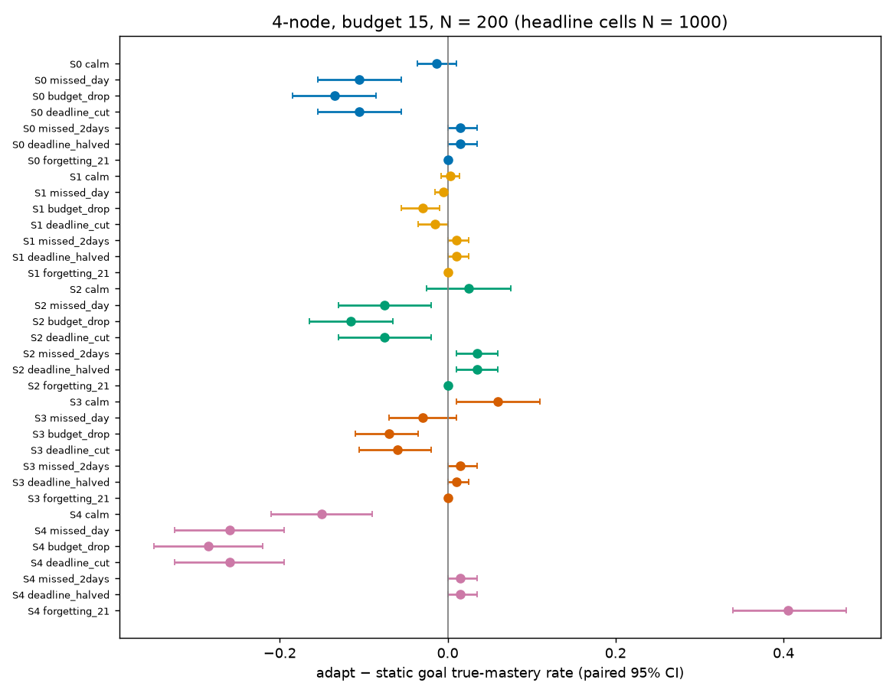
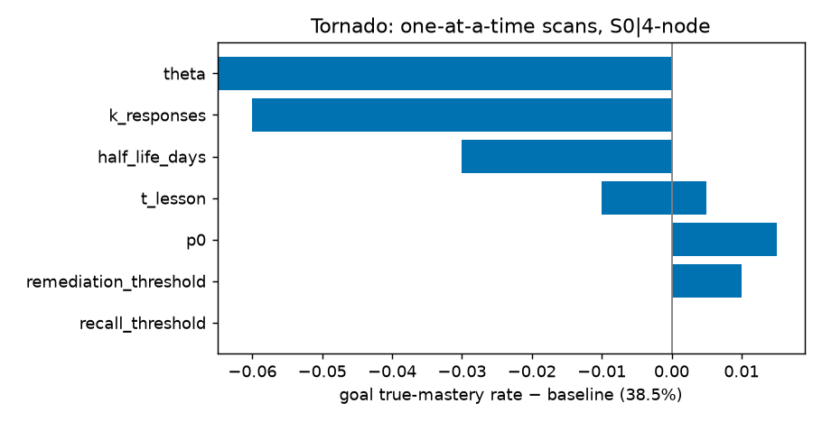
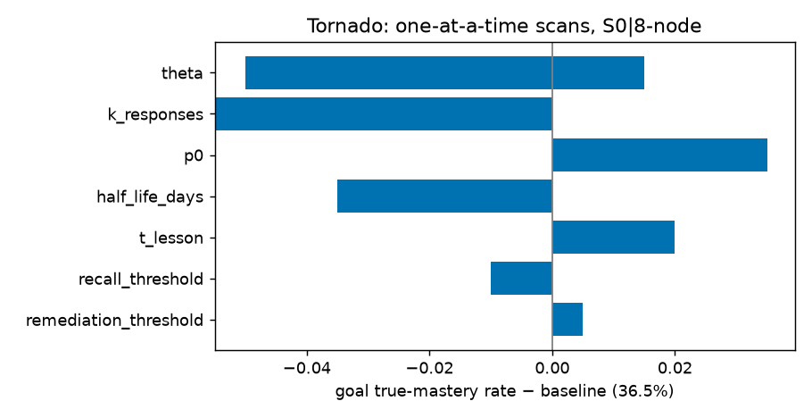
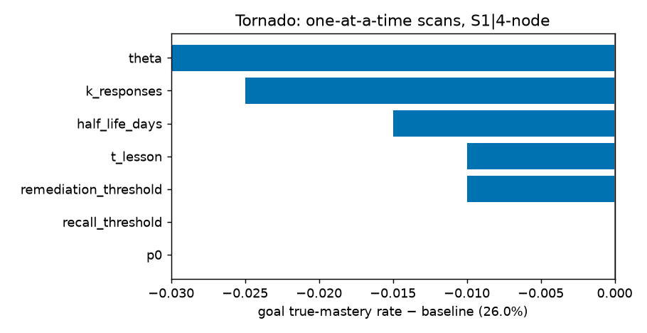
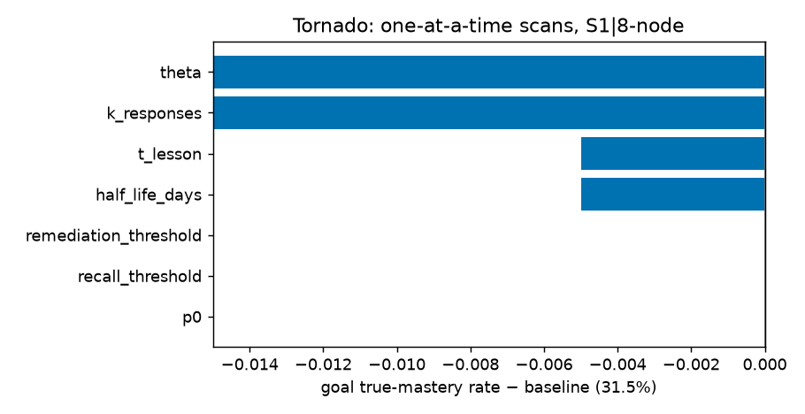
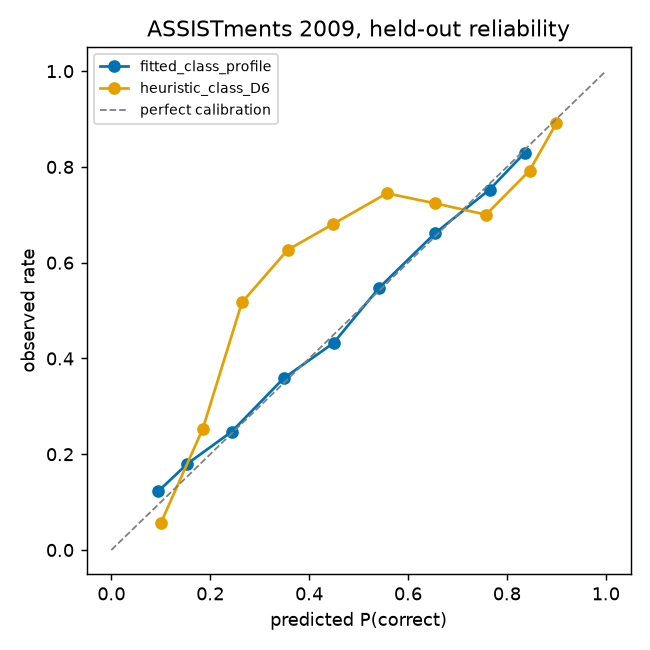

# AdaptEngine — Week 7 Results

Generated by `python experiments/make_w7_results.py` from `experiments/results/*.json`. Do not edit by hand.

## 1. Closed-loop evaluation grid (T4.4)

Source: `experiments/results/w7_grid.json` (`python experiments/run_w7_grid.py`), code_hash `c3cbb8f066c6…`, 420 cells, runtime 3228.4 s on 15 processes. Pre-registration: `docs/preregistration/W7_T4.1_2026-11-08.md`. N = 200 paired learners per cell; headline cells N = 1000.

### 1.1 H1 — executed prerequisite violations, summed over every cell

| Arm | Executed violations (all cells) |
|---|---|
| adapt | 0 |
| adapt_expected | 0 |
| no_review | 0 |
| no_replan | 1229249 |
| static | 1649720 |

### 1.2 Headline cells (4-node, B = 15, calm, N = 1000)

**S1** (horizon 4 days)

| Arm | Goal mastery rate | Mean goal θ | All required | Minutes | Exec. viol. (learners) | Idle days | adapt-arm − static: mastery / θ / θ at equal minutes |
|---|---|---|---|---|---|---|---|
| adapt | 29.0% | 0.5522 | 3.9% | 47.0 | 0 (0) | 0 | +0.003 [-0.008, +0.014] / +0.003 [-0.000, +0.006] / -0.012 [-0.015, -0.009] |
| adapt_expected | 27.3% | 0.5343 | 6.1% | 54.9 | 0 (0) | 0 | -0.014 [-0.025, -0.003] / -0.015 [-0.018, -0.011] / -0.045 [-0.048, -0.041] |
| no_replan | 26.8% | 0.5346 | 1.2% | 26.0 | 3933 (895) | 1110 | -0.019 [-0.028, -0.011] / -0.015 [-0.015, -0.014] / +0.037 [+0.034, +0.039] |
| no_review | 29.0% | 0.5522 | 3.9% | 47.0 | 0 (0) | 0 | +0.003 [-0.008, +0.014] / +0.003 [-0.000, +0.006] / -0.012 [-0.015, -0.009] |
| static | 28.7% | 0.5492 | 1.8% | 42.0 | 7200 (926) | 625 | — |

**S0** (horizon 4 days)

| Arm | Goal mastery rate | Mean goal θ | All required | Minutes | Exec. viol. (learners) | Idle days | adapt-arm − static: mastery / θ / θ at equal minutes |
|---|---|---|---|---|---|---|---|
| adapt | 42.6% | 0.6381 | 7.3% | 45.5 | 0 (0) | 0 | -0.013 [-0.036, +0.010] / -0.026 [-0.033, -0.020] / -0.055 [-0.064, -0.047] |
| adapt_expected | 36.6% | 0.5846 | 9.8% | 54.7 | 0 (0) | 0 | -0.073 [-0.096, -0.051] / -0.080 [-0.087, -0.073] / -0.150 [-0.156, -0.145] |
| no_replan | 37.5% | 0.6284 | 1.5% | 26.0 | 3744 (879) | 990 | -0.064 [-0.078, -0.050] / -0.036 [-0.037, -0.035] / +0.131 [+0.127, +0.134] |
| no_review | 42.6% | 0.6381 | 7.3% | 45.5 | 0 (0) | 0 | -0.013 [-0.036, +0.010] / -0.026 [-0.033, -0.020] / -0.055 [-0.064, -0.047] |
| static | 43.9% | 0.6647 | 2.5% | 42.0 | 6710 (916) | 549 | — |

### 1.3 Robustness matrix — 4-node, B = 15: adapt − static goal mastery rate [95% CI]; executed violations adapt / static

| Scenario | S0 | S1 | S2 | S3 | S4 |
|---|---|---|---|---|---|
| calm | -0.013 [-0.036, +0.010]; 0/6710 | +0.003 [-0.008, +0.014]; 0/7200 | +0.025 [-0.025, +0.075]; 0/1340 | +0.060 [+0.010, +0.110]; 0/1355 | -0.150 [-0.210, -0.090]; 0/1490 |
| missed_day | -0.105 [-0.155, -0.055]; 0/1200 | -0.005 [-0.015, +0.000]; 0/1200 | -0.075 [-0.130, -0.020]; 0/1200 | -0.030 [-0.070, +0.010]; 0/1200 | -0.260 [-0.325, -0.195]; 0/1200 |
| budget_drop | -0.135 [-0.185, -0.085]; 0/1305 | -0.030 [-0.055, -0.010]; 0/1420 | -0.115 [-0.165, -0.065]; 0/1340 | -0.070 [-0.110, -0.035]; 0/1355 | -0.285 [-0.350, -0.220]; 0/1490 |
| deadline_cut | -0.105 [-0.155, -0.055]; 0/1305 | -0.015 [-0.035, +0.000]; 0/1420 | -0.075 [-0.130, -0.020]; 0/1340 | -0.060 [-0.105, -0.020]; 0/1355 | -0.260 [-0.325, -0.195]; 0/1490 |
| missed_2days | +0.015 [+0.000, +0.035]; 0/0 | +0.010 [+0.000, +0.025]; 0/0 | +0.035 [+0.010, +0.060]; 0/0 | +0.015 [+0.000, +0.035]; 0/0 | +0.015 [+0.000, +0.035]; 0/0 |
| budget_crash | n/a | n/a | n/a | n/a | n/a |
| deadline_halved | +0.015 [+0.000, +0.035]; 0/640 | +0.010 [+0.000, +0.025]; 0/640 | +0.035 [+0.010, +0.060]; 0/636 | +0.010 [+0.000, +0.025]; 0/652 | +0.015 [+0.000, +0.035]; 0/668 |
| forgetting_21 | +0.000 [+0.000, +0.000]; 0/1410 | +0.000 [+0.000, +0.000]; 0/1505 | +0.000 [+0.000, +0.000]; 0/1380 | +0.000 [+0.000, +0.000]; 0/1410 | +0.405 [+0.340, +0.475]; 0/1490 |

### 1.3 Robustness matrix — 8-node, B = 15: adapt − static goal mastery rate [95% CI]; executed violations adapt / static

| Scenario | S0 | S1 | S2 | S3 | S4 |
|---|---|---|---|---|---|
| calm | -0.080 [-0.130, -0.035]; 0/3205 | -0.025 [-0.045, -0.005]; 0/3430 | -0.080 [-0.135, -0.025]; 0/3245 | -0.085 [-0.135, -0.040]; 0/3390 | -0.230 [-0.290, -0.175]; 0/3670 |
| missed_day | -0.115 [-0.165, -0.070]; 0/3100 | -0.035 [-0.060, -0.010]; 0/3215 | -0.170 [-0.225, -0.115]; 0/3105 | -0.125 [-0.175, -0.080]; 0/3235 | -0.240 [-0.300, -0.180]; 0/3380 |
| budget_drop | -0.155 [-0.205, -0.110]; 0/3205 | -0.050 [-0.080, -0.025]; 0/3430 | -0.235 [-0.295, -0.180]; 0/3245 | -0.155 [-0.205, -0.110]; 0/3390 | -0.245 [-0.305, -0.185]; 0/3670 |
| deadline_cut | -0.070 [-0.110, -0.030]; 0/3093 | -0.030 [-0.055, -0.010]; 0/3308 | -0.125 [-0.180, -0.070]; 0/3134 | -0.155 [-0.205, -0.105]; 0/3264 | -0.220 [-0.280, -0.165]; 0/3528 |
| missed_2days | -0.155 [-0.205, -0.110]; 0/2105 | -0.050 [-0.080, -0.025]; 0/2155 | -0.240 [-0.300, -0.185]; 0/2120 | -0.155 [-0.205, -0.110]; 0/2175 | -0.245 [-0.305, -0.185]; 0/2350 |
| budget_crash | n/a | n/a | n/a | n/a | n/a |
| deadline_halved | +0.000 [+0.000, +0.000]; 0/1305 | +0.000 [+0.000, +0.000]; 0/1420 | +0.000 [+0.000, +0.000]; 0/1340 | +0.000 [+0.000, +0.000]; 0/1355 | +0.000 [+0.000, +0.000]; 0/1490 |
| forgetting_21 | +0.005 [+0.000, +0.015]; 0/3575 | +0.000 [+0.000, +0.000]; 0/3805 | +0.000 [+0.000, +0.000]; 0/3575 | +0.005 [+0.000, +0.015]; 0/3575 | +0.405 [+0.335, +0.475]; 0/3670 |

### 1.3 Robustness matrix — synth-20, B = 15: adapt − static goal mastery rate [95% CI]; executed violations adapt / static

| Scenario | S0 | S1 | S2 | S3 | S4 |
|---|---|---|---|---|---|
| calm | +0.005 [+0.000, +0.015]; 0/6155 | +0.000 [+0.000, +0.000]; 0/6510 | +0.005 [+0.000, +0.015]; 0/6070 | +0.000 [+0.000, +0.000]; 0/6650 | +0.000 [+0.000, +0.000]; 0/6950 |
| missed_day | +0.000 [+0.000, +0.000]; 0/6340 | +0.000 [+0.000, +0.000]; 0/6700 | +0.005 [+0.000, +0.015]; 0/6300 | +0.000 [+0.000, +0.000]; 0/6810 | +0.000 [+0.000, +0.000]; 0/7095 |
| budget_drop | +0.000 [+0.000, +0.000]; 0/6155 | +0.000 [+0.000, +0.000]; 0/6510 | +0.000 [+0.000, +0.000]; 0/6070 | +0.000 [+0.000, +0.000]; 0/6650 | +0.000 [+0.000, +0.000]; 0/6950 |
| deadline_cut | +0.000 [+0.000, +0.000]; 0/5380 | +0.000 [+0.000, +0.000]; 0/5655 | +0.005 [+0.000, +0.015]; 0/5295 | +0.000 [+0.000, +0.000]; 0/5785 | +0.000 [+0.000, +0.000]; 0/6060 |
| missed_2days | +0.000 [+0.000, +0.000]; 0/6405 | +0.000 [+0.000, +0.000]; 0/6685 | +0.000 [+0.000, +0.000]; 0/6390 | +0.000 [+0.000, +0.000]; 0/6775 | +0.000 [+0.000, +0.000]; 0/6875 |
| budget_crash | n/a | n/a | n/a | n/a | n/a |
| deadline_halved | +0.000 [+0.000, +0.000]; 0/1875 | +0.000 [+0.000, +0.000]; 0/1875 | +0.000 [+0.000, +0.000]; 0/1830 | +0.000 [+0.000, +0.000]; 0/1900 | +0.000 [+0.000, +0.000]; 0/2105 |
| forgetting_21 | +0.005 [+0.000, +0.015]; 0/12325 | +0.000 [+0.000, +0.000]; 0/13100 | +0.005 [+0.000, +0.015]; 0/12110 | +0.005 [+0.000, +0.015]; 0/12325 | -0.230 [-0.290, -0.170]; 0/11720 |

### 1.4 Summary over every cell: adapt vs static goal mastery rate (paired CI)

| World | Curriculum | adapt better | no sig. difference | adapt worse |
|---|---|---|---|---|
| S0 | 4-node | 3 | 12 | 13 |
| S0 | 8-node | 1 | 11 | 16 |
| S0 | synth-20 | 1 | 23 | 4 |
| S1 | 4-node | 5 | 17 | 6 |
| S1 | 8-node | 0 | 10 | 18 |
| S1 | synth-20 | 0 | 28 | 0 |
| S2 | 4-node | 5 | 11 | 12 |
| S2 | 8-node | 2 | 10 | 16 |
| S2 | synth-20 | 1 | 23 | 4 |
| S3 | 4-node | 6 | 11 | 11 |
| S3 | 8-node | 2 | 14 | 12 |
| S3 | synth-20 | 0 | 24 | 4 |
| S4 | 4-node | 5 | 6 | 17 |
| S4 | 8-node | 3 | 5 | 20 |
| S4 | synth-20 | 1 | 21 | 6 |

### 1.5 Spaced review (forgetting_21, fast_forgetter, 21 days, B = 15)

| World | Curriculum | adapt − no_review θ (h = 30) | adapt_h7 − no_review_h7 θ (h = 7) | retention reviewed / not (adapt_h7) |
|---|---|---|---|---|
| S0 | 4-node | +0.000 [+0.000, +0.000] | -0.001 [-0.003, +0.000] | 0.2244 / 0.2804 |
| S0 | 8-node | +0.003 [-0.000, +0.007] | +0.041 [+0.032, +0.051] | 0.2604 / 0.3412 |
| S0 | synth-20 | -0.136 [-0.164, -0.110] | -0.030 [-0.052, -0.010] | 0.3654 / 0.382 |
| S1 | 4-node | -0.001 [-0.002, -0.000] | -0.021 [-0.025, -0.016] | 0.2275 / 0.2264 |
| S1 | 8-node | +0.003 [+0.001, +0.005] | +0.024 [+0.019, +0.028] | 0.2801 / 0.2072 |
| S1 | synth-20 | +0.000 [-0.000, +0.001] | +0.000 [+0.000, +0.001] | 0.2728 / 0.2429 |
| S2 | 4-node | +0.000 [+0.000, +0.000] | +0.000 [-0.001, +0.003] | 0.2413 / 0.2837 |
| S2 | 8-node | +0.001 [-0.000, +0.001] | +0.048 [+0.036, +0.060] | 0.2837 / 0.3502 |
| S2 | synth-20 | -0.118 [-0.143, -0.093] | -0.032 [-0.053, -0.013] | 0.3761 / 0.4258 |
| S3 | 4-node | +0.000 [+0.000, +0.000] | -0.001 [-0.003, +0.000] | 0.2244 / 0.2804 |
| S3 | 8-node | +0.003 [-0.000, +0.007] | +0.041 [+0.032, +0.051] | 0.2604 / 0.3412 |
| S3 | synth-20 | -0.136 [-0.164, -0.110] | -0.030 [-0.052, -0.010] | 0.3654 / 0.382 |
| S4 | 4-node | +0.000 [+0.000, +0.000] | +0.000 [+0.000, +0.000] | 1.0 / 1.0 |
| S4 | 8-node | -0.005 [-0.015, +0.000] | -0.035 [-0.060, -0.010] | 1.0 / 1.0 |
| S4 | synth-20 | -0.035 [-0.060, -0.010] | -0.025 [-0.050, -0.005] | 1.0 / 1.0 |

### 1.6 Expected-workload projection (T2.5): adapt − adapt_expected, B = 15

| World | calm | missed_day | budget_drop | deadline_cut |
|---|---|---|---|---|
| S0 (4-node) | +0.060 [+0.038, +0.083] | +0.065 [+0.025, +0.110] | +0.030 [-0.005, +0.065] | +0.065 [+0.025, +0.110] |
| S1 (4-node) | +0.017 [+0.005, +0.029] | +0.025 [+0.000, +0.055] | +0.015 [+0.000, +0.035] | +0.025 [+0.000, +0.055] |
| S2 (4-node) | +0.055 [+0.005, +0.105] | +0.135 [+0.090, +0.185] | +0.090 [+0.055, +0.130] | +0.135 [+0.090, +0.185] |
| S3 (4-node) | +0.090 [+0.045, +0.140] | +0.080 [+0.045, +0.120] | +0.030 [+0.010, +0.055] | +0.095 [+0.055, +0.135] |
| S4 (4-node) | +0.095 [+0.055, +0.135] | +0.030 [+0.010, +0.055] | +0.005 [+0.000, +0.015] | +0.030 [+0.010, +0.055] |

### 1.7 Engine P(correct) on executed attempts (adapt, 4-node, B = 15, calm)

| World | Brier | AUC |
|---|---|---|
| S0 | 0.2548 | 0.5331 |
| S1 | 0.2537 | 0.5496 |
| S2 | 0.2552 | 0.5281 |
| S3 | 0.2555 | 0.5372 |
| S4 | 0.2342 | 0.6375 |

### 1.8 Pre-registered run vs re-run after the Defect-7 fix (H1)

The registered run (`w7_grid_prereg.json`, code_hash `8ef52d544d11…`) found executed violations in the review-enabled arms; the scheduler fix (reviews and remediation obey the prerequisite gate) was applied and the grid re-run (`w7_grid.json`, code_hash `c3cbb8f066c6…`). Both are reported.

| Arm | Executed violations, registered run (cells) | Executed violations, after fix 1 (tiers 0/1 gated) (cells) | Executed violations, final (gate = prerequisite satisfied) (cells) |
|---|---|---|---|
| adapt | 6192 (138) | 53 (32) | 0 (0) |
| adapt_expected | 1149 (95) | 24 (13) | 0 (0) |
| no_review | 0 (0) | 0 (0) | 0 (0) |
| adapt_h7 | 25521 (57) | 257 (35) | 0 (0) |
| no_review_h7 | 0 (0) | 0 (0) | 0 (0) |
| no_replan | 1229249 (400) | 1229249 (400) | 1229249 (400) |
| static | 1649720 (405) | 1649720 (405) | 1649720 (405) |

## 2. Sensitivity analysis (WP5)

Source: `experiments/results/w7_sensitivity.json` (`python experiments/run_sensitivity.py`), code_hash `c3cbb8f066c6…`; calm (horizon fixed from DEFAULT_CONFIG), budget 15, N = 200, arm adapt (static shown for reference).

### S0|4-node

| Setting | Goal mastery | Δ vs baseline [95% CI] | Minutes | Δ minutes [95% CI] | Exec. viol. | All required |
|---|---|---|---|---|---|---|
| baseline | 38.5% | +0.000 [+0.000, +0.000] | 46.8 | +0.000 [+0.000, +0.000] | 0 | 6.5% |
| criterion=bkt_threshold | 38.5% | +0.000 [+0.000, +0.000] | 46.8 | +0.000 [+0.000, +0.000] | 0 | 6.5% |
| criterion=n_consecutive_2 | 38.0% | -0.005 [-0.025, +0.010] | 48.9 | +2.095 [+1.575, +2.670] | 0 | 7.0% |
| criterion=n_consecutive_3 | 26.0% | -0.125 [-0.185, -0.070] | 54.8 | +7.995 [+6.810, +9.220] | 0 | 9.0% |
| criterion=two_threshold | 38.0% | -0.005 [-0.025, +0.010] | 48.7 | +1.890 [+1.420, +2.415] | 0 | 7.0% |
| half_life_days=14.0 | 38.5% | +0.000 [+0.000, +0.000] | 46.8 | +0.000 [+0.000, +0.000] | 0 | 6.5% |
| half_life_days=30.0 | 38.5% | +0.000 [+0.000, +0.000] | 46.8 | +0.000 [+0.000, +0.000] | 0 | 6.5% |
| half_life_days=60.0 | 38.5% | +0.000 [+0.000, +0.000] | 46.8 | +0.000 [+0.000, +0.000] | 0 | 6.5% |
| half_life_days=7.0 | 35.5% | -0.030 [-0.055, -0.010] | 47.2 | +0.430 [+0.165, +0.700] | 0 | 7.0% |
| k_responses=1 | 38.5% | +0.000 [+0.000, +0.000] | 46.8 | +0.000 [+0.000, +0.000] | 0 | 6.5% |
| k_responses=2 | 38.5% | +0.000 [+0.000, +0.000] | 46.8 | +0.000 [+0.000, +0.000] | 0 | 6.5% |
| k_responses=3 | 36.0% | -0.025 [-0.070, +0.020] | 51.5 | +4.655 [+3.765, +5.620] | 0 | 7.5% |
| k_responses=4 | 32.5% | -0.060 [-0.115, -0.005] | 54.0 | +7.150 [+6.070, +8.285] | 0 | 7.5% |
| p0=0.1 | 38.5% | +0.000 [-0.015, +0.015] | 48.3 | +1.525 [+1.100, +2.015] | 0 | 6.5% |
| p0=0.2 | 38.5% | +0.000 [+0.000, +0.000] | 46.8 | +0.000 [+0.000, +0.000] | 0 | 6.5% |
| p0=0.3 | 38.5% | +0.000 [+0.000, +0.000] | 46.8 | +0.000 [+0.000, +0.000] | 0 | 6.5% |
| p0=0.4 | 40.0% | +0.015 [-0.010, +0.040] | 45.6 | -1.240 [-1.795, -0.685] | 0 | 6.0% |
| recall_threshold=0.7 | 38.5% | +0.000 [+0.000, +0.000] | 46.8 | +0.000 [+0.000, +0.000] | 0 | 6.5% |
| recall_threshold=0.8 | 38.5% | +0.000 [+0.000, +0.000] | 46.8 | +0.000 [+0.000, +0.000] | 0 | 6.5% |
| recall_threshold=0.9 | 38.5% | +0.000 [+0.000, +0.000] | 46.8 | +0.000 [+0.000, +0.000] | 0 | 6.5% |
| remediation_threshold=0.3 | 39.5% | +0.010 [-0.025, +0.045] | 47.0 | +0.210 [-0.445, +0.870] | 0 | 5.0% |
| remediation_threshold=0.4 | 38.5% | +0.000 [+0.000, +0.000] | 46.8 | +0.000 [+0.000, +0.000] | 0 | 6.5% |
| remediation_threshold=0.5 | 38.5% | +0.000 [+0.000, +0.000] | 47.0 | +0.160 [+0.035, +0.290] | 0 | 7.0% |
| static | 37.0% | -0.015 [-0.080, +0.045] | 42.0 | -4.810 [-5.995, -3.580] | 1305 | 1.5% |
| t_lesson=0.1 | 37.5% | -0.010 [-0.030, +0.010] | 49.1 | +2.330 [+1.835, +2.885] | 0 | 7.5% |
| t_lesson=0.2 | 38.5% | +0.000 [+0.000, +0.000] | 46.8 | +0.000 [+0.000, +0.000] | 0 | 6.5% |
| t_lesson=0.3 | 39.0% | +0.005 [-0.015, +0.025] | 46.3 | -0.505 [-0.800, -0.235] | 0 | 5.5% |
| theta=0.7 | 38.0% | -0.005 [-0.025, +0.015] | 46.5 | -0.340 [-0.615, -0.090] | 0 | 5.5% |
| theta=0.75 | 38.5% | +0.000 [+0.000, +0.000] | 46.8 | -0.030 [-0.130, +0.080] | 0 | 6.0% |
| theta=0.75|k=1 | 38.5% | +0.000 [+0.000, +0.000] | 46.8 | -0.030 [-0.130, +0.080] | 0 | 6.0% |
| theta=0.75|k=2 | 38.5% | +0.000 [+0.000, +0.000] | 46.8 | -0.030 [-0.130, +0.080] | 0 | 6.0% |
| theta=0.75|k=3 | 38.0% | -0.005 [-0.050, +0.035] | 51.0 | +4.215 [+3.505, +4.955] | 0 | 7.5% |
| theta=0.8 | 38.5% | +0.000 [+0.000, +0.000] | 46.8 | -0.020 [-0.080, +0.040] | 0 | 6.5% |
| theta=0.85 | 38.5% | +0.000 [+0.000, +0.000] | 46.8 | +0.000 [+0.000, +0.000] | 0 | 6.5% |
| theta=0.85|k=1 | 38.5% | +0.000 [+0.000, +0.000] | 46.8 | +0.000 [+0.000, +0.000] | 0 | 6.5% |
| theta=0.85|k=2 | 38.5% | +0.000 [+0.000, +0.000] | 46.8 | +0.000 [+0.000, +0.000] | 0 | 6.5% |
| theta=0.85|k=3 | 36.0% | -0.025 [-0.070, +0.020] | 51.5 | +4.655 [+3.765, +5.620] | 0 | 7.5% |
| theta=0.9 | 38.0% | -0.005 [-0.025, +0.010] | 48.7 | +1.890 [+1.420, +2.415] | 0 | 7.0% |
| theta=0.95 | 32.0% | -0.065 [-0.115, -0.020] | 54.1 | +7.275 [+6.245, +8.405] | 0 | 8.0% |
| theta=0.95|k=1 | 32.0% | -0.065 [-0.115, -0.020] | 54.1 | +7.275 [+6.245, +8.405] | 0 | 8.0% |
| theta=0.95|k=2 | 32.0% | -0.065 [-0.115, -0.020] | 54.1 | +7.275 [+6.245, +8.405] | 0 | 8.0% |
| theta=0.95|k=3 | 32.0% | -0.065 [-0.115, -0.020] | 54.1 | +7.275 [+6.245, +8.405] | 0 | 8.0% |

### S0|8-node

| Setting | Goal mastery | Δ vs baseline [95% CI] | Minutes | Δ minutes [95% CI] | Exec. viol. | All required |
|---|---|---|---|---|---|---|
| baseline | 36.5% | +0.000 [+0.000, +0.000] | 76.6 | +0.000 [+0.000, +0.000] | 0 | 0.5% |
| criterion=bkt_threshold | 36.5% | +0.000 [+0.000, +0.000] | 76.6 | +0.000 [+0.000, +0.000] | 0 | 0.5% |
| criterion=n_consecutive_2 | 36.5% | +0.000 [-0.025, +0.025] | 79.3 | +2.760 [+2.225, +3.310] | 0 | 0.5% |
| criterion=n_consecutive_3 | 30.5% | -0.060 [-0.095, -0.030] | 84.3 | +7.760 [+6.840, +8.760] | 0 | 1.5% |
| criterion=two_threshold | 36.5% | +0.000 [-0.025, +0.025] | 79.0 | +2.485 [+1.995, +2.995] | 0 | 0.5% |
| half_life_days=14.0 | 35.5% | -0.010 [-0.025, +0.000] | 77.3 | +0.775 [+0.515, +1.060] | 0 | 0.5% |
| half_life_days=30.0 | 36.5% | +0.000 [+0.000, +0.000] | 76.6 | +0.000 [+0.000, +0.000] | 0 | 0.5% |
| half_life_days=60.0 | 36.5% | +0.000 [+0.000, +0.000] | 76.6 | +0.000 [+0.000, +0.000] | 0 | 0.5% |
| half_life_days=7.0 | 33.0% | -0.035 [-0.065, -0.010] | 80.1 | +3.520 [+2.905, +4.230] | 0 | 1.0% |
| k_responses=1 | 36.5% | +0.000 [+0.000, +0.000] | 76.6 | +0.000 [+0.000, +0.000] | 0 | 0.5% |
| k_responses=2 | 36.5% | +0.000 [+0.000, +0.000] | 76.6 | +0.000 [+0.000, +0.000] | 0 | 0.5% |
| k_responses=3 | 34.5% | -0.020 [-0.045, +0.000] | 81.8 | +5.275 [+4.400, +6.180] | 0 | 1.0% |
| k_responses=4 | 31.0% | -0.055 [-0.090, -0.025] | 83.7 | +7.110 [+6.125, +8.095] | 0 | 1.0% |
| p0=0.1 | 37.0% | +0.005 [-0.015, +0.025] | 78.5 | +1.945 [+1.570, +2.355] | 0 | 0.5% |
| p0=0.2 | 36.5% | +0.000 [+0.000, +0.000] | 76.6 | +0.000 [+0.000, +0.000] | 0 | 0.5% |
| p0=0.3 | 36.5% | +0.000 [+0.000, +0.000] | 76.6 | +0.000 [+0.000, +0.000] | 0 | 0.5% |
| p0=0.4 | 40.0% | +0.035 [+0.010, +0.065] | 76.2 | -0.400 [-1.080, +0.300] | 0 | 0.5% |
| recall_threshold=0.7 | 36.5% | +0.000 [+0.000, +0.000] | 76.6 | +0.000 [+0.000, +0.000] | 0 | 0.5% |
| recall_threshold=0.8 | 36.5% | +0.000 [+0.000, +0.000] | 76.6 | +0.000 [+0.000, +0.000] | 0 | 0.5% |
| recall_threshold=0.9 | 35.5% | -0.010 [-0.025, +0.000] | 77.3 | +0.775 [+0.515, +1.060] | 0 | 0.5% |
| remediation_threshold=0.3 | 37.0% | +0.005 [-0.015, +0.025] | 78.1 | +1.545 [+0.850, +2.260] | 0 | 0.5% |
| remediation_threshold=0.4 | 36.5% | +0.000 [+0.000, +0.000] | 76.6 | +0.000 [+0.000, +0.000] | 0 | 0.5% |
| remediation_threshold=0.5 | 36.5% | +0.000 [+0.000, +0.000] | 76.7 | +0.145 [+0.015, +0.305] | 0 | 0.5% |
| static | 44.5% | +0.080 [+0.035, +0.130] | 74.0 | -2.560 [-3.465, -1.645] | 3205 | 0.0% |
| t_lesson=0.1 | 36.5% | +0.000 [-0.025, +0.025] | 79.5 | +2.990 [+2.490, +3.535] | 0 | 0.5% |
| t_lesson=0.2 | 36.5% | +0.000 [+0.000, +0.000] | 76.6 | +0.000 [+0.000, +0.000] | 0 | 0.5% |
| t_lesson=0.3 | 38.5% | +0.020 [+0.005, +0.040] | 76.6 | +0.010 [-0.310, +0.310] | 0 | 0.5% |
| theta=0.7 | 38.0% | +0.015 [+0.000, +0.035] | 76.0 | -0.535 [-0.895, -0.195] | 0 | 0.5% |
| theta=0.75 | 36.5% | +0.000 [+0.000, +0.000] | 76.4 | -0.170 [-0.300, -0.050] | 0 | 0.5% |
| theta=0.75|k=1 | 36.5% | +0.000 [+0.000, +0.000] | 76.4 | -0.170 [-0.300, -0.050] | 0 | 0.5% |
| theta=0.75|k=2 | 36.5% | +0.000 [+0.000, +0.000] | 76.4 | -0.170 [-0.300, -0.050] | 0 | 0.5% |
| theta=0.75|k=3 | 35.0% | -0.015 [-0.040, +0.005] | 81.5 | +4.955 [+4.160, +5.775] | 0 | 1.0% |
| theta=0.8 | 36.5% | +0.000 [+0.000, +0.000] | 76.5 | -0.055 [-0.120, +0.010] | 0 | 0.5% |
| theta=0.85 | 36.5% | +0.000 [+0.000, +0.000] | 76.6 | +0.000 [+0.000, +0.000] | 0 | 0.5% |
| theta=0.85|k=1 | 36.5% | +0.000 [+0.000, +0.000] | 76.6 | +0.000 [+0.000, +0.000] | 0 | 0.5% |
| theta=0.85|k=2 | 36.5% | +0.000 [+0.000, +0.000] | 76.6 | +0.000 [+0.000, +0.000] | 0 | 0.5% |
| theta=0.85|k=3 | 34.5% | -0.020 [-0.045, +0.000] | 81.8 | +5.275 [+4.400, +6.180] | 0 | 1.0% |
| theta=0.9 | 36.5% | +0.000 [-0.025, +0.025] | 79.0 | +2.480 [+1.995, +2.990] | 0 | 0.5% |
| theta=0.95 | 31.5% | -0.050 [-0.085, -0.020] | 84.2 | +7.660 [+6.740, +8.625] | 0 | 1.0% |
| theta=0.95|k=1 | 31.5% | -0.050 [-0.085, -0.020] | 84.2 | +7.660 [+6.740, +8.625] | 0 | 1.0% |
| theta=0.95|k=2 | 31.5% | -0.050 [-0.085, -0.020] | 84.2 | +7.660 [+6.740, +8.625] | 0 | 1.0% |
| theta=0.95|k=3 | 31.5% | -0.050 [-0.085, -0.020] | 84.2 | +7.660 [+6.740, +8.625] | 0 | 1.0% |

### S1|4-node

| Setting | Goal mastery | Δ vs baseline [95% CI] | Minutes | Δ minutes [95% CI] | Exec. viol. | All required |
|---|---|---|---|---|---|---|
| baseline | 26.0% | +0.000 [+0.000, +0.000] | 48.9 | +0.000 [+0.000, +0.000] | 0 | 3.0% |
| criterion=bkt_threshold | 26.0% | +0.000 [+0.000, +0.000] | 48.9 | +0.000 [+0.000, +0.000] | 0 | 3.0% |
| criterion=n_consecutive_2 | 25.0% | -0.010 [-0.025, +0.000] | 50.9 | +2.015 [+1.470, +2.575] | 0 | 3.0% |
| criterion=n_consecutive_3 | 20.5% | -0.055 [-0.095, -0.020] | 55.1 | +6.265 [+5.280, +7.290] | 0 | 4.0% |
| criterion=two_threshold | 25.0% | -0.010 [-0.025, +0.000] | 50.6 | +1.765 [+1.285, +2.280] | 0 | 3.0% |
| half_life_days=14.0 | 26.0% | +0.000 [+0.000, +0.000] | 48.9 | +0.000 [+0.000, +0.000] | 0 | 3.0% |
| half_life_days=30.0 | 26.0% | +0.000 [+0.000, +0.000] | 48.9 | +0.000 [+0.000, +0.000] | 0 | 3.0% |
| half_life_days=60.0 | 26.0% | +0.000 [+0.000, +0.000] | 48.9 | +0.000 [+0.000, +0.000] | 0 | 3.0% |
| half_life_days=7.0 | 24.5% | -0.015 [-0.035, +0.000] | 49.2 | +0.375 [+0.150, +0.610] | 0 | 2.5% |
| k_responses=1 | 26.0% | +0.000 [+0.000, +0.000] | 48.9 | +0.000 [+0.000, +0.000] | 0 | 3.0% |
| k_responses=2 | 26.0% | +0.000 [+0.000, +0.000] | 48.9 | +0.000 [+0.000, +0.000] | 0 | 3.0% |
| k_responses=3 | 24.5% | -0.015 [-0.045, +0.015] | 52.0 | +3.195 [+2.480, +3.930] | 0 | 3.0% |
| k_responses=4 | 23.5% | -0.025 [-0.060, +0.010] | 54.2 | +5.310 [+4.395, +6.235] | 0 | 3.0% |
| p0=0.1 | 26.0% | +0.000 [+0.000, +0.000] | 50.2 | +1.385 [+0.995, +1.835] | 0 | 3.0% |
| p0=0.2 | 26.0% | +0.000 [+0.000, +0.000] | 48.9 | +0.000 [+0.000, +0.000] | 0 | 3.0% |
| p0=0.3 | 26.0% | +0.000 [+0.000, +0.000] | 48.9 | +0.000 [+0.000, +0.000] | 0 | 3.0% |
| p0=0.4 | 26.0% | +0.000 [-0.020, +0.020] | 48.0 | -0.850 [-1.425, -0.275] | 0 | 3.0% |
| recall_threshold=0.7 | 26.0% | +0.000 [+0.000, +0.000] | 48.9 | +0.000 [+0.000, +0.000] | 0 | 3.0% |
| recall_threshold=0.8 | 26.0% | +0.000 [+0.000, +0.000] | 48.9 | +0.000 [+0.000, +0.000] | 0 | 3.0% |
| recall_threshold=0.9 | 26.0% | +0.000 [+0.000, +0.000] | 48.9 | +0.000 [+0.000, +0.000] | 0 | 3.0% |
| remediation_threshold=0.3 | 25.0% | -0.010 [-0.030, +0.010] | 49.4 | +0.545 [-0.080, +1.210] | 0 | 2.0% |
| remediation_threshold=0.4 | 26.0% | +0.000 [+0.000, +0.000] | 48.9 | +0.000 [+0.000, +0.000] | 0 | 3.0% |
| remediation_threshold=0.5 | 26.0% | +0.000 [+0.000, +0.000] | 49.0 | +0.115 [-0.020, +0.255] | 0 | 3.5% |
| static | 23.0% | -0.030 [-0.065, +0.000] | 42.0 | -6.850 [-7.855, -5.825] | 1420 | 1.5% |
| t_lesson=0.1 | 25.0% | -0.010 [-0.025, +0.000] | 51.0 | +2.180 [+1.655, +2.740] | 0 | 3.5% |
| t_lesson=0.2 | 26.0% | +0.000 [+0.000, +0.000] | 48.9 | +0.000 [+0.000, +0.000] | 0 | 3.0% |
| t_lesson=0.3 | 25.0% | -0.010 [-0.025, +0.000] | 48.4 | -0.495 [-0.780, -0.225] | 0 | 2.0% |
| theta=0.7 | 25.0% | -0.010 [-0.030, +0.010] | 48.3 | -0.560 [-0.925, -0.240] | 0 | 3.5% |
| theta=0.75 | 25.0% | -0.010 [-0.025, +0.000] | 48.7 | -0.160 [-0.380, +0.025] | 0 | 3.0% |
| theta=0.75|k=1 | 25.0% | -0.010 [-0.025, +0.000] | 48.7 | -0.160 [-0.380, +0.025] | 0 | 3.0% |
| theta=0.75|k=2 | 25.0% | -0.010 [-0.025, +0.000] | 48.7 | -0.160 [-0.380, +0.025] | 0 | 3.0% |
| theta=0.75|k=3 | 24.0% | -0.020 [-0.045, +0.005] | 52.0 | +3.100 [+2.430, +3.780] | 0 | 2.5% |
| theta=0.8 | 25.5% | -0.005 [-0.015, +0.000] | 48.8 | -0.050 [-0.165, +0.040] | 0 | 3.0% |
| theta=0.85 | 26.0% | +0.000 [+0.000, +0.000] | 48.9 | +0.000 [+0.000, +0.000] | 0 | 3.0% |
| theta=0.85|k=1 | 26.0% | +0.000 [+0.000, +0.000] | 48.9 | +0.000 [+0.000, +0.000] | 0 | 3.0% |
| theta=0.85|k=2 | 26.0% | +0.000 [+0.000, +0.000] | 48.9 | +0.000 [+0.000, +0.000] | 0 | 3.0% |
| theta=0.85|k=3 | 24.5% | -0.015 [-0.045, +0.015] | 52.0 | +3.195 [+2.480, +3.930] | 0 | 3.0% |
| theta=0.9 | 25.0% | -0.010 [-0.025, +0.000] | 50.6 | +1.765 [+1.285, +2.280] | 0 | 3.0% |
| theta=0.95 | 23.0% | -0.030 [-0.065, +0.000] | 54.5 | +5.700 [+4.830, +6.585] | 0 | 4.0% |
| theta=0.95|k=1 | 23.0% | -0.030 [-0.065, +0.000] | 54.5 | +5.700 [+4.830, +6.585] | 0 | 4.0% |
| theta=0.95|k=2 | 23.0% | -0.030 [-0.065, +0.000] | 54.5 | +5.700 [+4.830, +6.585] | 0 | 4.0% |
| theta=0.95|k=3 | 23.0% | -0.030 [-0.065, +0.000] | 54.5 | +5.700 [+4.830, +6.585] | 0 | 4.0% |

### S1|8-node

| Setting | Goal mastery | Δ vs baseline [95% CI] | Minutes | Δ minutes [95% CI] | Exec. viol. | All required |
|---|---|---|---|---|---|---|
| baseline | 31.5% | +0.000 [+0.000, +0.000] | 78.2 | +0.000 [+0.000, +0.000] | 0 | 0.0% |
| criterion=bkt_threshold | 31.5% | +0.000 [+0.000, +0.000] | 78.2 | +0.000 [+0.000, +0.000] | 0 | 0.0% |
| criterion=n_consecutive_2 | 31.5% | +0.000 [+0.000, +0.000] | 80.5 | +2.290 [+1.850, +2.780] | 0 | 0.0% |
| criterion=n_consecutive_3 | 30.0% | -0.015 [-0.035, +0.000] | 84.3 | +6.145 [+5.305, +7.055] | 0 | 0.0% |
| criterion=two_threshold | 31.5% | +0.000 [+0.000, +0.000] | 80.2 | +2.075 [+1.665, +2.510] | 0 | 0.0% |
| half_life_days=14.0 | 31.5% | +0.000 [+0.000, +0.000] | 78.7 | +0.500 [+0.310, +0.695] | 0 | 0.0% |
| half_life_days=30.0 | 31.5% | +0.000 [+0.000, +0.000] | 78.2 | +0.000 [+0.000, +0.000] | 0 | 0.0% |
| half_life_days=60.0 | 31.5% | +0.000 [+0.000, +0.000] | 78.2 | +0.000 [+0.000, +0.000] | 0 | 0.0% |
| half_life_days=7.0 | 31.0% | -0.005 [-0.015, +0.000] | 80.5 | +2.345 [+1.825, +2.965] | 0 | 0.5% |
| k_responses=1 | 31.5% | +0.000 [+0.000, +0.000] | 78.2 | +0.000 [+0.000, +0.000] | 0 | 0.0% |
| k_responses=2 | 31.5% | +0.000 [+0.000, +0.000] | 78.2 | +0.000 [+0.000, +0.000] | 0 | 0.0% |
| k_responses=3 | 30.5% | -0.010 [-0.025, +0.000] | 82.1 | +3.960 [+3.170, +4.815] | 0 | 0.0% |
| k_responses=4 | 30.0% | -0.015 [-0.035, +0.000] | 83.7 | +5.525 [+4.680, +6.385] | 0 | 0.0% |
| p0=0.1 | 31.5% | +0.000 [+0.000, +0.000] | 79.8 | +1.595 [+1.230, +2.025] | 0 | 0.0% |
| p0=0.2 | 31.5% | +0.000 [+0.000, +0.000] | 78.2 | +0.000 [+0.000, +0.000] | 0 | 0.0% |
| p0=0.3 | 31.5% | +0.000 [+0.000, +0.000] | 78.2 | +0.000 [+0.000, +0.000] | 0 | 0.0% |
| p0=0.4 | 31.5% | +0.000 [+0.000, +0.000] | 78.5 | +0.355 [-0.325, +1.010] | 0 | 0.0% |
| recall_threshold=0.7 | 31.5% | +0.000 [+0.000, +0.000] | 78.2 | +0.000 [+0.000, +0.000] | 0 | 0.0% |
| recall_threshold=0.8 | 31.5% | +0.000 [+0.000, +0.000] | 78.2 | +0.000 [+0.000, +0.000] | 0 | 0.0% |
| recall_threshold=0.9 | 31.5% | +0.000 [+0.000, +0.000] | 78.7 | +0.500 [+0.310, +0.695] | 0 | 0.0% |
| remediation_threshold=0.3 | 31.5% | +0.000 [+0.000, +0.000] | 80.2 | +2.090 [+1.510, +2.680] | 0 | 0.0% |
| remediation_threshold=0.4 | 31.5% | +0.000 [+0.000, +0.000] | 78.2 | +0.000 [+0.000, +0.000] | 0 | 0.0% |
| remediation_threshold=0.5 | 31.5% | +0.000 [+0.000, +0.000] | 78.2 | +0.060 [-0.085, +0.205] | 0 | 0.0% |
| static | 34.0% | +0.025 [+0.005, +0.045] | 74.0 | -4.160 [-4.960, -3.340] | 3430 | 0.0% |
| t_lesson=0.1 | 31.0% | -0.005 [-0.015, +0.000] | 80.8 | +2.630 [+2.195, +3.110] | 0 | 0.0% |
| t_lesson=0.2 | 31.5% | +0.000 [+0.000, +0.000] | 78.2 | +0.000 [+0.000, +0.000] | 0 | 0.0% |
| t_lesson=0.3 | 31.5% | +0.000 [+0.000, +0.000] | 78.5 | +0.340 [-0.010, +0.675] | 0 | 0.0% |
| theta=0.7 | 31.5% | +0.000 [+0.000, +0.000] | 77.7 | -0.415 [-0.800, -0.050] | 0 | 0.0% |
| theta=0.75 | 31.5% | +0.000 [+0.000, +0.000] | 77.9 | -0.230 [-0.435, -0.055] | 0 | 0.0% |
| theta=0.75|k=1 | 31.5% | +0.000 [+0.000, +0.000] | 77.9 | -0.230 [-0.435, -0.055] | 0 | 0.0% |
| theta=0.75|k=2 | 31.5% | +0.000 [+0.000, +0.000] | 77.9 | -0.230 [-0.435, -0.055] | 0 | 0.0% |
| theta=0.75|k=3 | 30.5% | -0.010 [-0.025, +0.000] | 81.8 | +3.690 [+2.985, +4.400] | 0 | 0.0% |
| theta=0.8 | 31.5% | +0.000 [+0.000, +0.000] | 78.0 | -0.125 [-0.270, -0.030] | 0 | 0.0% |
| theta=0.85 | 31.5% | +0.000 [+0.000, +0.000] | 78.2 | +0.000 [+0.000, +0.000] | 0 | 0.0% |
| theta=0.85|k=1 | 31.5% | +0.000 [+0.000, +0.000] | 78.2 | +0.000 [+0.000, +0.000] | 0 | 0.0% |
| theta=0.85|k=2 | 31.5% | +0.000 [+0.000, +0.000] | 78.2 | +0.000 [+0.000, +0.000] | 0 | 0.0% |
| theta=0.85|k=3 | 30.5% | -0.010 [-0.025, +0.000] | 82.1 | +3.960 [+3.170, +4.815] | 0 | 0.0% |
| theta=0.9 | 31.5% | +0.000 [+0.000, +0.000] | 80.2 | +2.070 [+1.665, +2.505] | 0 | 0.0% |
| theta=0.95 | 30.0% | -0.015 [-0.035, +0.000] | 84.2 | +6.025 [+5.200, +6.885] | 0 | 0.0% |
| theta=0.95|k=1 | 30.0% | -0.015 [-0.035, +0.000] | 84.2 | +6.025 [+5.200, +6.885] | 0 | 0.0% |
| theta=0.95|k=2 | 30.0% | -0.015 [-0.035, +0.000] | 84.2 | +6.025 [+5.200, +6.885] | 0 | 0.0% |
| theta=0.95|k=3 | 30.0% | -0.015 [-0.035, +0.000] | 84.2 | +6.025 [+5.200, +6.885] | 0 | 0.0% |

## 3. Diagnostic (WP3)

### 3.1 Pre-registered selection (T3.3)

Winner: `concept_cap=2`, `h_stop=0.5`, `min_items_per_concept=1`, `n_max=6`, `prior_mode=population`, `pruning_mode=hard`, `selection_scope=concept_sweep`

| Arm (held-out) | Brier | Log-loss | AUC | Next-resp. Brier | Items |
|---|---|---|---|---|---|
| prior_only | 0.208 | 0.6113 | 0.5 | 0.2955 | 0.0 |
| shipped | 0.2425 | 0.7386 | 0.5976 | 0.3071 | 2.96 |
| winner | 0.2324 | 0.7162 | 0.5865 | 0.297 | 2.76 |

- shipped_minus_prior_only: +0.035 [-0.000, +0.070]
- winner_minus_prior_only: +0.024 [-0.011, +0.061]
- winner_minus_shipped: -0.010 [-0.021, -0.002]

### 3.2 Matrix across worlds (T3.7)

| Arm | S0 Brier (AUC) | S2 Brier (AUC) | S4 Brier (AUC) |
|---|---|---|---|
| default_t33 | 0.2234 (0.5913) | 0.1888 (0.5851) | 0.1139 (0.7753) |
| fitted_bkt | 0.2368 (0.5943) | 0.2129 (0.5858) | 0.1266 (0.772) |
| fixed@n_default | 0.2019 (0.6195) | 0.1673 (0.6306) | 0.1309 (0.7724) |
| frontier | 0.2282 (0.5945) | 0.1889 (0.5922) | 0.1107 (0.7826) |
| irt_cat_global@8 | 0.2298 (0.5818) | 0.1515 (0.755) | 0.1619 (0.7187) |
| irt_cat_global@n | 0.2170 (0.5836) | 0.1583 (0.7092) | 0.1607 (0.6382) |
| irt_cat_per_concept@8 | 0.1785 (0.7174) | 0.1578 (0.6602) | 0.0771 (0.9434) |
| min_k2 | 0.2244 (0.6515) | 0.1987 (0.6389) | 0.0995 (0.8455) |
| prior_only | 0.2050 (0.5) | 0.1450 (0.5) | 0.1594 (0.5) |
| r74_recommended | 0.2280 (0.7025) | 0.2226 (0.6698) | 0.0589 (0.9453) |
| soft_prune | 0.2390 (0.6421) | 0.1978 (0.6458) | 0.0686 (0.8566) |
| state_space | 0.2520 (0.5666) | 0.1925 (0.6259) | 0.1319 (0.6105) |
| w6_shipped | 0.2282 (0.5945) | 0.1889 (0.5922) | 0.1107 (0.7826) |

## 4. Measured improvement: planning latency (T6.1)

Plan identity: 564 plans compared, 0 different.

| Case | Before (ms, mean ± sd) | After | Speed-up |
|---|---|---|---|
| 4-node | 2.905 ± 0.033 | 1.826 ± 0.024 | 1.59× |
| 8-node | 5.218 ± 0.075 | 3.066 ± 0.023 | 1.70× |
| synth-20 | 14.464 ± 0.214 | 7.603 ± 0.353 | 1.90× |
| synth-50 | 60.448 ± 0.579 | 22.496 ± 0.077 | 2.69× |
| synth-50_oracle_b10_d58 | 24.106 ± 0.092 | 9.463 ± 0.12 | 2.55× |

## 5. S4-fitted world (T7.5, exploratory, not pre-registered)

Profile `config/fitted_assist09.json`; 4-node, B = 15, N = 200; code_hash `c3cbb8f066c6…`.

| Scenario | Arm | Goal mastery | Δ vs static [95% CI] | All required | Minutes | Exec. viol. |
|---|---|---|---|---|---|---|
| calm | adapt | 86.0% | +0.000 [-0.035, +0.035] | 74.0% | 47.08 | 0 |
| calm | no_replan | 82.0% | -0.040 [-0.070, -0.015] | 49.0% | 26.0 | 744 |
| calm | static | 86.0% | +0.000 [+0.000, +0.000] | 54.5% | 42.0 | 1335 |
| missed_day | adapt | 79.5% | -0.065 [-0.110, -0.025] | 61.0% | 37.84 | 0 |
| missed_day | no_replan | 75.5% | -0.105 [-0.150, -0.065] | 42.0% | 12.0 | 0 |
| missed_day | static | 86.0% | +0.000 [+0.000, +0.000] | 46.0% | 28.0 | 1200 |

## 6. Calibration: heuristic vs fitted BKT parameters (T3.5, T6.3, T7.3, T7.6)

| Data | Model | RMSE | Brier | Log-loss | AUC | ECE |
|---|---|---|---|---|---|---|
| ASSISTments 2009 (5-fold by student) | fitted_per_skill | 0.4398 | 0.1934 | 0.5711 | 0.7142 | 0.0054 |
| ASSISTments 2009 (5-fold by student) | fitted_class_profile | 0.4414 | 0.1948 | 0.5753 | 0.7072 | 0.0086 |
| ASSISTments 2009 (5-fold by student) | heuristic_class_D6 | 0.4746 | 0.2252 | 0.6438 | 0.6858 | 0.1324 |
| ASSISTments 2009 (5-fold by student) | heuristic_continuous | 0.4740 | 0.2247 | 0.6420 | 0.6861 | 0.1323 |
| Cognitive Tutor (5-fold by student) | fitted_per_skill | 0.4527 | 0.2049 | 0.5949 | 0.7053 | 0.0291 |
| Cognitive Tutor (5-fold by student) | fitted_class_profile | 0.4549 | 0.2069 | 0.6007 | 0.6979 | 0.0112 |
| Cognitive Tutor (5-fold by student) | heuristic_class_D6 | 0.4952 | 0.2452 | 0.6844 | 0.6788 | 0.1452 |
| Cognitive Tutor (5-fold by student) | heuristic_continuous | 0.4935 | 0.2436 | 0.6802 | 0.6834 | 0.1445 |
| simulated S0 (held-out learners) | fitted_class | 0.4586 | 0.2103 | 0.6108 | 0.5702 | 0.0370 |
| simulated S0 (held-out learners) | heuristic_D6 | 0.5716 | 0.3267 | 0.8672 | 0.5436 | 0.3362 |
| simulated S4 (held-out learners) | fitted_class | 0.4910 | 0.2411 | 0.6763 | 0.6160 | 0.0499 |
| simulated S4 (held-out learners) | heuristic_D6 | 0.5206 | 0.2710 | 0.7463 | 0.6314 | 0.1885 |

